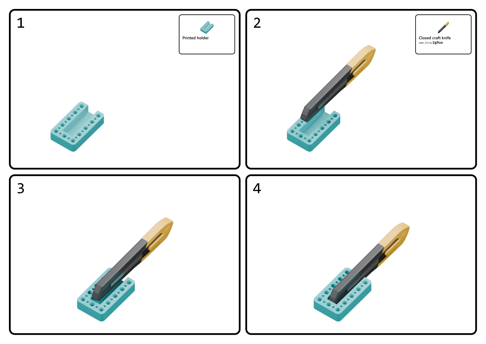
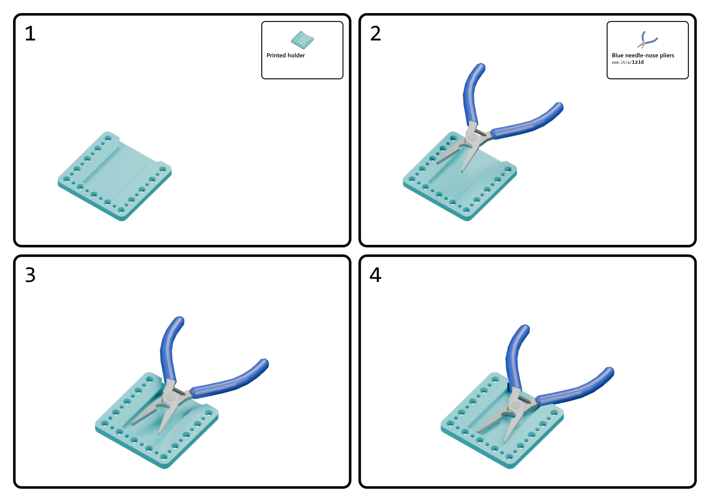
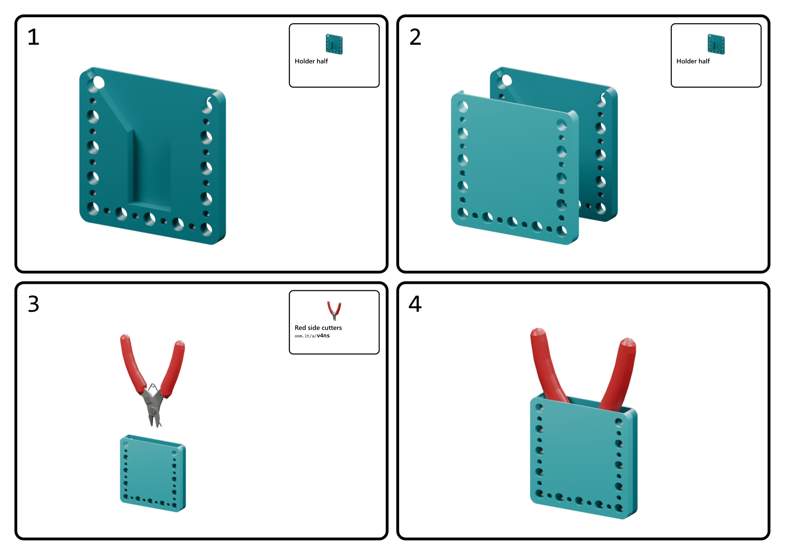

<!-- oobb-presentation:start -->
# OOBB tool holders

AI-generated CAD images and instructions. Errors possible.

## Summary

Printable holders for workshop hand tools on the 15 mm OOBB grid. These designs come from Oomlout’s [vertical tool holders](https://github.com/oomlout/oomlout_oobb_part_tool_holder_vertical) and [OOBB version 4](https://github.com/oomlout/oomlout_oobb_version_4).

This is an entirely AI-generated coding project. The generated outputs are included and usually work. The project is published so others can modify and regenerate the designs with their own AI tools.

[Blue needle-nose pliers, 130 mm](parts/oobb_part_holder_tool_pliers_needle_nose_130mm_1_place_5x5x12/README.md)

## Details

**[Browse by tool type](navigation_oobb/oobb/part/holder_tool/)** or see the [hierarchy and tool list](TOOLS.md). The catalogue contains 61 layouts across 17 categories. Choose a tool type, model, layout and size.

Run `python working.py` to rebuild. The [build notes](presentation/README.md) cover dependencies, filtered builds and source comparisons.

## Parts

Width and height use 15 mm grid units. A 3 × 5 holder has a nominal footprint of 44 × 74 mm. The last size value is the source design depth in millimetres. Vertical holders use two half-depth pieces. Stack them with the pockets facing inward and the holes aligned. Each part page gives its printed thickness, a section drawing and a CAD preview.

## Assembly

Four single-place holders have two-piece assembly and loading instructions illustrated with the original OOMP photo-based tool models. Each viewer opens offline. The print booklets use landscape A4 pages. Physical fit remains unverified.

For future renders, show vertical holders as they sit on the wall, with the opening and tool handles pointing up. Show the halves touching in the assembled view and move the front half outward along the mounting holes for the exploded view. The combined Prit and knife layout supplies both halves in one print. The mixed-tool bench stand prints as one piece.

| Holder README | Offline viewer | Print booklet |
| --- | --- | --- |
| [Closed craft knife](parts/oobb_part_holder_tool_knife_exacto_17mm_1_place_3x5x29d5/README.md#assembly) | [Offline HTML](parts/oobb_part_holder_tool_knife_exacto_17mm_1_place_3x5x29d5/assembly/assembly_instructions.html) | [Download PDF](parts/oobb_part_holder_tool_knife_exacto_17mm_1_place_3x5x29d5/assembly/assembly_instructions.pdf) |
| [Blue needle-nose pliers](parts/oobb_part_holder_tool_pliers_needle_nose_130mm_1_place_5x5x12/README.md#assembly) | [Offline HTML](parts/oobb_part_holder_tool_pliers_needle_nose_130mm_1_place_5x5x12/assembly/assembly_instructions.html) | [Download PDF](parts/oobb_part_holder_tool_pliers_needle_nose_130mm_1_place_5x5x12/assembly/assembly_instructions.pdf) |
| [Red side cutters](parts/oobb_part_holder_tool_side_cutters_generic_110mm_1_place_5x5x13/README.md#assembly) | [Offline HTML](parts/oobb_part_holder_tool_side_cutters_generic_110mm_1_place_5x5x13/assembly/assembly_instructions.html) | [Download PDF](parts/oobb_part_holder_tool_side_cutters_generic_110mm_1_place_5x5x13/assembly/assembly_instructions.pdf) |
| [Red wire strippers](parts/oobb_part_holder_tool_wire_strippers_generic_120mm_1_place_5x5x13/README.md#assembly) | [Offline HTML](parts/oobb_part_holder_tool_wire_strippers_generic_120mm_1_place_5x5x13/assembly/assembly_instructions.html) | [Download PDF](parts/oobb_part_holder_tool_wire_strippers_generic_120mm_1_place_5x5x13/assembly/assembly_instructions.pdf) |

### Closed craft knife

Print two copies of the holder STL. The dark teal half sits against the wall and the light teal half faces the room.

1. Orient the rear half as it sits on the wall, with the pocket facing you and the opening at the top. [View step 1](parts/oobb_part_holder_tool_knife_exacto_17mm_1_place_3x5x29d5/assembly/render/raw/step_01.png)
2. Face the front half toward the rear pocket. Align the mounting holes and both top openings. [View step 2](parts/oobb_part_holder_tool_knife_exacto_17mm_1_place_3x5x29d5/assembly/render/raw/step_02.png)
3. Bring the halves together until their rims meet. Keep the knife closed. Turn the housing edge-on and align the nose with the closed end of the slot. [View step 3](parts/oobb_part_holder_tool_knife_exacto_17mm_1_place_3x5x29d5/assembly/render/raw/step_03.png)
4. Lower the tool through the top opening. The housing sits edge-on in the slot. The heel projects above the holder. [View step 4](parts/oobb_part_holder_tool_knife_exacto_17mm_1_place_3x5x29d5/assembly/render/raw/step_04.png)

Illustrated assembly steps

Closed exterior based on the photo and a provisional 165 mm STANLEY 0-10-151 reference. The 17 mm OOMP label is retained. Size variant awaits measurement. The digital model was checked against both halves. Physical fit remains unverified. [OOMP tool record](https://github.com/oomlout/oomp_tool_version_5/tree/main/parts/tool_knife_craft_17_mm_black_exacto_style)

### Blue needle-nose pliers

Print two copies of the holder STL. The dark teal half sits against the wall and the light teal half faces the room.

1. Orient the rear half as it sits on the wall, with the pocket facing you and the opening at the top. [View step 1](parts/oobb_part_holder_tool_pliers_needle_nose_130mm_1_place_5x5x12/assembly/render/raw/step_01.png)
2. Face the front half toward the rear pocket. Align the mounting holes and both top openings. [View step 2](parts/oobb_part_holder_tool_pliers_needle_nose_130mm_1_place_5x5x12/assembly/render/raw/step_02.png)
3. Bring the halves together until their rims meet. Point the long jaws toward the closed end of the recess. Centre the steel nose between the rails. [View step 3](parts/oobb_part_holder_tool_pliers_needle_nose_130mm_1_place_5x5x12/assembly/render/raw/step_03.png)
4. Lower the tool through the top opening. The blue grips extend beyond the open end, with the pivot inside the holder. [View step 4](parts/oobb_part_holder_tool_pliers_needle_nose_130mm_1_place_5x5x12/assembly/render/raw/step_04.png)

Illustrated assembly steps

Open-pose photo trace with a provisional 130 mm closed-length reference (Rapid PC-022). Jaw and grip depths are estimated. The digital model was checked against both halves. Physical fit remains unverified. [OOMP tool record](https://github.com/oomlout/oomp_tool_version_5/tree/main/parts/tool_pliers_needle_nose_130_mm_length_blue)

### Red side cutters

Print two copies of the holder STL. The dark teal half sits against the wall and the light teal half faces the room.

1. Orient the rear half as it sits on the wall, with the pocket facing you and the opening at the top. [View step 1](parts/oobb_part_holder_tool_side_cutters_generic_110mm_1_place_5x5x13/assembly/render/raw/step_01.png)
2. Face the front half toward the rear pocket. Align the mounting holes and both top openings. [View step 2](parts/oobb_part_holder_tool_side_cutters_generic_110mm_1_place_5x5x13/assembly/render/raw/step_02.png)
3. Bring the halves together until their rims meet. Point the cutting head toward the closed end. Align the steel arms with the widening pocket. [View step 3](parts/oobb_part_holder_tool_side_cutters_generic_110mm_1_place_5x5x13/assembly/render/raw/step_03.png)
4. Lower the tool through the top opening. Leave both red grips clear of the open end. The jaw tips sit short of the end wall in the photographed pose. [View step 4](parts/oobb_part_holder_tool_side_cutters_generic_110mm_1_place_5x5x13/assembly/render/raw/step_04.png)

Illustrated assembly steps

Open-pose photo trace with a provisional 110 mm closed-length reference (Rapid SA-706 RED). Grip thickness is estimated. The digital model was checked against both halves. Physical fit remains unverified. [OOMP tool record](https://github.com/oomlout/oomp_tool_version_5/tree/main/parts/tool_side_cutters_110_mm_length_red)

### Red wire strippers

Print two copies of the holder STL. The dark teal half sits against the wall and the light teal half faces the room.

1. Orient the rear half as it sits on the wall, with the pocket facing you and the opening at the top. [View step 1](parts/oobb_part_holder_tool_wire_strippers_generic_120mm_1_place_5x5x13/assembly/render/raw/step_01.png)
2. Face the front half toward the rear pocket. Align the mounting holes and both top openings. [View step 2](parts/oobb_part_holder_tool_wire_strippers_generic_120mm_1_place_5x5x13/assembly/render/raw/step_02.png)
3. Bring the halves together until their rims meet. Point the jaws down into the opening with the adjustment hardware facing the room. [View step 3](parts/oobb_part_holder_tool_wire_strippers_generic_120mm_1_place_5x5x13/assembly/render/raw/step_03.png)
4. Lower the tool through the top opening. The jaws seat inside the two-piece pocket and the spread grips extend past the wide opening. [View step 4](parts/oobb_part_holder_tool_wire_strippers_generic_120mm_1_place_5x5x13/assembly/render/raw/step_04.png)

Illustrated assembly steps

Open-pose photo trace scaled to the candidate Anvil AV-LDWS catalogue length of 130 mm. The 120 mm OOMP label is retained. Thickness is estimated. The digital model was checked against both halves. Physical fit remains unverified. [OOMP tool record](https://github.com/oomlout/oomp_tool_version_5/tree/main/parts/tool_wire_strippers_120_mm_length_red)
<!-- oobb-presentation:end -->
