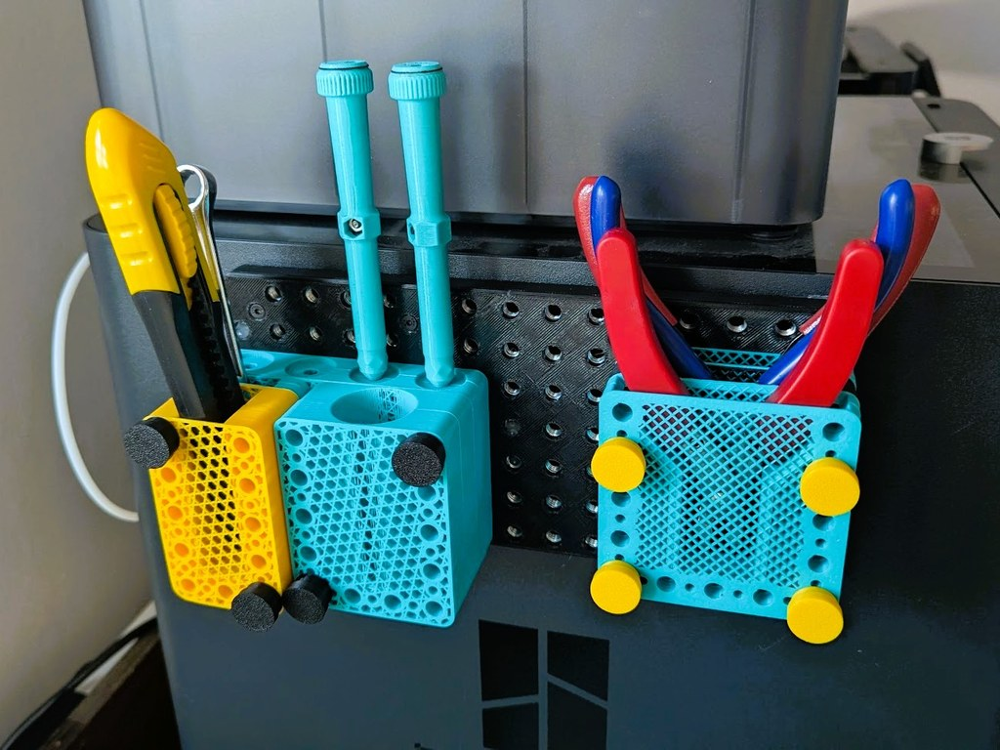

<!-- oobb-presentation:start -->
# OOBB tool holders

Print files for the [bolt covers](https://github.com/oomlout/oomlout_oobb_part_cosmetic_nut_screw_adapter_version_5) and the [black captive nut plate behind the holders](https://github.com/oomlout/oomlout_oobb_part_plate_captive_nut_version_5) are available in their respective repositories.

AI-generated CAD images and instructions. Errors possible.

## Summary

Printable holders for workshop hand tools on the 15 mm OOBB grid. These designs come from Oomlout’s [vertical tool holders](https://github.com/oomlout/oomlout_oobb_part_tool_holder_vertical) and [OOBB version 4](https://github.com/oomlout/oomlout_oobb_version_4).

This is an entirely AI-generated coding project. The generated outputs are included and usually work. The project is published so others can modify and regenerate the designs with their own AI tools.

## Details

**[Browse by tool type](navigation_oobb/oobb/part/holder_tool/)** or see the [hierarchy and tool list](TOOLS.md). The catalogue contains 64 layouts across 18 categories. Choose a tool type, model, layout and size.

The tool models used in the holder guides are available in the [OOMP tool repository](https://github.com/oomlout/oomp_tool_version_5).

Run `python working.py` to rebuild. The [build notes](presentation/README.md) cover dependencies and filtered builds. The [tool modelling queue](presentation/tool-model-handoff/README.md) maps each OOMP tool to its holder layouts and staged references.

## Parts

Width and height use 15 mm grid units. A 3 × 5 holder has a nominal footprint of 44 × 74 mm. The last size value is the assembled depth in millimetres. Two-piece wall holders use half-depth pieces. Stack them with the pockets facing inward and the holes aligned. Each part page gives its printed thickness, a section drawing and a CAD preview.

## Assembly

Choose a holder to view or print its assembly guide.

| Holder folder | Assembly viewer | Print booklet |
| --- | --- | --- |
| [OLFA DC-3 disposal can · 5 × 3 grid](parts/oobb_part_holder_tool_blade_disposal_olfa_dc3_1_place_5x3x29d5/) | [Open viewer](https://raw.githack.com/oomlout/oomlout_oobb_part_holder_tool_version_5/main/parts/oobb_part_holder_tool_blade_disposal_olfa_dc3_1_place_5x3x29d5/assembly/assembly_instructions.html) | [PDF](parts/oobb_part_holder_tool_blade_disposal_olfa_dc3_1_place_5x3x29d5/assembly/assembly_instructions.pdf) |
| [150 mm digital caliper · 7 × 6 grid](parts/oobb_part_holder_tool_caliper_mitutoyo_500_196_30_1_place_7x6x18/) | [Open viewer](https://raw.githack.com/oomlout/oomlout_oobb_part_holder_tool_version_5/main/parts/oobb_part_holder_tool_caliper_mitutoyo_500_196_30_1_place_7x6x18/assembly/assembly_instructions.html) | [PDF](parts/oobb_part_holder_tool_caliper_mitutoyo_500_196_30_1_place_7x6x18/assembly/assembly_instructions.pdf) |
| [60 mm driver bit · 3 × 3 grid](parts/oobb_part_holder_tool_driver_bit_driver_bit_60mm_1_place_3x3x10/) | [Open viewer](https://raw.githack.com/oomlout/oomlout_oobb_part_holder_tool_version_5/main/parts/oobb_part_holder_tool_driver_bit_driver_bit_60mm_1_place_3x3x10/assembly/assembly_instructions.html) | [PDF](parts/oobb_part_holder_tool_driver_bit_driver_bit_60mm_1_place_3x3x10/assembly/assembly_instructions.pdf) |
| [4 60 mm driver bits · 5 × 3 grid](parts/oobb_part_holder_tool_driver_bit_driver_bit_60mm_4_place_5x3x10/) | [Open viewer](https://raw.githack.com/oomlout/oomlout_oobb_part_holder_tool_version_5/main/parts/oobb_part_holder_tool_driver_bit_driver_bit_60mm_4_place_5x3x10/assembly/assembly_instructions.html) | [PDF](parts/oobb_part_holder_tool_driver_bit_driver_bit_60mm_4_place_5x3x10/assembly/assembly_instructions.pdf) |
| [6 60 mm driver bits · 7 × 3 grid](parts/oobb_part_holder_tool_driver_bit_driver_bit_60mm_6_place_7x3x10/) | [Open viewer](https://raw.githack.com/oomlout/oomlout_oobb_part_holder_tool_version_5/main/parts/oobb_part_holder_tool_driver_bit_driver_bit_60mm_6_place_7x3x10/assembly/assembly_instructions.html) | [PDF](parts/oobb_part_holder_tool_driver_bit_driver_bit_60mm_6_place_7x3x10/assembly/assembly_instructions.pdf) |
| [8 60 mm driver bits · 9 × 3 grid](parts/oobb_part_holder_tool_driver_bit_driver_bit_60mm_8_place_9x3x10/) | [Open viewer](https://raw.githack.com/oomlout/oomlout_oobb_part_holder_tool_version_5/main/parts/oobb_part_holder_tool_driver_bit_driver_bit_60mm_8_place_9x3x10/assembly/assembly_instructions.html) | [PDF](parts/oobb_part_holder_tool_driver_bit_driver_bit_60mm_8_place_9x3x10/assembly/assembly_instructions.pdf) |
| [7 quarter-inch driver bits · 9 × 3 grid](parts/oobb_part_holder_tool_driver_bit_quarter_inch_7_place_9x3x12/) | [Open viewer](https://raw.githack.com/oomlout/oomlout_oobb_part_holder_tool_version_5/main/parts/oobb_part_holder_tool_driver_bit_quarter_inch_7_place_9x3x12/assembly/assembly_instructions.html) | [PDF](parts/oobb_part_holder_tool_driver_bit_quarter_inch_7_place_9x3x12/assembly/assembly_instructions.pdf) |
| [7 quarter-inch driver bits · 9 × 4 grid](parts/oobb_part_holder_tool_driver_bit_quarter_inch_7_place_9x4x12/) | [Open viewer](https://raw.githack.com/oomlout/oomlout_oobb_part_holder_tool_version_5/main/parts/oobb_part_holder_tool_driver_bit_quarter_inch_7_place_9x4x12/assembly/assembly_instructions.html) | [PDF](parts/oobb_part_holder_tool_driver_bit_quarter_inch_7_place_9x4x12/assembly/assembly_instructions.pdf) |
| [8 quarter-inch driver bits · 9 × 3 grid](parts/oobb_part_holder_tool_driver_bit_quarter_inch_8_place_9x3x12/) | [Open viewer](https://raw.githack.com/oomlout/oomlout_oobb_part_holder_tool_version_5/main/parts/oobb_part_holder_tool_driver_bit_quarter_inch_8_place_9x3x12/assembly/assembly_instructions.html) | [PDF](parts/oobb_part_holder_tool_driver_bit_quarter_inch_8_place_9x3x12/assembly/assembly_instructions.pdf) |
| [8 quarter-inch driver bits · 9 × 4 grid](parts/oobb_part_holder_tool_driver_bit_quarter_inch_8_place_9x4x12/) | [Open viewer](https://raw.githack.com/oomlout/oomlout_oobb_part_holder_tool_version_5/main/parts/oobb_part_holder_tool_driver_bit_quarter_inch_8_place_9x4x12/assembly/assembly_instructions.html) | [PDF](parts/oobb_part_holder_tool_driver_bit_quarter_inch_8_place_9x4x12/assembly/assembly_instructions.pdf) |
| [15 quarter-inch driver bits · 9 × 3 grid](parts/oobb_part_holder_tool_driver_bit_quarter_inch_8_plus_7_layered_9x3x12/) | [Open viewer](https://raw.githack.com/oomlout/oomlout_oobb_part_holder_tool_version_5/main/parts/oobb_part_holder_tool_driver_bit_quarter_inch_8_plus_7_layered_9x3x12/assembly/assembly_instructions.html) | [PDF](parts/oobb_part_holder_tool_driver_bit_quarter_inch_8_plus_7_layered_9x3x12/assembly/assembly_instructions.pdf) |
| [15 quarter-inch driver bits · 9 × 4 grid](parts/oobb_part_holder_tool_driver_bit_quarter_inch_8_plus_7_layered_9x4x12/) | [Open viewer](https://raw.githack.com/oomlout/oomlout_oobb_part_holder_tool_version_5/main/parts/oobb_part_holder_tool_driver_bit_quarter_inch_8_plus_7_layered_9x4x12/assembly/assembly_instructions.html) | [PDF](parts/oobb_part_holder_tool_driver_bit_quarter_inch_8_plus_7_layered_9x4x12/assembly/assembly_instructions.pdf) |
| [23 quarter-inch bits in 3 rows · 9 × 3 grid](parts/oobb_part_holder_tool_driver_bit_quarter_inch_block_3_rows_9x3x24/) | [Open viewer](https://raw.githack.com/oomlout/oomlout_oobb_part_holder_tool_version_5/main/parts/oobb_part_holder_tool_driver_bit_quarter_inch_block_3_rows_9x3x24/assembly/assembly_instructions.html) | [PDF](parts/oobb_part_holder_tool_driver_bit_quarter_inch_block_3_rows_9x3x24/assembly/assembly_instructions.pdf) |
| [38 quarter-inch bits in 5 rows · 9 × 3 grid](parts/oobb_part_holder_tool_driver_bit_quarter_inch_block_5_rows_9x3x36/) | [Open viewer](https://raw.githack.com/oomlout/oomlout_oobb_part_holder_tool_version_5/main/parts/oobb_part_holder_tool_driver_bit_quarter_inch_block_5_rows_9x3x36/assembly/assembly_instructions.html) | [PDF](parts/oobb_part_holder_tool_driver_bit_quarter_inch_block_5_rows_9x3x36/assembly/assembly_instructions.pdf) |
| [53 quarter-inch bits in 7 rows · 9 × 3 grid](parts/oobb_part_holder_tool_driver_bit_quarter_inch_block_7_rows_9x3x48/) | [Open viewer](https://raw.githack.com/oomlout/oomlout_oobb_part_holder_tool_version_5/main/parts/oobb_part_holder_tool_driver_bit_quarter_inch_block_7_rows_9x3x48/assembly/assembly_instructions.html) | [PDF](parts/oobb_part_holder_tool_driver_bit_quarter_inch_block_7_rows_9x3x48/assembly/assembly_instructions.pdf) |
| [Medium Pritt glue stick · 4 × 5 grid](parts/oobb_part_holder_tool_glue_stick_prit_medium_1_place_4x5x30/) | [Open viewer](https://raw.githack.com/oomlout/oomlout_oobb_part_holder_tool_version_5/main/parts/oobb_part_holder_tool_glue_stick_prit_medium_1_place_4x5x30/assembly/assembly_instructions.html) | [PDF](parts/oobb_part_holder_tool_glue_stick_prit_medium_1_place_4x5x30/assembly/assembly_instructions.pdf) |
| [Glue stick and knife · 5 × 5 grid](parts/oobb_part_holder_tool_glue_stick_prit_medium_with_knife_5x5x30/) | [Open viewer](https://raw.githack.com/oomlout/oomlout_oobb_part_holder_tool_version_5/main/parts/oobb_part_holder_tool_glue_stick_prit_medium_with_knife_5x5x30/assembly/assembly_instructions.html) | [PDF](parts/oobb_part_holder_tool_glue_stick_prit_medium_with_knife_5x5x30/assembly/assembly_instructions.pdf) |
| [Metric hex keys, forward · 5 × 5 grid](parts/oobb_part_holder_tool_hex_key_small_metric_set_6_forward_5x5x8/) | [Open viewer](https://raw.githack.com/oomlout/oomlout_oobb_part_holder_tool_version_5/main/parts/oobb_part_holder_tool_hex_key_small_metric_set_6_forward_5x5x8/assembly/assembly_instructions.html) | [PDF](parts/oobb_part_holder_tool_hex_key_small_metric_set_6_forward_5x5x8/assembly/assembly_instructions.pdf) |
| [Metric hex keys, reverse · 5 × 5 grid](parts/oobb_part_holder_tool_hex_key_small_metric_set_6_reverse_5x5x8/) | [Open viewer](https://raw.githack.com/oomlout/oomlout_oobb_part_holder_tool_version_5/main/parts/oobb_part_holder_tool_hex_key_small_metric_set_6_reverse_5x5x8/assembly/assembly_instructions.html) | [PDF](parts/oobb_part_holder_tool_hex_key_small_metric_set_6_reverse_5x5x8/assembly/assembly_instructions.pdf) |
| [Closed utility knife · 3 × 5 grid](parts/oobb_part_holder_tool_knife_utility_17mm_1_place_3x5x29d5/) | [Open viewer](https://raw.githack.com/oomlout/oomlout_oobb_part_holder_tool_version_5/main/parts/oobb_part_holder_tool_knife_utility_17mm_1_place_3x5x29d5/assembly/assembly_instructions.html) | [PDF](parts/oobb_part_holder_tool_knife_utility_17mm_1_place_3x5x29d5/assembly/assembly_instructions.pdf) |
| [Sharpie, 1-place · 3 × 5 grid](parts/oobb_part_holder_tool_marker_sharpie_1_place_3x5x15/) | [Open viewer](https://raw.githack.com/oomlout/oomlout_oobb_part_holder_tool_version_5/main/parts/oobb_part_holder_tool_marker_sharpie_1_place_3x5x15/assembly/assembly_instructions.html) | [PDF](parts/oobb_part_holder_tool_marker_sharpie_1_place_3x5x15/assembly/assembly_instructions.pdf) |
| [Sharpie, 2-place · 5 × 5 grid](parts/oobb_part_holder_tool_marker_sharpie_2_place_5x5x15/) | [Open viewer](https://raw.githack.com/oomlout/oomlout_oobb_part_holder_tool_version_5/main/parts/oobb_part_holder_tool_marker_sharpie_2_place_5x5x15/assembly/assembly_instructions.html) | [PDF](parts/oobb_part_holder_tool_marker_sharpie_2_place_5x5x15/assembly/assembly_instructions.pdf) |
| [Sharpie, 5-place · 8 × 5 grid](parts/oobb_part_holder_tool_marker_sharpie_5_place_8x5x15/) | [Open viewer](https://raw.githack.com/oomlout/oomlout_oobb_part_holder_tool_version_5/main/parts/oobb_part_holder_tool_marker_sharpie_5_place_8x5x15/assembly/assembly_instructions.html) | [PDF](parts/oobb_part_holder_tool_marker_sharpie_5_place_8x5x15/assembly/assembly_instructions.pdf) |
| [Sharpie, 6-place · 9 × 5 grid](parts/oobb_part_holder_tool_marker_sharpie_6_place_9x5x15/) | [Open viewer](https://raw.githack.com/oomlout/oomlout_oobb_part_holder_tool_version_5/main/parts/oobb_part_holder_tool_marker_sharpie_6_place_9x5x15/assembly/assembly_instructions.html) | [PDF](parts/oobb_part_holder_tool_marker_sharpie_6_place_9x5x15/assembly/assembly_instructions.pdf) |
| [13 mm marker, short holder · 3 × 1 grid](parts/oobb_part_holder_tool_marker_sharpie_style_13mm_1_place_3x1x17/) | [Open viewer](https://raw.githack.com/oomlout/oomlout_oobb_part_holder_tool_version_5/main/parts/oobb_part_holder_tool_marker_sharpie_style_13mm_1_place_3x1x17/assembly/assembly_instructions.html) | [PDF](parts/oobb_part_holder_tool_marker_sharpie_style_13mm_1_place_3x1x17/assembly/assembly_instructions.pdf) |
| [13 mm marker, 1-place · 3 × 5 grid](parts/oobb_part_holder_tool_marker_sharpie_style_13mm_1_place_3x5x17/) | [Open viewer](https://raw.githack.com/oomlout/oomlout_oobb_part_holder_tool_version_5/main/parts/oobb_part_holder_tool_marker_sharpie_style_13mm_1_place_3x5x17/assembly/assembly_instructions.html) | [PDF](parts/oobb_part_holder_tool_marker_sharpie_style_13mm_1_place_3x5x17/assembly/assembly_instructions.pdf) |
| [13 mm marker, 2-place · 4 × 5 grid](parts/oobb_part_holder_tool_marker_sharpie_style_13mm_2_place_4x5x17/) | [Open viewer](https://raw.githack.com/oomlout/oomlout_oobb_part_holder_tool_version_5/main/parts/oobb_part_holder_tool_marker_sharpie_style_13mm_2_place_4x5x17/assembly/assembly_instructions.html) | [PDF](parts/oobb_part_holder_tool_marker_sharpie_style_13mm_2_place_4x5x17/assembly/assembly_instructions.pdf) |
| [13 mm marker, 3-place · 5 × 5 grid](parts/oobb_part_holder_tool_marker_sharpie_style_13mm_3_place_5x5x17/) | [Open viewer](https://raw.githack.com/oomlout/oomlout_oobb_part_holder_tool_version_5/main/parts/oobb_part_holder_tool_marker_sharpie_style_13mm_3_place_5x5x17/assembly/assembly_instructions.html) | [PDF](parts/oobb_part_holder_tool_marker_sharpie_style_13mm_3_place_5x5x17/assembly/assembly_instructions.pdf) |
| [13 mm marker, 4-place · 7 × 5 grid](parts/oobb_part_holder_tool_marker_sharpie_style_13mm_4_place_7x5x17/) | [Open viewer](https://raw.githack.com/oomlout/oomlout_oobb_part_holder_tool_version_5/main/parts/oobb_part_holder_tool_marker_sharpie_style_13mm_4_place_7x5x17/assembly/assembly_instructions.html) | [PDF](parts/oobb_part_holder_tool_marker_sharpie_style_13mm_4_place_7x5x17/assembly/assembly_instructions.pdf) |
| [13 mm marker, 5-place · 8 × 5 grid](parts/oobb_part_holder_tool_marker_sharpie_style_13mm_5_place_8x5x17/) | [Open viewer](https://raw.githack.com/oomlout/oomlout_oobb_part_holder_tool_version_5/main/parts/oobb_part_holder_tool_marker_sharpie_style_13mm_5_place_8x5x17/assembly/assembly_instructions.html) | [PDF](parts/oobb_part_holder_tool_marker_sharpie_style_13mm_5_place_8x5x17/assembly/assembly_instructions.pdf) |
| [Mixed tool bench stand · 7 × 10 grid](parts/oobb_part_holder_tool_mixed_tools_basic_stand_bench_7x10x66/) | [Open viewer](https://raw.githack.com/oomlout/oomlout_oobb_part_holder_tool_version_5/main/parts/oobb_part_holder_tool_mixed_tools_basic_stand_bench_7x10x66/assembly/assembly_instructions.html) | [PDF](parts/oobb_part_holder_tool_mixed_tools_basic_stand_bench_7x10x66/assembly/assembly_instructions.pdf) |
| [Blue needle-nose pliers · 5 × 5 grid](parts/oobb_part_holder_tool_pliers_needle_nose_130mm_1_place_5x5x12/) | [Open viewer](https://raw.githack.com/oomlout/oomlout_oobb_part_holder_tool_version_5/main/parts/oobb_part_holder_tool_pliers_needle_nose_130mm_1_place_5x5x12/assembly/assembly_instructions.html) | [PDF](parts/oobb_part_holder_tool_pliers_needle_nose_130mm_1_place_5x5x12/assembly/assembly_instructions.pdf) |
| [Picquic Teeny Turner · 3 × 3 grid](parts/oobb_part_holder_tool_screwdriver_picquic_teeny_turner_1_place_3x3x31/) | [Open viewer](https://raw.githack.com/oomlout/oomlout_oobb_part_holder_tool_version_5/main/parts/oobb_part_holder_tool_screwdriver_picquic_teeny_turner_1_place_3x3x31/assembly/assembly_instructions.html) | [PDF](parts/oobb_part_holder_tool_screwdriver_picquic_teeny_turner_1_place_3x3x31/assembly/assembly_instructions.pdf) |
| [1.5 mm tall precision screwdriver · 3 × 5 grid](parts/oobb_part_holder_tool_screwdriver_precision_tall_hex_60mm_m1d5_1_place_3x5x20/) | [Open viewer](https://raw.githack.com/oomlout/oomlout_oobb_part_holder_tool_version_5/main/parts/oobb_part_holder_tool_screwdriver_precision_tall_hex_60mm_m1d5_1_place_3x5x20/assembly/assembly_instructions.html) | [PDF](parts/oobb_part_holder_tool_screwdriver_precision_tall_hex_60mm_m1d5_1_place_3x5x20/assembly/assembly_instructions.pdf) |
| [2 mm tall precision screwdriver · 3 × 5 grid](parts/oobb_part_holder_tool_screwdriver_precision_tall_hex_60mm_m2_1_place_3x5x20/) | [Open viewer](https://raw.githack.com/oomlout/oomlout_oobb_part_holder_tool_version_5/main/parts/oobb_part_holder_tool_screwdriver_precision_tall_hex_60mm_m2_1_place_3x5x20/assembly/assembly_instructions.html) | [PDF](parts/oobb_part_holder_tool_screwdriver_precision_tall_hex_60mm_m2_1_place_3x5x20/assembly/assembly_instructions.pdf) |
| [2.5 mm precision driver · 3 × 5 grid](parts/oobb_part_holder_tool_screwdriver_precision_tall_hex_60mm_m2d5_1_place_3x5x20/) | [Open viewer](https://raw.githack.com/oomlout/oomlout_oobb_part_holder_tool_version_5/main/parts/oobb_part_holder_tool_screwdriver_precision_tall_hex_60mm_m2d5_1_place_3x5x20/assembly/assembly_instructions.html) | [PDF](parts/oobb_part_holder_tool_screwdriver_precision_tall_hex_60mm_m2d5_1_place_3x5x20/assembly/assembly_instructions.pdf) |
| [2.5 mm drivers, 2-place · 5 × 5 grid](parts/oobb_part_holder_tool_screwdriver_precision_tall_hex_60mm_m2d5_2_place_5x5x20/) | [Open viewer](https://raw.githack.com/oomlout/oomlout_oobb_part_holder_tool_version_5/main/parts/oobb_part_holder_tool_screwdriver_precision_tall_hex_60mm_m2d5_2_place_5x5x20/assembly/assembly_instructions.html) | [PDF](parts/oobb_part_holder_tool_screwdriver_precision_tall_hex_60mm_m2d5_2_place_5x5x20/assembly/assembly_instructions.pdf) |
| [2.5 mm drivers, 4-place · 7 × 5 grid](parts/oobb_part_holder_tool_screwdriver_precision_tall_hex_60mm_m2d5_4_place_7x5x20/) | [Open viewer](https://raw.githack.com/oomlout/oomlout_oobb_part_holder_tool_version_5/main/parts/oobb_part_holder_tool_screwdriver_precision_tall_hex_60mm_m2d5_4_place_7x5x20/assembly/assembly_instructions.html) | [PDF](parts/oobb_part_holder_tool_screwdriver_precision_tall_hex_60mm_m2d5_4_place_7x5x20/assembly/assembly_instructions.pdf) |
| [2.5 mm drivers, 5-place · 9 × 5 grid](parts/oobb_part_holder_tool_screwdriver_precision_tall_hex_60mm_m2d5_5_place_9x5x20/) | [Open viewer](https://raw.githack.com/oomlout/oomlout_oobb_part_holder_tool_version_5/main/parts/oobb_part_holder_tool_screwdriver_precision_tall_hex_60mm_m2d5_5_place_9x5x20/assembly/assembly_instructions.html) | [PDF](parts/oobb_part_holder_tool_screwdriver_precision_tall_hex_60mm_m2d5_5_place_9x5x20/assembly/assembly_instructions.pdf) |
| [Multi-driver and knife · 5 × 5 grid](parts/oobb_part_holder_tool_screwdriver_quikpik_200mm_with_knife_5x5x38/) | [Open viewer](https://raw.githack.com/oomlout/oomlout_oobb_part_holder_tool_version_5/main/parts/oobb_part_holder_tool_screwdriver_quikpik_200mm_with_knife_5x5x38/assembly/assembly_instructions.html) | [PDF](parts/oobb_part_holder_tool_screwdriver_quikpik_200mm_with_knife_5x5x38/assembly/assembly_instructions.pdf) |
| [Red side cutters · 5 × 5 grid](parts/oobb_part_holder_tool_side_cutters_generic_110mm_1_place_5x5x13/) | [Open viewer](https://raw.githack.com/oomlout/oomlout_oobb_part_holder_tool_version_5/main/parts/oobb_part_holder_tool_side_cutters_generic_110mm_1_place_5x5x13/assembly/assembly_instructions.html) | [PDF](parts/oobb_part_holder_tool_side_cutters_generic_110mm_1_place_5x5x13/assembly/assembly_instructions.pdf) |
| [10 mm spanner · 3 × 5 grid](parts/oobb_part_holder_tool_spanner_m10_1_place_3x5x9/) | [Open viewer](https://raw.githack.com/oomlout/oomlout_oobb_part_holder_tool_version_5/main/parts/oobb_part_holder_tool_spanner_m10_1_place_3x5x9/assembly/assembly_instructions.html) | [PDF](parts/oobb_part_holder_tool_spanner_m10_1_place_3x5x9/assembly/assembly_instructions.pdf) |
| [Two 10 mm spanners · 5 × 5 grid](parts/oobb_part_holder_tool_spanner_m10_2_place_5x5x9/) | [Open viewer](https://raw.githack.com/oomlout/oomlout_oobb_part_holder_tool_version_5/main/parts/oobb_part_holder_tool_spanner_m10_2_place_5x5x9/assembly/assembly_instructions.html) | [PDF](parts/oobb_part_holder_tool_spanner_m10_2_place_5x5x9/assembly/assembly_instructions.pdf) |
| [Three 10 mm spanners · 7 × 5 grid](parts/oobb_part_holder_tool_spanner_m10_3_place_7x5x9/) | [Open viewer](https://raw.githack.com/oomlout/oomlout_oobb_part_holder_tool_version_5/main/parts/oobb_part_holder_tool_spanner_m10_3_place_7x5x9/assembly/assembly_instructions.html) | [PDF](parts/oobb_part_holder_tool_spanner_m10_3_place_7x5x9/assembly/assembly_instructions.pdf) |
| [Four 10 mm spanners · 9 × 5 grid](parts/oobb_part_holder_tool_spanner_m10_4_place_9x5x9/) | [Open viewer](https://raw.githack.com/oomlout/oomlout_oobb_part_holder_tool_version_5/main/parts/oobb_part_holder_tool_spanner_m10_4_place_9x5x9/assembly/assembly_instructions.html) | [PDF](parts/oobb_part_holder_tool_spanner_m10_4_place_9x5x9/assembly/assembly_instructions.pdf) |
| [13 mm spanner · 3 × 5 grid](parts/oobb_part_holder_tool_spanner_m13_1_place_3x5x10/) | [Open viewer](https://raw.githack.com/oomlout/oomlout_oobb_part_holder_tool_version_5/main/parts/oobb_part_holder_tool_spanner_m13_1_place_3x5x10/assembly/assembly_instructions.html) | [PDF](parts/oobb_part_holder_tool_spanner_m13_1_place_3x5x10/assembly/assembly_instructions.pdf) |
| [Four metric spanners · 9 × 5 grid](parts/oobb_part_holder_tool_spanner_m13_m10_m8_m7_4_place_9x5x10/) | [Open viewer](https://raw.githack.com/oomlout/oomlout_oobb_part_holder_tool_version_5/main/parts/oobb_part_holder_tool_spanner_m13_m10_m8_m7_4_place_9x5x10/assembly/assembly_instructions.html) | [PDF](parts/oobb_part_holder_tool_spanner_m13_m10_m8_m7_4_place_9x5x10/assembly/assembly_instructions.pdf) |
| [21 mm spanner · 5 × 5 grid](parts/oobb_part_holder_tool_spanner_m21_1_place_5x5x12/) | [Open viewer](https://raw.githack.com/oomlout/oomlout_oobb_part_holder_tool_version_5/main/parts/oobb_part_holder_tool_spanner_m21_1_place_5x5x12/assembly/assembly_instructions.html) | [PDF](parts/oobb_part_holder_tool_spanner_m21_1_place_5x5x12/assembly/assembly_instructions.pdf) |
| [7 mm open spanner · 3 × 5 grid](parts/oobb_part_holder_tool_spanner_m7_1_place_3x5x6d5/) | [Open viewer](https://raw.githack.com/oomlout/oomlout_oobb_part_holder_tool_version_5/main/parts/oobb_part_holder_tool_spanner_m7_1_place_3x5x6d5/assembly/assembly_instructions.html) | [PDF](parts/oobb_part_holder_tool_spanner_m7_1_place_3x5x6d5/assembly/assembly_instructions.pdf) |
| [8 mm spanner · 3 × 5 grid](parts/oobb_part_holder_tool_spanner_m8_1_place_3x5x7d5/) | [Open viewer](https://raw.githack.com/oomlout/oomlout_oobb_part_holder_tool_version_5/main/parts/oobb_part_holder_tool_spanner_m8_1_place_3x5x7d5/assembly/assembly_instructions.html) | [PDF](parts/oobb_part_holder_tool_spanner_m8_1_place_3x5x7d5/assembly/assembly_instructions.pdf) |
| [Stanley 5 m tape measure · 7 × 3 grid](parts/oobb_part_holder_tool_tape_measure_stanley_1_30_696_1_place_7x3x44/) | [Open viewer](https://raw.githack.com/oomlout/oomlout_oobb_part_holder_tool_version_5/main/parts/oobb_part_holder_tool_tape_measure_stanley_1_30_696_1_place_7x3x44/assembly/assembly_instructions.html) | [PDF](parts/oobb_part_holder_tool_tape_measure_stanley_1_30_696_1_place_7x3x44/assembly/assembly_instructions.pdf) |
| [80 mm round timer · 7 × 3 grid](parts/oobb_part_holder_tool_timer_round_80mm_1_place_7x3x34/) | [Open viewer](https://raw.githack.com/oomlout/oomlout_oobb_part_holder_tool_version_5/main/parts/oobb_part_holder_tool_timer_round_80mm_1_place_7x3x34/assembly/assembly_instructions.html) | [PDF](parts/oobb_part_holder_tool_timer_round_80mm_1_place_7x3x34/assembly/assembly_instructions.pdf) |
| [Red wire strippers · 5 × 5 grid](parts/oobb_part_holder_tool_wire_strippers_generic_120mm_1_place_5x5x13/) | [Open viewer](https://raw.githack.com/oomlout/oomlout_oobb_part_holder_tool_version_5/main/parts/oobb_part_holder_tool_wire_strippers_generic_120mm_1_place_5x5x13/assembly/assembly_instructions.html) | [PDF](parts/oobb_part_holder_tool_wire_strippers_generic_120mm_1_place_5x5x13/assembly/assembly_instructions.pdf) |
<!-- oobb-presentation:end -->
