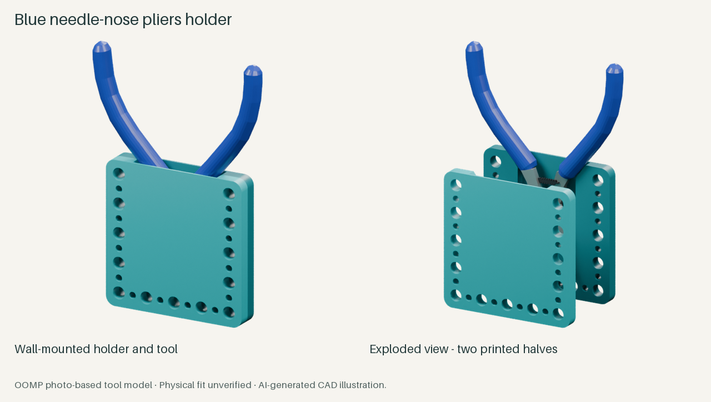

<!-- oobb-presentation:start -->
# OOBB tool holders

AI-generated CAD images and instructions. Errors possible.

## Summary

Printable holders for workshop hand tools on the 15 mm OOBB grid. These designs come from Oomlout’s [vertical tool holders](https://github.com/oomlout/oomlout_oobb_part_tool_holder_vertical) and [OOBB version 4](https://github.com/oomlout/oomlout_oobb_version_4).

This is an entirely AI-generated coding project. The generated outputs are included and usually work. The project is published so others can modify and regenerate the designs with their own AI tools.

[Blue needle-nose pliers, 130 mm](parts/oobb_part_holder_tool_pliers_needle_nose_130mm_1_place_5x5x12/)

## Details

**[Browse by tool type](navigation_oobb/oobb/part/holder_tool/)** or see the [hierarchy and tool list](TOOLS.md). The catalogue contains 61 layouts across 17 categories. Choose a tool type, model, layout and size.

Run `python working.py` to rebuild. The [build notes](presentation/README.md) cover dependencies, filtered builds and source comparisons.

## Parts

Width and height use 15 mm grid units. A 3 × 5 holder has a nominal footprint of 44 × 74 mm. The last size value is the source design depth in millimetres. Vertical holders use two half-depth pieces. Stack them with the pockets facing inward and the holes aligned. Each part page gives its printed thickness, a section drawing and a CAD preview.

## Assembly

Four single-place holders have two-piece assembly and loading instructions illustrated with the original OOMP photo-based tool models. Each viewer opens offline. The print booklets use landscape A4 pages. Physical fit remains unverified.

| Tool and illustrated sequence | Offline viewer | Print booklet |
| --- | --- | --- |
| [Closed craft knife](parts/oobb_part_holder_tool_knife_exacto_17mm_1_place_3x5x29d5/assembly/ASSEMBLY.md) | [Open HTML](parts/oobb_part_holder_tool_knife_exacto_17mm_1_place_3x5x29d5/assembly/assembly_instructions.html) | [Download PDF](parts/oobb_part_holder_tool_knife_exacto_17mm_1_place_3x5x29d5/assembly/assembly_instructions.pdf) |
| [Blue needle-nose pliers](parts/oobb_part_holder_tool_pliers_needle_nose_130mm_1_place_5x5x12/assembly/ASSEMBLY.md) | [Open HTML](parts/oobb_part_holder_tool_pliers_needle_nose_130mm_1_place_5x5x12/assembly/assembly_instructions.html) | [Download PDF](parts/oobb_part_holder_tool_pliers_needle_nose_130mm_1_place_5x5x12/assembly/assembly_instructions.pdf) |
| [Red side cutters](parts/oobb_part_holder_tool_side_cutters_generic_110mm_1_place_5x5x13/assembly/ASSEMBLY.md) | [Open HTML](parts/oobb_part_holder_tool_side_cutters_generic_110mm_1_place_5x5x13/assembly/assembly_instructions.html) | [Download PDF](parts/oobb_part_holder_tool_side_cutters_generic_110mm_1_place_5x5x13/assembly/assembly_instructions.pdf) |
| [Red wire strippers](parts/oobb_part_holder_tool_wire_strippers_generic_120mm_1_place_5x5x13/assembly/ASSEMBLY.md) | [Open HTML](parts/oobb_part_holder_tool_wire_strippers_generic_120mm_1_place_5x5x13/assembly/assembly_instructions.html) | [Download PDF](parts/oobb_part_holder_tool_wire_strippers_generic_120mm_1_place_5x5x13/assembly/assembly_instructions.pdf) |

For future renders, show vertical holders as they sit on the wall, with the opening and tool handles pointing up. Show the halves touching in the assembled view and move the front half outward along the mounting holes for the exploded view. The combined Prit and knife layout supplies both halves in one print. The mixed-tool bench stand prints as one piece.
<!-- oobb-presentation:end -->
