<!-- oobb-presentation:start -->
# OOBB tool holders

AI-generated CAD images and instructions. Errors possible.

## Summary

Printable holders for workshop hand tools on the 15 mm OOBB grid. These designs come from Oomlout’s [vertical tool holders](https://github.com/oomlout/oomlout_oobb_part_tool_holder_vertical) and [OOBB version 4](https://github.com/oomlout/oomlout_oobb_version_4).

This is an entirely AI-generated coding project. The generated outputs are included and usually work. The project is published so others can modify and regenerate the designs with their own AI tools.

[Blue needle-nose pliers, 130 mm](parts/oobb_part_holder_tool_pliers_needle_nose_130mm_1_place_5x5x12/README.md)

## Details

**[Browse by tool type](navigation_oobb/oobb/part/holder_tool/)** or see the [hierarchy and tool list](TOOLS.md). The catalogue contains 64 layouts across 18 categories. Choose a tool type, model, layout and size.

Run `python working.py` to rebuild. The [build notes](presentation/README.md) cover dependencies and filtered builds. The [tool modelling queue](presentation/tool-model-handoff/README.md) maps each OOMP tool to its holder layouts and staged references.

## Parts

Width and height use 15 mm grid units. A 3 × 5 holder has a nominal footprint of 44 × 74 mm. The last size value is the assembled depth in millimetres. Two-piece wall holders use half-depth pieces. Stack them with the pockets facing inward and the holes aligned. Each part page gives its printed thickness, a section drawing and a CAD preview.

## Assembly

49 holders have illustrated assembly and loading instructions using OOMP tool models. Each viewer opens offline. The print booklets use landscape A4 pages. Physical fit remains unverified.

For future renders, show vertical holders as they sit on the wall, with the opening and tool handles pointing up. Show the halves touching in the assembled view and move the front half outward along the mounting holes for the exploded view. Print the Quikpik combination, utility knife, Prit combination, metric hex-key sets and four-size spanner layout once to obtain both halves. The quarter-inch bit blocks and mixed-tool bench stand each print as one piece.

| Holder README | Offline viewer | Print booklet |
| --- | --- | --- |
| [OLFA DC-3 disposal can](parts/oobb_part_holder_tool_blade_disposal_olfa_dc3_1_place_5x3x29d5/README.md#assembly) | [Offline HTML](parts/oobb_part_holder_tool_blade_disposal_olfa_dc3_1_place_5x3x29d5/assembly/assembly_instructions.html) | [Download PDF](parts/oobb_part_holder_tool_blade_disposal_olfa_dc3_1_place_5x3x29d5/assembly/assembly_instructions.pdf) |
| [150 mm digital caliper](parts/oobb_part_holder_tool_caliper_mitutoyo_500_196_30_1_place_7x6x18/README.md#assembly) | [Offline HTML](parts/oobb_part_holder_tool_caliper_mitutoyo_500_196_30_1_place_7x6x18/assembly/assembly_instructions.html) | [Download PDF](parts/oobb_part_holder_tool_caliper_mitutoyo_500_196_30_1_place_7x6x18/assembly/assembly_instructions.pdf) |
| [60 mm driver bit](parts/oobb_part_holder_tool_driver_bit_driver_bit_60mm_1_place_3x3x10/README.md#assembly) | [Offline HTML](parts/oobb_part_holder_tool_driver_bit_driver_bit_60mm_1_place_3x3x10/assembly/assembly_instructions.html) | [Download PDF](parts/oobb_part_holder_tool_driver_bit_driver_bit_60mm_1_place_3x3x10/assembly/assembly_instructions.pdf) |
| [4 60 mm driver bits](parts/oobb_part_holder_tool_driver_bit_driver_bit_60mm_4_place_5x3x10/README.md#assembly) | [Offline HTML](parts/oobb_part_holder_tool_driver_bit_driver_bit_60mm_4_place_5x3x10/assembly/assembly_instructions.html) | [Download PDF](parts/oobb_part_holder_tool_driver_bit_driver_bit_60mm_4_place_5x3x10/assembly/assembly_instructions.pdf) |
| [6 60 mm driver bits](parts/oobb_part_holder_tool_driver_bit_driver_bit_60mm_6_place_7x3x10/README.md#assembly) | [Offline HTML](parts/oobb_part_holder_tool_driver_bit_driver_bit_60mm_6_place_7x3x10/assembly/assembly_instructions.html) | [Download PDF](parts/oobb_part_holder_tool_driver_bit_driver_bit_60mm_6_place_7x3x10/assembly/assembly_instructions.pdf) |
| [8 60 mm driver bits](parts/oobb_part_holder_tool_driver_bit_driver_bit_60mm_8_place_9x3x10/README.md#assembly) | [Offline HTML](parts/oobb_part_holder_tool_driver_bit_driver_bit_60mm_8_place_9x3x10/assembly/assembly_instructions.html) | [Download PDF](parts/oobb_part_holder_tool_driver_bit_driver_bit_60mm_8_place_9x3x10/assembly/assembly_instructions.pdf) |
| [7 quarter-inch driver bits](parts/oobb_part_holder_tool_driver_bit_quarter_inch_7_place_9x3x12/README.md#assembly) | [Offline HTML](parts/oobb_part_holder_tool_driver_bit_quarter_inch_7_place_9x3x12/assembly/assembly_instructions.html) | [Download PDF](parts/oobb_part_holder_tool_driver_bit_quarter_inch_7_place_9x3x12/assembly/assembly_instructions.pdf) |
| [7 quarter-inch driver bits](parts/oobb_part_holder_tool_driver_bit_quarter_inch_7_place_9x4x12/README.md#assembly) | [Offline HTML](parts/oobb_part_holder_tool_driver_bit_quarter_inch_7_place_9x4x12/assembly/assembly_instructions.html) | [Download PDF](parts/oobb_part_holder_tool_driver_bit_quarter_inch_7_place_9x4x12/assembly/assembly_instructions.pdf) |
| [8 quarter-inch driver bits](parts/oobb_part_holder_tool_driver_bit_quarter_inch_8_place_9x3x12/README.md#assembly) | [Offline HTML](parts/oobb_part_holder_tool_driver_bit_quarter_inch_8_place_9x3x12/assembly/assembly_instructions.html) | [Download PDF](parts/oobb_part_holder_tool_driver_bit_quarter_inch_8_place_9x3x12/assembly/assembly_instructions.pdf) |
| [8 quarter-inch driver bits](parts/oobb_part_holder_tool_driver_bit_quarter_inch_8_place_9x4x12/README.md#assembly) | [Offline HTML](parts/oobb_part_holder_tool_driver_bit_quarter_inch_8_place_9x4x12/assembly/assembly_instructions.html) | [Download PDF](parts/oobb_part_holder_tool_driver_bit_quarter_inch_8_place_9x4x12/assembly/assembly_instructions.pdf) |
| [15 quarter-inch driver bits](parts/oobb_part_holder_tool_driver_bit_quarter_inch_8_plus_7_layered_9x3x12/README.md#assembly) | [Offline HTML](parts/oobb_part_holder_tool_driver_bit_quarter_inch_8_plus_7_layered_9x3x12/assembly/assembly_instructions.html) | [Download PDF](parts/oobb_part_holder_tool_driver_bit_quarter_inch_8_plus_7_layered_9x3x12/assembly/assembly_instructions.pdf) |
| [15 quarter-inch driver bits](parts/oobb_part_holder_tool_driver_bit_quarter_inch_8_plus_7_layered_9x4x12/README.md#assembly) | [Offline HTML](parts/oobb_part_holder_tool_driver_bit_quarter_inch_8_plus_7_layered_9x4x12/assembly/assembly_instructions.html) | [Download PDF](parts/oobb_part_holder_tool_driver_bit_quarter_inch_8_plus_7_layered_9x4x12/assembly/assembly_instructions.pdf) |
| [23 quarter-inch bits in 3 rows](parts/oobb_part_holder_tool_driver_bit_quarter_inch_block_3_rows_9x3x24/README.md#assembly) | [Offline HTML](parts/oobb_part_holder_tool_driver_bit_quarter_inch_block_3_rows_9x3x24/assembly/assembly_instructions.html) | [Download PDF](parts/oobb_part_holder_tool_driver_bit_quarter_inch_block_3_rows_9x3x24/assembly/assembly_instructions.pdf) |
| [38 quarter-inch bits in 5 rows](parts/oobb_part_holder_tool_driver_bit_quarter_inch_block_5_rows_9x3x36/README.md#assembly) | [Offline HTML](parts/oobb_part_holder_tool_driver_bit_quarter_inch_block_5_rows_9x3x36/assembly/assembly_instructions.html) | [Download PDF](parts/oobb_part_holder_tool_driver_bit_quarter_inch_block_5_rows_9x3x36/assembly/assembly_instructions.pdf) |
| [53 quarter-inch bits in 7 rows](parts/oobb_part_holder_tool_driver_bit_quarter_inch_block_7_rows_9x3x48/README.md#assembly) | [Offline HTML](parts/oobb_part_holder_tool_driver_bit_quarter_inch_block_7_rows_9x3x48/assembly/assembly_instructions.html) | [Download PDF](parts/oobb_part_holder_tool_driver_bit_quarter_inch_block_7_rows_9x3x48/assembly/assembly_instructions.pdf) |
| [Medium Pritt glue stick](parts/oobb_part_holder_tool_glue_stick_prit_medium_1_place_4x5x30/README.md#assembly) | [Offline HTML](parts/oobb_part_holder_tool_glue_stick_prit_medium_1_place_4x5x30/assembly/assembly_instructions.html) | [Download PDF](parts/oobb_part_holder_tool_glue_stick_prit_medium_1_place_4x5x30/assembly/assembly_instructions.pdf) |
| [Glue stick and knife](parts/oobb_part_holder_tool_glue_stick_prit_medium_with_knife_5x5x30/README.md#assembly) | [Offline HTML](parts/oobb_part_holder_tool_glue_stick_prit_medium_with_knife_5x5x30/assembly/assembly_instructions.html) | [Download PDF](parts/oobb_part_holder_tool_glue_stick_prit_medium_with_knife_5x5x30/assembly/assembly_instructions.pdf) |
| [Metric hex keys, forward](parts/oobb_part_holder_tool_hex_key_small_metric_set_6_forward_5x5x8/README.md#assembly) | [Offline HTML](parts/oobb_part_holder_tool_hex_key_small_metric_set_6_forward_5x5x8/assembly/assembly_instructions.html) | [Download PDF](parts/oobb_part_holder_tool_hex_key_small_metric_set_6_forward_5x5x8/assembly/assembly_instructions.pdf) |
| [Metric hex keys, reverse](parts/oobb_part_holder_tool_hex_key_small_metric_set_6_reverse_5x5x8/README.md#assembly) | [Offline HTML](parts/oobb_part_holder_tool_hex_key_small_metric_set_6_reverse_5x5x8/assembly/assembly_instructions.html) | [Download PDF](parts/oobb_part_holder_tool_hex_key_small_metric_set_6_reverse_5x5x8/assembly/assembly_instructions.pdf) |
| [Closed utility knife](parts/oobb_part_holder_tool_knife_utility_17mm_1_place_3x5x29d5/README.md#assembly) | [Offline HTML](parts/oobb_part_holder_tool_knife_utility_17mm_1_place_3x5x29d5/assembly/assembly_instructions.html) | [Download PDF](parts/oobb_part_holder_tool_knife_utility_17mm_1_place_3x5x29d5/assembly/assembly_instructions.pdf) |
| [Sharpie, 1-place](parts/oobb_part_holder_tool_marker_sharpie_1_place_3x5x15/README.md#assembly) | [Offline HTML](parts/oobb_part_holder_tool_marker_sharpie_1_place_3x5x15/assembly/assembly_instructions.html) | [Download PDF](parts/oobb_part_holder_tool_marker_sharpie_1_place_3x5x15/assembly/assembly_instructions.pdf) |
| [Sharpie, 2-place](parts/oobb_part_holder_tool_marker_sharpie_2_place_5x5x15/README.md#assembly) | [Offline HTML](parts/oobb_part_holder_tool_marker_sharpie_2_place_5x5x15/assembly/assembly_instructions.html) | [Download PDF](parts/oobb_part_holder_tool_marker_sharpie_2_place_5x5x15/assembly/assembly_instructions.pdf) |
| [Sharpie, 5-place](parts/oobb_part_holder_tool_marker_sharpie_5_place_8x5x15/README.md#assembly) | [Offline HTML](parts/oobb_part_holder_tool_marker_sharpie_5_place_8x5x15/assembly/assembly_instructions.html) | [Download PDF](parts/oobb_part_holder_tool_marker_sharpie_5_place_8x5x15/assembly/assembly_instructions.pdf) |
| [Sharpie, 6-place](parts/oobb_part_holder_tool_marker_sharpie_6_place_9x5x15/README.md#assembly) | [Offline HTML](parts/oobb_part_holder_tool_marker_sharpie_6_place_9x5x15/assembly/assembly_instructions.html) | [Download PDF](parts/oobb_part_holder_tool_marker_sharpie_6_place_9x5x15/assembly/assembly_instructions.pdf) |
| [13 mm marker, short holder](parts/oobb_part_holder_tool_marker_sharpie_style_13mm_1_place_3x1x17/README.md#assembly) | [Offline HTML](parts/oobb_part_holder_tool_marker_sharpie_style_13mm_1_place_3x1x17/assembly/assembly_instructions.html) | [Download PDF](parts/oobb_part_holder_tool_marker_sharpie_style_13mm_1_place_3x1x17/assembly/assembly_instructions.pdf) |
| [13 mm marker, 1-place](parts/oobb_part_holder_tool_marker_sharpie_style_13mm_1_place_3x5x17/README.md#assembly) | [Offline HTML](parts/oobb_part_holder_tool_marker_sharpie_style_13mm_1_place_3x5x17/assembly/assembly_instructions.html) | [Download PDF](parts/oobb_part_holder_tool_marker_sharpie_style_13mm_1_place_3x5x17/assembly/assembly_instructions.pdf) |
| [13 mm marker, 2-place](parts/oobb_part_holder_tool_marker_sharpie_style_13mm_2_place_4x5x17/README.md#assembly) | [Offline HTML](parts/oobb_part_holder_tool_marker_sharpie_style_13mm_2_place_4x5x17/assembly/assembly_instructions.html) | [Download PDF](parts/oobb_part_holder_tool_marker_sharpie_style_13mm_2_place_4x5x17/assembly/assembly_instructions.pdf) |
| [13 mm marker, 3-place](parts/oobb_part_holder_tool_marker_sharpie_style_13mm_3_place_5x5x17/README.md#assembly) | [Offline HTML](parts/oobb_part_holder_tool_marker_sharpie_style_13mm_3_place_5x5x17/assembly/assembly_instructions.html) | [Download PDF](parts/oobb_part_holder_tool_marker_sharpie_style_13mm_3_place_5x5x17/assembly/assembly_instructions.pdf) |
| [13 mm marker, 4-place](parts/oobb_part_holder_tool_marker_sharpie_style_13mm_4_place_7x5x17/README.md#assembly) | [Offline HTML](parts/oobb_part_holder_tool_marker_sharpie_style_13mm_4_place_7x5x17/assembly/assembly_instructions.html) | [Download PDF](parts/oobb_part_holder_tool_marker_sharpie_style_13mm_4_place_7x5x17/assembly/assembly_instructions.pdf) |
| [13 mm marker, 5-place](parts/oobb_part_holder_tool_marker_sharpie_style_13mm_5_place_8x5x17/README.md#assembly) | [Offline HTML](parts/oobb_part_holder_tool_marker_sharpie_style_13mm_5_place_8x5x17/assembly/assembly_instructions.html) | [Download PDF](parts/oobb_part_holder_tool_marker_sharpie_style_13mm_5_place_8x5x17/assembly/assembly_instructions.pdf) |
| [Blue needle-nose pliers](parts/oobb_part_holder_tool_pliers_needle_nose_130mm_1_place_5x5x12/README.md#assembly) | [Offline HTML](parts/oobb_part_holder_tool_pliers_needle_nose_130mm_1_place_5x5x12/assembly/assembly_instructions.html) | [Download PDF](parts/oobb_part_holder_tool_pliers_needle_nose_130mm_1_place_5x5x12/assembly/assembly_instructions.pdf) |
| [Picquic Teeny Turner](parts/oobb_part_holder_tool_screwdriver_picquic_teeny_turner_1_place_3x3x31/README.md#assembly) | [Offline HTML](parts/oobb_part_holder_tool_screwdriver_picquic_teeny_turner_1_place_3x3x31/assembly/assembly_instructions.html) | [Download PDF](parts/oobb_part_holder_tool_screwdriver_picquic_teeny_turner_1_place_3x3x31/assembly/assembly_instructions.pdf) |
| [1.5 mm tall precision screwdriver](parts/oobb_part_holder_tool_screwdriver_precision_tall_hex_60mm_m1d5_1_place_3x5x20/README.md#assembly) | [Offline HTML](parts/oobb_part_holder_tool_screwdriver_precision_tall_hex_60mm_m1d5_1_place_3x5x20/assembly/assembly_instructions.html) | [Download PDF](parts/oobb_part_holder_tool_screwdriver_precision_tall_hex_60mm_m1d5_1_place_3x5x20/assembly/assembly_instructions.pdf) |
| [2 mm tall precision screwdriver](parts/oobb_part_holder_tool_screwdriver_precision_tall_hex_60mm_m2_1_place_3x5x20/README.md#assembly) | [Offline HTML](parts/oobb_part_holder_tool_screwdriver_precision_tall_hex_60mm_m2_1_place_3x5x20/assembly/assembly_instructions.html) | [Download PDF](parts/oobb_part_holder_tool_screwdriver_precision_tall_hex_60mm_m2_1_place_3x5x20/assembly/assembly_instructions.pdf) |
| [2.5 mm precision driver](parts/oobb_part_holder_tool_screwdriver_precision_tall_hex_60mm_m2d5_1_place_3x5x20/README.md#assembly) | [Offline HTML](parts/oobb_part_holder_tool_screwdriver_precision_tall_hex_60mm_m2d5_1_place_3x5x20/assembly/assembly_instructions.html) | [Download PDF](parts/oobb_part_holder_tool_screwdriver_precision_tall_hex_60mm_m2d5_1_place_3x5x20/assembly/assembly_instructions.pdf) |
| [2.5 mm drivers, 2-place](parts/oobb_part_holder_tool_screwdriver_precision_tall_hex_60mm_m2d5_2_place_5x5x20/README.md#assembly) | [Offline HTML](parts/oobb_part_holder_tool_screwdriver_precision_tall_hex_60mm_m2d5_2_place_5x5x20/assembly/assembly_instructions.html) | [Download PDF](parts/oobb_part_holder_tool_screwdriver_precision_tall_hex_60mm_m2d5_2_place_5x5x20/assembly/assembly_instructions.pdf) |
| [2.5 mm drivers, 4-place](parts/oobb_part_holder_tool_screwdriver_precision_tall_hex_60mm_m2d5_4_place_7x5x20/README.md#assembly) | [Offline HTML](parts/oobb_part_holder_tool_screwdriver_precision_tall_hex_60mm_m2d5_4_place_7x5x20/assembly/assembly_instructions.html) | [Download PDF](parts/oobb_part_holder_tool_screwdriver_precision_tall_hex_60mm_m2d5_4_place_7x5x20/assembly/assembly_instructions.pdf) |
| [2.5 mm drivers, 5-place](parts/oobb_part_holder_tool_screwdriver_precision_tall_hex_60mm_m2d5_5_place_9x5x20/README.md#assembly) | [Offline HTML](parts/oobb_part_holder_tool_screwdriver_precision_tall_hex_60mm_m2d5_5_place_9x5x20/assembly/assembly_instructions.html) | [Download PDF](parts/oobb_part_holder_tool_screwdriver_precision_tall_hex_60mm_m2d5_5_place_9x5x20/assembly/assembly_instructions.pdf) |
| [Red side cutters](parts/oobb_part_holder_tool_side_cutters_generic_110mm_1_place_5x5x13/README.md#assembly) | [Offline HTML](parts/oobb_part_holder_tool_side_cutters_generic_110mm_1_place_5x5x13/assembly/assembly_instructions.html) | [Download PDF](parts/oobb_part_holder_tool_side_cutters_generic_110mm_1_place_5x5x13/assembly/assembly_instructions.pdf) |
| [10 mm spanner](parts/oobb_part_holder_tool_spanner_m10_1_place_3x5x9/README.md#assembly) | [Offline HTML](parts/oobb_part_holder_tool_spanner_m10_1_place_3x5x9/assembly/assembly_instructions.html) | [Download PDF](parts/oobb_part_holder_tool_spanner_m10_1_place_3x5x9/assembly/assembly_instructions.pdf) |
| [Two 10 mm spanners](parts/oobb_part_holder_tool_spanner_m10_2_place_5x5x9/README.md#assembly) | [Offline HTML](parts/oobb_part_holder_tool_spanner_m10_2_place_5x5x9/assembly/assembly_instructions.html) | [Download PDF](parts/oobb_part_holder_tool_spanner_m10_2_place_5x5x9/assembly/assembly_instructions.pdf) |
| [Three 10 mm spanners](parts/oobb_part_holder_tool_spanner_m10_3_place_7x5x9/README.md#assembly) | [Offline HTML](parts/oobb_part_holder_tool_spanner_m10_3_place_7x5x9/assembly/assembly_instructions.html) | [Download PDF](parts/oobb_part_holder_tool_spanner_m10_3_place_7x5x9/assembly/assembly_instructions.pdf) |
| [Four 10 mm spanners](parts/oobb_part_holder_tool_spanner_m10_4_place_9x5x9/README.md#assembly) | [Offline HTML](parts/oobb_part_holder_tool_spanner_m10_4_place_9x5x9/assembly/assembly_instructions.html) | [Download PDF](parts/oobb_part_holder_tool_spanner_m10_4_place_9x5x9/assembly/assembly_instructions.pdf) |
| [13 mm spanner](parts/oobb_part_holder_tool_spanner_m13_1_place_3x5x10/README.md#assembly) | [Offline HTML](parts/oobb_part_holder_tool_spanner_m13_1_place_3x5x10/assembly/assembly_instructions.html) | [Download PDF](parts/oobb_part_holder_tool_spanner_m13_1_place_3x5x10/assembly/assembly_instructions.pdf) |
| [7 mm open spanner](parts/oobb_part_holder_tool_spanner_m7_1_place_3x5x6d5/README.md#assembly) | [Offline HTML](parts/oobb_part_holder_tool_spanner_m7_1_place_3x5x6d5/assembly/assembly_instructions.html) | [Download PDF](parts/oobb_part_holder_tool_spanner_m7_1_place_3x5x6d5/assembly/assembly_instructions.pdf) |
| [8 mm spanner](parts/oobb_part_holder_tool_spanner_m8_1_place_3x5x7d5/README.md#assembly) | [Offline HTML](parts/oobb_part_holder_tool_spanner_m8_1_place_3x5x7d5/assembly/assembly_instructions.html) | [Download PDF](parts/oobb_part_holder_tool_spanner_m8_1_place_3x5x7d5/assembly/assembly_instructions.pdf) |
| [Stanley 5 m tape measure](parts/oobb_part_holder_tool_tape_measure_stanley_1_30_696_1_place_7x3x44/README.md#assembly) | [Offline HTML](parts/oobb_part_holder_tool_tape_measure_stanley_1_30_696_1_place_7x3x44/assembly/assembly_instructions.html) | [Download PDF](parts/oobb_part_holder_tool_tape_measure_stanley_1_30_696_1_place_7x3x44/assembly/assembly_instructions.pdf) |
| [80 mm round timer](parts/oobb_part_holder_tool_timer_round_80mm_1_place_7x3x34/README.md#assembly) | [Offline HTML](parts/oobb_part_holder_tool_timer_round_80mm_1_place_7x3x34/assembly/assembly_instructions.html) | [Download PDF](parts/oobb_part_holder_tool_timer_round_80mm_1_place_7x3x34/assembly/assembly_instructions.pdf) |
| [Red wire strippers](parts/oobb_part_holder_tool_wire_strippers_generic_120mm_1_place_5x5x13/README.md#assembly) | [Offline HTML](parts/oobb_part_holder_tool_wire_strippers_generic_120mm_1_place_5x5x13/assembly/assembly_instructions.html) | [Download PDF](parts/oobb_part_holder_tool_wire_strippers_generic_120mm_1_place_5x5x13/assembly/assembly_instructions.pdf) |

### OLFA DC-3 disposal can

Print two copies of the holder STL. The dark teal half sits against the wall and the light teal half faces the room.

1. Orient the rear half as it sits on the wall, with the pocket facing you and the opening at the top. [View step 1](parts/oobb_part_holder_tool_blade_disposal_olfa_dc3_1_place_5x3x29d5/assembly/render/raw/step_01.png)
2. Face the front half toward the rear pocket. Align the mounting holes and both top openings. [View step 2](parts/oobb_part_holder_tool_blade_disposal_olfa_dc3_1_place_5x3x29d5/assembly/render/raw/step_02.png)
3. Bring the halves together until their rims meet. Keep the disposal can closed and lower its round body into the pocket. [View step 3](parts/oobb_part_holder_tool_blade_disposal_olfa_dc3_1_place_5x3x29d5/assembly/render/raw/step_03.png)
4. Lower the tool through the top opening. The can rests against the bottom of the curved pocket with the red face towards the room. [View step 4](parts/oobb_part_holder_tool_blade_disposal_olfa_dc3_1_place_5x3x29d5/assembly/render/raw/step_04.png)

Illustrated assembly steps

Round yellow body and red face approximation using OLFA's overall length and thickness and product photograph. The sliding door, lettering and rim details are omitted. The digital model was checked against the printed holder. Physical fit remains unverified. [OOMP tool record](https://github.com/oomlout/oomp_tool_version_5/tree/main/parts/tool_knife_utility_blade_disposal_can_olfa_dc_3)

### 150 mm digital caliper

Print two copies of the holder STL. The dark teal half sits against the wall and the light teal half faces the room.

1. Orient the rear half as it sits on the wall, with the pocket facing you and the opening at the top. [View step 1](parts/oobb_part_holder_tool_caliper_mitutoyo_500_196_30_1_place_7x6x18/assembly/render/raw/step_01.png)
2. Face the front half toward the rear pocket. Align the mounting holes and both top openings. [View step 2](parts/oobb_part_holder_tool_caliper_mitutoyo_500_196_30_1_place_7x6x18/assembly/render/raw/step_02.png)
3. Bring the halves together until their rims meet. Close the caliper jaws and lower the end of the beam into the opening, with the display facing forward. [View step 3](parts/oobb_part_holder_tool_caliper_mitutoyo_500_196_30_1_place_7x6x18/assembly/render/raw/step_03.png)
4. Lower the tool through the top opening. The beam rests at the pocket floor and the closed jaws and display remain visible above the holder. [View step 4](parts/oobb_part_holder_tool_caliper_mitutoyo_500_196_30_1_place_7x6x18/assembly/render/raw/step_04.png)

Illustrated assembly steps

Closed caliper. Overall length, beam width and outside jaw length follow the Mitutoyo dimensional drawing. Slider, jaws and display are simplified for identification. The digital model was checked against the printed holder. Physical fit remains unverified. [OOMP tool record](https://github.com/oomlout/oomp_tool_version_5/tree/main/parts/tool_measure_caliper_digital_150_mm_length_mitutoyo_mit500_196_30)

### 60 mm driver bit

Print two copies of the holder STL. The dark teal half sits against the wall and the light teal half faces the room.

1. Orient the rear half as it sits on the wall, with the pocket facing you and the opening at the top. [View step 1](parts/oobb_part_holder_tool_driver_bit_driver_bit_60mm_1_place_3x3x10/assembly/render/raw/step_01.png)
2. Face the front half toward the rear pocket. Align the mounting holes and both top openings. [View step 2](parts/oobb_part_holder_tool_driver_bit_driver_bit_60mm_1_place_3x3x10/assembly/render/raw/step_02.png)
3. Bring the halves together until their rims meet. Hold the bit vertically above the round pocket. [View step 3](parts/oobb_part_holder_tool_driver_bit_driver_bit_60mm_1_place_3x3x10/assembly/render/raw/step_03.png)
4. Lower the tool through the top opening. The lower tip rests at the bottom and the upper tip remains accessible. [View step 4](parts/oobb_part_holder_tool_driver_bit_driver_bit_60mm_1_place_3x3x10/assembly/render/raw/step_04.png)

Illustrated assembly steps

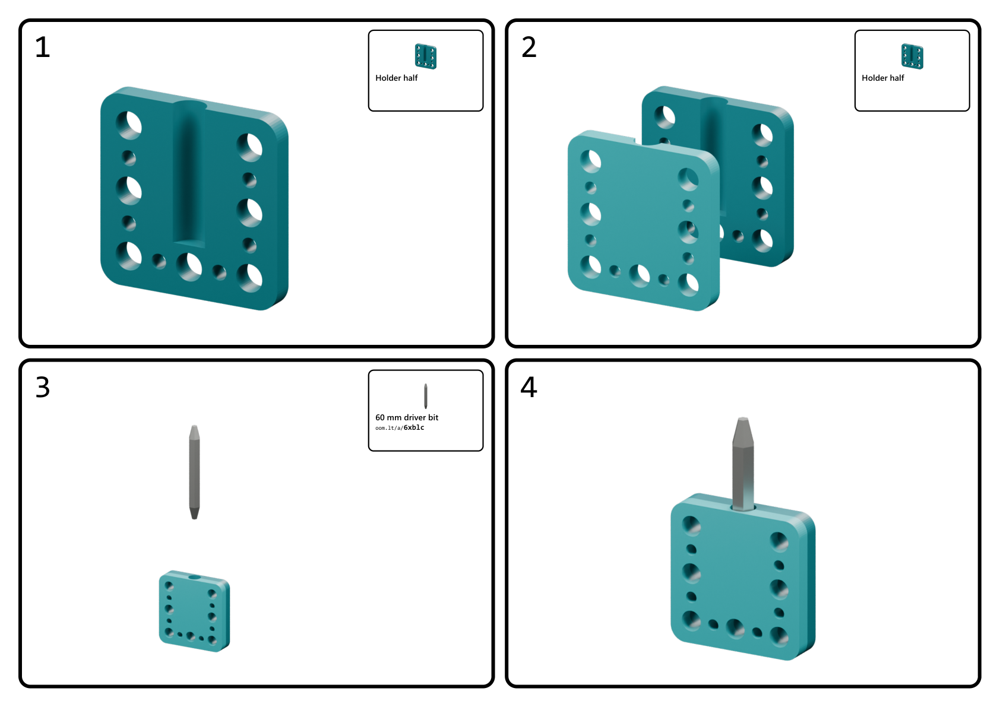

Representative 60 mm quarter-inch double-ended PH2/PZ2 bit. Length and drive size follow the HiKOKI product. The tapered hexagonal tips are simplified and their length and end diameter are estimates. The digital model was checked against the printed holder. Physical fit remains unverified. [OOMP tool record](https://github.com/oomlout/oomp_tool_version_5/tree/main/parts/tool_screwdriver_bit_60_mm_profile)

### 4 60 mm driver bits

Print two copies of the holder STL. The dark teal half sits against the wall and the light teal half faces the room.

1. Orient the rear half as it sits on the wall, with the pocket facing you and the opening at the top. [View step 1](parts/oobb_part_holder_tool_driver_bit_driver_bit_60mm_4_place_5x3x10/assembly/render/raw/step_01.png)
2. Face the front half toward the rear pocket. Align the mounting holes and both top openings. [View step 2](parts/oobb_part_holder_tool_driver_bit_driver_bit_60mm_4_place_5x3x10/assembly/render/raw/step_02.png)
3. Bring the halves together until their rims meet. Hold the bits vertically above their round pockets. [View step 3](parts/oobb_part_holder_tool_driver_bit_driver_bit_60mm_4_place_5x3x10/assembly/render/raw/step_03.png)
4. Lower the tools through the top openings. Each lower tip rests at the bottom and each upper tip remains accessible. [View step 4](parts/oobb_part_holder_tool_driver_bit_driver_bit_60mm_4_place_5x3x10/assembly/render/raw/step_04.png)

Illustrated assembly steps

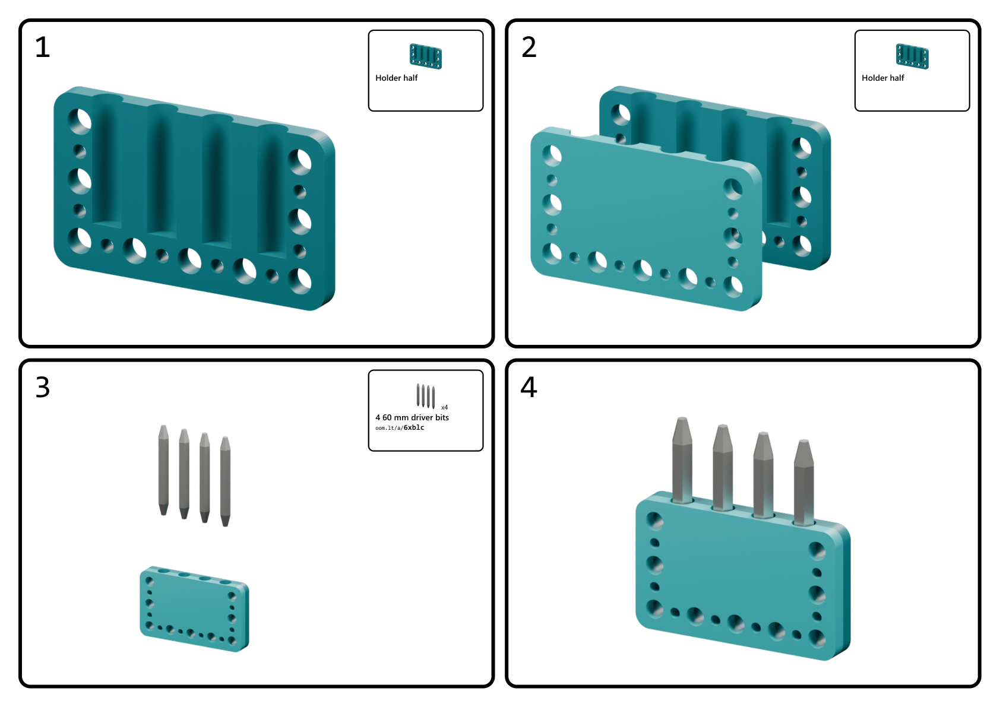

Representative 60 mm quarter-inch double-ended PH2/PZ2 bit. Length and drive size follow the HiKOKI product. The tapered hexagonal tips are simplified and their length and end diameter are estimates. The digital model was checked against the printed holder. Physical fit remains unverified. [OOMP tool record](https://github.com/oomlout/oomp_tool_version_5/tree/main/parts/tool_screwdriver_bit_60_mm_profile)

### 6 60 mm driver bits

Print two copies of the holder STL. The dark teal half sits against the wall and the light teal half faces the room.

1. Orient the rear half as it sits on the wall, with the pocket facing you and the opening at the top. [View step 1](parts/oobb_part_holder_tool_driver_bit_driver_bit_60mm_6_place_7x3x10/assembly/render/raw/step_01.png)
2. Face the front half toward the rear pocket. Align the mounting holes and both top openings. [View step 2](parts/oobb_part_holder_tool_driver_bit_driver_bit_60mm_6_place_7x3x10/assembly/render/raw/step_02.png)
3. Bring the halves together until their rims meet. Hold the bits vertically above their round pockets. [View step 3](parts/oobb_part_holder_tool_driver_bit_driver_bit_60mm_6_place_7x3x10/assembly/render/raw/step_03.png)
4. Lower the tools through the top openings. Each lower tip rests at the bottom and each upper tip remains accessible. [View step 4](parts/oobb_part_holder_tool_driver_bit_driver_bit_60mm_6_place_7x3x10/assembly/render/raw/step_04.png)

Illustrated assembly steps

Representative 60 mm quarter-inch double-ended PH2/PZ2 bit. Length and drive size follow the HiKOKI product. The tapered hexagonal tips are simplified and their length and end diameter are estimates. The digital model was checked against the printed holder. Physical fit remains unverified. [OOMP tool record](https://github.com/oomlout/oomp_tool_version_5/tree/main/parts/tool_screwdriver_bit_60_mm_profile)

### 8 60 mm driver bits

Print two copies of the holder STL. The dark teal half sits against the wall and the light teal half faces the room.

1. Orient the rear half as it sits on the wall, with the pocket facing you and the opening at the top. [View step 1](parts/oobb_part_holder_tool_driver_bit_driver_bit_60mm_8_place_9x3x10/assembly/render/raw/step_01.png)
2. Face the front half toward the rear pocket. Align the mounting holes and both top openings. [View step 2](parts/oobb_part_holder_tool_driver_bit_driver_bit_60mm_8_place_9x3x10/assembly/render/raw/step_02.png)
3. Bring the halves together until their rims meet. Hold the bits vertically above their round pockets. [View step 3](parts/oobb_part_holder_tool_driver_bit_driver_bit_60mm_8_place_9x3x10/assembly/render/raw/step_03.png)
4. Lower the tools through the top openings. Each lower tip rests at the bottom and each upper tip remains accessible. [View step 4](parts/oobb_part_holder_tool_driver_bit_driver_bit_60mm_8_place_9x3x10/assembly/render/raw/step_04.png)

Illustrated assembly steps

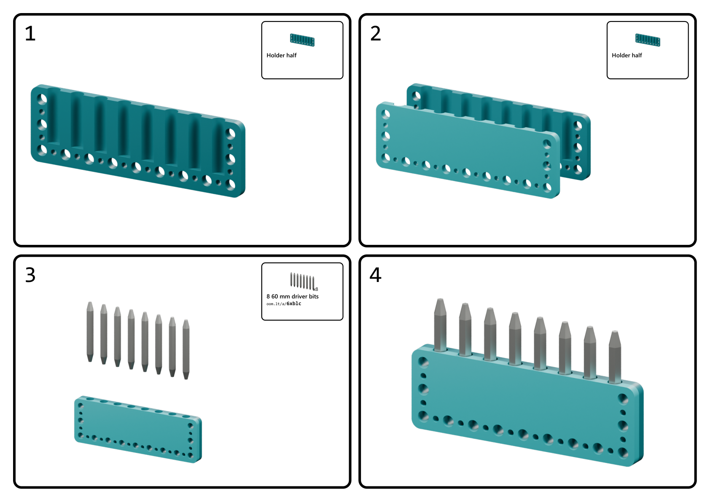

Representative 60 mm quarter-inch double-ended PH2/PZ2 bit. Length and drive size follow the HiKOKI product. The tapered hexagonal tips are simplified and their length and end diameter are estimates. The digital model was checked against the printed holder. Physical fit remains unverified. [OOMP tool record](https://github.com/oomlout/oomp_tool_version_5/tree/main/parts/tool_screwdriver_bit_60_mm_profile)

### 7 quarter-inch driver bits

Print two copies of the holder STL. The dark teal half sits against the wall and the light teal half faces the room.

1. Orient the rear half as it sits on the wall, with the pocket facing you and the opening at the top. [View step 1](parts/oobb_part_holder_tool_driver_bit_quarter_inch_7_place_9x3x12/assembly/render/raw/step_01.png)
2. Face the front half toward the rear pocket. Align the mounting holes and both top openings. [View step 2](parts/oobb_part_holder_tool_driver_bit_quarter_inch_7_place_9x3x12/assembly/render/raw/step_02.png)
3. Bring the halves together until their rims meet. Hold the bits vertically above their round pockets. [View step 3](parts/oobb_part_holder_tool_driver_bit_quarter_inch_7_place_9x3x12/assembly/render/raw/step_03.png)
4. Lower the tools through the top openings. Each shank rests at the pocket floor with the tip accessible above the holder. [View step 4](parts/oobb_part_holder_tool_driver_bit_quarter_inch_7_place_9x3x12/assembly/render/raw/step_04.png)

Illustrated assembly steps

Representative Wera 851/4 Z PH2 bit, 89 mm long with a quarter-inch drive. The tapered tip is simplified and its length and end diameter are estimated. The digital model was checked against the printed holder. Physical fit remains unverified. [OOMP tool record](https://github.com/oomlout/oomp_tool_version_5/tree/main/parts/tool_screwdriver_bit_quarter_inch_drive)

### 7 quarter-inch driver bits

Print two copies of the holder STL. The dark teal half sits against the wall and the light teal half faces the room.

1. Orient the rear half as it sits on the wall, with the pocket facing you and the opening at the top. [View step 1](parts/oobb_part_holder_tool_driver_bit_quarter_inch_7_place_9x4x12/assembly/render/raw/step_01.png)
2. Face the front half toward the rear pocket. Align the mounting holes and both top openings. [View step 2](parts/oobb_part_holder_tool_driver_bit_quarter_inch_7_place_9x4x12/assembly/render/raw/step_02.png)
3. Bring the halves together until their rims meet. Hold the bits vertically above their round pockets. [View step 3](parts/oobb_part_holder_tool_driver_bit_quarter_inch_7_place_9x4x12/assembly/render/raw/step_03.png)
4. Lower the tools through the top openings. Each shank rests at the pocket floor with the tip accessible above the holder. [View step 4](parts/oobb_part_holder_tool_driver_bit_quarter_inch_7_place_9x4x12/assembly/render/raw/step_04.png)

Illustrated assembly steps

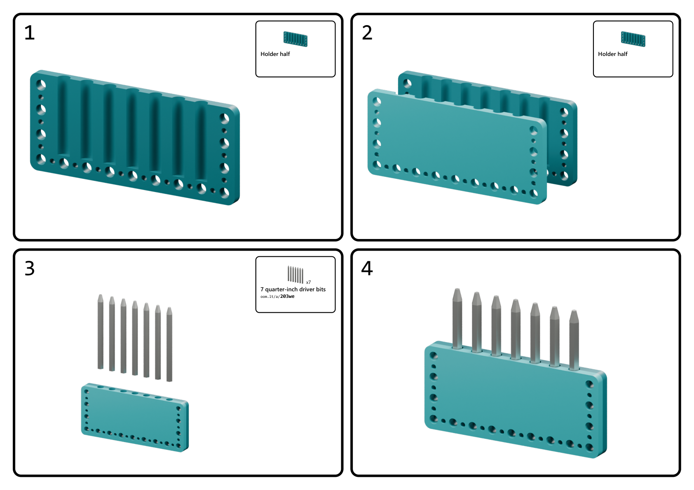

Representative Wera 851/4 Z PH2 bit, 89 mm long with a quarter-inch drive. The tapered tip is simplified and its length and end diameter are estimated. The digital model was checked against the printed holder. Physical fit remains unverified. [OOMP tool record](https://github.com/oomlout/oomp_tool_version_5/tree/main/parts/tool_screwdriver_bit_quarter_inch_drive)

### 8 quarter-inch driver bits

Print two copies of the holder STL. The dark teal half sits against the wall and the light teal half faces the room.

1. Orient the rear half as it sits on the wall, with the pocket facing you and the opening at the top. [View step 1](parts/oobb_part_holder_tool_driver_bit_quarter_inch_8_place_9x3x12/assembly/render/raw/step_01.png)
2. Face the front half toward the rear pocket. Align the mounting holes and both top openings. [View step 2](parts/oobb_part_holder_tool_driver_bit_quarter_inch_8_place_9x3x12/assembly/render/raw/step_02.png)
3. Bring the halves together until their rims meet. Hold the bits vertically above their round pockets. [View step 3](parts/oobb_part_holder_tool_driver_bit_quarter_inch_8_place_9x3x12/assembly/render/raw/step_03.png)
4. Lower the tools through the top openings. Each shank rests at the pocket floor with the tip accessible above the holder. [View step 4](parts/oobb_part_holder_tool_driver_bit_quarter_inch_8_place_9x3x12/assembly/render/raw/step_04.png)

Illustrated assembly steps

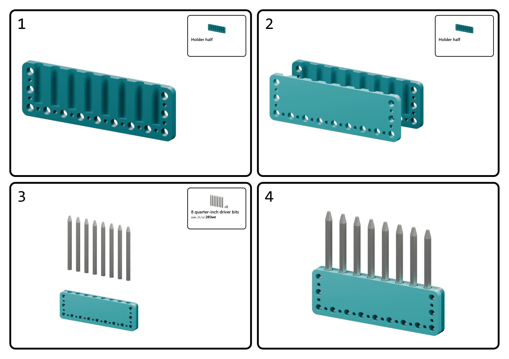

Representative Wera 851/4 Z PH2 bit, 89 mm long with a quarter-inch drive. The tapered tip is simplified and its length and end diameter are estimated. The digital model was checked against the printed holder. Physical fit remains unverified. [OOMP tool record](https://github.com/oomlout/oomp_tool_version_5/tree/main/parts/tool_screwdriver_bit_quarter_inch_drive)

### 8 quarter-inch driver bits

Print two copies of the holder STL. The dark teal half sits against the wall and the light teal half faces the room.

1. Orient the rear half as it sits on the wall, with the pocket facing you and the opening at the top. [View step 1](parts/oobb_part_holder_tool_driver_bit_quarter_inch_8_place_9x4x12/assembly/render/raw/step_01.png)
2. Face the front half toward the rear pocket. Align the mounting holes and both top openings. [View step 2](parts/oobb_part_holder_tool_driver_bit_quarter_inch_8_place_9x4x12/assembly/render/raw/step_02.png)
3. Bring the halves together until their rims meet. Hold the bits vertically above their round pockets. [View step 3](parts/oobb_part_holder_tool_driver_bit_quarter_inch_8_place_9x4x12/assembly/render/raw/step_03.png)
4. Lower the tools through the top openings. Each shank rests at the pocket floor with the tip accessible above the holder. [View step 4](parts/oobb_part_holder_tool_driver_bit_quarter_inch_8_place_9x4x12/assembly/render/raw/step_04.png)

Illustrated assembly steps

Representative Wera 851/4 Z PH2 bit, 89 mm long with a quarter-inch drive. The tapered tip is simplified and its length and end diameter are estimated. The digital model was checked against the printed holder. Physical fit remains unverified. [OOMP tool record](https://github.com/oomlout/oomp_tool_version_5/tree/main/parts/tool_screwdriver_bit_quarter_inch_drive)

### 15 quarter-inch driver bits

Print two copies of the holder STL. The dark teal half sits against the wall and the light teal half faces the room.

1. Orient the rear half as it sits on the wall, with the pocket facing you and the opening at the top. [View step 1](parts/oobb_part_holder_tool_driver_bit_quarter_inch_8_plus_7_layered_9x3x12/assembly/render/raw/step_01.png)
2. Face the front half toward the rear pocket. Align the mounting holes and both top openings. [View step 2](parts/oobb_part_holder_tool_driver_bit_quarter_inch_8_plus_7_layered_9x3x12/assembly/render/raw/step_02.png)
3. Bring the halves together until their rims meet. Place eight bits in the centre row and seven in the staggered front row. [View step 3](parts/oobb_part_holder_tool_driver_bit_quarter_inch_8_plus_7_layered_9x3x12/assembly/render/raw/step_03.png)
4. Lower the tools through the top openings. Seat the shanks at the pocket floors. The staggered row lies in the front-face grooves. [View step 4](parts/oobb_part_holder_tool_driver_bit_quarter_inch_8_plus_7_layered_9x3x12/assembly/render/raw/step_04.png)

Illustrated assembly steps

Representative Wera 851/4 Z PH2 bit, 89 mm long with a quarter-inch drive. The tapered tip is simplified and its length and end diameter are estimated. The digital model was checked against the printed holder. Physical fit remains unverified. [OOMP tool record](https://github.com/oomlout/oomp_tool_version_5/tree/main/parts/tool_screwdriver_bit_quarter_inch_drive)

The seven staggered front positions are open-face grooves. Retention of the bits in those grooves has not been physically tested.

### 15 quarter-inch driver bits

Print two copies of the holder STL. The dark teal half sits against the wall and the light teal half faces the room.

1. Orient the rear half as it sits on the wall, with the pocket facing you and the opening at the top. [View step 1](parts/oobb_part_holder_tool_driver_bit_quarter_inch_8_plus_7_layered_9x4x12/assembly/render/raw/step_01.png)
2. Face the front half toward the rear pocket. Align the mounting holes and both top openings. [View step 2](parts/oobb_part_holder_tool_driver_bit_quarter_inch_8_plus_7_layered_9x4x12/assembly/render/raw/step_02.png)
3. Bring the halves together until their rims meet. Place eight bits in the centre row and seven in the staggered front row. [View step 3](parts/oobb_part_holder_tool_driver_bit_quarter_inch_8_plus_7_layered_9x4x12/assembly/render/raw/step_03.png)
4. Lower the tools through the top openings. Seat the shanks at the pocket floors. The staggered row lies in the front-face grooves. [View step 4](parts/oobb_part_holder_tool_driver_bit_quarter_inch_8_plus_7_layered_9x4x12/assembly/render/raw/step_04.png)

Illustrated assembly steps

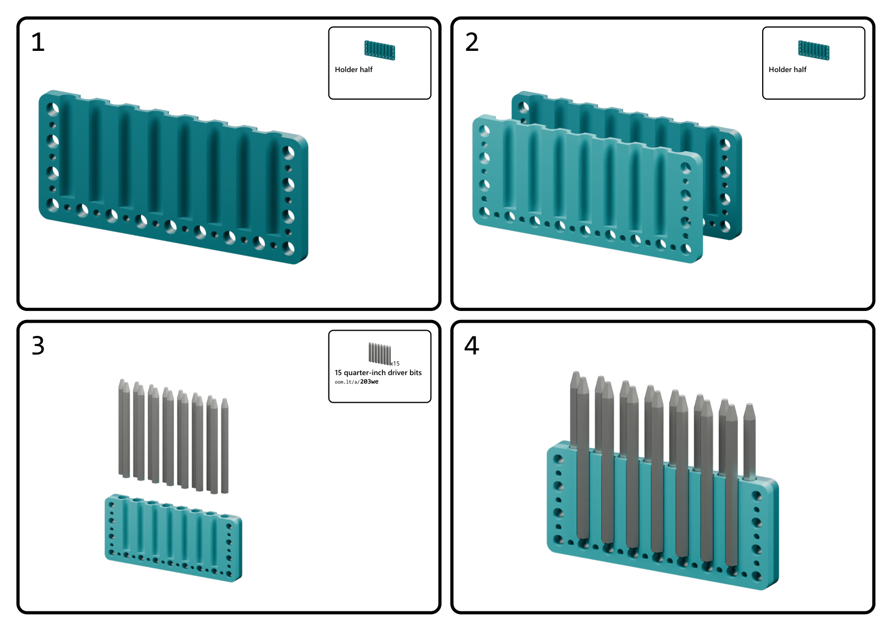

Representative Wera 851/4 Z PH2 bit, 89 mm long with a quarter-inch drive. The tapered tip is simplified and its length and end diameter are estimated. The digital model was checked against the printed holder. Physical fit remains unverified. [OOMP tool record](https://github.com/oomlout/oomp_tool_version_5/tree/main/parts/tool_screwdriver_bit_quarter_inch_drive)

The seven staggered front positions are open-face grooves. Retention of the bits in those grooves has not been physically tested.

### 23 quarter-inch bits in 3 rows

Print the holder once. Place the block upright with its openings facing up.

1. Place the printed block upright with all pocket openings facing up. [View step 1](parts/oobb_part_holder_tool_driver_bit_quarter_inch_block_3_rows_9x3x24/assembly/render/raw/step_01.png)
2. Align the bits vertically above the staggered rows of openings. [View step 2](parts/oobb_part_holder_tool_driver_bit_quarter_inch_block_3_rows_9x3x24/assembly/render/raw/step_02.png)
3. Lower the bits into the pockets. Each shank rests on its pocket floor, with its tip above the block. [View step 3](parts/oobb_part_holder_tool_driver_bit_quarter_inch_block_3_rows_9x3x24/assembly/render/raw/step_03.png)

Illustrated assembly steps

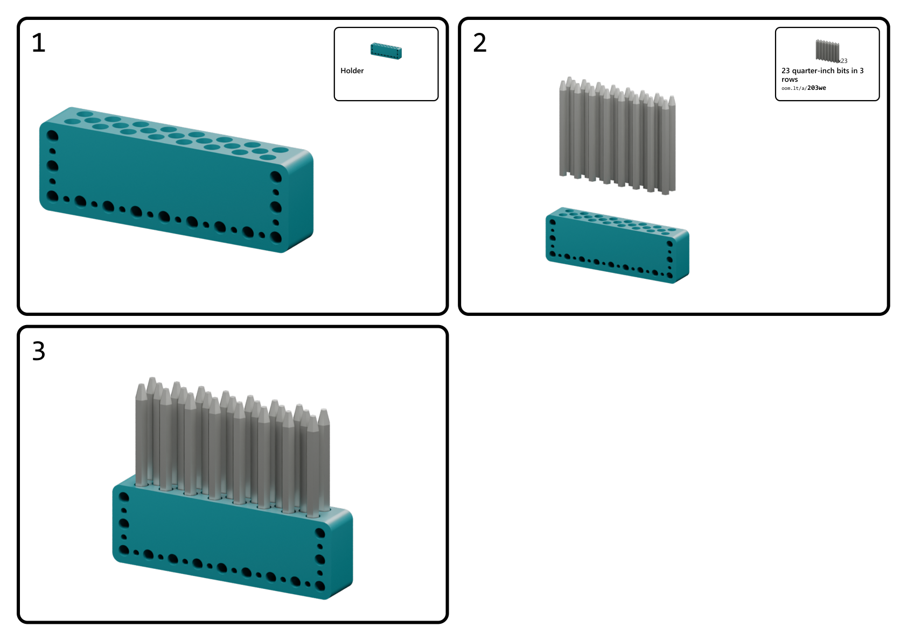

Representative Wera 851/4 Z PH2 bit, 89 mm long with a quarter-inch drive. The tapered tip is simplified and its length and end diameter are estimated. The digital model was checked against the printed holder. Physical fit remains unverified. [OOMP tool record](https://github.com/oomlout/oomp_tool_version_5/tree/main/parts/tool_screwdriver_bit_quarter_inch_drive)

### 38 quarter-inch bits in 5 rows

Print the holder once. Place the block upright with its openings facing up.

1. Place the printed block upright with all pocket openings facing up. [View step 1](parts/oobb_part_holder_tool_driver_bit_quarter_inch_block_5_rows_9x3x36/assembly/render/raw/step_01.png)
2. Align the bits vertically above the staggered rows of openings. [View step 2](parts/oobb_part_holder_tool_driver_bit_quarter_inch_block_5_rows_9x3x36/assembly/render/raw/step_02.png)
3. Lower the bits into the pockets. Each shank rests on its pocket floor, with its tip above the block. [View step 3](parts/oobb_part_holder_tool_driver_bit_quarter_inch_block_5_rows_9x3x36/assembly/render/raw/step_03.png)

Illustrated assembly steps

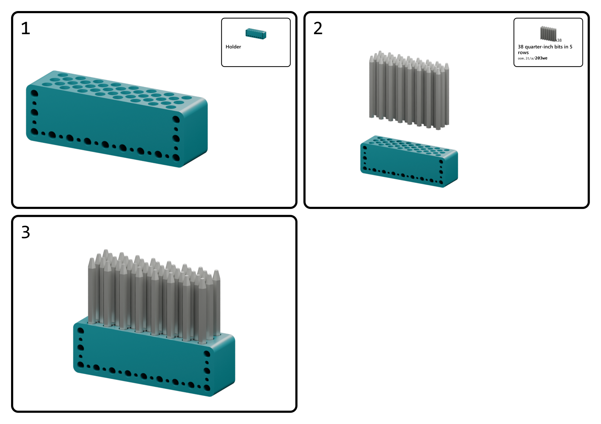

Representative Wera 851/4 Z PH2 bit, 89 mm long with a quarter-inch drive. The tapered tip is simplified and its length and end diameter are estimated. The digital model was checked against the printed holder. Physical fit remains unverified. [OOMP tool record](https://github.com/oomlout/oomp_tool_version_5/tree/main/parts/tool_screwdriver_bit_quarter_inch_drive)

### 53 quarter-inch bits in 7 rows

Print the holder once. Place the block upright with its openings facing up.

1. Place the printed block upright with all pocket openings facing up. [View step 1](parts/oobb_part_holder_tool_driver_bit_quarter_inch_block_7_rows_9x3x48/assembly/render/raw/step_01.png)
2. Align the bits vertically above the staggered rows of openings. [View step 2](parts/oobb_part_holder_tool_driver_bit_quarter_inch_block_7_rows_9x3x48/assembly/render/raw/step_02.png)
3. Lower the bits into the pockets. Each shank rests on its pocket floor, with its tip above the block. [View step 3](parts/oobb_part_holder_tool_driver_bit_quarter_inch_block_7_rows_9x3x48/assembly/render/raw/step_03.png)

Illustrated assembly steps

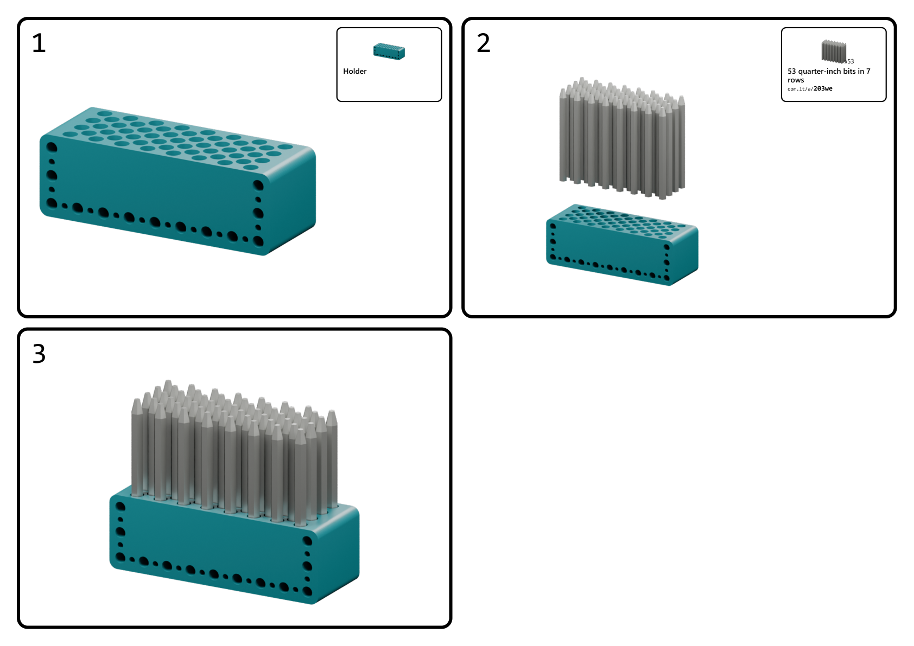

Representative Wera 851/4 Z PH2 bit, 89 mm long with a quarter-inch drive. The tapered tip is simplified and its length and end diameter are estimated. The digital model was checked against the printed holder. Physical fit remains unverified. [OOMP tool record](https://github.com/oomlout/oomp_tool_version_5/tree/main/parts/tool_screwdriver_bit_quarter_inch_drive)

### Medium Pritt glue stick

Print two copies of the holder STL. The dark teal half sits against the wall and the light teal half faces the room.

1. Orient the rear half as it sits on the wall, with the pocket facing you and the opening at the top. [View step 1](parts/oobb_part_holder_tool_glue_stick_prit_medium_1_place_4x5x30/assembly/render/raw/step_01.png)
2. Face the front half toward the rear pocket. Align the mounting holes and both top openings. [View step 2](parts/oobb_part_holder_tool_glue_stick_prit_medium_1_place_4x5x30/assembly/render/raw/step_02.png)
3. Bring the halves together until their rims meet. Hold the glue stick closed and lower the twist base into the round opening. [View step 3](parts/oobb_part_holder_tool_glue_stick_prit_medium_1_place_4x5x30/assembly/render/raw/step_03.png)
4. Lower the tool through the top opening. The twist base rests at the pocket floor and the closed cap remains accessible. [View step 4](parts/oobb_part_holder_tool_glue_stick_prit_medium_1_place_4x5x30/assembly/render/raw/step_04.png)

Illustrated assembly steps

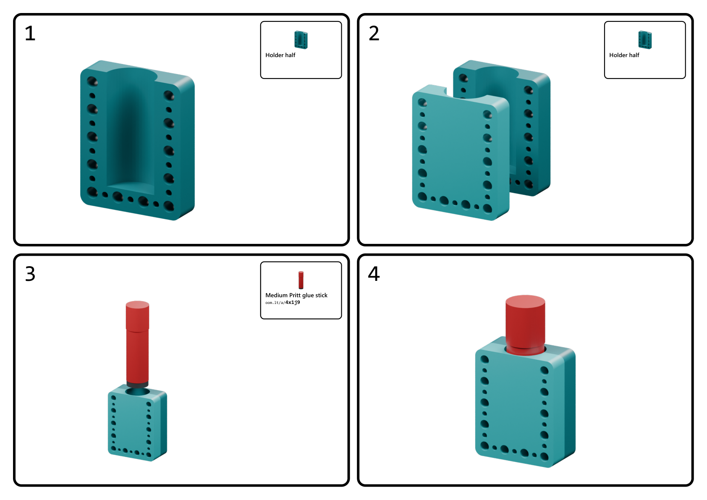

Representative PLUS Pritt medium NS-702, approximately 20 g and 26 × 95 mm. The red closed body and dark twist base are simplified, with estimated cap and base lengths. The workshop specimen has not been measured. The digital model was checked against the printed holder. Physical fit remains unverified. [OOMP tool record](https://github.com/oomlout/oomp_tool_version_5/tree/main/parts/stationery_glue_stick_medium_prit_style)

### Glue stick and knife

Print the supplied two-half layout once. The dark teal half sits against the wall and the light teal half faces the room.

1. Orient the rear half as it sits on the wall, with the pocket facing you and the opening at the top. [View step 1](parts/oobb_part_holder_tool_glue_stick_prit_medium_with_knife_5x5x30/assembly/render/raw/step_01.png)
2. Face the front half toward the rear pocket. Align the mounting holes and both top openings. [View step 2](parts/oobb_part_holder_tool_glue_stick_prit_medium_with_knife_5x5x30/assembly/render/raw/step_02.png)
3. Bring the halves together until their rims meet. Hold the glue stick closed over the round pocket and the closed utility knife edge-on over its slot. [View step 3](parts/oobb_part_holder_tool_glue_stick_prit_medium_with_knife_5x5x30/assembly/render/raw/step_03.png)
4. Lower the tools through the top openings. The twist base and closed knife sit in their separate pockets, with their upper ends accessible. [View step 4](parts/oobb_part_holder_tool_glue_stick_prit_medium_with_knife_5x5x30/assembly/render/raw/step_04.png)

Illustrated assembly steps

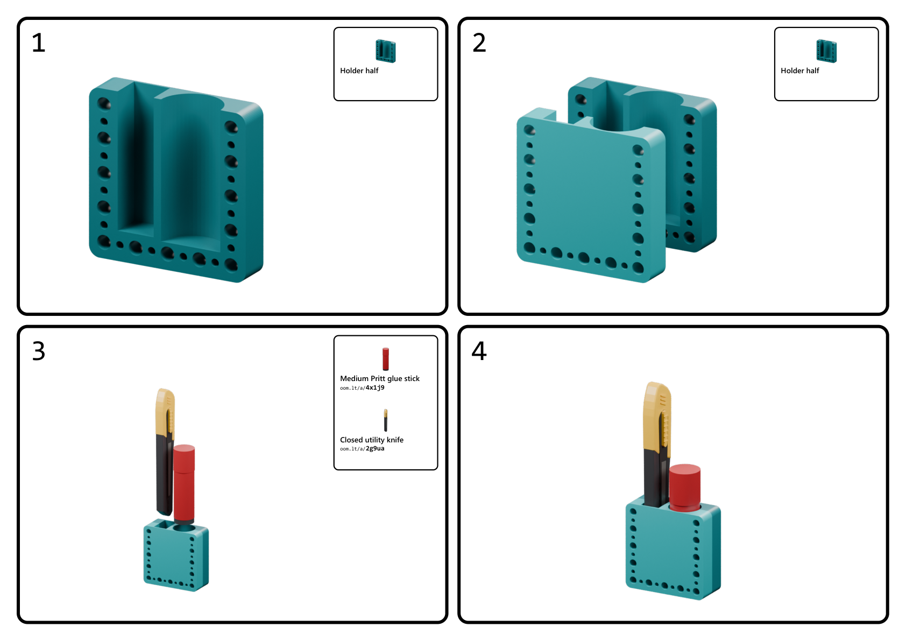

Representative PLUS Pritt medium NS-702, approximately 20 g and 26 × 95 mm. The red closed body and dark twist base are simplified, with estimated cap and base lengths. The workshop specimen has not been measured. The digital model was checked against the printed holder. Physical fit remains unverified. [OOMP tool record](https://github.com/oomlout/oomp_tool_version_5/tree/main/parts/stationery_glue_stick_medium_prit_style)

Closed exterior based on the photo and a provisional 165 mm STANLEY 0-10-151 reference. The 17 mm OOMP label is retained. Size variant awaits measurement. [OOMP tool record](https://github.com/oomlout/oomp_tool_version_5/tree/main/parts/tool_knife_craft_17_mm_black_exacto_style)

### Metric hex keys, forward

Print the supplied two-half layout once. The dark teal half sits against the wall and the light teal half faces the room.

1. Orient the rear printed half on the wall with the pockets facing out. [View step 1](parts/oobb_part_holder_tool_hex_key_small_metric_set_6_forward_5x5x8/assembly/render/raw/step_01.png)
2. Align the front printed half with the rear half and their holes. [View step 2](parts/oobb_part_holder_tool_hex_key_small_metric_set_6_forward_5x5x8/assembly/render/raw/step_02.png)
3. Join the halves and lower the 1.5, 2 and 2.5 mm keys into their pockets. [View step 3](parts/oobb_part_holder_tool_hex_key_small_metric_set_6_forward_5x5x8/assembly/render/raw/step_03.png)
4. Lower the 3, 4 and 5 mm keys into the remaining pockets. [View step 4](parts/oobb_part_holder_tool_hex_key_small_metric_set_6_forward_5x5x8/assembly/render/raw/step_04.png)
5. Seat every key at its pocket floor with each short arm pointing forward. [View step 5](parts/oobb_part_holder_tool_hex_key_small_metric_set_6_forward_5x5x8/assembly/render/raw/step_05.png)

Illustrated assembly steps

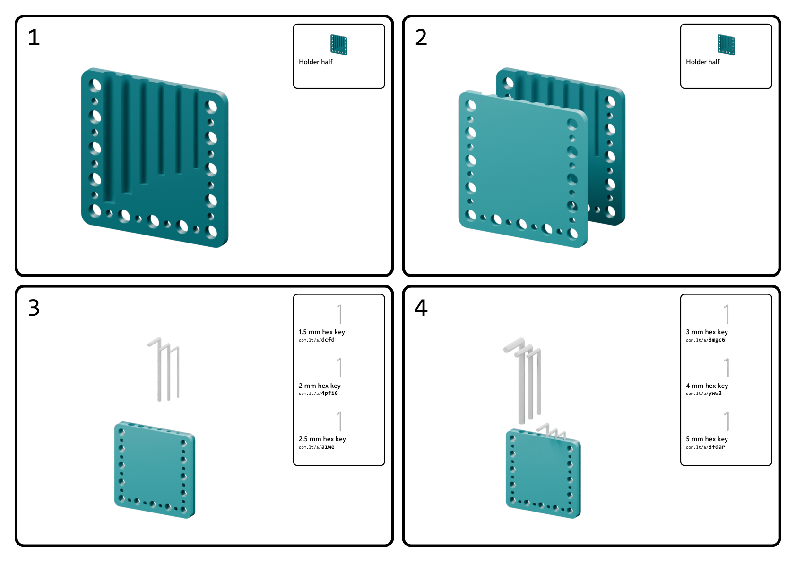
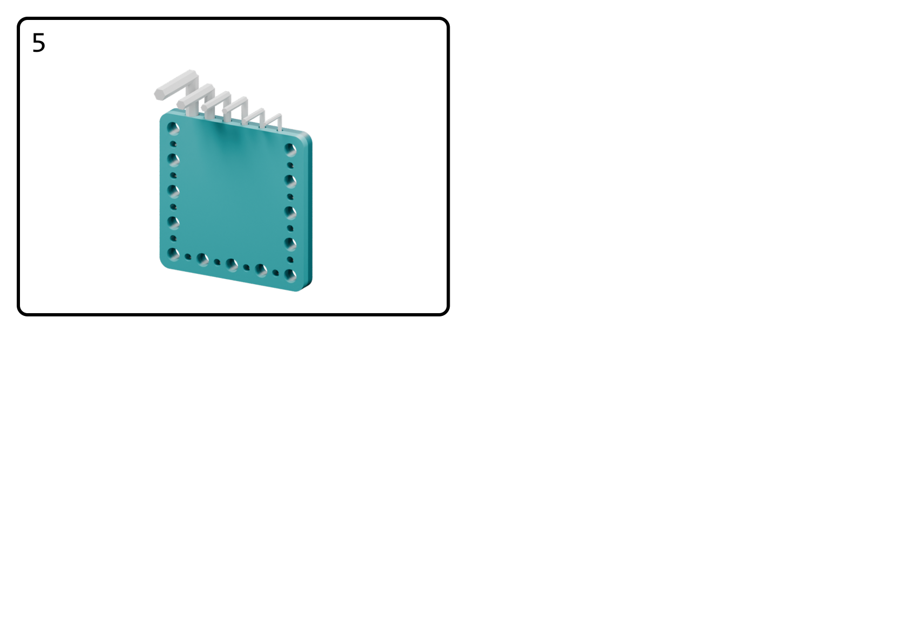

The holder specifies the hex size. Arm lengths follow the Wiha 350 short series as a representative example. The holder source leaves the key manufacturer unspecified. The elbow is simplified. The digital model was checked against the printed holder. Physical fit remains unverified. [OOMP tool record](https://github.com/oomlout/oomp_tool_version_5/tree/main/parts/tool_hex_key_1_5_mm)

The holder specifies the hex size. Arm lengths follow the Wiha 350 short series as a representative example. The holder source leaves the key manufacturer unspecified. The elbow is simplified. [OOMP tool record](https://github.com/oomlout/oomp_tool_version_5/tree/main/parts/tool_hex_key_2_mm)

The holder specifies the hex size. Arm lengths follow the Wiha 350 short series as a representative example. The holder source leaves the key manufacturer unspecified. The elbow is simplified. [OOMP tool record](https://github.com/oomlout/oomp_tool_version_5/tree/main/parts/tool_hex_key_2_5_mm)

The holder specifies the hex size. Arm lengths follow the Wiha 350 short series as a representative example. The holder source leaves the key manufacturer unspecified. The elbow is simplified. [OOMP tool record](https://github.com/oomlout/oomp_tool_version_5/tree/main/parts/tool_hex_key_3_mm)

The holder specifies the hex size. Arm lengths follow the Wiha 350 short series as a representative example. The holder source leaves the key manufacturer unspecified. The elbow is simplified. [OOMP tool record](https://github.com/oomlout/oomp_tool_version_5/tree/main/parts/tool_hex_key_4_mm)

The holder specifies the hex size. Arm lengths follow the Wiha 350 short series as a representative example. The holder source leaves the key manufacturer unspecified. The elbow is simplified. [OOMP tool record](https://github.com/oomlout/oomp_tool_version_5/tree/main/parts/tool_hex_key_5_mm)

### Metric hex keys, reverse

Print the supplied two-half layout once. The dark teal half sits against the wall and the light teal half faces the room.

1. Orient the rear printed half on the wall with the pockets facing out. [View step 1](parts/oobb_part_holder_tool_hex_key_small_metric_set_6_reverse_5x5x8/assembly/render/raw/step_01.png)
2. Align the front printed half with the rear half and their holes. [View step 2](parts/oobb_part_holder_tool_hex_key_small_metric_set_6_reverse_5x5x8/assembly/render/raw/step_02.png)
3. Join the halves and lower the 1.5, 2 and 2.5 mm keys into their pockets. [View step 3](parts/oobb_part_holder_tool_hex_key_small_metric_set_6_reverse_5x5x8/assembly/render/raw/step_03.png)
4. Lower the 3, 4 and 5 mm keys into the remaining pockets. [View step 4](parts/oobb_part_holder_tool_hex_key_small_metric_set_6_reverse_5x5x8/assembly/render/raw/step_04.png)
5. Seat every key at its pocket floor with each short arm pointing forward. [View step 5](parts/oobb_part_holder_tool_hex_key_small_metric_set_6_reverse_5x5x8/assembly/render/raw/step_05.png)

Illustrated assembly steps

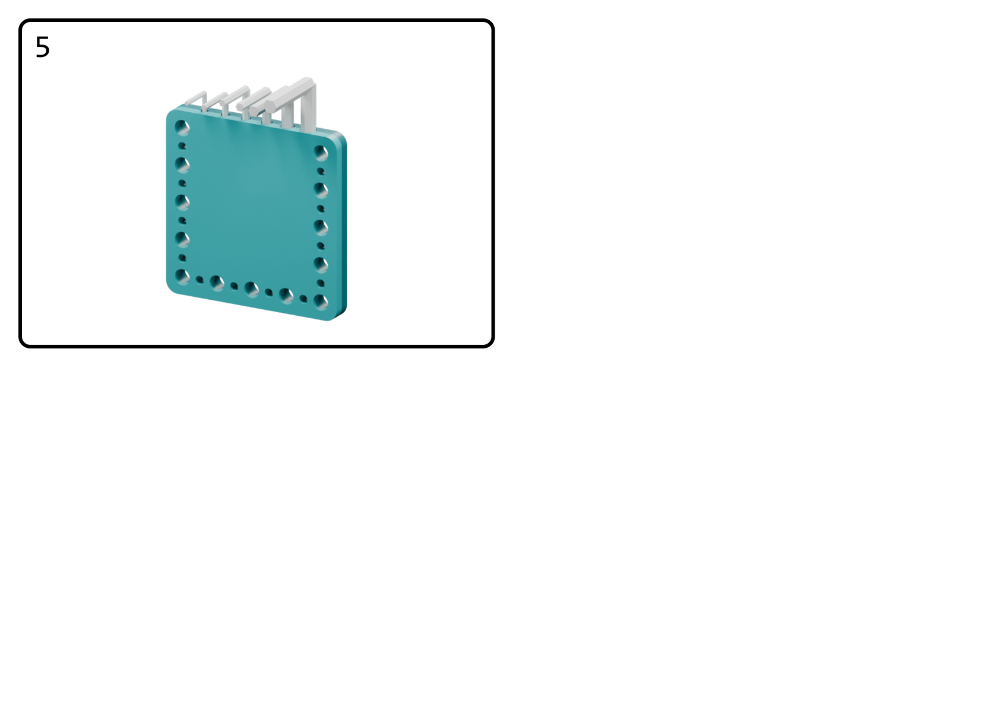

The holder specifies the hex size. Arm lengths follow the Wiha 350 short series as a representative example. The holder source leaves the key manufacturer unspecified. The elbow is simplified. The digital model was checked against the printed holder. Physical fit remains unverified. [OOMP tool record](https://github.com/oomlout/oomp_tool_version_5/tree/main/parts/tool_hex_key_1_5_mm)

The holder specifies the hex size. Arm lengths follow the Wiha 350 short series as a representative example. The holder source leaves the key manufacturer unspecified. The elbow is simplified. [OOMP tool record](https://github.com/oomlout/oomp_tool_version_5/tree/main/parts/tool_hex_key_2_mm)

The holder specifies the hex size. Arm lengths follow the Wiha 350 short series as a representative example. The holder source leaves the key manufacturer unspecified. The elbow is simplified. [OOMP tool record](https://github.com/oomlout/oomp_tool_version_5/tree/main/parts/tool_hex_key_2_5_mm)

The holder specifies the hex size. Arm lengths follow the Wiha 350 short series as a representative example. The holder source leaves the key manufacturer unspecified. The elbow is simplified. [OOMP tool record](https://github.com/oomlout/oomp_tool_version_5/tree/main/parts/tool_hex_key_3_mm)

The holder specifies the hex size. Arm lengths follow the Wiha 350 short series as a representative example. The holder source leaves the key manufacturer unspecified. The elbow is simplified. [OOMP tool record](https://github.com/oomlout/oomp_tool_version_5/tree/main/parts/tool_hex_key_4_mm)

The holder specifies the hex size. Arm lengths follow the Wiha 350 short series as a representative example. The holder source leaves the key manufacturer unspecified. The elbow is simplified. [OOMP tool record](https://github.com/oomlout/oomp_tool_version_5/tree/main/parts/tool_hex_key_5_mm)

### Closed utility knife

Print the supplied two-half layout once. The dark teal half sits against the wall and the light teal half faces the room.

1. Orient the rear half as it sits on the wall, with the pocket facing you and the opening at the top. [View step 1](parts/oobb_part_holder_tool_knife_utility_17mm_1_place_3x5x29d5/assembly/render/raw/step_01.png)
2. Face the front half toward the rear pocket. Align the mounting holes and both top openings. [View step 2](parts/oobb_part_holder_tool_knife_utility_17mm_1_place_3x5x29d5/assembly/render/raw/step_02.png)
3. Bring the halves together until their rims meet. Keep the knife closed. Turn the housing edge-on and align the nose with the closed end of the slot. [View step 3](parts/oobb_part_holder_tool_knife_utility_17mm_1_place_3x5x29d5/assembly/render/raw/step_03.png)
4. Lower the tool through the top opening. The housing sits edge-on in the slot. The heel projects above the holder. [View step 4](parts/oobb_part_holder_tool_knife_utility_17mm_1_place_3x5x29d5/assembly/render/raw/step_04.png)

Illustrated assembly steps

Closed exterior based on the photo and a provisional 165 mm STANLEY 0-10-151 reference. The 17 mm OOMP label is retained. Size variant awaits measurement. The digital model was checked against the printed holder. Physical fit remains unverified. [OOMP tool record](https://github.com/oomlout/oomp_tool_version_5/tree/main/parts/tool_knife_craft_17_mm_black_exacto_style)

### Sharpie, 1-place

Print two copies of the holder STL. The dark teal half sits against the wall and the light teal half faces the room.

1. Orient the rear half as it sits on the wall, with the pocket facing you and the opening at the top. [View step 1](parts/oobb_part_holder_tool_marker_sharpie_1_place_3x5x15/assembly/render/raw/step_01.png)
2. Face the front half toward the rear pocket. Align the mounting holes and both top openings. [View step 2](parts/oobb_part_holder_tool_marker_sharpie_1_place_3x5x15/assembly/render/raw/step_02.png)
3. Bring the halves together until their rims meet. Hold the capped markers vertically above their openings. [View step 3](parts/oobb_part_holder_tool_marker_sharpie_1_place_3x5x15/assembly/render/raw/step_03.png)
4. Lower the tool through the top opening. Each marker rests at its pocket floor with the cap accessible. [View step 4](parts/oobb_part_holder_tool_marker_sharpie_1_place_3x5x15/assembly/render/raw/step_04.png)

Illustrated assembly steps

The standard-tip OOMP record matches the branded v4 profile in diameter and length. Cap and barrel split are illustrative. The digital model was checked against the printed holder. Physical fit remains unverified. [OOMP tool record](https://github.com/oomlout/oomp_tool_version_5/tree/main/parts/stationery_felt_tip_pen_sharpie_standard_tip_style_13_mm_diameter_137_mm_length_sharpie)

### Sharpie, 2-place

Print two copies of the holder STL. The dark teal half sits against the wall and the light teal half faces the room.

1. Orient the rear half as it sits on the wall, with the pocket facing you and the opening at the top. [View step 1](parts/oobb_part_holder_tool_marker_sharpie_2_place_5x5x15/assembly/render/raw/step_01.png)
2. Face the front half toward the rear pocket. Align the mounting holes and both top openings. [View step 2](parts/oobb_part_holder_tool_marker_sharpie_2_place_5x5x15/assembly/render/raw/step_02.png)
3. Bring the halves together until their rims meet. Hold the capped markers vertically above their openings. [View step 3](parts/oobb_part_holder_tool_marker_sharpie_2_place_5x5x15/assembly/render/raw/step_03.png)
4. Lower the tools through the top openings. Each marker rests at its pocket floor with the cap accessible. [View step 4](parts/oobb_part_holder_tool_marker_sharpie_2_place_5x5x15/assembly/render/raw/step_04.png)

Illustrated assembly steps

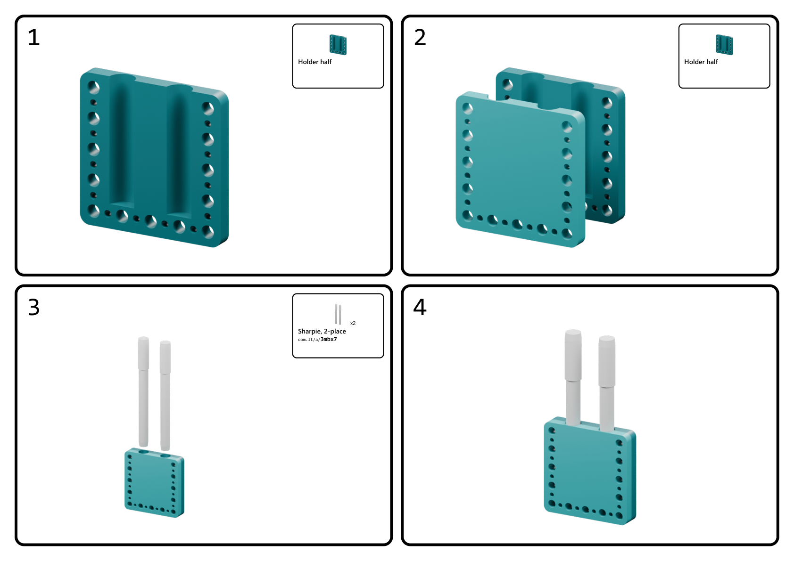

The standard-tip OOMP record matches the branded v4 profile in diameter and length. Cap and barrel split are illustrative. The digital model was checked against the printed holder. Physical fit remains unverified. [OOMP tool record](https://github.com/oomlout/oomp_tool_version_5/tree/main/parts/stationery_felt_tip_pen_sharpie_standard_tip_style_13_mm_diameter_137_mm_length_sharpie)

### Sharpie, 5-place

Print two copies of the holder STL. The dark teal half sits against the wall and the light teal half faces the room.

1. Orient the rear half as it sits on the wall, with the pocket facing you and the opening at the top. [View step 1](parts/oobb_part_holder_tool_marker_sharpie_5_place_8x5x15/assembly/render/raw/step_01.png)
2. Face the front half toward the rear pocket. Align the mounting holes and both top openings. [View step 2](parts/oobb_part_holder_tool_marker_sharpie_5_place_8x5x15/assembly/render/raw/step_02.png)
3. Bring the halves together until their rims meet. Hold the capped markers vertically above their openings. [View step 3](parts/oobb_part_holder_tool_marker_sharpie_5_place_8x5x15/assembly/render/raw/step_03.png)
4. Lower the tools through the top openings. Each marker rests at its pocket floor with the cap accessible. [View step 4](parts/oobb_part_holder_tool_marker_sharpie_5_place_8x5x15/assembly/render/raw/step_04.png)

Illustrated assembly steps

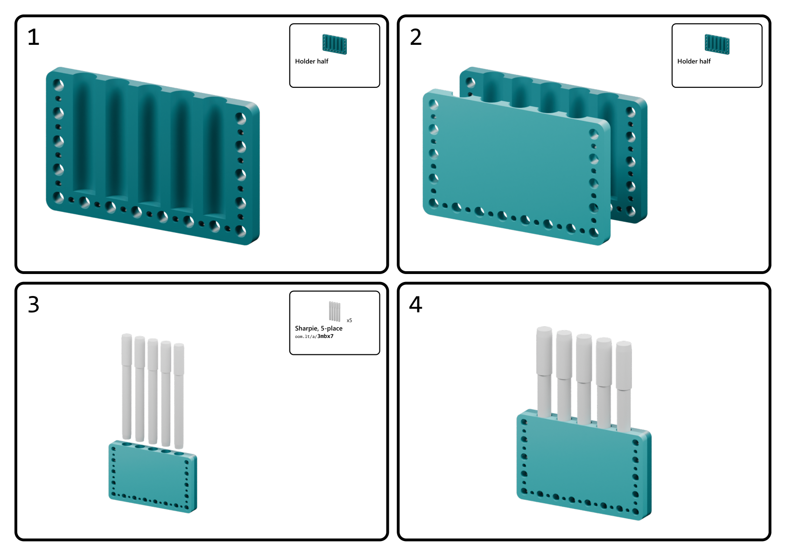

The standard-tip OOMP record matches the branded v4 profile in diameter and length. Cap and barrel split are illustrative. The digital model was checked against the printed holder. Physical fit remains unverified. [OOMP tool record](https://github.com/oomlout/oomp_tool_version_5/tree/main/parts/stationery_felt_tip_pen_sharpie_standard_tip_style_13_mm_diameter_137_mm_length_sharpie)

### Sharpie, 6-place

Print two copies of the holder STL. The dark teal half sits against the wall and the light teal half faces the room.

1. Orient the rear half as it sits on the wall, with the pocket facing you and the opening at the top. [View step 1](parts/oobb_part_holder_tool_marker_sharpie_6_place_9x5x15/assembly/render/raw/step_01.png)
2. Face the front half toward the rear pocket. Align the mounting holes and both top openings. [View step 2](parts/oobb_part_holder_tool_marker_sharpie_6_place_9x5x15/assembly/render/raw/step_02.png)
3. Bring the halves together until their rims meet. Hold the capped markers vertically above their openings. [View step 3](parts/oobb_part_holder_tool_marker_sharpie_6_place_9x5x15/assembly/render/raw/step_03.png)
4. Lower the tools through the top openings. Each marker rests at its pocket floor with the cap accessible. [View step 4](parts/oobb_part_holder_tool_marker_sharpie_6_place_9x5x15/assembly/render/raw/step_04.png)

Illustrated assembly steps

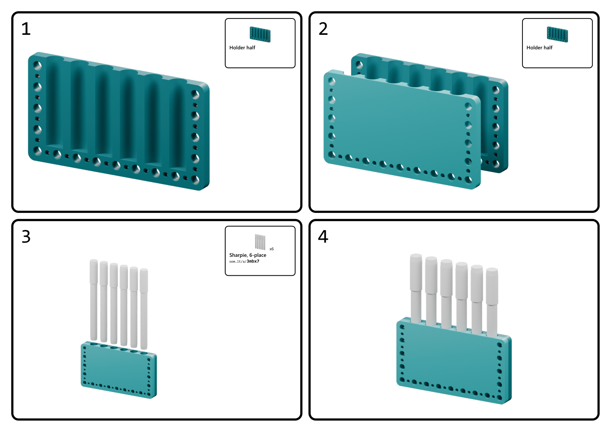

The standard-tip OOMP record matches the branded v4 profile in diameter and length. Cap and barrel split are illustrative. The digital model was checked against the printed holder. Physical fit remains unverified. [OOMP tool record](https://github.com/oomlout/oomp_tool_version_5/tree/main/parts/stationery_felt_tip_pen_sharpie_standard_tip_style_13_mm_diameter_137_mm_length_sharpie)

### 13 mm marker, short holder

Print two copies of the holder STL. The dark teal half sits against the wall and the light teal half faces the room.

1. Orient the rear half as it sits on the wall, with the pocket facing you and the opening at the top. [View step 1](parts/oobb_part_holder_tool_marker_sharpie_style_13mm_1_place_3x1x17/assembly/render/raw/step_01.png)
2. Face the front half toward the rear pocket. Align the mounting holes and both top openings. [View step 2](parts/oobb_part_holder_tool_marker_sharpie_style_13mm_1_place_3x1x17/assembly/render/raw/step_02.png)
3. Bring the halves together until their rims meet. Hold the capped marker vertically and slide it into the opening. [View step 3](parts/oobb_part_holder_tool_marker_sharpie_style_13mm_1_place_3x1x17/assembly/render/raw/step_03.png)
4. Lower the tool through the top opening. The marker projects below the holder because the pocket opens at both ends. Retention has not been physically tested. [View step 4](parts/oobb_part_holder_tool_marker_sharpie_style_13mm_1_place_3x1x17/assembly/render/raw/step_04.png)

Illustrated assembly steps

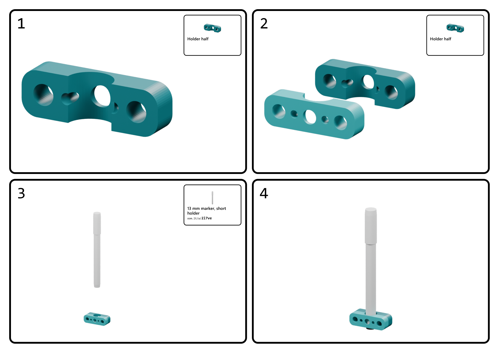

Nominal capped body from the vertical holder's tool identity. The 14 mm pocket includes clearance. Cap and barrel split are illustrative. The digital model was checked against the printed holder. Physical fit remains unverified. [OOMP tool record](https://github.com/oomlout/oomp_tool_version_5/tree/main/parts/stationery_felt_tip_pen_13_mm_diameter_137_mm_length_sharpie_style)

### 13 mm marker, 1-place

Print two copies of the holder STL. The dark teal half sits against the wall and the light teal half faces the room.

1. Orient the rear half as it sits on the wall, with the pocket facing you and the opening at the top. [View step 1](parts/oobb_part_holder_tool_marker_sharpie_style_13mm_1_place_3x5x17/assembly/render/raw/step_01.png)
2. Face the front half toward the rear pocket. Align the mounting holes and both top openings. [View step 2](parts/oobb_part_holder_tool_marker_sharpie_style_13mm_1_place_3x5x17/assembly/render/raw/step_02.png)
3. Bring the halves together until their rims meet. Hold the capped markers vertically above their openings. [View step 3](parts/oobb_part_holder_tool_marker_sharpie_style_13mm_1_place_3x5x17/assembly/render/raw/step_03.png)
4. Lower the tool through the top opening. Each marker rests at its pocket floor with the cap accessible. [View step 4](parts/oobb_part_holder_tool_marker_sharpie_style_13mm_1_place_3x5x17/assembly/render/raw/step_04.png)

Illustrated assembly steps

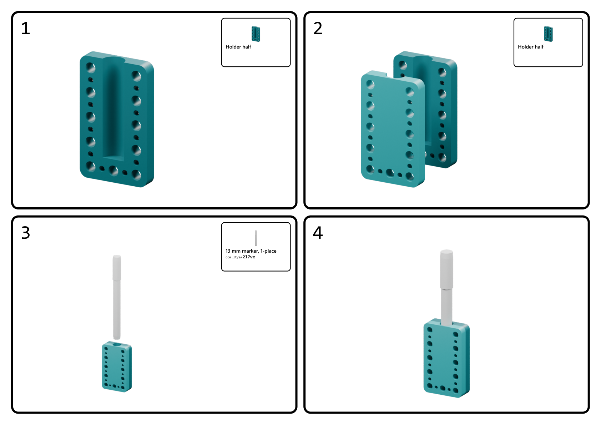

Nominal capped body from the vertical holder's tool identity. The 14 mm pocket includes clearance. Cap and barrel split are illustrative. The digital model was checked against the printed holder. Physical fit remains unverified. [OOMP tool record](https://github.com/oomlout/oomp_tool_version_5/tree/main/parts/stationery_felt_tip_pen_13_mm_diameter_137_mm_length_sharpie_style)

### 13 mm marker, 2-place

Print two copies of the holder STL. The dark teal half sits against the wall and the light teal half faces the room.

1. Orient the rear half as it sits on the wall, with the pocket facing you and the opening at the top. [View step 1](parts/oobb_part_holder_tool_marker_sharpie_style_13mm_2_place_4x5x17/assembly/render/raw/step_01.png)
2. Face the front half toward the rear pocket. Align the mounting holes and both top openings. [View step 2](parts/oobb_part_holder_tool_marker_sharpie_style_13mm_2_place_4x5x17/assembly/render/raw/step_02.png)
3. Bring the halves together until their rims meet. Hold the capped markers vertically above their openings. [View step 3](parts/oobb_part_holder_tool_marker_sharpie_style_13mm_2_place_4x5x17/assembly/render/raw/step_03.png)
4. Lower the tools through the top openings. Each marker rests at its pocket floor with the cap accessible. [View step 4](parts/oobb_part_holder_tool_marker_sharpie_style_13mm_2_place_4x5x17/assembly/render/raw/step_04.png)

Illustrated assembly steps

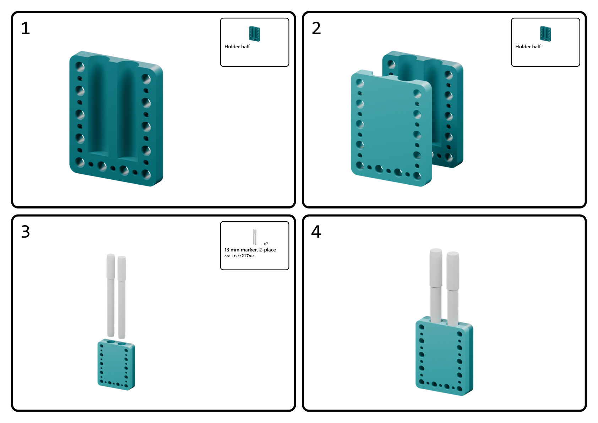

Nominal capped body from the vertical holder's tool identity. The 14 mm pocket includes clearance. Cap and barrel split are illustrative. The digital model was checked against the printed holder. Physical fit remains unverified. [OOMP tool record](https://github.com/oomlout/oomp_tool_version_5/tree/main/parts/stationery_felt_tip_pen_13_mm_diameter_137_mm_length_sharpie_style)

### 13 mm marker, 3-place

Print two copies of the holder STL. The dark teal half sits against the wall and the light teal half faces the room.

1. Orient the rear half as it sits on the wall, with the pocket facing you and the opening at the top. [View step 1](parts/oobb_part_holder_tool_marker_sharpie_style_13mm_3_place_5x5x17/assembly/render/raw/step_01.png)
2. Face the front half toward the rear pocket. Align the mounting holes and both top openings. [View step 2](parts/oobb_part_holder_tool_marker_sharpie_style_13mm_3_place_5x5x17/assembly/render/raw/step_02.png)
3. Bring the halves together until their rims meet. Hold the capped markers vertically above their openings. [View step 3](parts/oobb_part_holder_tool_marker_sharpie_style_13mm_3_place_5x5x17/assembly/render/raw/step_03.png)
4. Lower the tools through the top openings. Each marker rests at its pocket floor with the cap accessible. [View step 4](parts/oobb_part_holder_tool_marker_sharpie_style_13mm_3_place_5x5x17/assembly/render/raw/step_04.png)

Illustrated assembly steps

Nominal capped body from the vertical holder's tool identity. The 14 mm pocket includes clearance. Cap and barrel split are illustrative. The digital model was checked against the printed holder. Physical fit remains unverified. [OOMP tool record](https://github.com/oomlout/oomp_tool_version_5/tree/main/parts/stationery_felt_tip_pen_13_mm_diameter_137_mm_length_sharpie_style)

### 13 mm marker, 4-place

Print two copies of the holder STL. The dark teal half sits against the wall and the light teal half faces the room.

1. Orient the rear half as it sits on the wall, with the pocket facing you and the opening at the top. [View step 1](parts/oobb_part_holder_tool_marker_sharpie_style_13mm_4_place_7x5x17/assembly/render/raw/step_01.png)
2. Face the front half toward the rear pocket. Align the mounting holes and both top openings. [View step 2](parts/oobb_part_holder_tool_marker_sharpie_style_13mm_4_place_7x5x17/assembly/render/raw/step_02.png)
3. Bring the halves together until their rims meet. Hold the capped markers vertically above their openings. [View step 3](parts/oobb_part_holder_tool_marker_sharpie_style_13mm_4_place_7x5x17/assembly/render/raw/step_03.png)
4. Lower the tools through the top openings. Each marker rests at its pocket floor with the cap accessible. [View step 4](parts/oobb_part_holder_tool_marker_sharpie_style_13mm_4_place_7x5x17/assembly/render/raw/step_04.png)

Illustrated assembly steps

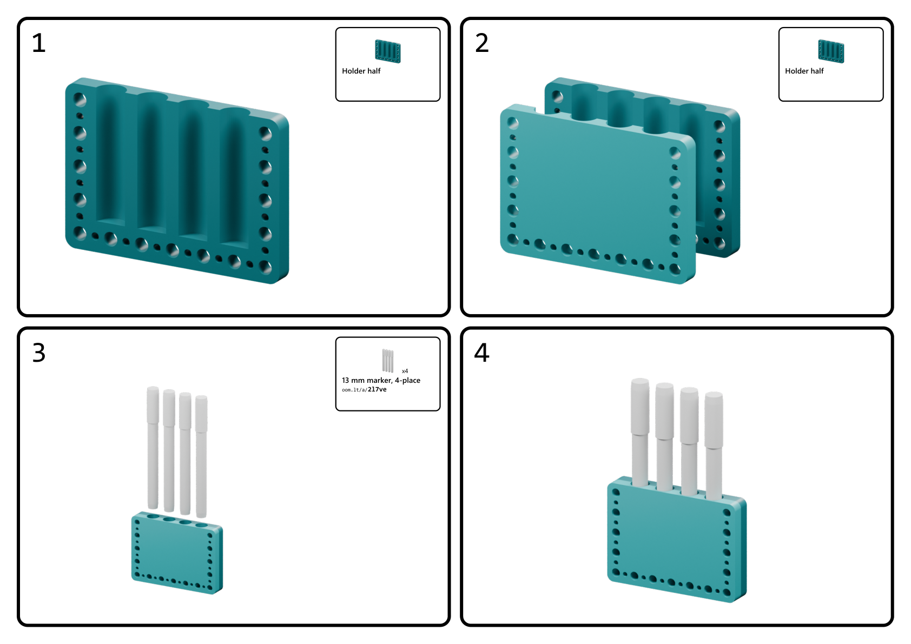

Nominal capped body from the vertical holder's tool identity. The 14 mm pocket includes clearance. Cap and barrel split are illustrative. The digital model was checked against the printed holder. Physical fit remains unverified. [OOMP tool record](https://github.com/oomlout/oomp_tool_version_5/tree/main/parts/stationery_felt_tip_pen_13_mm_diameter_137_mm_length_sharpie_style)

### 13 mm marker, 5-place

Print two copies of the holder STL. The dark teal half sits against the wall and the light teal half faces the room.

1. Orient the rear half as it sits on the wall, with the pocket facing you and the opening at the top. [View step 1](parts/oobb_part_holder_tool_marker_sharpie_style_13mm_5_place_8x5x17/assembly/render/raw/step_01.png)
2. Face the front half toward the rear pocket. Align the mounting holes and both top openings. [View step 2](parts/oobb_part_holder_tool_marker_sharpie_style_13mm_5_place_8x5x17/assembly/render/raw/step_02.png)
3. Bring the halves together until their rims meet. Hold the capped markers vertically above their openings. [View step 3](parts/oobb_part_holder_tool_marker_sharpie_style_13mm_5_place_8x5x17/assembly/render/raw/step_03.png)
4. Lower the tools through the top openings. Each marker rests at its pocket floor with the cap accessible. [View step 4](parts/oobb_part_holder_tool_marker_sharpie_style_13mm_5_place_8x5x17/assembly/render/raw/step_04.png)

Illustrated assembly steps

Nominal capped body from the vertical holder's tool identity. The 14 mm pocket includes clearance. Cap and barrel split are illustrative. The digital model was checked against the printed holder. Physical fit remains unverified. [OOMP tool record](https://github.com/oomlout/oomp_tool_version_5/tree/main/parts/stationery_felt_tip_pen_13_mm_diameter_137_mm_length_sharpie_style)

### Blue needle-nose pliers

Print two copies of the holder STL. The dark teal half sits against the wall and the light teal half faces the room.

1. Orient the rear half as it sits on the wall, with the pocket facing you and the opening at the top. [View step 1](parts/oobb_part_holder_tool_pliers_needle_nose_130mm_1_place_5x5x12/assembly/render/raw/step_01.png)
2. Face the front half toward the rear pocket. Align the mounting holes and both top openings. [View step 2](parts/oobb_part_holder_tool_pliers_needle_nose_130mm_1_place_5x5x12/assembly/render/raw/step_02.png)
3. Bring the halves together until their rims meet. Point the long jaws toward the closed end of the recess. Centre the steel nose between the rails. [View step 3](parts/oobb_part_holder_tool_pliers_needle_nose_130mm_1_place_5x5x12/assembly/render/raw/step_03.png)
4. Lower the tool through the top opening. The blue grips extend beyond the open end, with the pivot inside the holder. [View step 4](parts/oobb_part_holder_tool_pliers_needle_nose_130mm_1_place_5x5x12/assembly/render/raw/step_04.png)

Illustrated assembly steps

Open-pose photo trace with a provisional 130 mm closed-length reference (Rapid PC-022). Jaw and grip depths are estimated. The digital model was checked against the printed holder. Physical fit remains unverified. [OOMP tool record](https://github.com/oomlout/oomp_tool_version_5/tree/main/parts/tool_pliers_needle_nose_130_mm_length_blue)

### Picquic Teeny Turner

Print two copies of the holder STL. The dark teal half sits against the wall and the light teal half faces the room.

1. Orient the rear half as it sits on the wall, with the pocket facing you and the opening at the top. [View step 1](parts/oobb_part_holder_tool_screwdriver_picquic_teeny_turner_1_place_3x3x31/assembly/render/raw/step_01.png)
2. Face the front half toward the rear pocket. Align the mounting holes and both top openings. [View step 2](parts/oobb_part_holder_tool_screwdriver_picquic_teeny_turner_1_place_3x3x31/assembly/render/raw/step_02.png)
3. Bring the halves together until their rims meet. Point the exposed bit down and centre it over the round opening. [View step 3](parts/oobb_part_holder_tool_screwdriver_picquic_teeny_turner_1_place_3x3x31/assembly/render/raw/step_03.png)
4. Lower the tool through the top opening. The shoulder of the short handle rests at the top of the holder. [View step 4](parts/oobb_part_holder_tool_screwdriver_picquic_teeny_turner_1_place_3x3x31/assembly/render/raw/step_04.png)

Illustrated assembly steps

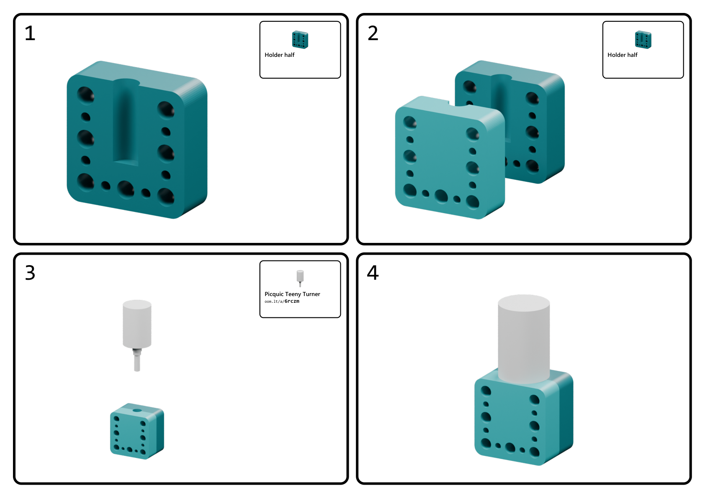

Four coaxial sections follow the archived OOMP drawing, read at its document scale. The handle and exposed bit use simplified round sections. The digital model was checked against the printed holder. Physical fit remains unverified. [OOMP tool record](https://github.com/oomlout/oomp_tool_version_5/tree/main/parts/tool_screw_driver_multi_driver_precision_size_teeny_turner_model_picquic)

### 1.5 mm tall precision screwdriver

Print two copies of the holder STL. The dark teal half sits against the wall and the light teal half faces the room.

1. Orient the rear half as it sits on the wall, with the pocket facing you and the opening at the top. [View step 1](parts/oobb_part_holder_tool_screwdriver_precision_tall_hex_60mm_m1d5_1_place_3x5x20/assembly/render/raw/step_01.png)
2. Face the front half toward the rear pocket. Align the mounting holes and both top openings. [View step 2](parts/oobb_part_holder_tool_screwdriver_precision_tall_hex_60mm_m1d5_1_place_3x5x20/assembly/render/raw/step_02.png)
3. Bring the halves together until their rims meet. Point the hex tip down and centre the shaft over the narrow opening. [View step 3](parts/oobb_part_holder_tool_screwdriver_precision_tall_hex_60mm_m1d5_1_place_3x5x20/assembly/render/raw/step_03.png)
4. Lower the tool through the top opening. The tip reaches the pocket floor and the precision handle remains accessible above the holder. [View step 4](parts/oobb_part_holder_tool_screwdriver_precision_tall_hex_60mm_m1d5_1_place_3x5x20/assembly/render/raw/step_04.png)

Illustrated assembly steps

Wera specifies the shaft diameter, shaft length and handle length. The archived OOMP record supplies the 18 mm handle envelope. Grip taper, cap and tip transition are illustrative. The digital model was checked against the printed holder. Physical fit remains unverified. [OOMP tool record](https://github.com/oomlout/oomp_tool_version_5/tree/main/parts/tool_screw_driver_precision_kraftform_micro_style_18_mm_diameter_157_mm_depth_hex_head_1_5_mm_wera_2054_series_05118066001)

### 2 mm tall precision screwdriver

Print two copies of the holder STL. The dark teal half sits against the wall and the light teal half faces the room.

1. Orient the rear half as it sits on the wall, with the pocket facing you and the opening at the top. [View step 1](parts/oobb_part_holder_tool_screwdriver_precision_tall_hex_60mm_m2_1_place_3x5x20/assembly/render/raw/step_01.png)
2. Face the front half toward the rear pocket. Align the mounting holes and both top openings. [View step 2](parts/oobb_part_holder_tool_screwdriver_precision_tall_hex_60mm_m2_1_place_3x5x20/assembly/render/raw/step_02.png)
3. Bring the halves together until their rims meet. Point the hex tip down and centre the shaft over the narrow opening. [View step 3](parts/oobb_part_holder_tool_screwdriver_precision_tall_hex_60mm_m2_1_place_3x5x20/assembly/render/raw/step_03.png)
4. Lower the tool through the top opening. The tip reaches the pocket floor and the precision handle remains accessible above the holder. [View step 4](parts/oobb_part_holder_tool_screwdriver_precision_tall_hex_60mm_m2_1_place_3x5x20/assembly/render/raw/step_04.png)

Illustrated assembly steps

Wera specifies the shaft diameter, shaft length and handle length. The archived OOMP record supplies the 18 mm handle envelope. Grip taper, cap and tip transition are illustrative. The digital model was checked against the printed holder. Physical fit remains unverified. [OOMP tool record](https://github.com/oomlout/oomp_tool_version_5/tree/main/parts/tool_screw_driver_precision_kraftform_micro_style_18_mm_diameter_157_mm_depth_hex_head_2_mm_wera_2054_series_05118068001)

### 2.5 mm precision driver

Print two copies of the holder STL. The dark teal half sits against the wall and the light teal half faces the room.

1. Orient the rear half as it sits on the wall, with the pocket facing you and the opening at the top. [View step 1](parts/oobb_part_holder_tool_screwdriver_precision_tall_hex_60mm_m2d5_1_place_3x5x20/assembly/render/raw/step_01.png)
2. Face the front half toward the rear pocket. Align the mounting holes and both top openings. [View step 2](parts/oobb_part_holder_tool_screwdriver_precision_tall_hex_60mm_m2d5_1_place_3x5x20/assembly/render/raw/step_02.png)
3. Bring the halves together until their rims meet. Point the hex tip down and centre the shaft over the narrow opening. [View step 3](parts/oobb_part_holder_tool_screwdriver_precision_tall_hex_60mm_m2d5_1_place_3x5x20/assembly/render/raw/step_03.png)
4. Lower the tool through the top opening. The tip reaches the pocket floor and the precision handle remains accessible above the holder. [View step 4](parts/oobb_part_holder_tool_screwdriver_precision_tall_hex_60mm_m2d5_1_place_3x5x20/assembly/render/raw/step_04.png)

Illustrated assembly steps

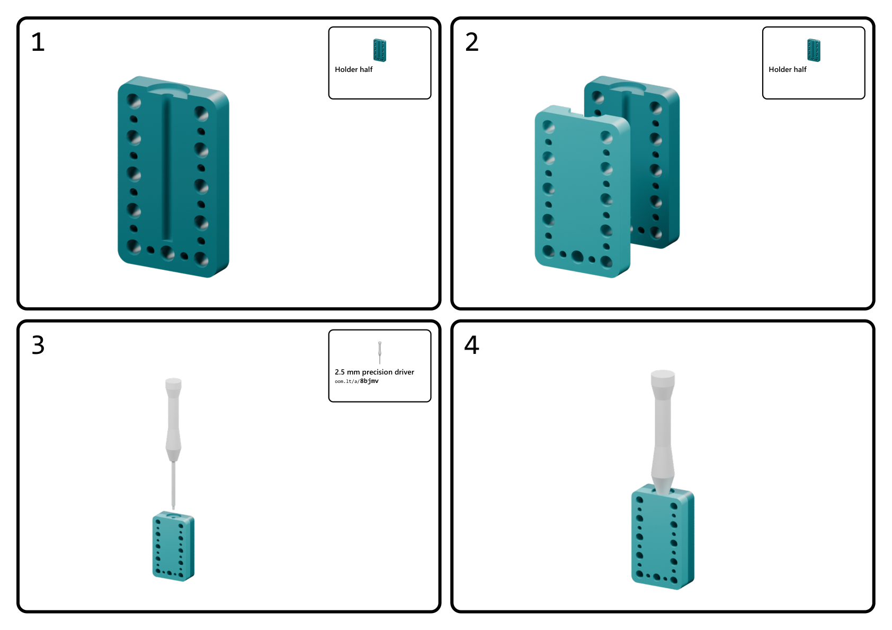

Wera specifies the shaft diameter, shaft length and handle length. The archived OOMP record supplies the 18 mm handle envelope. Grip taper, cap and tip transition are illustrative. The digital model was checked against the printed holder. Physical fit remains unverified. [OOMP tool record](https://github.com/oomlout/oomp_tool_version_5/tree/main/parts/tool_screw_driver_precision_kraftform_micro_style_18_mm_diameter_157_mm_depth_hex_head_2_5_mm_wera_2054_series_05118070001)

### 2.5 mm drivers, 2-place

Print two copies of the holder STL. The dark teal half sits against the wall and the light teal half faces the room.

1. Orient the rear half as it sits on the wall, with the pocket facing you and the opening at the top. [View step 1](parts/oobb_part_holder_tool_screwdriver_precision_tall_hex_60mm_m2d5_2_place_5x5x20/assembly/render/raw/step_01.png)
2. Face the front half toward the rear pocket. Align the mounting holes and both top openings. [View step 2](parts/oobb_part_holder_tool_screwdriver_precision_tall_hex_60mm_m2d5_2_place_5x5x20/assembly/render/raw/step_02.png)
3. Bring the halves together until their rims meet. Point the hex tips down and centre the shafts over the openings. [View step 3](parts/oobb_part_holder_tool_screwdriver_precision_tall_hex_60mm_m2d5_2_place_5x5x20/assembly/render/raw/step_03.png)
4. Lower the tools through the top openings. Each tip reaches its pocket floor and the handles remain accessible above the holder. [View step 4](parts/oobb_part_holder_tool_screwdriver_precision_tall_hex_60mm_m2d5_2_place_5x5x20/assembly/render/raw/step_04.png)

Illustrated assembly steps

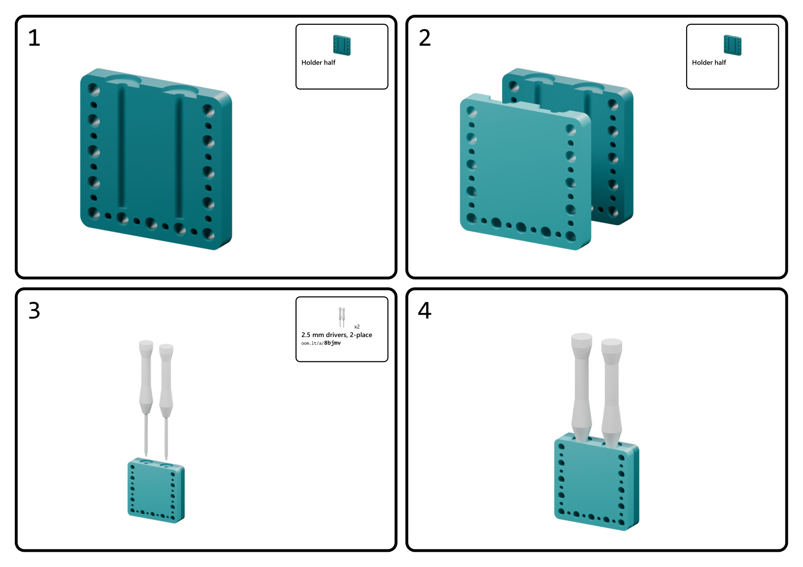

Wera specifies the shaft diameter, shaft length and handle length. The archived OOMP record supplies the 18 mm handle envelope. Grip taper, cap and tip transition are illustrative. The digital model was checked against the printed holder. Physical fit remains unverified. [OOMP tool record](https://github.com/oomlout/oomp_tool_version_5/tree/main/parts/tool_screw_driver_precision_kraftform_micro_style_18_mm_diameter_157_mm_depth_hex_head_2_5_mm_wera_2054_series_05118070001)

### 2.5 mm drivers, 4-place

Print two copies of the holder STL. The dark teal half sits against the wall and the light teal half faces the room.

1. Orient the rear half as it sits on the wall, with the pocket facing you and the opening at the top. [View step 1](parts/oobb_part_holder_tool_screwdriver_precision_tall_hex_60mm_m2d5_4_place_7x5x20/assembly/render/raw/step_01.png)
2. Face the front half toward the rear pocket. Align the mounting holes and both top openings. [View step 2](parts/oobb_part_holder_tool_screwdriver_precision_tall_hex_60mm_m2d5_4_place_7x5x20/assembly/render/raw/step_02.png)
3. Bring the halves together until their rims meet. Point the hex tips down and centre the shafts over the openings. [View step 3](parts/oobb_part_holder_tool_screwdriver_precision_tall_hex_60mm_m2d5_4_place_7x5x20/assembly/render/raw/step_03.png)
4. Lower the tools through the top openings. Each tip reaches its pocket floor and the handles remain accessible above the holder. [View step 4](parts/oobb_part_holder_tool_screwdriver_precision_tall_hex_60mm_m2d5_4_place_7x5x20/assembly/render/raw/step_04.png)

Illustrated assembly steps

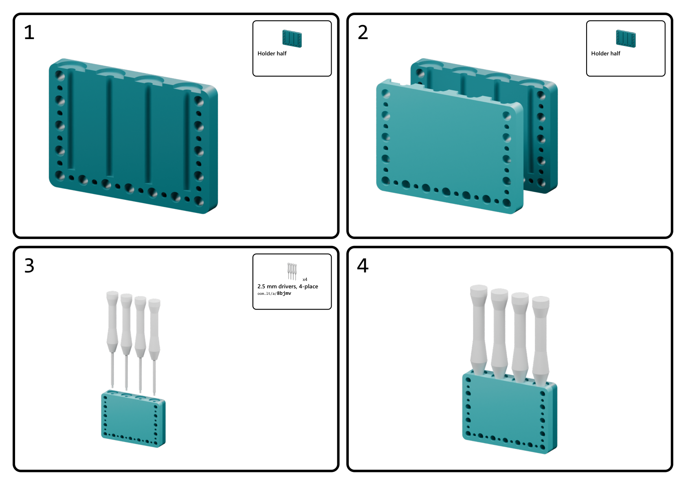

Wera specifies the shaft diameter, shaft length and handle length. The archived OOMP record supplies the 18 mm handle envelope. Grip taper, cap and tip transition are illustrative. The digital model was checked against the printed holder. Physical fit remains unverified. [OOMP tool record](https://github.com/oomlout/oomp_tool_version_5/tree/main/parts/tool_screw_driver_precision_kraftform_micro_style_18_mm_diameter_157_mm_depth_hex_head_2_5_mm_wera_2054_series_05118070001)

### 2.5 mm drivers, 5-place

Print two copies of the holder STL. The dark teal half sits against the wall and the light teal half faces the room.

1. Orient the rear half as it sits on the wall, with the pocket facing you and the opening at the top. [View step 1](parts/oobb_part_holder_tool_screwdriver_precision_tall_hex_60mm_m2d5_5_place_9x5x20/assembly/render/raw/step_01.png)
2. Face the front half toward the rear pocket. Align the mounting holes and both top openings. [View step 2](parts/oobb_part_holder_tool_screwdriver_precision_tall_hex_60mm_m2d5_5_place_9x5x20/assembly/render/raw/step_02.png)
3. Bring the halves together until their rims meet. Point the hex tips down and centre the shafts over the openings. [View step 3](parts/oobb_part_holder_tool_screwdriver_precision_tall_hex_60mm_m2d5_5_place_9x5x20/assembly/render/raw/step_03.png)
4. Lower the tools through the top openings. Each tip reaches its pocket floor and the handles remain accessible above the holder. [View step 4](parts/oobb_part_holder_tool_screwdriver_precision_tall_hex_60mm_m2d5_5_place_9x5x20/assembly/render/raw/step_04.png)

Illustrated assembly steps

Wera specifies the shaft diameter, shaft length and handle length. The archived OOMP record supplies the 18 mm handle envelope. Grip taper, cap and tip transition are illustrative. The digital model was checked against the printed holder. Physical fit remains unverified. [OOMP tool record](https://github.com/oomlout/oomp_tool_version_5/tree/main/parts/tool_screw_driver_precision_kraftform_micro_style_18_mm_diameter_157_mm_depth_hex_head_2_5_mm_wera_2054_series_05118070001)

### Red side cutters

Print two copies of the holder STL. The dark teal half sits against the wall and the light teal half faces the room.

1. Orient the rear half as it sits on the wall, with the pocket facing you and the opening at the top. [View step 1](parts/oobb_part_holder_tool_side_cutters_generic_110mm_1_place_5x5x13/assembly/render/raw/step_01.png)
2. Face the front half toward the rear pocket. Align the mounting holes and both top openings. [View step 2](parts/oobb_part_holder_tool_side_cutters_generic_110mm_1_place_5x5x13/assembly/render/raw/step_02.png)
3. Bring the halves together until their rims meet. Point the cutting head toward the closed end. Align the steel arms with the widening pocket. [View step 3](parts/oobb_part_holder_tool_side_cutters_generic_110mm_1_place_5x5x13/assembly/render/raw/step_03.png)
4. Lower the tool through the top opening. Leave both red grips clear of the open end. The jaw tips sit short of the end wall in the photographed pose. [View step 4](parts/oobb_part_holder_tool_side_cutters_generic_110mm_1_place_5x5x13/assembly/render/raw/step_04.png)

Illustrated assembly steps

Open-pose photo trace with a provisional 110 mm closed-length reference (Rapid SA-706 RED). Grip thickness is estimated. The digital model was checked against the printed holder. Physical fit remains unverified. [OOMP tool record](https://github.com/oomlout/oomp_tool_version_5/tree/main/parts/tool_side_cutters_110_mm_length_red)

### 10 mm spanner

Print two copies of the holder STL. The dark teal half sits against the wall and the light teal half faces the room.

1. Orient the rear half as it sits on the wall, with the pocket facing you and the opening at the top. [View step 1](parts/oobb_part_holder_tool_spanner_m10_1_place_3x5x9/assembly/render/raw/step_01.png)
2. Face the front half toward the rear pocket. Align the mounting holes and both top openings. [View step 2](parts/oobb_part_holder_tool_spanner_m10_1_place_3x5x9/assembly/render/raw/step_02.png)
3. Bring the halves together until their rims meet. Hold the spanner flat against the wall plane with the ring end down. Centre it over the top opening. [View step 3](parts/oobb_part_holder_tool_spanner_m10_1_place_3x5x9/assembly/render/raw/step_03.png)
4. Lower the tool through the top opening. Rest the ring on the pocket floor. The open jaw remains above the holder. [View step 4](parts/oobb_part_holder_tool_spanner_m10_1_place_3x5x9/assembly/render/raw/step_04.png)

Illustrated assembly steps

Generic 10 mm combination spanner using the Bahco 111M-10 as a dimensional reference. Length and head widths and thicknesses follow the catalogue. The straight shank, jaw outline and six-point ring are simplified. The workshop specimen has not been measured. The digital model was checked against the printed holder. Physical fit remains unverified. [OOMP tool record](https://github.com/oomlout/oomp_tool_version_5/tree/main/parts/tool_wrench_m10)

### Two 10 mm spanners

Print two copies of the holder STL. The dark teal half sits against the wall and the light teal half faces the room.

1. Orient the rear half as it sits on the wall, with the pocket facing you and the opening at the top. [View step 1](parts/oobb_part_holder_tool_spanner_m10_2_place_5x5x9/assembly/render/raw/step_01.png)
2. Face the front half toward the rear pocket. Align the mounting holes and both top openings. [View step 2](parts/oobb_part_holder_tool_spanner_m10_2_place_5x5x9/assembly/render/raw/step_02.png)
3. Bring the halves together until their rims meet. Hold both spanners with their ring ends down over the two openings. [View step 3](parts/oobb_part_holder_tool_spanner_m10_2_place_5x5x9/assembly/render/raw/step_03.png)
4. Lower the tools through the top openings. Each ring rests on its own pocket floor, with the open jaws above the holder. [View step 4](parts/oobb_part_holder_tool_spanner_m10_2_place_5x5x9/assembly/render/raw/step_04.png)

Illustrated assembly steps

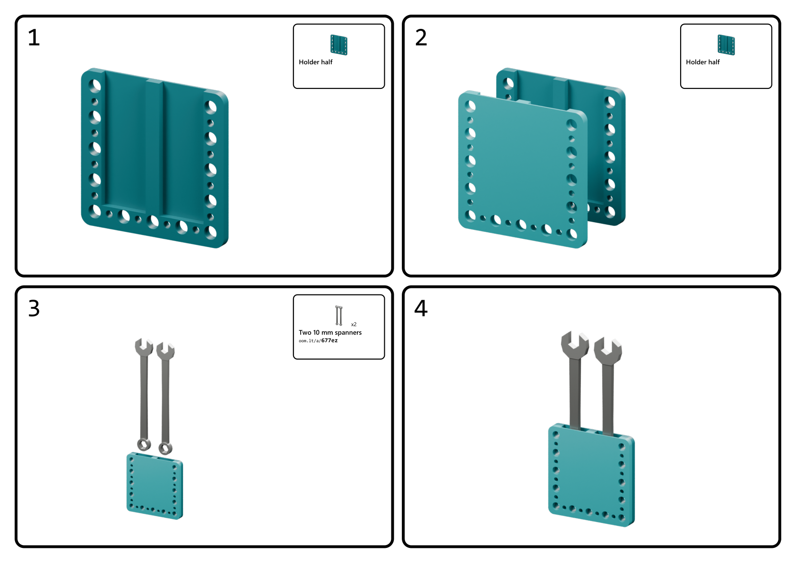

Generic 10 mm combination spanner using the Bahco 111M-10 as a dimensional reference. Length and head widths and thicknesses follow the catalogue. The straight shank, jaw outline and six-point ring are simplified. The workshop specimen has not been measured. The digital model was checked against the printed holder. Physical fit remains unverified. [OOMP tool record](https://github.com/oomlout/oomp_tool_version_5/tree/main/parts/tool_wrench_m10)

### Three 10 mm spanners

Print two copies of the holder STL. The dark teal half sits against the wall and the light teal half faces the room.

1. Orient the rear half as it sits on the wall, with the pocket facing you and the opening at the top. [View step 1](parts/oobb_part_holder_tool_spanner_m10_3_place_7x5x9/assembly/render/raw/step_01.png)
2. Face the front half toward the rear pocket. Align the mounting holes and both top openings. [View step 2](parts/oobb_part_holder_tool_spanner_m10_3_place_7x5x9/assembly/render/raw/step_02.png)
3. Bring the halves together until their rims meet. Hold the three spanners with their ring ends down over the openings. [View step 3](parts/oobb_part_holder_tool_spanner_m10_3_place_7x5x9/assembly/render/raw/step_03.png)
4. Lower the tools through the top openings. Each ring rests on its own pocket floor, with the open jaws above the holder. [View step 4](parts/oobb_part_holder_tool_spanner_m10_3_place_7x5x9/assembly/render/raw/step_04.png)

Illustrated assembly steps

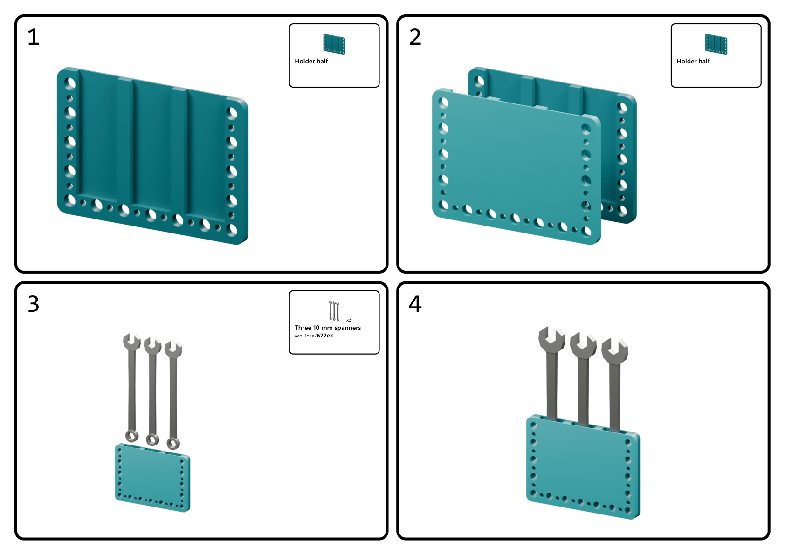

Generic 10 mm combination spanner using the Bahco 111M-10 as a dimensional reference. Length and head widths and thicknesses follow the catalogue. The straight shank, jaw outline and six-point ring are simplified. The workshop specimen has not been measured. The digital model was checked against the printed holder. Physical fit remains unverified. [OOMP tool record](https://github.com/oomlout/oomp_tool_version_5/tree/main/parts/tool_wrench_m10)

### Four 10 mm spanners

Print two copies of the holder STL. The dark teal half sits against the wall and the light teal half faces the room.

1. Orient the rear half as it sits on the wall, with the pocket facing you and the opening at the top. [View step 1](parts/oobb_part_holder_tool_spanner_m10_4_place_9x5x9/assembly/render/raw/step_01.png)
2. Face the front half toward the rear pocket. Align the mounting holes and both top openings. [View step 2](parts/oobb_part_holder_tool_spanner_m10_4_place_9x5x9/assembly/render/raw/step_02.png)
3. Bring the halves together until their rims meet. Hold the four spanners with their ring ends down over the openings. [View step 3](parts/oobb_part_holder_tool_spanner_m10_4_place_9x5x9/assembly/render/raw/step_03.png)
4. Lower the tools through the top openings. Each ring rests on its own pocket floor, with the open jaws above the holder. [View step 4](parts/oobb_part_holder_tool_spanner_m10_4_place_9x5x9/assembly/render/raw/step_04.png)

Illustrated assembly steps

Generic 10 mm combination spanner using the Bahco 111M-10 as a dimensional reference. Length and head widths and thicknesses follow the catalogue. The straight shank, jaw outline and six-point ring are simplified. The workshop specimen has not been measured. The digital model was checked against the printed holder. Physical fit remains unverified. [OOMP tool record](https://github.com/oomlout/oomp_tool_version_5/tree/main/parts/tool_wrench_m10)

### 13 mm spanner

Print two copies of the holder STL. The dark teal half sits against the wall and the light teal half faces the room.

1. Orient the rear half as it sits on the wall, with the pocket facing you and the opening at the top. [View step 1](parts/oobb_part_holder_tool_spanner_m13_1_place_3x5x10/assembly/render/raw/step_01.png)
2. Face the front half toward the rear pocket. Align the mounting holes and both top openings. [View step 2](parts/oobb_part_holder_tool_spanner_m13_1_place_3x5x10/assembly/render/raw/step_02.png)
3. Bring the halves together until their rims meet. Hold the spanner flat against the wall plane with the ring end down. Centre it over the top opening. [View step 3](parts/oobb_part_holder_tool_spanner_m13_1_place_3x5x10/assembly/render/raw/step_03.png)
4. Lower the tool through the top opening. Rest the ring on the pocket floor. The open jaw remains above the holder. [View step 4](parts/oobb_part_holder_tool_spanner_m13_1_place_3x5x10/assembly/render/raw/step_04.png)

Illustrated assembly steps

Generic 13 mm combination spanner using the Bahco 111M-13 as a dimensional reference. Length and head widths and thicknesses follow the catalogue. The straight shank, jaw outline and six-point ring are simplified. The workshop specimen has not been measured. The digital model was checked against the printed holder. Physical fit remains unverified. [OOMP tool record](https://github.com/oomlout/oomp_tool_version_5/tree/main/parts/tool_wrench_m13)

### 7 mm open spanner

Print two copies of the holder STL. The dark teal half sits against the wall and the light teal half faces the room.

1. Orient the rear half as it sits on the wall, with the pocket facing you and the opening at the top. [View step 1](parts/oobb_part_holder_tool_spanner_m7_1_place_3x5x6d5/assembly/render/raw/step_01.png)
2. Face the front half toward the rear pocket. Align the mounting holes and both top openings. [View step 2](parts/oobb_part_holder_tool_spanner_m7_1_place_3x5x6d5/assembly/render/raw/step_02.png)
3. Bring the halves together until their rims meet. Lower one open end of the spanner into the narrow pocket. [View step 3](parts/oobb_part_holder_tool_spanner_m7_1_place_3x5x6d5/assembly/render/raw/step_03.png)
4. Lower the tool through the top opening. The lower jaws rest at the pocket floor and the upper jaws remain accessible. [View step 4](parts/oobb_part_holder_tool_spanner_m7_1_place_3x5x6d5/assembly/render/raw/step_04.png)

Illustrated assembly steps

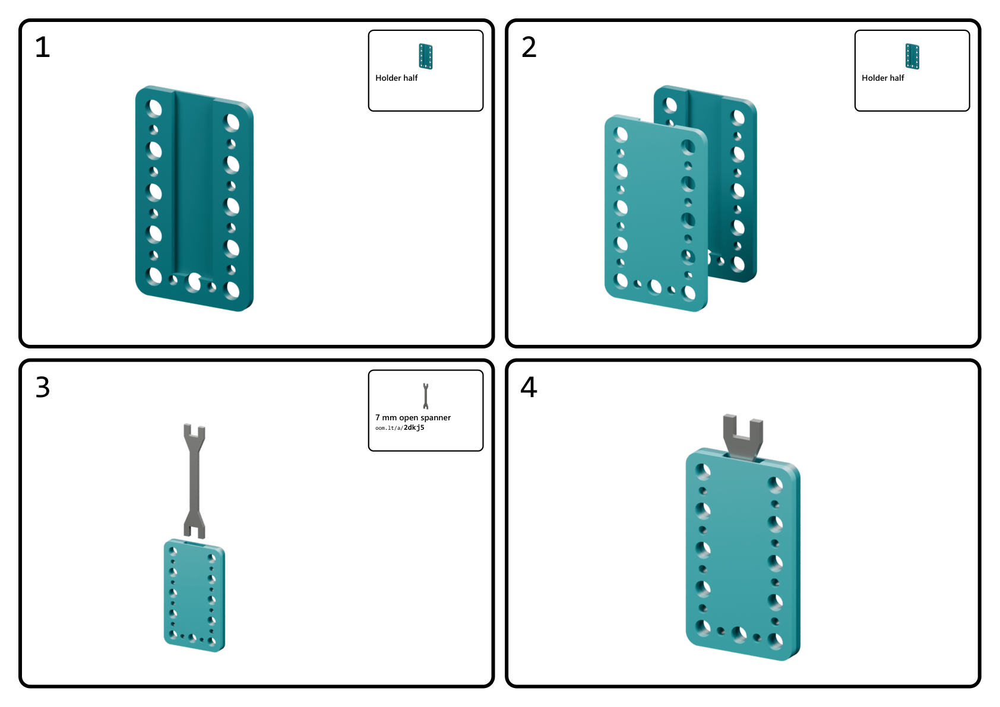

Generic 7 mm open-end spanner using the FACOM 34.7 as a dimensional reference. Length, maximum head width and thickness follow the catalogue. The square-on jaws and shank are simplified, and the workshop specimen has not been measured. The digital model was checked against the printed holder. Physical fit remains unverified. [OOMP tool record](https://github.com/oomlout/oomp_tool_version_5/tree/main/parts/tool_wrench_m7)

### 8 mm spanner

Print two copies of the holder STL. The dark teal half sits against the wall and the light teal half faces the room.

1. Orient the rear half as it sits on the wall, with the pocket facing you and the opening at the top. [View step 1](parts/oobb_part_holder_tool_spanner_m8_1_place_3x5x7d5/assembly/render/raw/step_01.png)
2. Face the front half toward the rear pocket. Align the mounting holes and both top openings. [View step 2](parts/oobb_part_holder_tool_spanner_m8_1_place_3x5x7d5/assembly/render/raw/step_02.png)
3. Bring the halves together until their rims meet. Point the open jaws down and centre them over the pocket. [View step 3](parts/oobb_part_holder_tool_spanner_m8_1_place_3x5x7d5/assembly/render/raw/step_03.png)
4. Lower the tool through the top opening. The open head rests at the pocket floor and the ring end remains accessible above the holder. [View step 4](parts/oobb_part_holder_tool_spanner_m8_1_place_3x5x7d5/assembly/render/raw/step_04.png)

Illustrated assembly steps

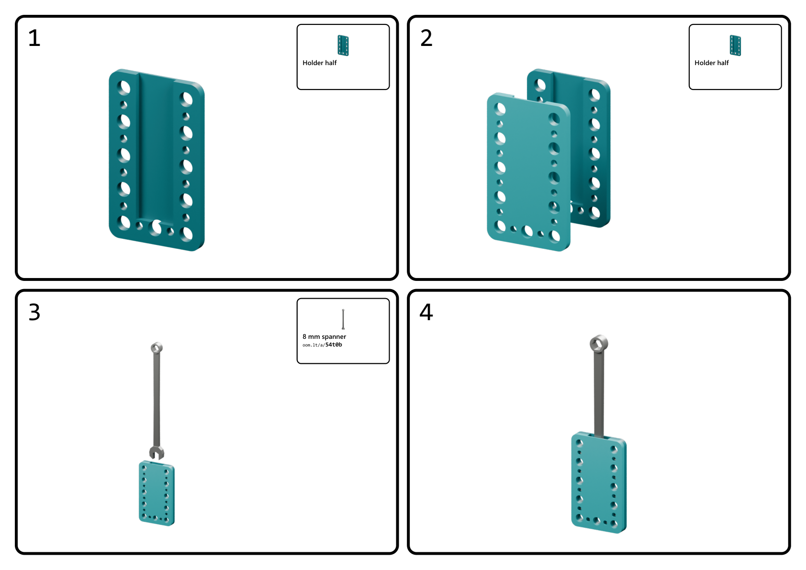

Generic 8 mm combination spanner using Stahlwille OPEN BOX 14 article 40100808 as a dimensional reference. Length and both head widths and thicknesses follow the catalogue. The straight body, head outlines and ring offset are simplified. The workshop specimen has not been measured. The digital model was checked against the printed holder. Physical fit remains unverified. [OOMP tool record](https://github.com/oomlout/oomp_tool_version_5/tree/main/parts/tool_wrench_m8)

### Stanley 5 m tape measure

Print two copies of the holder STL. The dark teal half sits against the wall and the light teal half faces the room.

1. Orient the rear half as it sits on the wall, with the pocket facing you and the opening at the top. [View step 1](parts/oobb_part_holder_tool_tape_measure_stanley_1_30_696_1_place_7x3x44/assembly/render/raw/step_01.png)
2. Face the front half toward the rear pocket. Align the mounting holes and both top openings. [View step 2](parts/oobb_part_holder_tool_tape_measure_stanley_1_30_696_1_place_7x3x44/assembly/render/raw/step_02.png)
3. Bring the halves together until their rims meet. Retract the tape and lower the case into the wide opening with the dark face forward. [View step 3](parts/oobb_part_holder_tool_tape_measure_stanley_1_30_696_1_place_7x3x44/assembly/render/raw/step_03.png)
4. Lower the tool through the top opening. The lower case rests on the pocket floor and the upper case remains accessible. [View step 4](parts/oobb_part_holder_tool_tape_measure_stanley_1_30_696_1_place_7x3x44/assembly/render/raw/step_04.png)

Illustrated assembly steps

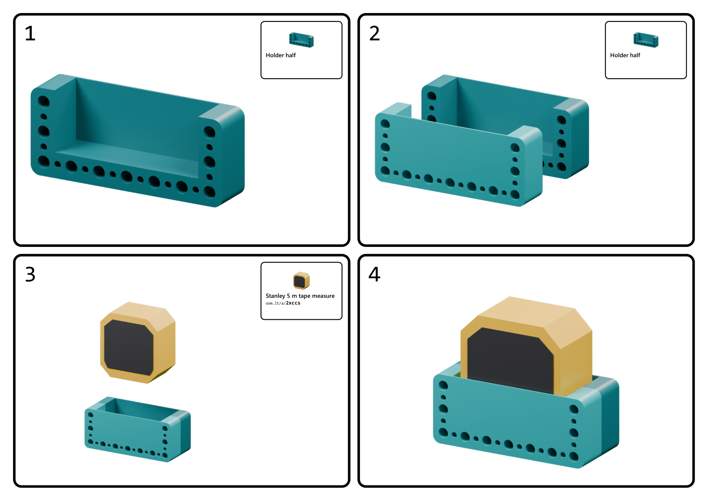

Retracted Stanley Tylon 1-30-696, modelled with a 69 × 72 × 40 mm case from a distributor listing. The outline and coloured face follow the manufacturer photograph. The lock, hook and belt clip are simplified or omitted; dimensions and physical fit require confirmation on the actual tool. The digital model was checked against the printed holder. Physical fit remains unverified. [OOMP tool record](https://github.com/oomlout/oomp_tool_version_5/tree/main/parts/tool_measure_tape_measure_5000_mm_length_stanley_1_30_696)

### 80 mm round timer

Print two copies of the holder STL. The dark teal half sits against the wall and the light teal half faces the room.

1. Orient the rear half as it sits on the wall, with the pocket facing you and the opening at the top. [View step 1](parts/oobb_part_holder_tool_timer_round_80mm_1_place_7x3x34/assembly/render/raw/step_01.png)
2. Face the front half toward the rear pocket. Align the mounting holes and both top openings. [View step 2](parts/oobb_part_holder_tool_timer_round_80mm_1_place_7x3x34/assembly/render/raw/step_02.png)
3. Bring the halves together until their rims meet. Hold the round timer with its face towards the room and align it above the curved pocket. [View step 3](parts/oobb_part_holder_tool_timer_round_80mm_1_place_7x3x34/assembly/render/raw/step_03.png)
4. Lower the tool through the top opening. Lower the timer until its rim rests on the curved pocket floor. [View step 4](parts/oobb_part_holder_tool_timer_round_80mm_1_place_7x3x34/assembly/render/raw/step_04.png)

Illustrated assembly steps

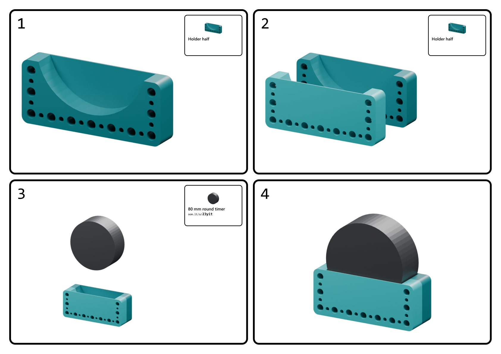

External body envelope from the OOMP timer record. The holder has clearance around both faces and the rim. The digital model was checked against the printed holder. Physical fit remains unverified. [OOMP tool record](https://github.com/oomlout/oomp_tool_version_5/tree/main/parts/tool_timer_80_mm_diameter_30_mm_depth_black)

### Red wire strippers

Print two copies of the holder STL. The dark teal half sits against the wall and the light teal half faces the room.

1. Orient the rear half as it sits on the wall, with the pocket facing you and the opening at the top. [View step 1](parts/oobb_part_holder_tool_wire_strippers_generic_120mm_1_place_5x5x13/assembly/render/raw/step_01.png)
2. Face the front half toward the rear pocket. Align the mounting holes and both top openings. [View step 2](parts/oobb_part_holder_tool_wire_strippers_generic_120mm_1_place_5x5x13/assembly/render/raw/step_02.png)
3. Bring the halves together until their rims meet. Point the jaws down into the opening with the adjustment hardware facing the room. [View step 3](parts/oobb_part_holder_tool_wire_strippers_generic_120mm_1_place_5x5x13/assembly/render/raw/step_03.png)
4. Lower the tool through the top opening. The jaws seat inside the two-piece pocket and the spread grips extend past the wide opening. [View step 4](parts/oobb_part_holder_tool_wire_strippers_generic_120mm_1_place_5x5x13/assembly/render/raw/step_04.png)

Illustrated assembly steps

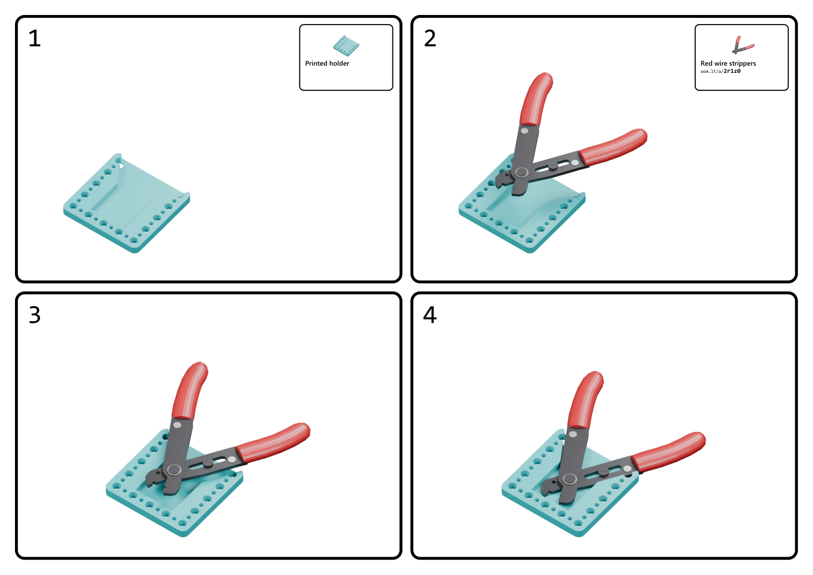

Open-pose photo trace scaled to the candidate Anvil AV-LDWS catalogue length of 130 mm. The 120 mm OOMP label is retained. Thickness is estimated. The digital model was checked against the printed holder. Physical fit remains unverified. [OOMP tool record](https://github.com/oomlout/oomp_tool_version_5/tree/main/parts/tool_wire_strippers_120_mm_length_red)
<!-- oobb-presentation:end -->
