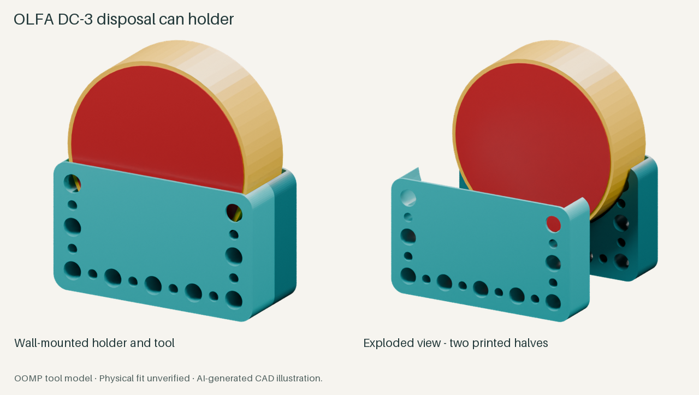
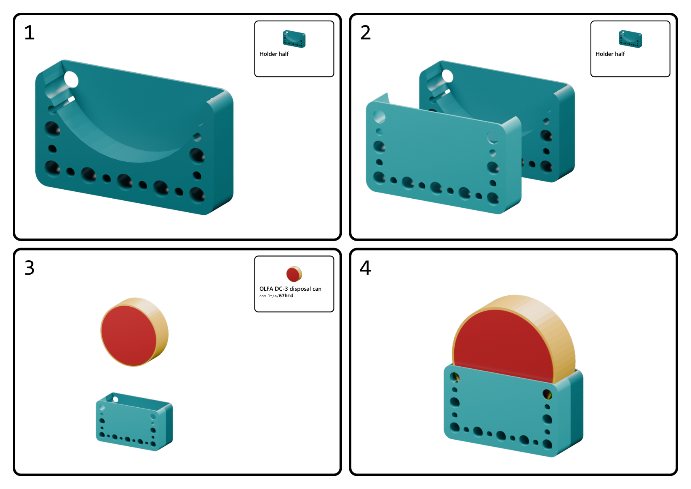

<!-- oobb-presentation:start -->
# OLFA DC-3 blade disposal can

AI-generated CAD images and instructions. Errors possible.

## Summary

OOBB blade disposal holder · 1 place.

This is an entirely AI-generated coding project. The generated outputs are included and usually work. The project is published so others can modify and regenerate the designs with their own AI tools.



## Details

| Grid (width × height) | Assembled thickness | Thickness per printed piece |
| --- | --- | --- |
| 5 × 3 | 29.5 mm | 14.75 mm |

The grid pitch is 15 mm. The dashed line on the plan locates the cross section. [Section drawing](../../../../../../../../parts/oobb_part_holder_tool_blade_disposal_olfa_dc3_1_place_5x3x29d5/working.svg)

OOMP ID `oobb_part_holder_tool_blade_disposal_olfa_dc3_1_place_5x3x29d5`

[Part folder](../../../../../../../../parts/oobb_part_holder_tool_blade_disposal_olfa_dc3_1_place_5x3x29d5/) · [OOBB navigation](../) · [Source design](https://github.com/oomlout/oomlout_oobb_version_4/blob/41f5386997faef4473c959dfb8c929864d7bf697/oobb_make_sets.py#L626)

<details><summary>Complete part metadata</summary>

```yaml
assembly_details:
  alignment: Keep the disposal can closed and lower its round body into the pocket.
  check: The can rests against the bottom of the curved pocket with the red face towards
    the room.
  label: OLFA DC-3 disposal can
  layout: 1_place
  model_kind: olfa_can
  rotation_deg:
  - 0
  - 0
  - 0
  steps:
  - action: Orient the rear half as it sits on the wall, with the pocket facing you
      and the opening at the top.
    add:
    - holder
    key: step_01
    upper_lift_mm: 0
    withdraw_mm: 0
  - action: Face the front half toward the rear pocket. Align the mounting holes and
      both top openings.
    add:
    - holder
    key: step_02
    upper_lift_mm: 36
    withdraw_mm: 0
  - action: Bring the halves together until their rims meet. Keep the disposal can
      closed and lower its round body into the pocket.
    add:
    - tool
    key: step_03
    upper_lift_mm: 0
    withdraw_mm: 70
  - action: Lower the tool through the top opening. The can rests against the bottom
      of the curved pocket with the red face towards the room.
    add: []
    key: step_04
    upper_lift_mm: 0
    withdraw_mm: 0
  style:
    border: '000000'
    border_radius_mm: 3
    border_width_pt: 3
    columns: 2
    component_border_width_pt: 1.1
    font_body_pt: 7
    font_code_pt: 6.4
    font_url_prefix_pt: 4.8
    gutter_mm: 4
    margin_mm: 6
    page_mm:
    - 297
    - 210
    quantity_pt: 5.8
    quantity_shift_mm: 1
    rows: 2
    thumbnail_height_mm: 8.5
  tool_id: tool_knife_utility_blade_disposal_can_olfa_dc_3
  translation_mm:
  - 0
  - 27.5
  - 1.75
body_style: vertical_v4
construction:
  mirror_second_print_x: false
  mode: repeat_half
  pocket_on_underside: false
depth: 29.5
height: 3
layout: 1_place
model: olfa_dc3
oobb_details:
  body_style: vertical_v4
  corner_radius_mm: 5
  count: 1
  depth: 29.5
  edge_reduction_mm: 1
  height: 3
  layered: false
  offset_mm:
  - 0
  - 0
  - 0
  oobb_type: holder_tool
  pitch_mm: 15
  profile:
  - h: 27.5
    pos:
    - 0
    - 27.5
    - 0
    r: 34.5
    rot:
    - 0
    - 0
    - 0
    shape: cylinder
  run_scad: true
  run_solidcraft: false
  spacing_mm: 15
  width: 5
oobb_type: holder_tool
profile: tool_knife_utility_blade_disposal_can_olfa_dc_3
show_underside: false
source_id: tool_knife_utility_blade_disposal_can_olfa_dc_3
svg_details:
  cross_section_y_fraction: 0.82
  near_face_fraction: 0.08
  show_underside: false
  svg_name: holder_sections
taxonomy_1: oobb
taxonomy_10: ''
taxonomy_11: ''
taxonomy_12: ''
taxonomy_13: ''
taxonomy_14: ''
taxonomy_15: ''
taxonomy_2: part
taxonomy_3: holder_tool
taxonomy_4: blade_disposal
taxonomy_5: olfa_dc3
taxonomy_6: 1_place
taxonomy_7: 5x3x29d5
taxonomy_8: ''
taxonomy_9: ''
title: OLFA DC-3 blade disposal can
tool_type: blade_disposal
width: 5
id: oobb_part_holder_tool_blade_disposal_olfa_dc3_1_place_5x3x29d5
directory: parts/oobb_part_holder_tool_blade_disposal_olfa_dc3_1_place_5x3x29d5
md5: bb6a648558439aaac2bc840735685ed6
md5_6: bb6a64
md5_6_alpha: 7b97o
```

</details>

## Parts

Use the print mesh in the part folder. Tool and mounting hardware are supplied separately.

## Assembly

Print two copies of the holder STL. The dark teal half sits against the wall and the light teal half faces the room.

1. Orient the rear half as it sits on the wall, with the pocket facing you and the opening at the top. [View step 1](../../../../../../../../parts/oobb_part_holder_tool_blade_disposal_olfa_dc3_1_place_5x3x29d5/assembly/render/raw/step_01.png)
2. Face the front half toward the rear pocket. Align the mounting holes and both top openings. [View step 2](../../../../../../../../parts/oobb_part_holder_tool_blade_disposal_olfa_dc3_1_place_5x3x29d5/assembly/render/raw/step_02.png)
3. Bring the halves together until their rims meet. Keep the disposal can closed and lower its round body into the pocket. [View step 3](../../../../../../../../parts/oobb_part_holder_tool_blade_disposal_olfa_dc3_1_place_5x3x29d5/assembly/render/raw/step_03.png)
4. Lower the tool through the top opening. The can rests against the bottom of the curved pocket with the red face towards the room. [View step 4](../../../../../../../../parts/oobb_part_holder_tool_blade_disposal_olfa_dc3_1_place_5x3x29d5/assembly/render/raw/step_04.png)

<details><summary>Illustrated assembly steps</summary>



</details>

Round yellow body and red face approximation using OLFA's overall length and thickness and product photograph. The sliding door, lettering and rim details are omitted. The digital model was checked against the printed holder. Physical fit remains unverified. [OOMP tool record](https://github.com/oomlout/oomp_tool_version_5/tree/main/parts/tool_knife_utility_blade_disposal_can_olfa_dc_3)

[Offline HTML viewer](../../../../../../../../parts/oobb_part_holder_tool_blade_disposal_olfa_dc3_1_place_5x3x29d5/assembly/assembly_instructions.html) · [Print booklet (PDF)](../../../../../../../../parts/oobb_part_holder_tool_blade_disposal_olfa_dc3_1_place_5x3x29d5/assembly/assembly_instructions.pdf)
<!-- oobb-presentation:end -->
