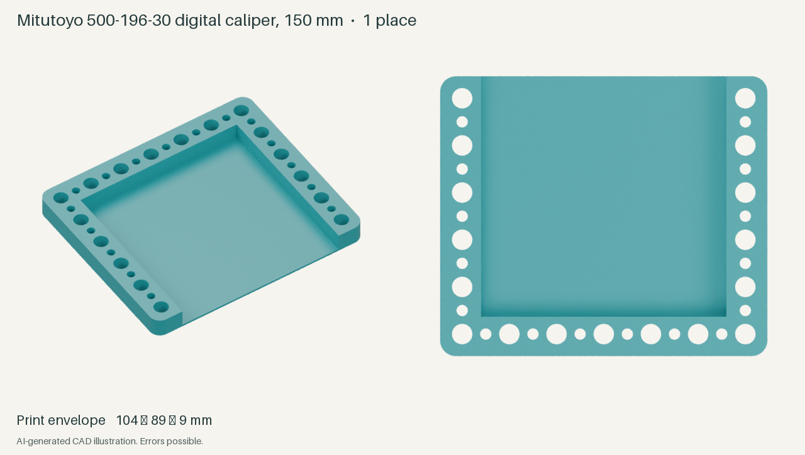
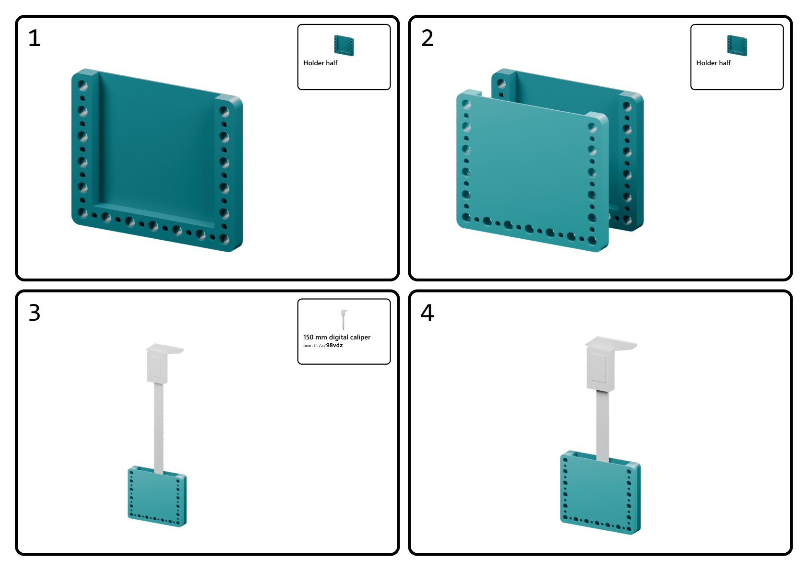

<!-- oobb-presentation:start -->
# Mitutoyo 500-196-30 digital caliper, 150 mm

AI-generated CAD images and instructions. Errors possible.

## Summary

OOBB caliper holder · 1 place.

This is an entirely AI-generated coding project. The generated outputs are included and usually work. The project is published so others can modify and regenerate the designs with their own AI tools.



## Details

| Grid (width × height) | Assembled thickness | Thickness per printed piece |
| --- | --- | --- |
| 7 × 6 | 18 mm | 9 mm |

The grid pitch is 15 mm. The dashed line on the plan locates the cross section. [Section drawing](../../../../../../../../parts/oobb_part_holder_tool_caliper_mitutoyo_500_196_30_1_place_7x6x18/working.svg)

OOMP ID `oobb_part_holder_tool_caliper_mitutoyo_500_196_30_1_place_7x6x18`

[Part folder](../../../../../../../../parts/oobb_part_holder_tool_caliper_mitutoyo_500_196_30_1_place_7x6x18/) · [OOBB navigation](../) · [Source design](https://github.com/oomlout/oomlout_oobb_version_4/blob/41f5386997faef4473c959dfb8c929864d7bf697/oobb_make_sets.py#L626)

<details><summary>Complete part metadata</summary>

```yaml
assembly_details:
  alignment: Close the caliper jaws and lower the wide jaw end into the opening, with
    the display facing forward.
  check: The wide jaw end rests at the pocket floor and the beam projects above the
    holder.
  label: 150 mm digital caliper
  layout: 1_place
  model_kind: caliper
  rotation_deg:
  - 0
  - 0
  - 0
  steps:
  - action: Orient the rear half as it sits on the wall, with the pocket facing you
      and the opening at the top.
    add:
    - holder
    key: step_01
    upper_lift_mm: 0
    withdraw_mm: 0
  - action: Face the front half toward the rear pocket. Align the mounting holes and
      both top openings.
    add:
    - holder
    key: step_02
    upper_lift_mm: 36
    withdraw_mm: 0
  - action: Bring the halves together until their rims meet. Close the caliper jaws
      and lower the wide jaw end into the opening, with the display facing forward.
    add:
    - tool
    key: step_03
    upper_lift_mm: 0
    withdraw_mm: 70
  - action: Lower the tool through the top opening. The wide jaw end rests at the
      pocket floor and the beam projects above the holder.
    add: []
    key: step_04
    upper_lift_mm: 0
    withdraw_mm: 0
  style:
    border: '000000'
    border_radius_mm: 3
    border_width_pt: 3
    columns: 2
    component_border_width_pt: 1.1
    font_body_pt: 7
    font_code_pt: 6.4
    font_url_prefix_pt: 4.8
    gutter_mm: 4
    margin_mm: 6
    page_mm:
    - 297
    - 210
    quantity_pt: 5.8
    quantity_shift_mm: 1
    rows: 2
    thumbnail_height_mm: 8.5
  tool_id: tool_measure_caliper_digital_150_mm_length_mitutoyo_mit500_196_30
  translation_mm:
  - 9.5
  - -32
  - 1
body_style: vertical_v4
construction:
  mirror_second_print_x: false
  mode: repeat_half
  pocket_on_underside: false
depth: 18
height: 6
layout: 1_place
model: mitutoyo_500_196_30
oobb_details:
  body_style: vertical_v4
  corner_radius_mm: 5
  count: 1
  depth: 18
  edge_reduction_mm: 1
  height: 6
  layered: false
  offset_mm:
  - 0
  - 0
  - 0
  oobb_type: holder_tool
  pitch_mm: 15
  profile:
  - h: 16
    points:
    - - -39
      - 0
    - - -39
      - 78
    - - 39
      - 78
    - - 39
      - 0
    pos:
    - 0
    - -32
    - 0
    rot:
    - 0
    - 0
    - 0
    shape: polygon
  run_scad: true
  run_solidcraft: false
  spacing_mm: 15
  width: 7
oobb_type: holder_tool
profile: tool_measure_caliper_digital_150_mm_length_mitutoyo_mit500_196_30
show_underside: false
source_id: tool_measure_caliper_digital_150_mm_length_mitutoyo_mit500_196_30
svg_details:
  cross_section_y_fraction: 0.82
  near_face_fraction: 0.08
  show_underside: false
  svg_name: holder_sections
taxonomy_1: oobb
taxonomy_10: ''
taxonomy_11: ''
taxonomy_12: ''
taxonomy_13: ''
taxonomy_14: ''
taxonomy_15: ''
taxonomy_2: part
taxonomy_3: holder_tool
taxonomy_4: caliper
taxonomy_5: mitutoyo_500_196_30
taxonomy_6: 1_place
taxonomy_7: 7x6x18
taxonomy_8: ''
taxonomy_9: ''
title: Mitutoyo 500-196-30 digital caliper, 150 mm
tool_type: caliper
width: 7
id: oobb_part_holder_tool_caliper_mitutoyo_500_196_30_1_place_7x6x18
directory: parts/oobb_part_holder_tool_caliper_mitutoyo_500_196_30_1_place_7x6x18
md5: d4785241cc09f79d67b29c3f990ffc08
md5_6: d47852
md5_6_alpha: 8ag5u
```

</details>

## Parts

Use the print mesh in the part folder. Tool and mounting hardware are supplied separately.

## Assembly

Print two copies of the holder STL. The dark teal half sits against the wall and the light teal half faces the room.

1. Orient the rear half as it sits on the wall, with the pocket facing you and the opening at the top. [View step 1](../../../../../../../../parts/oobb_part_holder_tool_caliper_mitutoyo_500_196_30_1_place_7x6x18/assembly/render/raw/step_01.png)
2. Face the front half toward the rear pocket. Align the mounting holes and both top openings. [View step 2](../../../../../../../../parts/oobb_part_holder_tool_caliper_mitutoyo_500_196_30_1_place_7x6x18/assembly/render/raw/step_02.png)
3. Bring the halves together until their rims meet. Close the caliper jaws and lower the wide jaw end into the opening, with the display facing forward. [View step 3](../../../../../../../../parts/oobb_part_holder_tool_caliper_mitutoyo_500_196_30_1_place_7x6x18/assembly/render/raw/step_03.png)
4. Lower the tool through the top opening. The wide jaw end rests at the pocket floor and the beam projects above the holder. [View step 4](../../../../../../../../parts/oobb_part_holder_tool_caliper_mitutoyo_500_196_30_1_place_7x6x18/assembly/render/raw/step_04.png)

<details><summary>Illustrated assembly steps</summary>



</details>

Closed caliper. Overall length, beam width and outside jaw length follow the Mitutoyo dimensional drawing. Slider, jaws and display are simplified for identification. The digital model was checked against the printed holder. Physical fit remains unverified. [OOMP tool record](https://github.com/oomlout/oomp_tool_version_5/tree/main/parts/tool_measure_caliper_digital_150_mm_length_mitutoyo_mit500_196_30)

[Open assembly viewer](https://raw.githack.com/oomlout/oomlout_oobb_part_holder_tool_version_5/main/parts/oobb_part_holder_tool_caliper_mitutoyo_500_196_30_1_place_7x6x18/assembly/assembly_instructions.html) · [Print booklet (PDF)](../../../../../../../../parts/oobb_part_holder_tool_caliper_mitutoyo_500_196_30_1_place_7x6x18/assembly/assembly_instructions.pdf)
<!-- oobb-presentation:end -->
