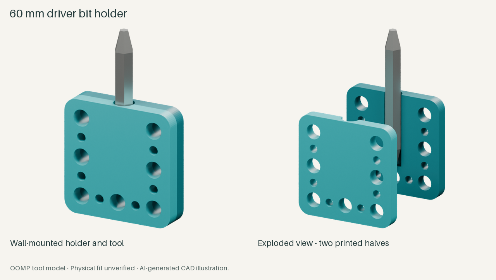
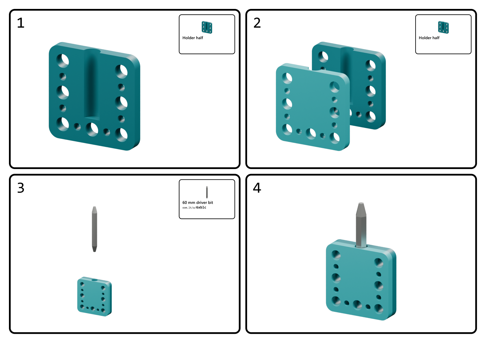

<!-- oobb-presentation:start -->
# Driver bit, 60 mm profile

AI-generated CAD images and instructions. Errors possible.

## Summary

OOBB driver bit holder · 1 place.

This is an entirely AI-generated coding project. The generated outputs are included and usually work. The project is published so others can modify and regenerate the designs with their own AI tools.



## Details

| Grid (width × height) | Assembled thickness | Thickness per printed piece |
| --- | --- | --- |
| 3 × 3 | 10 mm | 5 mm |

The grid pitch is 15 mm. The dashed line on the plan locates the cross section. [Section drawing](../../../../../../../../parts/oobb_part_holder_tool_driver_bit_driver_bit_60mm_1_place_3x3x10/working.svg)

OOMP ID `oobb_part_holder_tool_driver_bit_driver_bit_60mm_1_place_3x3x10`

[Part folder](../../../../../../../../parts/oobb_part_holder_tool_driver_bit_driver_bit_60mm_1_place_3x3x10/) · [OOBB navigation](../) · [Source design](https://github.com/oomlout/oomlout_oobb_version_4/blob/41f5386997faef4473c959dfb8c929864d7bf697/oobb_make_sets.py#L626)

<details><summary>Complete part metadata</summary>

```yaml
assembly_details:
  alignment: Hold the bit vertically above the round pocket.
  check: The lower tip rests at the bottom and the upper tip remains accessible.
  label: 60 mm driver bit
  layout: 1_place
  model_kind: double_ended_bit
  rotation_deg:
  - 0
  - 0
  - 0
  steps:
  - action: Orient the rear half as it sits on the wall, with the pocket facing you
      and the opening at the top.
    add:
    - holder
    key: step_01
    upper_lift_mm: 0
    withdraw_mm: 0
  - action: Face the front half toward the rear pocket. Align the mounting holes and
      both top openings.
    add:
    - holder
    key: step_02
    upper_lift_mm: 36
    withdraw_mm: 0
  - action: Bring the halves together until their rims meet. Hold the bit vertically
      above the round pocket.
    add:
    - tool
    key: step_03
    upper_lift_mm: 0
    withdraw_mm: 70
  - action: Lower the tool through the top opening. The lower tip rests at the bottom
      and the upper tip remains accessible.
    add: []
    key: step_04
    upper_lift_mm: 0
    withdraw_mm: 0
  style:
    border: '000000'
    border_radius_mm: 3
    border_width_pt: 3
    columns: 2
    component_border_width_pt: 1.1
    font_body_pt: 7
    font_code_pt: 6.4
    font_url_prefix_pt: 4.8
    gutter_mm: 4
    margin_mm: 6
    page_mm:
    - 297
    - 210
    quantity_pt: 5.8
    quantity_shift_mm: 1
    rows: 2
    thumbnail_height_mm: 8.5
  tool_id: tool_screwdriver_bit_60_mm_profile
  translation_mm:
  - 0
  - -10
  - 4
body_style: vertical_v4
construction:
  mirror_second_print_x: false
  mode: repeat_half
  pocket_on_underside: false
depth: 10
height: 3
layout: 1_place
model: driver_bit_60mm
oobb_details:
  body_style: vertical_v4
  corner_radius_mm: 5
  count: 1
  depth: 10
  edge_reduction_mm: 1
  height: 3
  layered: false
  offset_mm:
  - 0
  - 0
  - 0
  oobb_type: holder_tool
  pitch_mm: 15
  profile:
  - h: 60
    pos:
    - 0
    - -10
    - 4
    r: 4
    rot:
    - -90
    - 0
    - 0
    shape: cylinder
  run_scad: true
  run_solidcraft: false
  spacing_mm: 15
  width: 3
oobb_type: holder_tool
profile: tool_screwdriver_driver_bit
show_underside: false
source_id: tool_screwdriver_driver_bit
svg_details:
  cross_section_y_fraction: 0.82
  near_face_fraction: 0.08
  show_underside: false
  svg_name: holder_sections
taxonomy_1: oobb
taxonomy_10: ''
taxonomy_11: ''
taxonomy_12: ''
taxonomy_13: ''
taxonomy_14: ''
taxonomy_15: ''
taxonomy_2: part
taxonomy_3: holder_tool
taxonomy_4: driver_bit
taxonomy_5: driver_bit_60mm
taxonomy_6: 1_place
taxonomy_7: 3x3x10
taxonomy_8: ''
taxonomy_9: ''
title: Driver bit, 60 mm profile
tool_type: driver_bit
width: 3
id: oobb_part_holder_tool_driver_bit_driver_bit_60mm_1_place_3x3x10
directory: parts/oobb_part_holder_tool_driver_bit_driver_bit_60mm_1_place_3x3x10
md5: 9140e4a97644d977ebe35fb3a5192358
md5_6: 9140e4
md5_6_alpha: 5o15w
```

</details>

## Parts

Use the print mesh in the part folder. Tool and mounting hardware are supplied separately.

## Assembly

Print two copies of the holder STL. The dark teal half sits against the wall and the light teal half faces the room.

1. Orient the rear half as it sits on the wall, with the pocket facing you and the opening at the top. [View step 1](../../../../../../../../parts/oobb_part_holder_tool_driver_bit_driver_bit_60mm_1_place_3x3x10/assembly/render/raw/step_01.png)
2. Face the front half toward the rear pocket. Align the mounting holes and both top openings. [View step 2](../../../../../../../../parts/oobb_part_holder_tool_driver_bit_driver_bit_60mm_1_place_3x3x10/assembly/render/raw/step_02.png)
3. Bring the halves together until their rims meet. Hold the bit vertically above the round pocket. [View step 3](../../../../../../../../parts/oobb_part_holder_tool_driver_bit_driver_bit_60mm_1_place_3x3x10/assembly/render/raw/step_03.png)
4. Lower the tool through the top opening. The lower tip rests at the bottom and the upper tip remains accessible. [View step 4](../../../../../../../../parts/oobb_part_holder_tool_driver_bit_driver_bit_60mm_1_place_3x3x10/assembly/render/raw/step_04.png)

<details><summary>Illustrated assembly steps</summary>



</details>

Representative 60 mm quarter-inch double-ended PH2/PZ2 bit. Length and drive size follow the HiKOKI product. The tapered hexagonal tips are simplified and their length and end diameter are estimates. The digital model was checked against the printed holder. Physical fit remains unverified. [OOMP tool record](https://github.com/oomlout/oomp_tool_version_5/tree/main/parts/tool_screwdriver_bit_60_mm_profile)

[Offline HTML viewer](../../../../../../../../parts/oobb_part_holder_tool_driver_bit_driver_bit_60mm_1_place_3x3x10/assembly/assembly_instructions.html) · [Print booklet (PDF)](../../../../../../../../parts/oobb_part_holder_tool_driver_bit_driver_bit_60mm_1_place_3x3x10/assembly/assembly_instructions.pdf)
<!-- oobb-presentation:end -->
