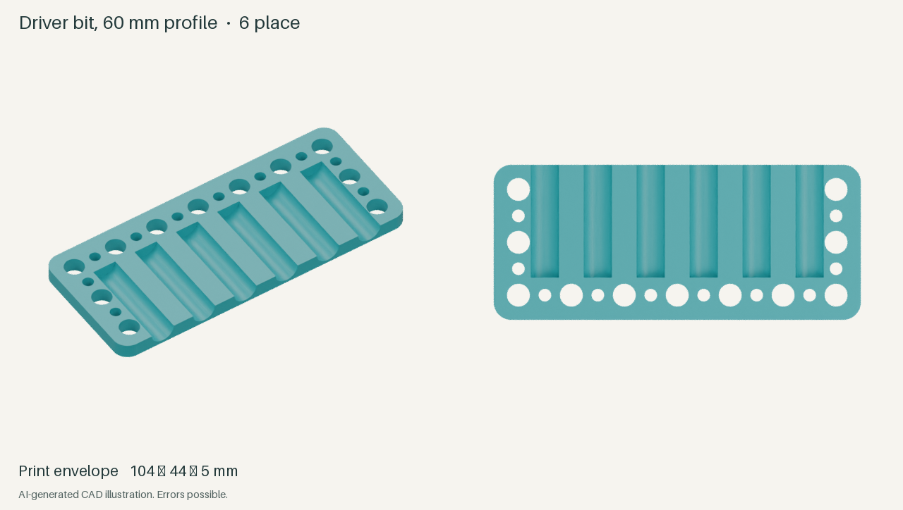

<!-- oobb-presentation:start -->
# Driver bit, 60 mm profile

AI-generated CAD images and instructions. Errors possible.

## Summary

OOBB driver bit holder · 6 place.

This is an entirely AI-generated coding project. The generated outputs are included and usually work. The project is published so others can modify and regenerate the designs with their own AI tools.



## Details

| Grid (width × height) | Design depth | Printed thickness |
| --- | --- | --- |
| 7 × 3 | 10 mm | 5 mm |

The grid pitch is 15 mm. The dashed line on the plan locates the cross section. [Section drawing](../../../../../../../../parts/oobb_part_holder_tool_driver_bit_driver_bit_60mm_6_place_7x3x10/working.svg)

OOMP ID `oobb_part_holder_tool_driver_bit_driver_bit_60mm_6_place_7x3x10`

[Part folder](../../../../../../../../parts/oobb_part_holder_tool_driver_bit_driver_bit_60mm_6_place_7x3x10/) · [OOBB navigation](../) · [Source design](https://github.com/oomlout/oomlout_oobb_version_4/blob/41f5386997faef4473c959dfb8c929864d7bf697/oobb_make_sets.py#L626)

<details><summary>Complete part metadata</summary>

```yaml
body_style: vertical_v4
count: 6
depth: 10
height: 3
layout: 6_place
model: driver_bit_60mm
oobb_details:
  body_style: vertical_v4
  corner_radius_mm: 5
  count: 6
  depth: 10
  edge_reduction_mm: 1
  height: 3
  layered: false
  offset_mm:
  - 0
  - 0
  - 0
  oobb_type: holder_tool
  pitch_mm: 15
  profile:
  - h: 60
    pos:
    - 0
    - -10
    - 4
    r: 4
    rot:
    - -90
    - 0
    - 0
    shape: cylinder
  run_scad: true
  run_solidcraft: false
  spacing_mm: 15
  width: 7
oobb_type: holder_tool
profile: tool_screwdriver_driver_bit
show_underside: false
source_id: tool_screwdriver_driver_bit_x6
spacing_mm: 15
svg_details:
  cross_section_y_fraction: 0.82
  near_face_fraction: 0.08
  show_underside: false
  svg_name: holder_sections
taxonomy_1: oobb
taxonomy_10: ''
taxonomy_11: ''
taxonomy_12: ''
taxonomy_13: ''
taxonomy_14: ''
taxonomy_15: ''
taxonomy_2: part
taxonomy_3: holder_tool
taxonomy_4: driver_bit
taxonomy_5: driver_bit_60mm
taxonomy_6: 6_place
taxonomy_7: 7x3x10
taxonomy_8: ''
taxonomy_9: ''
title: Driver bit, 60 mm profile
tool_type: driver_bit
width: 7
id: oobb_part_holder_tool_driver_bit_driver_bit_60mm_6_place_7x3x10
directory: parts/oobb_part_holder_tool_driver_bit_driver_bit_60mm_6_place_7x3x10
md5: f5ee0ee67c449a12c8273964fe8a85e5
md5_6: f5ee0e
md5_6_alpha: 9lg5q
```

</details>

## Parts

Use the print mesh in the part folder. Tool and mounting hardware are supplied separately.

## Assembly

Identify the tool pockets in the section drawing before choosing the mounting orientation. [Illustrated guides for the four photo-modelled tools](../../../../../../../../README.md#assembly)
<!-- oobb-presentation:end -->
