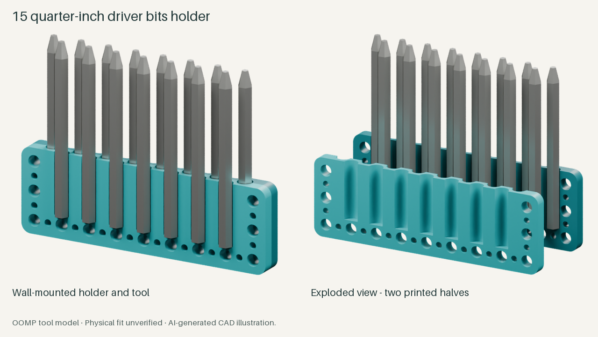
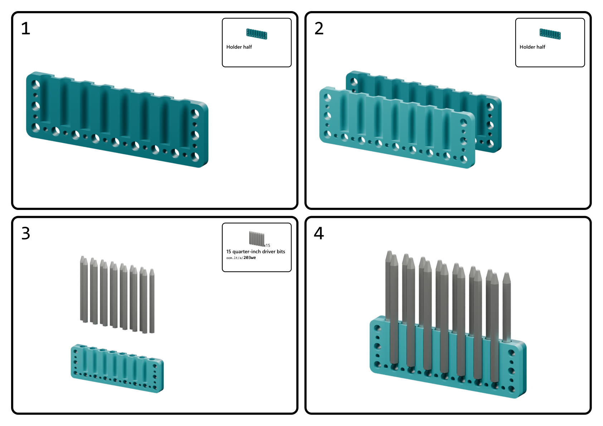

<!-- oobb-presentation:start -->
# Quarter-inch drive bit

AI-generated CAD images and instructions. Errors possible.

## Summary

OOBB driver bit holder · 8 plus 7 layered.

This is an entirely AI-generated coding project. The generated outputs are included and usually work. The project is published so others can modify and regenerate the designs with their own AI tools.



## Details

| Grid (width × height) | Assembled thickness | Thickness per printed piece |
| --- | --- | --- |
| 9 × 3 | 12 mm | 6 mm |

The grid pitch is 15 mm. The dashed line on the plan locates the cross section. [Section drawing](../../../../../../../../parts/oobb_part_holder_tool_driver_bit_quarter_inch_8_plus_7_layered_9x3x12/working.svg)

OOMP ID `oobb_part_holder_tool_driver_bit_quarter_inch_8_plus_7_layered_9x3x12`

[Part folder](../../../../../../../../parts/oobb_part_holder_tool_driver_bit_quarter_inch_8_plus_7_layered_9x3x12/) · [OOBB navigation](../) · [Source design](https://github.com/oomlout/oomlout_oobb_part_tool_holder_vertical/tree/93a962a09e0c275c3cfa62187182ac3203bde1b2/parts/oobb_part_tool_holder_vertical_9_width_3_height_12_mm_depth_tool_screwdriver_bit_quarter_inch_drive_tool_8_multiple_layered_extra)

<details><summary>Complete part metadata</summary>

```yaml
assembly_details:
  alignment: Place eight bits in the centre row and seven in the staggered front row.
  check: Seat the shanks at the pocket floors. The staggered row lies in the front-face
    grooves.
  instance_offsets_mm:
  - - -52.5
    - 0
    - 0
  - - -37.5
    - 0
    - 0
  - - -22.5
    - 0
    - 0
  - - -7.5
    - 0
    - 0
  - - 7.5
    - 0
    - 0
  - - 22.5
    - 0
    - 0
  - - 37.5
    - 0
    - 0
  - - 52.5
    - 0
    - 0
  - - -45
    - 0
    - 6
  - - -30
    - 0
    - 6
  - - -15
    - 0
    - 6
  - - 0
    - 0
    - 6
  - - 15
    - 0
    - 6
  - - 30
    - 0
    - 6
  - - 45
    - 0
    - 6
  label: 15 quarter-inch driver bits
  layout: 8_plus_7_layered
  model_kind: long_driver_bit
  rotation_deg:
  - 0
  - 0
  - 0
  steps:
  - action: Orient the rear half as it sits on the wall, with the pocket facing you
      and the opening at the top.
    add:
    - holder
    key: step_01
    upper_lift_mm: 0
    withdraw_mm: 0
  - action: Face the front half toward the rear pocket. Align the mounting holes and
      both top openings.
    add:
    - holder
    key: step_02
    upper_lift_mm: 36
    withdraw_mm: 0
  - action: Bring the halves together until their rims meet. Place eight bits in the
      centre row and seven in the staggered front row.
    add:
    - tool
    - tool
    - tool
    - tool
    - tool
    - tool
    - tool
    - tool
    - tool
    - tool
    - tool
    - tool
    - tool
    - tool
    - tool
    key: step_03
    upper_lift_mm: 0
    withdraw_mm: 70
  - action: Lower the tools through the top openings. Seat the shanks at the pocket
      floors. The staggered row lies in the front-face grooves.
    add: []
    key: step_04
    upper_lift_mm: 0
    withdraw_mm: 0
  style:
    border: '000000'
    border_radius_mm: 3
    border_width_pt: 3
    columns: 2
    component_border_width_pt: 1.1
    font_body_pt: 7
    font_code_pt: 6.4
    font_url_prefix_pt: 4.8
    gutter_mm: 4
    margin_mm: 6
    page_mm:
    - 297
    - 210
    quantity_pt: 5.8
    quantity_shift_mm: 1
    rows: 2
    thumbnail_height_mm: 8.5
  tool_id: tool_screwdriver_bit_quarter_inch_drive
  translation_mm:
  - 0
  - -10.25
  - 0
body_style: vertical_project
bottom_m6_clearance_mm: 1.5
construction:
  mirror_second_print_x: false
  mode: repeat_half
  pocket_on_underside: true
count: 8
depth: 12
height: 3
layered: true
layout: 8_plus_7_layered
model: quarter_inch
oobb_details:
  body_style: vertical_project
  bottom_m6_clearance_mm: 1.5
  corner_radius_mm: 5
  count: 8
  depth: 12
  edge_reduction_mm: 1
  height: 3
  layered: true
  offset_mm:
  - 0
  - 0
  - 0
  oobb_type: holder_tool
  pitch_mm: 15
  profile:
  - h: 100
    pos:
    - 0
    - 0
    - 0
    r: 4
    rot:
    - -90
    - 0
    - 0
    shape: cylinder
  run_scad: true
  run_solidcraft: false
  spacing_mm: 15
  width: 9
oobb_type: holder_tool
profile: quarter_inch
show_underside: false
source_id: oobb_part_tool_holder_vertical_9_width_3_height_12_mm_depth_tool_screwdriver_bit_quarter_inch_drive_tool_8_multiple_layered_extra
spacing_mm: 15
svg_details:
  cross_section_y_fraction: 0.82
  near_face_fraction: 0.08
  show_underside: false
  svg_name: holder_sections
taxonomy_1: oobb
taxonomy_10: ''
taxonomy_11: ''
taxonomy_12: ''
taxonomy_13: ''
taxonomy_14: ''
taxonomy_15: ''
taxonomy_2: part
taxonomy_3: holder_tool
taxonomy_4: driver_bit
taxonomy_5: quarter_inch
taxonomy_6: 8_plus_7_layered
taxonomy_7: 9x3x12
taxonomy_8: ''
taxonomy_9: ''
title: Quarter-inch drive bit
tool_type: driver_bit
width: 9
id: oobb_part_holder_tool_driver_bit_quarter_inch_8_plus_7_layered_9x3x12
directory: parts/oobb_part_holder_tool_driver_bit_quarter_inch_8_plus_7_layered_9x3x12
md5: 4b2073c7fadc3ff99b85303cc83f7fbb
md5_6: 4b2073
md5_6_alpha: 2xj03
```

</details>

## Parts

Use the print mesh in the part folder. Tool and mounting hardware are supplied separately.

## Assembly

Print two copies of the holder STL. The dark teal half sits against the wall and the light teal half faces the room.

1. Orient the rear half as it sits on the wall, with the pocket facing you and the opening at the top. [View step 1](../../../../../../../../parts/oobb_part_holder_tool_driver_bit_quarter_inch_8_plus_7_layered_9x3x12/assembly/render/raw/step_01.png)
2. Face the front half toward the rear pocket. Align the mounting holes and both top openings. [View step 2](../../../../../../../../parts/oobb_part_holder_tool_driver_bit_quarter_inch_8_plus_7_layered_9x3x12/assembly/render/raw/step_02.png)
3. Bring the halves together until their rims meet. Place eight bits in the centre row and seven in the staggered front row. [View step 3](../../../../../../../../parts/oobb_part_holder_tool_driver_bit_quarter_inch_8_plus_7_layered_9x3x12/assembly/render/raw/step_03.png)
4. Lower the tools through the top openings. Seat the shanks at the pocket floors. The staggered row lies in the front-face grooves. [View step 4](../../../../../../../../parts/oobb_part_holder_tool_driver_bit_quarter_inch_8_plus_7_layered_9x3x12/assembly/render/raw/step_04.png)

<details><summary>Illustrated assembly steps</summary>



</details>

Representative Wera 851/4 Z PH2 bit, 89 mm long with a quarter-inch drive. The tapered tip is simplified and its length and end diameter are estimated. The digital model was checked against the printed holder. Physical fit remains unverified. [OOMP tool record](https://github.com/oomlout/oomp_tool_version_5/tree/main/parts/tool_screwdriver_bit_quarter_inch_drive)

The seven staggered front positions are open-face grooves. Retention of the bits in those grooves has not been physically tested.

[Offline HTML viewer](../../../../../../../../parts/oobb_part_holder_tool_driver_bit_quarter_inch_8_plus_7_layered_9x3x12/assembly/assembly_instructions.html) · [Print booklet (PDF)](../../../../../../../../parts/oobb_part_holder_tool_driver_bit_quarter_inch_8_plus_7_layered_9x3x12/assembly/assembly_instructions.pdf)
<!-- oobb-presentation:end -->
