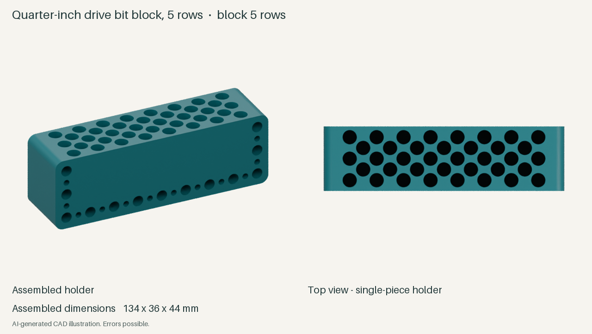

<!-- oobb-presentation:start -->
# Quarter-inch drive bit block, 5 rows

AI-generated CAD images and instructions. Errors possible.

## Summary

OOBB driver bit holder · block 5 rows.

This is an entirely AI-generated coding project. The generated outputs are included and usually work. The project is published so others can modify and regenerate the designs with their own AI tools.



## Details

| Grid (width × height) | Assembled thickness | Thickness per printed piece |
| --- | --- | --- |
| 9 × 3 | 36 mm | 36 mm |

The grid pitch is 15 mm. The dashed line on the plan locates the cross section. [Section drawing](../../../../../../../../parts/oobb_part_holder_tool_driver_bit_quarter_inch_block_5_rows_9x3x36/working.svg)

OOMP ID `oobb_part_holder_tool_driver_bit_quarter_inch_block_5_rows_9x3x36`

[Part folder](../../../../../../../../parts/oobb_part_holder_tool_driver_bit_quarter_inch_block_5_rows_9x3x36/) · [OOBB navigation](../) · [Source design](../../../../../../../../working_oomp_populate.py)

<details><summary>Complete part metadata</summary>

```yaml
body_style: bit_block
bottom_m6_clearance_mm: 1.5
construction:
  mirror_second_print_x: false
  mode: block
  pocket_on_underside: false
count: 8
cross_section_y_fraction: 0.5
depth: 36
height: 3
layout: block_5_rows
model: quarter_inch
oobb_details:
  body_style: bit_block
  bottom_m6_clearance_mm: 1.5
  corner_radius_mm: 5
  count: 8
  depth: 36
  edge_reduction_mm: 1
  height: 3
  layered: false
  offset_mm:
  - 0
  - 0
  - 0
  oobb_type: holder_tool
  pitch_mm: 15
  profile:
  - h: 100
    pos:
    - 0
    - 0
    - 0
    r: 4
    rot:
    - -90
    - 0
    - 0
    shape: cylinder
  row_count: 5
  row_pitch_mm: 6
  run_scad: true
  run_solidcraft: false
  spacing_mm: 15
  width: 9
oobb_type: holder_tool
profile: quarter_inch
row_count: 5
row_pitch_mm: 6
spacing_mm: 15
svg_details:
  cross_section_y_fraction: 0.5
  near_face_fraction: 0.08
  show_underside: false
  svg_name: holder_sections
taxonomy_1: oobb
taxonomy_10: ''
taxonomy_11: ''
taxonomy_12: ''
taxonomy_13: ''
taxonomy_14: ''
taxonomy_15: ''
taxonomy_2: part
taxonomy_3: holder_tool
taxonomy_4: driver_bit
taxonomy_5: quarter_inch
taxonomy_6: block_5_rows
taxonomy_7: 9x3x36
taxonomy_8: ''
taxonomy_9: ''
title: Quarter-inch drive bit block, 5 rows
tool_type: driver_bit
width: 9
id: oobb_part_holder_tool_driver_bit_quarter_inch_block_5_rows_9x3x36
directory: parts/oobb_part_holder_tool_driver_bit_quarter_inch_block_5_rows_9x3x36
md5: 0d4aae1abda1ea1ba4115f2eb78804a9
md5_6: 0d4aae
md5_6_alpha: io4u
```

</details>

## Parts

Use the print mesh in the part folder. Tool and mounting hardware are supplied separately.

## Assembly

Print the block once with its pockets opening upward. Its 5 staggered rows hold 38 quarter-inch bits. The pocket floors stop 1.5 mm above the rim of the bottom M6 mounting holes. [Illustrated tool-loading guides](../../../../../../../../README.md#assembly)
<!-- oobb-presentation:end -->
