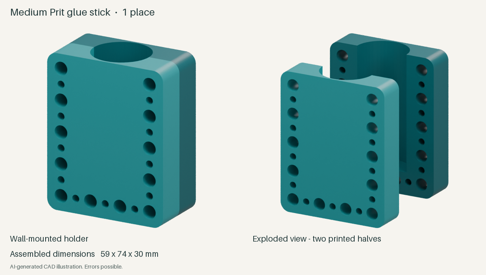

<!-- oobb-presentation:start -->
# Medium Prit glue stick

AI-generated CAD images and instructions. Errors possible.

## Summary

OOBB glue stick holder · 1 place.

This is an entirely AI-generated coding project. The generated outputs are included and usually work. The project is published so others can modify and regenerate the designs with their own AI tools.



## Details

| Grid (width × height) | Assembled thickness | Thickness per printed piece |
| --- | --- | --- |
| 4 × 5 | 30 mm | 15 mm |

The grid pitch is 15 mm. The dashed line on the plan locates the cross section. [Section drawing](../../../../../../../../parts/oobb_part_holder_tool_glue_stick_prit_medium_1_place_4x5x30/working.svg)

OOMP ID `oobb_part_holder_tool_glue_stick_prit_medium_1_place_4x5x30`

[Part folder](../../../../../../../../parts/oobb_part_holder_tool_glue_stick_prit_medium_1_place_4x5x30/) · [OOBB navigation](../) · [Source design](https://github.com/oomlout/oomlout_oobb_version_4/blob/41f5386997faef4473c959dfb8c929864d7bf697/oobb_make_sets.py#L626)

<details><summary>Complete part metadata</summary>

```yaml
body_style: vertical_v4
construction:
  mirror_second_print_x: false
  mode: repeat_half
  pocket_on_underside: false
depth: 30
height: 5
layout: 1_place
model: prit_medium
oobb_details:
  body_style: vertical_v4
  corner_radius_mm: 5
  count: 1
  depth: 30
  edge_reduction_mm: 1
  height: 5
  layered: false
  offset_mm:
  - 0
  - 0
  - 0
  oobb_type: holder_tool
  pitch_mm: 15
  profile:
  - h: 96
    pos:
    - 0
    - -25
    - 14
    r: 14
    rot:
    - -90
    - 0
    - 0
    shape: cylinder
  run_scad: true
  run_solidcraft: false
  spacing_mm: 15
  width: 4
oobb_type: holder_tool
profile: tool_tdpb_glue_stick_prit_medium
show_underside: false
source_id: tool_tdpb_glue_stick_prit_medium
svg_details:
  cross_section_y_fraction: 0.82
  near_face_fraction: 0.08
  show_underside: false
  svg_name: holder_sections
taxonomy_1: oobb
taxonomy_10: ''
taxonomy_11: ''
taxonomy_12: ''
taxonomy_13: ''
taxonomy_14: ''
taxonomy_15: ''
taxonomy_2: part
taxonomy_3: holder_tool
taxonomy_4: glue_stick
taxonomy_5: prit_medium
taxonomy_6: 1_place
taxonomy_7: 4x5x30
taxonomy_8: ''
taxonomy_9: ''
title: Medium Prit glue stick
tool_type: glue_stick
width: 4
id: oobb_part_holder_tool_glue_stick_prit_medium_1_place_4x5x30
directory: parts/oobb_part_holder_tool_glue_stick_prit_medium_1_place_4x5x30
md5: fa752944163c4465b42fb57e5a250229
md5_6: fa7529
md5_6_alpha: 9rt49
```

</details>

## Parts

Use the print mesh in the part folder. Tool and mounting hardware are supplied separately.

## Assembly

Print two copies of the holder half. Turn one over, face the pockets inward and line up the mounting holes and open ends. [Illustrated guides for the four photo-modelled tools](../../../../../../../../README.md#assembly)
<!-- oobb-presentation:end -->
