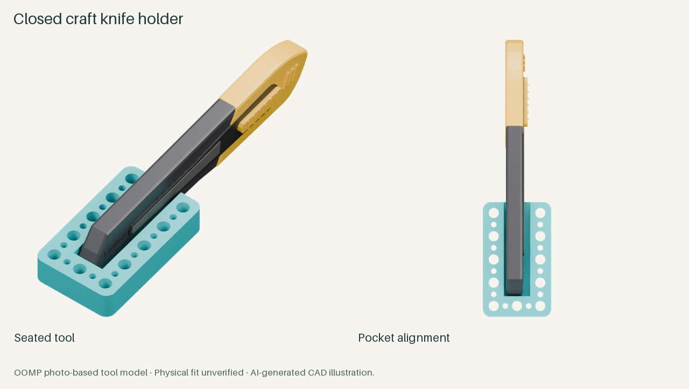

<!-- oobb-presentation:start -->
# Black Exacto craft knife, 17 mm

AI-generated CAD images and instructions. Errors possible.

## Summary

OOBB knife holder · 1 place.

This is an entirely AI-generated coding project. The generated outputs are included and usually work. The project is published so others can modify and regenerate the designs with their own AI tools.



## Details

| Grid (width × height) | Design depth | Printed thickness |
| --- | --- | --- |
| 3 × 5 | 29.5 mm | 14.75 mm |

The grid pitch is 15 mm. The dashed line on the plan locates the cross section. [Section drawing](../../../../../../../../parts/oobb_part_holder_tool_knife_exacto_17mm_1_place_3x5x29d5/working.svg)

OOMP ID `oobb_part_holder_tool_knife_exacto_17mm_1_place_3x5x29d5`

[Part folder](../../../../../../../../parts/oobb_part_holder_tool_knife_exacto_17mm_1_place_3x5x29d5/) · [OOBB navigation](../) · [Source design](https://github.com/oomlout/oomlout_oobb_version_4/blob/41f5386997faef4473c959dfb8c929864d7bf697/oobb_make_sets.py#L626)

<details><summary>Complete part metadata</summary>

```yaml
assembly_details:
  alignment: Keep the knife closed. Turn the housing edge-on and align the nose with
    the closed end of the slot.
  check: The housing stands on its narrow edge. The heel projects past the open end
    of the holder.
  label: Closed craft knife
  rotation_deg:
  - 0
  - 90
  - 0
  steps:
  - action: Orient the printed holder with the pocket facing up. Locate its open end.
    add:
    - holder
    key: step_01
    lift_mm: 0
  - action: Keep the knife closed. Turn the housing edge-on and align the nose with
      the closed end of the slot.
    add:
    - tool
    key: step_02
    lift_mm: 32
  - action: Lower the tool into the recess, keeping its nose between the pocket walls.
    add: []
    key: step_03
    lift_mm: 10
  - action: The housing stands on its narrow edge. The heel projects past the open
      end of the holder.
    add: []
    key: step_04
    lift_mm: 0
  style:
    border: '000000'
    border_radius_mm: 3
    border_width_pt: 3
    columns: 2
    component_border_width_pt: 1.1
    font_body_pt: 7
    font_code_pt: 6.4
    font_url_prefix_pt: 4.8
    gutter_mm: 4
    margin_mm: 6
    page_mm:
    - 297
    - 210
    quantity_pt: 5.8
    quantity_shift_mm: 1
    rows: 2
    thumbnail_height_mm: 8.5
  tool_id: tool_knife_craft_17_mm_black_exacto_style
  translation_mm:
  - -7.5
  - -23.1
  - 8.96
body_style: vertical_v4
depth: 29.5
height: 5
layout: 1_place
model: exacto_17mm
oobb_details:
  body_style: vertical_v4
  corner_radius_mm: 5
  count: 1
  depth: 29.5
  edge_reduction_mm: 1
  height: 5
  layered: false
  offset_mm:
  - 0
  - 0
  - 0
  oobb_type: holder_tool
  pitch_mm: 15
  profile:
  - h: 27.5
    points:
    - - -8.5
      - 0
    - - -8.5
      - 160
    - - 8.5
      - 160
    - - 8.5
      - 0
    pos:
    - 0
    - -23.75
    - 0
    rot:
    - 0
    - 0
    - 0
    shape: polygon
  run_scad: true
  run_solidcraft: false
  spacing_mm: 15
  width: 3
oobb_type: holder_tool
profile: tool_knife_exacto_17mm_black
show_underside: false
source_id: tool_knife_exacto_17mm_black
svg_details:
  cross_section_y_fraction: 0.82
  near_face_fraction: 0.08
  show_underside: false
  svg_name: holder_sections
taxonomy_1: oobb
taxonomy_10: ''
taxonomy_11: ''
taxonomy_12: ''
taxonomy_13: ''
taxonomy_14: ''
taxonomy_15: ''
taxonomy_2: part
taxonomy_3: holder_tool
taxonomy_4: knife
taxonomy_5: exacto_17mm
taxonomy_6: 1_place
taxonomy_7: 3x5x29d5
taxonomy_8: ''
taxonomy_9: ''
title: Black Exacto craft knife, 17 mm
tool_type: knife
width: 3
id: oobb_part_holder_tool_knife_exacto_17mm_1_place_3x5x29d5
directory: parts/oobb_part_holder_tool_knife_exacto_17mm_1_place_3x5x29d5
md5: 161dee15772170f0db5d4c5cf171cb86
md5_6: 161dee
md5_6_alpha: v2em
```

</details>

## Parts

Use the print mesh in the part folder. Tool and mounting hardware are supplied separately.

## Assembly

Load the closed craft knife in the orientation shown. The illustration uses its OOMP photo-based model at catalogue scale. Physical fit is unverified.

[Illustrated sequence](../../../../../../../../parts/oobb_part_holder_tool_knife_exacto_17mm_1_place_3x5x29d5/assembly/ASSEMBLY.md) · [Offline step viewer](../../../../../../../../parts/oobb_part_holder_tool_knife_exacto_17mm_1_place_3x5x29d5/assembly/assembly_instructions.html) · [Print booklet](../../../../../../../../parts/oobb_part_holder_tool_knife_exacto_17mm_1_place_3x5x29d5/assembly/assembly_instructions.pdf)
<!-- oobb-presentation:end -->
