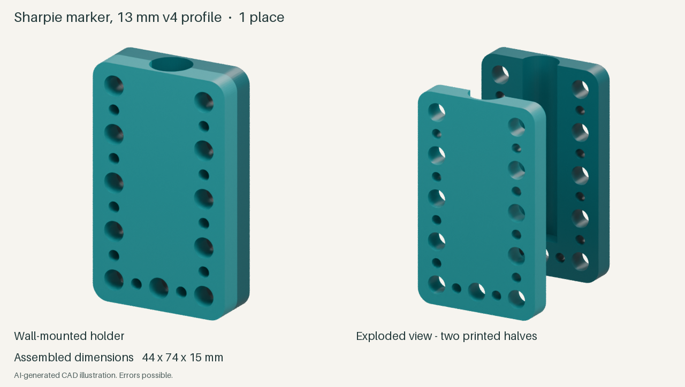

<!-- oobb-presentation:start -->
# Sharpie marker, 13 mm v4 profile

AI-generated CAD images and instructions. Errors possible.

## Summary

OOBB marker holder · 1 place.

This is an entirely AI-generated coding project. The generated outputs are included and usually work. The project is published so others can modify and regenerate the designs with their own AI tools.



## Details

| Grid (width × height) | Assembled thickness | Thickness per printed piece |
| --- | --- | --- |
| 3 × 5 | 15 mm | 7.5 mm |

The grid pitch is 15 mm. The dashed line on the plan locates the cross section. [Section drawing](../../../../../../../../parts/oobb_part_holder_tool_marker_sharpie_1_place_3x5x15/working.svg)

OOMP ID `oobb_part_holder_tool_marker_sharpie_1_place_3x5x15`

[Part folder](../../../../../../../../parts/oobb_part_holder_tool_marker_sharpie_1_place_3x5x15/) · [OOBB navigation](../) · [Source design](https://github.com/oomlout/oomlout_oobb_version_4/blob/41f5386997faef4473c959dfb8c929864d7bf697/oobb_make_sets.py#L626)

<details><summary>Complete part metadata</summary>

```yaml
body_style: vertical_v4
construction:
  mirror_second_print_x: false
  mode: repeat_half
  pocket_on_underside: true
depth: 15
height: 5
layout: 1_place
model: sharpie
oobb_details:
  body_style: vertical_v4
  corner_radius_mm: 5
  count: 1
  depth: 15
  edge_reduction_mm: 1
  height: 5
  layered: false
  offset_mm:
  - 0
  - 0
  - 0
  oobb_type: holder_tool
  pitch_mm: 15
  profile:
  - h: 137
    pos:
    - 0
    - -25
    - -1
    r: 6.5
    rot:
    - -90
    - 0
    - 0
    shape: cylinder
  run_scad: true
  run_solidcraft: false
  spacing_mm: 15
  width: 3
oobb_type: holder_tool
profile: tool_marker_sharpie
show_underside: true
source_id: tool_marker_sharpie
svg_details:
  cross_section_y_fraction: 0.82
  near_face_fraction: 0.08
  show_underside: true
  svg_name: holder_sections
taxonomy_1: oobb
taxonomy_10: ''
taxonomy_11: ''
taxonomy_12: ''
taxonomy_13: ''
taxonomy_14: ''
taxonomy_15: ''
taxonomy_2: part
taxonomy_3: holder_tool
taxonomy_4: marker
taxonomy_5: sharpie
taxonomy_6: 1_place
taxonomy_7: 3x5x15
taxonomy_8: ''
taxonomy_9: ''
title: Sharpie marker, 13 mm v4 profile
tool_type: marker
width: 3
id: oobb_part_holder_tool_marker_sharpie_1_place_3x5x15
directory: parts/oobb_part_holder_tool_marker_sharpie_1_place_3x5x15
md5: fb6c59b47b6752b95670ade2e9cf669b
md5_6: fb6c59
md5_6_alpha: 9t5y1
```

</details>

## Parts

Use the print mesh in the part folder. Tool and mounting hardware are supplied separately.

## Assembly

Print two copies of the holder half. Turn one over, face the pockets inward and line up the mounting holes and open ends. [Illustrated tool-loading guides](../../../../../../../../README.md#assembly)
<!-- oobb-presentation:end -->
