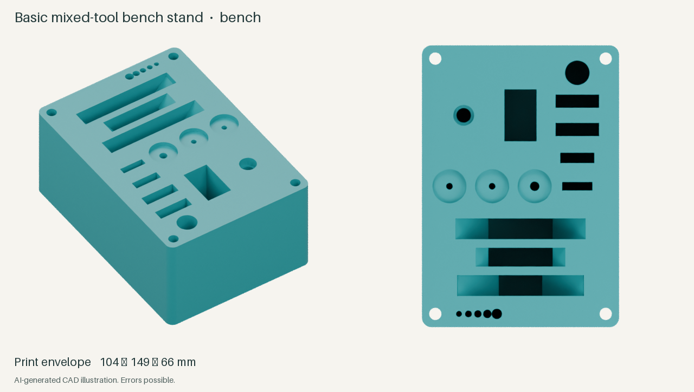

<!-- oobb-presentation:start -->
# Basic mixed-tool bench stand

AI-generated CAD images and instructions. Errors possible.

## Summary

OOBB mixed tools holder · bench.

This is an entirely AI-generated coding project. The generated outputs are included and usually work. The project is published so others can modify and regenerate the designs with their own AI tools.



## Details

| Grid (width × height) | Design depth | Printed thickness |
| --- | --- | --- |
| 7 × 10 | 66 mm | 66 mm |

The grid pitch is 15 mm. The dashed line on the plan locates the cross section. [Section drawing](../../../../../../../../parts/oobb_part_holder_tool_mixed_tools_basic_stand_bench_7x10x66/working.svg)

OOMP ID `oobb_part_holder_tool_mixed_tools_basic_stand_bench_7x10x66`

[Part folder](../../../../../../../../parts/oobb_part_holder_tool_mixed_tools_basic_stand_bench_7x10x66/) · [OOBB navigation](../) · [Source design](https://github.com/oomlout/oomlout_oobb_version_4/blob/41f5386997faef4473c959dfb8c929864d7bf697/oobb_make_sets.py#L626)

<details><summary>Complete part metadata</summary>

```yaml
body_style: stand
depth: 66
height: 10
layout: bench
model: basic_stand
oobb_details:
  body_style: stand
  corner_radius_mm: 5
  count: 1
  depth: 66
  edge_reduction_mm: 1
  height: 10
  layered: false
  offset_mm:
  - 0
  - 0
  - 0
  oobb_type: holder_tool
  pitch_mm: 15
  profile:
  - h: 11
    points:
    - - -11.5
      - -30
    - - -11.5
      - 5
    - - -33
      - 30
    - - -42
      - 80
    - - 42
      - 80
    - - 33
      - 30
    - - 11.5
      - 5
    - - 11.5
      - -30
    pos:
    - 0
    - -47
    - 0
    rot:
    - 90
    - 0
    - 0
    shape: polygon
  - h: 10
    points:
    - - -17
      - -30
    - - -17
      - 24
    - - -46
      - 63
    - - -50
      - 95
    - - 50
      - 95
    - - 46
      - 63
    - - 17
      - 24
    - - 17
      - -30
    pos:
    - 0
    - -32.5
    - 0
    rot:
    - 90
    - 0
    - 0
    shape: polygon
  - h: 11
    points:
    - - -17
      - -30
    - - -17
      - 5
    - - -45
      - 50
    - - -55
      - 90
    - - 55
      - 90
    - - 45
      - 50
    - - 17
      - 5
    - - 17
      - -30
    pos:
    - 0
    - -17
    - 0
    rot:
    - 90
    - 0
    - 0
    shape: polygon
  - h: 60
    pos:
    - -37.5
    - 0
    - -30
    r: 1.75
    rot:
    - 0
    - 0
    - 0
    shape: cylinder
  - h: 98
    pos:
    - -37.5
    - 0
    - 30
    r: 9
    rot:
    - 0
    - 0
    - 0
    shape: cylinder
  - h: 60
    pos:
    - -15
    - 0
    - -30
    r: 1.75
    rot:
    - 0
    - 0
    - 0
    shape: cylinder
  - h: 98
    pos:
    - -15
    - 0
    - 30
    r: 9
    rot:
    - 0
    - 0
    - 0
    shape: cylinder
  - h: 60
    pos:
    - 7.5
    - 0
    - -30
    r: 2.5
    rot:
    - 0
    - 0
    - 0
    shape: cylinder
  - h: 98
    pos:
    - 7.5
    - 0
    - 30
    r: 9
    rot:
    - 0
    - 0
    - 0
    shape: cylinder
  - h: 57
    pos:
    - -30
    - 37.5
    - -30
    r: 3.85
    rot:
    - 0
    - 0
    - 0
    shape: cylinder
  - h: 30
    pos:
    - -30
    - 37.5
    - 27
    r: 5.5
    rot:
    - 0
    - 0
    - 0
    shape: cylinder
  - h: 17
    pos:
    - -30
    - 37.5
    - 57
    r: 6.5
    rot:
    - 0
    - 0
    - 0
    shape: cylinder
  - h: 100
    pos:
    - -30
    - 37.5
    - 74
    r: 18
    rot:
    - 0
    - 0
    - 0
    shape: cylinder
  - h: 4.5
    points:
    - - 22
      - -30
    - - 22
      - 80
    - - 38
      - 80
    - - 38
      - -30
    pos:
    - 0
    - 2.25
    - 0
    rot:
    - 90
    - 0
    - 0
    shape: polygon
  - h: 5.5
    points:
    - - 21
      - -30
    - - 21
      - 90
    - - 39
      - 90
    - - 39
      - -30
    pos:
    - 0
    - 17.75
    - 0
    rot:
    - 90
    - 0
    - 0
    shape: polygon
  - h: 7
    points:
    - - 18.5
      - -30
    - - 18.5
      - 110
    - - 41.5
      - 110
    - - 41.5
      - -30
    pos:
    - 0
    - 33.5
    - 0
    rot:
    - 90
    - 0
    - 0
    shape: polygon
  - h: 7
    points:
    - - 18.5
      - -30
    - - 18.5
      - 110
    - - 41.5
      - 110
    - - 41.5
      - -30
    pos:
    - 0
    - 48.5
    - 0
    rot:
    - 90
    - 0
    - 0
    shape: polygon
  - h: 27.5
    points:
    - - -8.5
      - -30
    - - -8.5
      - 130
    - - 8.5
      - 130
    - - 8.5
      - -30
    pos:
    - 0
    - 51.25
    - 0
    rot:
    - 90
    - 0
    - 0
    shape: polygon
  - h: 100
    pos:
    - -32.5
    - -67.5
    - -7
    r: 1.55
    rot:
    - 0
    - 0
    - 0
    shape: cylinder
  - h: 100
    pos:
    - -27.5
    - -67.5
    - -12
    r: 1.8
    rot:
    - 0
    - 0
    - 0
    shape: cylinder
  - h: 100
    pos:
    - -22.5
    - -67.5
    - -17
    r: 1.95
    rot:
    - 0
    - 0
    - 0
    shape: cylinder
  - h: 100
    pos:
    - -17.5
    - -67.5
    - -22
    r: 2.25
    rot:
    - 0
    - 0
    - 0
    shape: cylinder
  - h: 100
    pos:
    - -12.5
    - -67.5
    - -27
    r: 2.75
    rot:
    - 0
    - 0
    - 0
    shape: cylinder
  - h: 137
    pos:
    - 30
    - 60
    - -30
    r: 6.5
    rot:
    - 0
    - 0
    - 0
    shape: cylinder
  run_scad: true
  run_solidcraft: false
  spacing_mm: 15
  width: 7
oobb_type: holder_tool
profile: basic_bench_stand
show_underside: false
source_id: tool_holder_basic
svg_details:
  cross_section_y_fraction: 0.82
  near_face_fraction: 0.08
  show_underside: false
  svg_name: holder_sections
taxonomy_1: oobb
taxonomy_10: ''
taxonomy_11: ''
taxonomy_12: ''
taxonomy_13: ''
taxonomy_14: ''
taxonomy_15: ''
taxonomy_2: part
taxonomy_3: holder_tool
taxonomy_4: mixed_tools
taxonomy_5: basic_stand
taxonomy_6: bench
taxonomy_7: 7x10x66
taxonomy_8: ''
taxonomy_9: ''
title: Basic mixed-tool bench stand
tool_type: mixed_tools
width: 7
id: oobb_part_holder_tool_mixed_tools_basic_stand_bench_7x10x66
directory: parts/oobb_part_holder_tool_mixed_tools_basic_stand_bench_7x10x66
md5: 204636b0c2a0478cbdde1c138b72ea71
md5_6: '204636'
md5_6_alpha: 19c1i
```

</details>

## Parts

Use the print mesh in the part folder. Tool and mounting hardware are supplied separately.

## Assembly

The stand prints as one piece. Tools enter the pockets from the top.

These tools also have illustrated single-place holder guides. [Black Exacto-style craft knife, 17 mm](../../../../../../../../parts/oobb_part_holder_tool_knife_exacto_17mm_1_place_3x5x29d5/assembly/ASSEMBLY.md) · [Blue needle-nose pliers, 130 mm](../../../../../../../../parts/oobb_part_holder_tool_pliers_needle_nose_130mm_1_place_5x5x12/assembly/ASSEMBLY.md) · [Red side cutters, 110 mm](../../../../../../../../parts/oobb_part_holder_tool_side_cutters_generic_110mm_1_place_5x5x13/assembly/ASSEMBLY.md) · [Red wire strippers, 120 mm](../../../../../../../../parts/oobb_part_holder_tool_wire_strippers_generic_120mm_1_place_5x5x13/assembly/ASSEMBLY.md)
<!-- oobb-presentation:end -->
