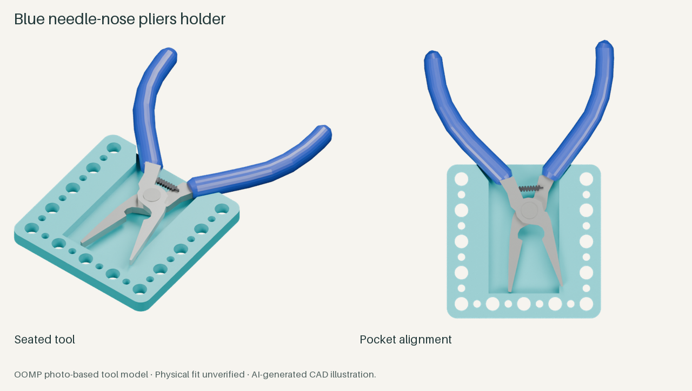

<!-- oobb-presentation:start -->
# Blue needle-nose pliers, 130 mm

AI-generated CAD images and instructions. Errors possible.

## Summary

OOBB pliers holder · 1 place.

This is an entirely AI-generated coding project. The generated outputs are included and usually work. The project is published so others can modify and regenerate the designs with their own AI tools.



## Details

| Grid (width × height) | Design depth | Printed thickness |
| --- | --- | --- |
| 5 × 5 | 12 mm | 6 mm |

The grid pitch is 15 mm. The dashed line on the plan locates the cross section. [Section drawing](../../../../../../../../parts/oobb_part_holder_tool_pliers_needle_nose_130mm_1_place_5x5x12/working.svg)

OOMP ID `oobb_part_holder_tool_pliers_needle_nose_130mm_1_place_5x5x12`

[Part folder](../../../../../../../../parts/oobb_part_holder_tool_pliers_needle_nose_130mm_1_place_5x5x12/) · [OOBB navigation](../) · [Source design](https://github.com/oomlout/oomlout_oobb_version_4/blob/41f5386997faef4473c959dfb8c929864d7bf697/oobb_make_sets.py#L626)

<details><summary>Complete part metadata</summary>

```yaml
assembly_details:
  alignment: Point the long jaws toward the closed end of the recess. Centre the steel
    nose between the rails.
  check: The blue grips extend beyond the open end, with the pivot visible above the
    recess.
  label: Blue needle-nose pliers
  rotation_deg:
  - 0
  - 0
  - 4.15
  steps:
  - action: Orient the printed holder with the pocket facing up. Locate its open end.
    add:
    - holder
    key: step_01
    lift_mm: 0
  - action: Point the long jaws toward the closed end of the recess. Centre the steel
      nose between the rails.
    add:
    - tool
    key: step_02
    lift_mm: 32
  - action: Lower the tool into the recess, keeping its nose between the pocket walls.
    add: []
    key: step_03
    lift_mm: 10
  - action: The blue grips extend beyond the open end, with the pivot visible above
      the recess.
    add: []
    key: step_04
    lift_mm: 0
  style:
    border: '000000'
    border_radius_mm: 3
    border_width_pt: 3
    columns: 2
    component_border_width_pt: 1.1
    font_body_pt: 7
    font_code_pt: 6.4
    font_url_prefix_pt: 4.8
    gutter_mm: 4
    margin_mm: 6
    page_mm:
    - 297
    - 210
    quantity_pt: 5.8
    quantity_shift_mm: 1
    rows: 2
    thumbnail_height_mm: 8.5
  tool_id: tool_pliers_needle_nose_130_mm_length_blue
  translation_mm:
  - -6.75
  - -24.4
  - 0
body_style: vertical_v4
depth: 12
height: 5
layout: 1_place
model: needle_nose_130mm
oobb_details:
  body_style: vertical_v4
  corner_radius_mm: 5
  count: 1
  depth: 12
  edge_reduction_mm: 1
  height: 5
  layered: false
  offset_mm:
  - 0
  - 0
  - 0
  oobb_type: holder_tool
  pitch_mm: 15
  profile:
  - h: 10
    points:
    - - -17
      - 0
    - - -17
      - 54
    - - -46
      - 93
    - - -50
      - 125
    - - 50
      - 125
    - - 46
      - 93
    - - 17
      - 54
    - - 17
      - 0
    pos:
    - 0
    - -25
    - 0
    rot:
    - 0
    - 0
    - 0
    shape: polygon
  run_scad: true
  run_solidcraft: false
  spacing_mm: 15
  width: 5
oobb_type: holder_tool
profile: tool_pliers_needlenose_generic_130_mm_blue
show_underside: false
source_id: tool_pliers_needlenose_generic_130_mm_blue
svg_details:
  cross_section_y_fraction: 0.82
  near_face_fraction: 0.08
  show_underside: false
  svg_name: holder_sections
taxonomy_1: oobb
taxonomy_10: ''
taxonomy_11: ''
taxonomy_12: ''
taxonomy_13: ''
taxonomy_14: ''
taxonomy_15: ''
taxonomy_2: part
taxonomy_3: holder_tool
taxonomy_4: pliers
taxonomy_5: needle_nose_130mm
taxonomy_6: 1_place
taxonomy_7: 5x5x12
taxonomy_8: ''
taxonomy_9: ''
title: Blue needle-nose pliers, 130 mm
tool_type: pliers
width: 5
id: oobb_part_holder_tool_pliers_needle_nose_130mm_1_place_5x5x12
directory: parts/oobb_part_holder_tool_pliers_needle_nose_130mm_1_place_5x5x12
md5: 4d76bfaac77d2ea77d63021172a7e68c
md5_6: 4d76bf
md5_6_alpha: 30t6n
```

</details>

## Parts

Use the print mesh in the part folder. Tool and mounting hardware are supplied separately.

## Assembly

Load the blue needle-nose pliers in the orientation shown. The illustration uses its OOMP photo-based model at catalogue scale. Physical fit is unverified.

[Illustrated sequence](../../../../../../../../parts/oobb_part_holder_tool_pliers_needle_nose_130mm_1_place_5x5x12/assembly/ASSEMBLY.md) · [Offline step viewer](../../../../../../../../parts/oobb_part_holder_tool_pliers_needle_nose_130mm_1_place_5x5x12/assembly/assembly_instructions.html) · [Print booklet](../../../../../../../../parts/oobb_part_holder_tool_pliers_needle_nose_130mm_1_place_5x5x12/assembly/assembly_instructions.pdf)
<!-- oobb-presentation:end -->
