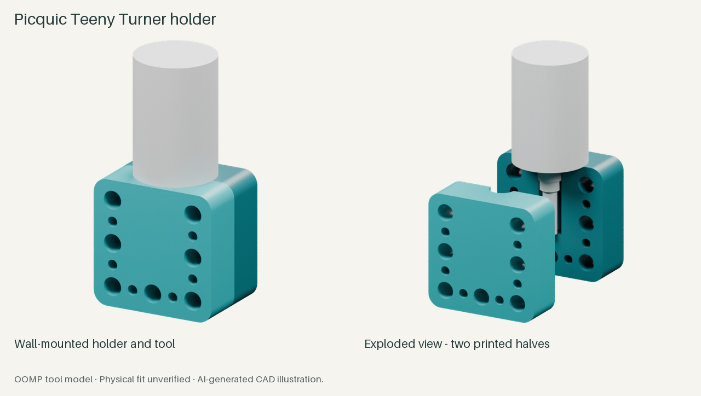
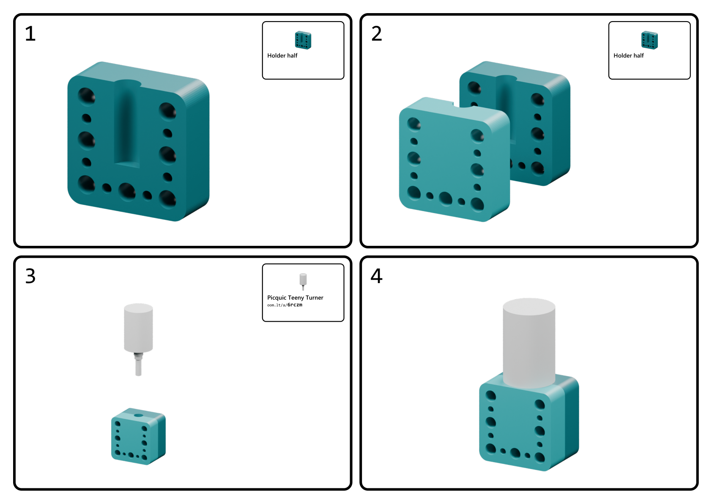

<!-- oobb-presentation:start -->
# Picquic Teeny Turner precision multi-driver

AI-generated CAD images and instructions. Errors possible.

## Summary

OOBB screwdriver holder · 1 place.

This is an entirely AI-generated coding project. The generated outputs are included and usually work. The project is published so others can modify and regenerate the designs with their own AI tools.



## Details

| Grid (width × height) | Assembled thickness | Thickness per printed piece |
| --- | --- | --- |
| 3 × 3 | 31 mm | 15.5 mm |

The grid pitch is 15 mm. The dashed line on the plan locates the cross section. [Section drawing](../../../../../../../../parts/oobb_part_holder_tool_screwdriver_picquic_teeny_turner_1_place_3x3x31/working.svg)

OOMP ID `oobb_part_holder_tool_screwdriver_picquic_teeny_turner_1_place_3x3x31`

[Part folder](../../../../../../../../parts/oobb_part_holder_tool_screwdriver_picquic_teeny_turner_1_place_3x3x31/) · [OOBB navigation](../) · [Source design](https://github.com/oomlout/oomlout_oobb_part_tool_holder_vertical/tree/93a962a09e0c275c3cfa62187182ac3203bde1b2/parts/oobb_part_tool_holder_vertical_3_width_3_height_31_mm_depth_tool_screw_driver_multi_driver_precision_size_teeny_turner_model_picquic_tool_extra)

<details><summary>Complete part metadata</summary>

```yaml
assembly_details:
  alignment: Point the exposed bit down and centre it over the round opening.
  check: The shoulder of the short handle rests at the top of the holder.
  label: Picquic Teeny Turner
  layout: 1_place
  model_kind: stepped_body
  rotation_deg:
  - 0
  - 0
  - 0
  steps:
  - action: Orient the rear half as it sits on the wall, with the pocket facing you
      and the opening at the top.
    add:
    - holder
    key: step_01
    upper_lift_mm: 0
    withdraw_mm: 0
  - action: Face the front half toward the rear pocket. Align the mounting holes and
      both top openings.
    add:
    - holder
    key: step_02
    upper_lift_mm: 36
    withdraw_mm: 0
  - action: Bring the halves together until their rims meet. Point the exposed bit
      down and centre it over the round opening.
    add:
    - tool
    key: step_03
    upper_lift_mm: 0
    withdraw_mm: 70
  - action: Lower the tool through the top opening. The shoulder of the short handle
      rests at the top of the holder.
    add: []
    key: step_04
    upper_lift_mm: 0
    withdraw_mm: 0
  style:
    border: '000000'
    border_radius_mm: 3
    border_width_pt: 3
    columns: 2
    component_border_width_pt: 1.1
    font_body_pt: 7
    font_code_pt: 6.4
    font_url_prefix_pt: 4.8
    gutter_mm: 4
    margin_mm: 6
    page_mm:
    - 297
    - 210
    quantity_pt: 5.8
    quantity_shift_mm: 1
    rows: 2
    thumbnail_height_mm: 8.5
  tool_id: tool_screw_driver_multi_driver_precision_size_teeny_turner_model_picquic
  translation_mm:
  - 0
  - -5.98
  - 0
body_style: vertical_project
construction:
  mirror_second_print_x: false
  mode: repeat_half
  pocket_on_underside: true
count: 1
depth: 31
height: 3
layered: false
layout: 1_place
model: picquic_teeny_turner
offset_mm:
- 0
- 8
- 0
oobb_details:
  body_style: vertical_project
  corner_radius_mm: 5
  count: 1
  depth: 31
  edge_reduction_mm: 1
  height: 3
  layered: false
  offset_mm:
  - 0
  - 8
  - 0
  oobb_type: holder_tool
  pitch_mm: 15
  profile:
  - h: 28
    pos:
    - 0
    - -14
    - 0
    r: 4.75
    rot:
    - -90
    - 0
    - 0
    shape: cylinder
  run_scad: true
  run_solidcraft: false
  spacing_mm: 15
  width: 3
oobb_type: holder_tool
profile: picquic_teeny_turner
show_underside: true
source_id: oobb_part_tool_holder_vertical_3_width_3_height_31_mm_depth_tool_screw_driver_multi_driver_precision_size_teeny_turner_model_picquic_tool_extra
spacing_mm: 15
svg_details:
  cross_section_y_fraction: 0.82
  near_face_fraction: 0.08
  show_underside: true
  svg_name: holder_sections
taxonomy_1: oobb
taxonomy_10: ''
taxonomy_11: ''
taxonomy_12: ''
taxonomy_13: ''
taxonomy_14: ''
taxonomy_15: ''
taxonomy_2: part
taxonomy_3: holder_tool
taxonomy_4: screwdriver
taxonomy_5: picquic_teeny_turner
taxonomy_6: 1_place
taxonomy_7: 3x3x31
taxonomy_8: ''
taxonomy_9: ''
title: Picquic Teeny Turner precision multi-driver
tool_type: screwdriver
width: 3
id: oobb_part_holder_tool_screwdriver_picquic_teeny_turner_1_place_3x3x31
directory: parts/oobb_part_holder_tool_screwdriver_picquic_teeny_turner_1_place_3x3x31
md5: 865fb3c3892c505e5dbe2a060dda094b
md5_6: 865fb3
md5_6_alpha: 58r03
```

</details>

## Parts

Use the print mesh in the part folder. Tool and mounting hardware are supplied separately.

## Assembly

Print two copies of the holder STL. The dark teal half sits against the wall and the light teal half faces the room.

1. Orient the rear half as it sits on the wall, with the pocket facing you and the opening at the top. [View step 1](../../../../../../../../parts/oobb_part_holder_tool_screwdriver_picquic_teeny_turner_1_place_3x3x31/assembly/render/raw/step_01.png)
2. Face the front half toward the rear pocket. Align the mounting holes and both top openings. [View step 2](../../../../../../../../parts/oobb_part_holder_tool_screwdriver_picquic_teeny_turner_1_place_3x3x31/assembly/render/raw/step_02.png)
3. Bring the halves together until their rims meet. Point the exposed bit down and centre it over the round opening. [View step 3](../../../../../../../../parts/oobb_part_holder_tool_screwdriver_picquic_teeny_turner_1_place_3x3x31/assembly/render/raw/step_03.png)
4. Lower the tool through the top opening. The shoulder of the short handle rests at the top of the holder. [View step 4](../../../../../../../../parts/oobb_part_holder_tool_screwdriver_picquic_teeny_turner_1_place_3x3x31/assembly/render/raw/step_04.png)

<details><summary>Illustrated assembly steps</summary>



</details>

Four coaxial sections follow the archived OOMP drawing, read at its document scale. The handle and exposed bit use simplified round sections. The digital model was checked against the printed holder. Physical fit remains unverified. [OOMP tool record](https://github.com/oomlout/oomp_tool_version_5/tree/main/parts/tool_screw_driver_multi_driver_precision_size_teeny_turner_model_picquic)

[Offline HTML viewer](../../../../../../../../parts/oobb_part_holder_tool_screwdriver_picquic_teeny_turner_1_place_3x3x31/assembly/assembly_instructions.html) · [Print booklet (PDF)](../../../../../../../../parts/oobb_part_holder_tool_screwdriver_picquic_teeny_turner_1_place_3x3x31/assembly/assembly_instructions.pdf)
<!-- oobb-presentation:end -->
