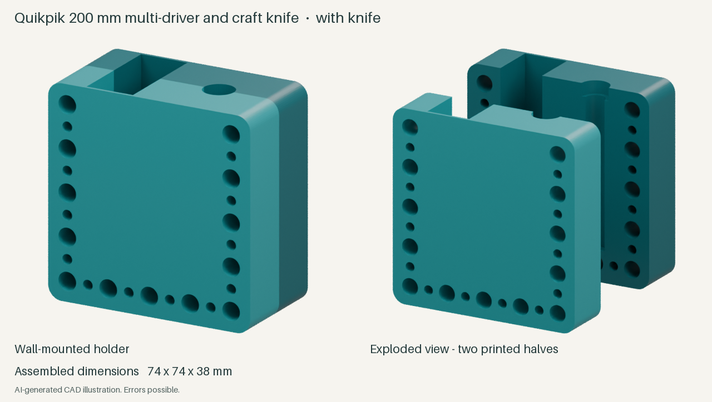
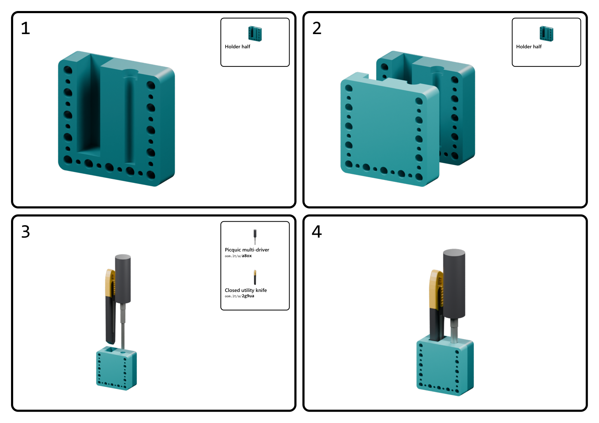

<!-- oobb-presentation:start -->
# Quikpik 200 mm multi-driver and utility knife

AI-generated CAD images and instructions. Errors possible.

## Summary

OOBB screwdriver holder · with knife.

This is an entirely AI-generated coding project. The generated outputs are included and usually work. The project is published so others can modify and regenerate the designs with their own AI tools.



## Details

| Grid (width × height) | Assembled thickness | Thickness per printed piece |
| --- | --- | --- |
| 5 × 5 | 38 mm | 19 mm |

The grid pitch is 15 mm. The dashed line on the plan locates the cross section. [Section drawing](../../../../../../../../parts/oobb_part_holder_tool_screwdriver_quikpik_200mm_with_knife_5x5x38/working.svg)

OOMP ID `oobb_part_holder_tool_screwdriver_quikpik_200mm_with_knife_5x5x38`

[Part folder](../../../../../../../../parts/oobb_part_holder_tool_screwdriver_quikpik_200mm_with_knife_5x5x38/) · [OOBB navigation](../) · [Source design](https://github.com/oomlout/oomlout_oobb_version_4/blob/41f5386997faef4473c959dfb8c929864d7bf697/oobb_make_sets.py#L626)

<details><summary>Complete part metadata</summary>

```yaml
assembly_details:
  additional_tools:
  - key: knife
    label: Closed utility knife
    model_kind: photo_reference
    rotation_deg:
    - 0
    - 90
    - 0
    tool_id: tool_knife_craft_17_mm_black_exacto_style
    translation_mm:
    - -22.5
    - -23.1
    - 8.96
  alignment: Keep the utility knife closed and align it edge-on with its slot. Point
    the multi-driver bit down into the round pocket.
  check: The closed knife and multi-driver sit in their separate pockets with their
    handles accessible.
  label: Multi-driver and knife
  layout: with_knife
  model_kind: picquic_sixpac
  primary_label: Picquic multi-driver
  rotation_deg:
  - 0
  - 0
  - 0
  steps:
  - action: Orient the rear half as it sits on the wall, with the pocket facing you
      and the opening at the top.
    add:
    - holder
    key: step_01
    upper_lift_mm: 0
    withdraw_mm: 0
  - action: Face the front half toward the rear pocket. Align the mounting holes and
      both top openings.
    add:
    - holder
    key: step_02
    upper_lift_mm: 36
    withdraw_mm: 0
  - action: Bring the halves together until their rims meet. Keep the utility knife
      closed and align it edge-on with its slot. Point the multi-driver bit down into
      the round pocket.
    add:
    - tool
    - knife
    key: step_03
    upper_lift_mm: 0
    withdraw_mm: 70
  - action: Lower the tools through the top openings. The closed knife and multi-driver
      sit in their separate pockets with their handles accessible.
    add: []
    key: step_04
    upper_lift_mm: 0
    withdraw_mm: 0
  style:
    border: '000000'
    border_radius_mm: 3
    border_width_pt: 3
    columns: 2
    component_border_width_pt: 1.1
    font_body_pt: 7
    font_code_pt: 6.4
    font_url_prefix_pt: 4.8
    gutter_mm: 4
    margin_mm: 6
    page_mm:
    - 297
    - 210
    quantity_pt: 5.8
    quantity_shift_mm: 1
    rows: 2
    thumbnail_height_mm: 8.5
  tool_id: tool_screw_driver_multi_driver_200_mm_quikpik
  translation_mm:
  - 15
  - -25
  - 18
body_style: paired_face_up
construction:
  mirror_second_print_x: false
  mode: handed_pair
  pocket_on_underside: false
depth: 38
height: 5
layout: with_knife
model: quikpik_200mm
oobb_details:
  body_style: paired_face_up
  corner_radius_mm: 5
  count: 1
  depth: 38
  edge_reduction_mm: 1
  height: 5
  layered: false
  offset_mm:
  - 0
  - 0
  - 0
  oobb_type: holder_tool
  pitch_mm: 15
  profile:
  - h: 27.5
    points:
    - - -23.5
      - 0
    - - -23.5
      - 160
    - - -6.5
      - 160
    - - -6.5
      - 0
    pos:
    - 0
    - -23.75
    - 0
    rot:
    - 0
    - 0
    - 0
    shape: polygon
  - h: 57
    pos:
    - 15
    - -25
    - 18
    r: 3.85
    rot:
    - -90
    - 0
    - 0
    shape: cylinder
  - h: 30
    pos:
    - 15
    - 32
    - 18
    r: 5.5
    rot:
    - -90
    - 0
    - 0
    shape: cylinder
  - h: 17
    pos:
    - 15
    - 62
    - 18
    r: 6.5
    rot:
    - -90
    - 0
    - 0
    shape: cylinder
  - h: 100
    pos:
    - 15
    - 79
    - 18
    r: 18
    rot:
    - -90
    - 0
    - 0
    shape: cylinder
  run_scad: true
  run_solidcraft: false
  spacing_mm: 15
  width: 5
oobb_type: holder_tool
profile: tool_screwdriver_multi_quikpik_200_mm_knife
show_underside: false
source_id: tool_screwdriver_multi_quikpik_200_mm_knife
svg_details:
  cross_section_y_fraction: 0.82
  near_face_fraction: 0.08
  show_underside: false
  svg_name: holder_sections
taxonomy_1: oobb
taxonomy_10: ''
taxonomy_11: ''
taxonomy_12: ''
taxonomy_13: ''
taxonomy_14: ''
taxonomy_15: ''
taxonomy_2: part
taxonomy_3: holder_tool
taxonomy_4: screwdriver
taxonomy_5: quikpik_200mm
taxonomy_6: with_knife
taxonomy_7: 5x5x38
taxonomy_8: ''
taxonomy_9: ''
title: Quikpik 200 mm multi-driver and utility knife
tool_type: screwdriver
width: 5
id: oobb_part_holder_tool_screwdriver_quikpik_200mm_with_knife_5x5x38
directory: parts/oobb_part_holder_tool_screwdriver_quikpik_200mm_with_knife_5x5x38
md5: f2d42d359ca5bb9a020245cd4a6db1fc
md5_6: f2d42d
md5_6_alpha: 9h3cd
```

</details>

## Parts

Use the print mesh in the part folder. Tool and mounting hardware are supplied separately.

## Assembly

Print the supplied two-half layout once. The dark teal half sits against the wall and the light teal half faces the room.

1. Orient the rear half as it sits on the wall, with the pocket facing you and the opening at the top. [View step 1](../../../../../../../../parts/oobb_part_holder_tool_screwdriver_quikpik_200mm_with_knife_5x5x38/assembly/render/raw/step_01.png)
2. Face the front half toward the rear pocket. Align the mounting holes and both top openings. [View step 2](../../../../../../../../parts/oobb_part_holder_tool_screwdriver_quikpik_200mm_with_knife_5x5x38/assembly/render/raw/step_02.png)
3. Bring the halves together until their rims meet. Keep the utility knife closed and align it edge-on with its slot. Point the multi-driver bit down into the round pocket. [View step 3](../../../../../../../../parts/oobb_part_holder_tool_screwdriver_quikpik_200mm_with_knife_5x5x38/assembly/render/raw/step_03.png)
4. Lower the tools through the top openings. The closed knife and multi-driver sit in their separate pockets with their handles accessible. [View step 4](../../../../../../../../parts/oobb_part_holder_tool_screwdriver_quikpik_200mm_with_knife_5x5x38/assembly/render/raw/step_04.png)

<details><summary>Illustrated assembly steps</summary>



</details>

Representative Picquic SIXPAC Plus, 200 mm overall and 32 mm handle diameter from a distributor listing. Picquic specifies 3-inch quarter-inch bits and a 7/16-inch hex bolster. Exposed bit, shank and bolster lengths are estimates for the stored-bit pose. The handle contour, stored bits and workshop specimen have not been measured. The digital model was checked against the printed holder. Physical fit remains unverified. [OOMP tool record](https://github.com/oomlout/oomp_tool_version_5/tree/main/parts/tool_screw_driver_multi_driver_200_mm_quikpik)

Closed exterior based on the photo and a provisional 165 mm STANLEY 0-10-151 reference. The 17 mm OOMP label is retained. Size variant awaits measurement. [OOMP tool record](https://github.com/oomlout/oomp_tool_version_5/tree/main/parts/tool_knife_craft_17_mm_black_exacto_style)

[Open assembly viewer](https://raw.githack.com/oomlout/oomlout_oobb_part_holder_tool_version_5/main/parts/oobb_part_holder_tool_screwdriver_quikpik_200mm_with_knife_5x5x38/assembly/assembly_instructions.html) · [Print booklet (PDF)](../../../../../../../../parts/oobb_part_holder_tool_screwdriver_quikpik_200mm_with_knife_5x5x38/assembly/assembly_instructions.pdf)
<!-- oobb-presentation:end -->
