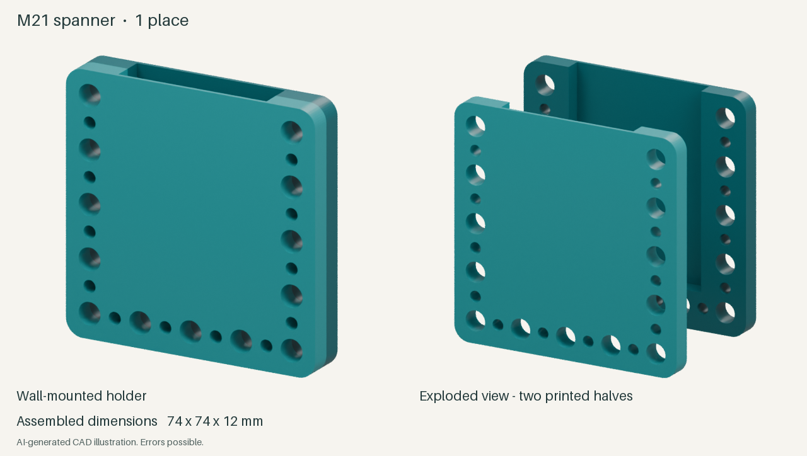
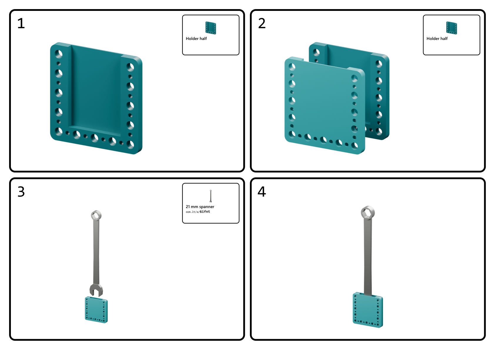

<!-- oobb-presentation:start -->
# M21 spanner

AI-generated CAD images and instructions. Errors possible.

## Summary

OOBB spanner holder · 1 place.

This is an entirely AI-generated coding project. The generated outputs are included and usually work. The project is published so others can modify and regenerate the designs with their own AI tools.



## Details

| Grid (width × height) | Assembled thickness | Thickness per printed piece |
| --- | --- | --- |
| 5 × 5 | 12 mm | 6 mm |

The grid pitch is 15 mm. The dashed line on the plan locates the cross section. [Section drawing](../../../../../../../../parts/oobb_part_holder_tool_spanner_m21_1_place_5x5x12/working.svg)

OOMP ID `oobb_part_holder_tool_spanner_m21_1_place_5x5x12`

[Part folder](../../../../../../../../parts/oobb_part_holder_tool_spanner_m21_1_place_5x5x12/) · [OOBB navigation](../) · [Source design](https://github.com/oomlout/oomlout_oobb_version_4/blob/41f5386997faef4473c959dfb8c929864d7bf697/oobb_make_sets.py#L626)

<details><summary>Complete part metadata</summary>

```yaml
assembly_details:
  alignment: Point the open jaws down and centre them over the pocket.
  check: The open head rests at the pocket floor and the ring end remains accessible
    above the holder.
  label: 21 mm spanner
  layout: 1_place
  model_kind: combination_spanner
  rotation_deg:
  - 0
  - 0
  - 180
  steps:
  - action: Orient the rear half as it sits on the wall, with the pocket facing you
      and the opening at the top.
    add:
    - holder
    key: step_01
    upper_lift_mm: 0
    withdraw_mm: 0
  - action: Face the front half toward the rear pocket. Align the mounting holes and
      both top openings.
    add:
    - holder
    key: step_02
    upper_lift_mm: 36
    withdraw_mm: 0
  - action: Bring the halves together until their rims meet. Point the open jaws down
      and centre them over the pocket.
    add:
    - tool
    key: step_03
    upper_lift_mm: 0
    withdraw_mm: 70
  - action: Lower the tool through the top opening. The open head rests at the pocket
      floor and the ring end remains accessible above the holder.
    add: []
    key: step_04
    upper_lift_mm: 0
    withdraw_mm: 0
  style:
    border: '000000'
    border_radius_mm: 3
    border_width_pt: 3
    columns: 2
    component_border_width_pt: 1.1
    font_body_pt: 7
    font_code_pt: 6.4
    font_url_prefix_pt: 4.8
    gutter_mm: 4
    margin_mm: 6
    page_mm:
    - 297
    - 210
    quantity_pt: 5.8
    quantity_shift_mm: 1
    rows: 2
    thumbnail_height_mm: 8.5
  tool_id: tool_wrench_m21
  translation_mm:
  - 0
  - 255
  - 5
body_style: vertical_v4
construction:
  mirror_second_print_x: false
  mode: repeat_half
  pocket_on_underside: false
depth: 12
height: 5
layout: 1_place
model: m21
oobb_details:
  body_style: vertical_v4
  corner_radius_mm: 5
  count: 1
  depth: 12
  edge_reduction_mm: 1
  height: 5
  layered: false
  offset_mm:
  - 0
  - 0
  - 0
  oobb_type: holder_tool
  pitch_mm: 15
  profile:
  - h: 10
    points:
    - - -22
      - 0
    - - -22
      - 140
    - - 22
      - 140
    - - 22
      - 0
    pos:
    - 0
    - -25
    - 0
    rot:
    - 0
    - 0
    - 0
    shape: polygon
  run_scad: true
  run_solidcraft: false
  spacing_mm: 15
  width: 5
oobb_type: holder_tool
profile: tool_spanner_m21
show_underside: false
svg_details:
  cross_section_y_fraction: 0.82
  near_face_fraction: 0.08
  show_underside: false
  svg_name: holder_sections
taxonomy_1: oobb
taxonomy_10: ''
taxonomy_11: ''
taxonomy_12: ''
taxonomy_13: ''
taxonomy_14: ''
taxonomy_15: ''
taxonomy_2: part
taxonomy_3: holder_tool
taxonomy_4: spanner
taxonomy_5: m21
taxonomy_6: 1_place
taxonomy_7: 5x5x12
taxonomy_8: ''
taxonomy_9: ''
title: M21 spanner
tool_type: spanner
width: 5
id: oobb_part_holder_tool_spanner_m21_1_place_5x5x12
directory: parts/oobb_part_holder_tool_spanner_m21_1_place_5x5x12
md5: a307de089bbf6a5b681edb68054ddad3
md5_6: a307de
md5_6_alpha: 6d04e
```

</details>

## Parts

Use the print mesh in the part folder. Tool and mounting hardware are supplied separately.

## Assembly

Print two copies of the holder STL. The dark teal half sits against the wall and the light teal half faces the room.

1. Orient the rear half as it sits on the wall, with the pocket facing you and the opening at the top. [View step 1](../../../../../../../../parts/oobb_part_holder_tool_spanner_m21_1_place_5x5x12/assembly/render/raw/step_01.png)
2. Face the front half toward the rear pocket. Align the mounting holes and both top openings. [View step 2](../../../../../../../../parts/oobb_part_holder_tool_spanner_m21_1_place_5x5x12/assembly/render/raw/step_02.png)
3. Bring the halves together until their rims meet. Point the open jaws down and centre them over the pocket. [View step 3](../../../../../../../../parts/oobb_part_holder_tool_spanner_m21_1_place_5x5x12/assembly/render/raw/step_03.png)
4. Lower the tool through the top opening. The open head rests at the pocket floor and the ring end remains accessible above the holder. [View step 4](../../../../../../../../parts/oobb_part_holder_tool_spanner_m21_1_place_5x5x12/assembly/render/raw/step_04.png)

<details><summary>Illustrated assembly steps</summary>



</details>

Generic 21 mm combination spanner using Stahlwille OPEN BOX 14 article 40102121 as a dimensional reference. Length and both head widths and thicknesses follow the catalogue. The straight body, head outlines and ring offset are simplified. The workshop specimen has not been measured. The digital model was checked against the printed holder. Physical fit remains unverified. [OOMP tool record](https://github.com/oomlout/oomp_tool_version_5/tree/main/parts/tool_wrench_m21)

[Open assembly viewer](https://raw.githack.com/oomlout/oomlout_oobb_part_holder_tool_version_5/main/parts/oobb_part_holder_tool_spanner_m21_1_place_5x5x12/assembly/assembly_instructions.html) · [Print booklet (PDF)](../../../../../../../../parts/oobb_part_holder_tool_spanner_m21_1_place_5x5x12/assembly/assembly_instructions.pdf)
<!-- oobb-presentation:end -->
