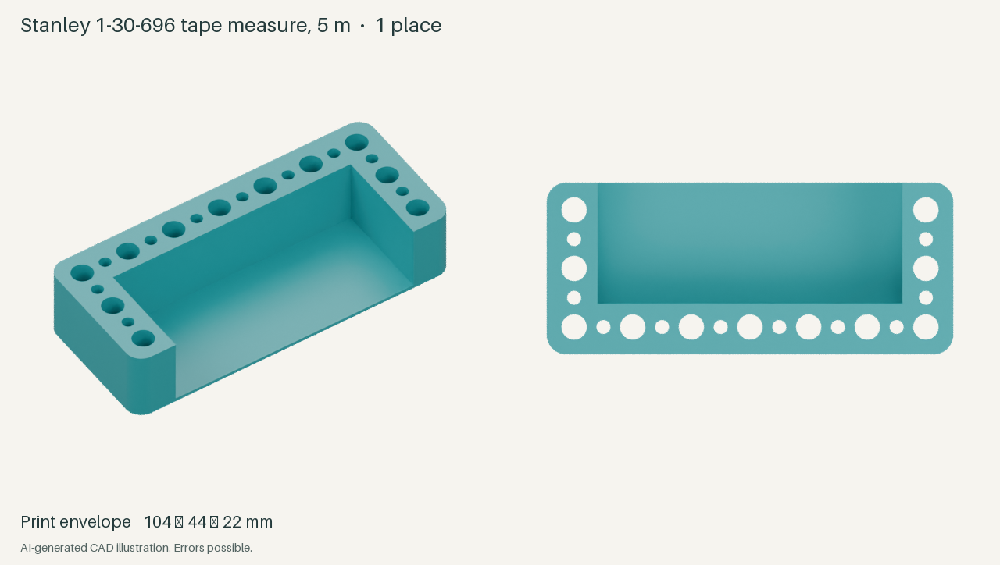

<!-- oobb-presentation:start -->
# Stanley 1-30-696 tape measure, 5 m

AI-generated CAD images and instructions. Errors possible.

## Summary

OOBB tape measure holder · 1 place.

This is an entirely AI-generated coding project. The generated outputs are included and usually work. The project is published so others can modify and regenerate the designs with their own AI tools.



## Details

| Grid (width × height) | Design depth | Printed thickness |
| --- | --- | --- |
| 7 × 3 | 44 mm | 22 mm |

The grid pitch is 15 mm. The dashed line on the plan locates the cross section. [Section drawing](../../../../../../../../parts/oobb_part_holder_tool_tape_measure_stanley_1_30_696_1_place_7x3x44/working.svg)

OOMP ID `oobb_part_holder_tool_tape_measure_stanley_1_30_696_1_place_7x3x44`

[Part folder](../../../../../../../../parts/oobb_part_holder_tool_tape_measure_stanley_1_30_696_1_place_7x3x44/) · [OOBB navigation](../) · [Source design](https://github.com/oomlout/oomlout_oobb_version_4/blob/41f5386997faef4473c959dfb8c929864d7bf697/oobb_make_sets.py#L626)

<details><summary>Complete part metadata</summary>

```yaml
body_style: vertical_v4
depth: 44
height: 3
layout: 1_place
model: stanley_1_30_696
oobb_details:
  body_style: vertical_v4
  corner_radius_mm: 5
  count: 1
  depth: 44
  edge_reduction_mm: 1
  height: 3
  layered: false
  offset_mm:
  - 0
  - 0
  - 0
  oobb_type: holder_tool
  pitch_mm: 15
  profile:
  - h: 42
    points:
    - - -39
      - 0
    - - -39
      - 74
    - - 39
      - 74
    - - 39
      - 0
    pos:
    - 0
    - -9
    - 0
    rot:
    - 0
    - 0
    - 0
    shape: polygon
  run_scad: true
  run_solidcraft: false
  spacing_mm: 15
  width: 7
oobb_type: holder_tool
profile: tool_measure_tape_measure_5000_mm_length_stanley_1_30_696
show_underside: false
source_id: tool_measure_tape_measure_5000_mm_length_stanley_1_30_696
svg_details:
  cross_section_y_fraction: 0.82
  near_face_fraction: 0.08
  show_underside: false
  svg_name: holder_sections
taxonomy_1: oobb
taxonomy_10: ''
taxonomy_11: ''
taxonomy_12: ''
taxonomy_13: ''
taxonomy_14: ''
taxonomy_15: ''
taxonomy_2: part
taxonomy_3: holder_tool
taxonomy_4: tape_measure
taxonomy_5: stanley_1_30_696
taxonomy_6: 1_place
taxonomy_7: 7x3x44
taxonomy_8: ''
taxonomy_9: ''
title: Stanley 1-30-696 tape measure, 5 m
tool_type: tape_measure
width: 7
id: oobb_part_holder_tool_tape_measure_stanley_1_30_696_1_place_7x3x44
directory: parts/oobb_part_holder_tool_tape_measure_stanley_1_30_696_1_place_7x3x44
md5: 9dbb56f01a6d6eb4e92e9024244390b2
md5_6: 9dbb56
md5_6_alpha: 65k5y
```

</details>

## Parts

Use the print mesh in the part folder. Tool and mounting hardware are supplied separately.

## Assembly

Identify the tool pockets in the section drawing before choosing the mounting orientation. [Illustrated guides for the four photo-modelled tools](../../../../../../../../README.md#assembly)
<!-- oobb-presentation:end -->
