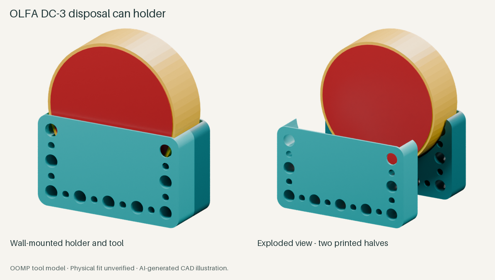

# OLFA DC-3 disposal can holder

AI-generated CAD images and instructions. Errors possible.

[Offline step viewer](assembly_instructions.html) · [Print booklet](assembly_instructions.pdf) · [Holder files](../)

## Assembly and loading

Print two copies of the holder STL. The dark teal half sits against the wall. The light teal half faces the room. The opening and tool handles point up.

1. Orient the rear half as it sits on the wall, with the pocket facing you and the opening at the top.
2. Face the front half toward the rear pocket. Align the mounting holes and both top openings.
3. Bring the halves together until their rims meet. Keep the disposal can closed and lower its round body into the pocket.
4. Lower the tool through the top opening. The can rests against the bottom of the curved pocket with the red face towards the room.

## Model and fit

Round yellow body and red face approximation using OLFA's overall length and thickness and product photograph. The sliding door, lettering and rim details are omitted. The illustrated pose was checked against the production STL at the original model scale. Physical fit remains unverified. [OOMP tool record](https://github.com/oomlout/oomp_tool_version_5/tree/main/parts/tool_knife_utility_blade_disposal_can_olfa_dc_3)

The PDF uses eight landscape A4 pages in reader order. Choose booklet printing for folded copies.
