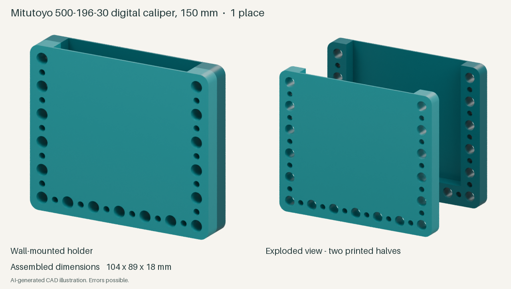

<!-- oobb-presentation:start -->
# Mitutoyo 500-196-30 digital caliper, 150 mm

AI-generated CAD images and instructions. Errors possible.

## Summary

OOBB caliper holder · 1 place.

This is an entirely AI-generated coding project. The generated outputs are included and usually work. The project is published so others can modify and regenerate the designs with their own AI tools.



## Details

| Grid (width × height) | Assembled thickness | Thickness per printed piece |
| --- | --- | --- |
| 7 × 6 | 18 mm | 9 mm |

The grid pitch is 15 mm. The dashed line on the plan locates the cross section. [Section drawing](working.svg)

OOMP ID `oobb_part_holder_tool_caliper_mitutoyo_500_196_30_1_place_7x6x18`

[Part folder](./) · [OOBB navigation](../../navigation_oobb/oobb/part/holder_tool/caliper/mitutoyo_500_196_30/1_place/) · [Source design](https://github.com/oomlout/oomlout_oobb_version_4/blob/41f5386997faef4473c959dfb8c929864d7bf697/oobb_make_sets.py#L626)

<details><summary>Complete part metadata</summary>

```yaml
body_style: vertical_v4
construction:
  mirror_second_print_x: false
  mode: repeat_half
  pocket_on_underside: false
depth: 18
height: 6
layout: 1_place
model: mitutoyo_500_196_30
oobb_details:
  body_style: vertical_v4
  corner_radius_mm: 5
  count: 1
  depth: 18
  edge_reduction_mm: 1
  height: 6
  layered: false
  offset_mm:
  - 0
  - 0
  - 0
  oobb_type: holder_tool
  pitch_mm: 15
  profile:
  - h: 16
    points:
    - - -39
      - 0
    - - -39
      - 78
    - - 39
      - 78
    - - 39
      - 0
    pos:
    - 0
    - -32
    - 0
    rot:
    - 0
    - 0
    - 0
    shape: polygon
  run_scad: true
  run_solidcraft: false
  spacing_mm: 15
  width: 7
oobb_type: holder_tool
profile: tool_measure_caliper_digital_150_mm_length_mitutoyo_mit500_196_30
show_underside: false
source_id: tool_measure_caliper_digital_150_mm_length_mitutoyo_mit500_196_30
svg_details:
  cross_section_y_fraction: 0.82
  near_face_fraction: 0.08
  show_underside: false
  svg_name: holder_sections
taxonomy_1: oobb
taxonomy_10: ''
taxonomy_11: ''
taxonomy_12: ''
taxonomy_13: ''
taxonomy_14: ''
taxonomy_15: ''
taxonomy_2: part
taxonomy_3: holder_tool
taxonomy_4: caliper
taxonomy_5: mitutoyo_500_196_30
taxonomy_6: 1_place
taxonomy_7: 7x6x18
taxonomy_8: ''
taxonomy_9: ''
title: Mitutoyo 500-196-30 digital caliper, 150 mm
tool_type: caliper
width: 7
id: oobb_part_holder_tool_caliper_mitutoyo_500_196_30_1_place_7x6x18
directory: parts/oobb_part_holder_tool_caliper_mitutoyo_500_196_30_1_place_7x6x18
md5: d4785241cc09f79d67b29c3f990ffc08
md5_6: d47852
md5_6_alpha: 8ag5u
```

</details>

## Parts

Use the print mesh in the part folder. Tool and mounting hardware are supplied separately.

## Assembly

Print two copies of the holder half. Turn one over, face the pockets inward and line up the mounting holes and open ends. [Illustrated guides for the four photo-modelled tools](../../README.md#assembly)
<!-- oobb-presentation:end -->
