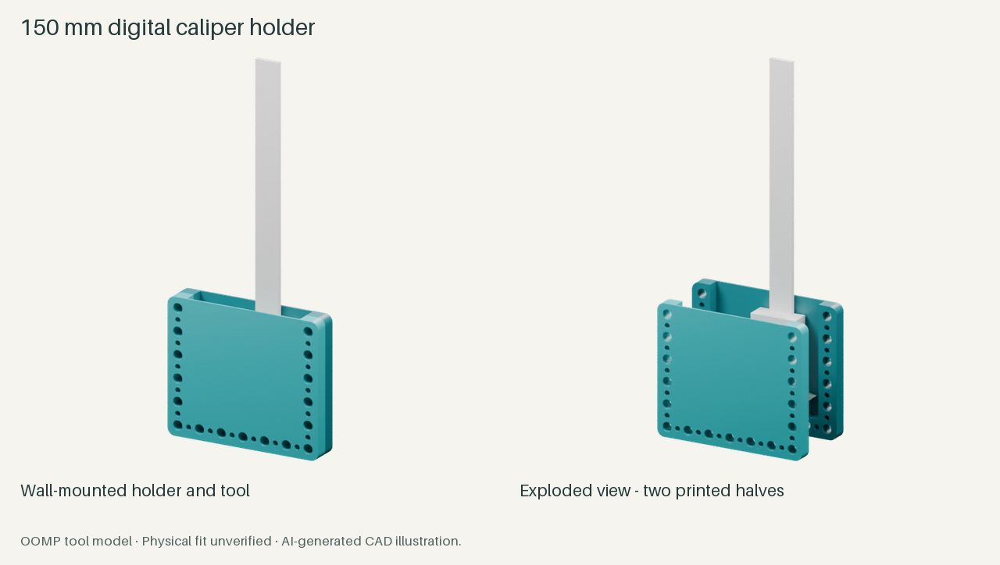

# 150 mm digital caliper holder

AI-generated CAD images and instructions. Errors possible.

[Offline step viewer](assembly_instructions.html) · [Print booklet](assembly_instructions.pdf) · [Holder files](../)

## Assembly and loading

Print two copies of the holder STL. The dark teal half sits against the wall. The light teal half faces the room. The opening and tool handles point up.

1. Orient the rear half as it sits on the wall, with the pocket facing you and the opening at the top.
2. Face the front half toward the rear pocket. Align the mounting holes and both top openings.
3. Bring the halves together until their rims meet. Close the caliper jaws and lower the wide jaw end into the opening, with the display facing forward.
4. Lower the tool through the top opening. The wide jaw end rests at the pocket floor and the beam projects above the holder.

## Model and fit

Closed caliper. Overall length, beam width and outside jaw length follow the Mitutoyo dimensional drawing. Slider, jaws and display are simplified for identification. The illustrated pose was checked against the production STL at the original model scale. Physical fit remains unverified. [OOMP tool record](https://github.com/oomlout/oomp_tool_version_5/tree/main/parts/tool_measure_caliper_digital_150_mm_length_mitutoyo_mit500_196_30)

The PDF uses eight landscape A4 pages in reader order. Choose booklet printing for folded copies.
