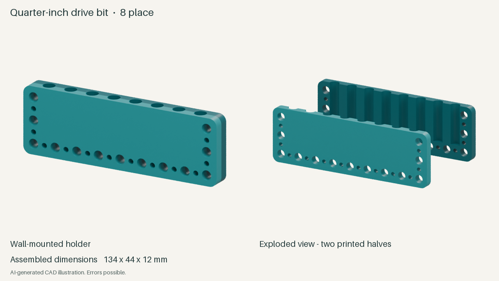

<!-- oobb-presentation:start -->
# Quarter-inch drive bit

AI-generated CAD images and instructions. Errors possible.

## Summary

OOBB driver bit holder · 8 place.

This is an entirely AI-generated coding project. The generated outputs are included and usually work. The project is published so others can modify and regenerate the designs with their own AI tools.



## Details

| Grid (width × height) | Assembled thickness | Thickness per printed piece |
| --- | --- | --- |
| 9 × 3 | 12 mm | 6 mm |

The grid pitch is 15 mm. The dashed line on the plan locates the cross section. [Section drawing](working.svg)

OOMP ID `oobb_part_holder_tool_driver_bit_quarter_inch_8_place_9x3x12`

[Part folder](./) · [OOBB navigation](../../navigation_oobb/oobb/part/holder_tool/driver_bit/quarter_inch/8_place/) · [Source design](https://github.com/oomlout/oomlout_oobb_part_tool_holder_vertical/tree/93a962a09e0c275c3cfa62187182ac3203bde1b2/parts/oobb_part_tool_holder_vertical_9_width_3_height_12_mm_depth_tool_screwdriver_bit_quarter_inch_drive_tool_8_multiple_extra)

<details><summary>Complete part metadata</summary>

```yaml
body_style: vertical_project
bottom_m6_clearance_mm: 1.5
construction:
  mirror_second_print_x: false
  mode: repeat_half
  pocket_on_underside: true
count: 8
depth: 12
height: 3
layered: false
layout: 8_place
model: quarter_inch
oobb_details:
  body_style: vertical_project
  bottom_m6_clearance_mm: 1.5
  corner_radius_mm: 5
  count: 8
  depth: 12
  edge_reduction_mm: 1
  height: 3
  layered: false
  offset_mm:
  - 0
  - 0
  - 0
  oobb_type: holder_tool
  pitch_mm: 15
  profile:
  - h: 100
    pos:
    - 0
    - 0
    - 0
    r: 4
    rot:
    - -90
    - 0
    - 0
    shape: cylinder
  run_scad: true
  run_solidcraft: false
  spacing_mm: 15
  width: 9
oobb_type: holder_tool
profile: quarter_inch
show_underside: true
source_id: oobb_part_tool_holder_vertical_9_width_3_height_12_mm_depth_tool_screwdriver_bit_quarter_inch_drive_tool_8_multiple_extra
spacing_mm: 15
svg_details:
  cross_section_y_fraction: 0.82
  near_face_fraction: 0.08
  show_underside: true
  svg_name: holder_sections
taxonomy_1: oobb
taxonomy_10: ''
taxonomy_11: ''
taxonomy_12: ''
taxonomy_13: ''
taxonomy_14: ''
taxonomy_15: ''
taxonomy_2: part
taxonomy_3: holder_tool
taxonomy_4: driver_bit
taxonomy_5: quarter_inch
taxonomy_6: 8_place
taxonomy_7: 9x3x12
taxonomy_8: ''
taxonomy_9: ''
title: Quarter-inch drive bit
tool_type: driver_bit
width: 9
id: oobb_part_holder_tool_driver_bit_quarter_inch_8_place_9x3x12
directory: parts/oobb_part_holder_tool_driver_bit_quarter_inch_8_place_9x3x12
md5: 7d5bd8c6a943e1040b903eb56e6fd5e4
md5_6: 7d5bd8
md5_6_alpha: 4w34o
```

</details>

## Parts

Use the print mesh in the part folder. Tool and mounting hardware are supplied separately.

## Assembly

Print two copies of the holder half. Turn one over, face the pockets inward and line up the mounting holes and open ends. The pocket floors stop 1.5 mm above the rim of the bottom M6 mounting holes. [Illustrated tool-loading guides](../../README.md#assembly)
<!-- oobb-presentation:end -->
