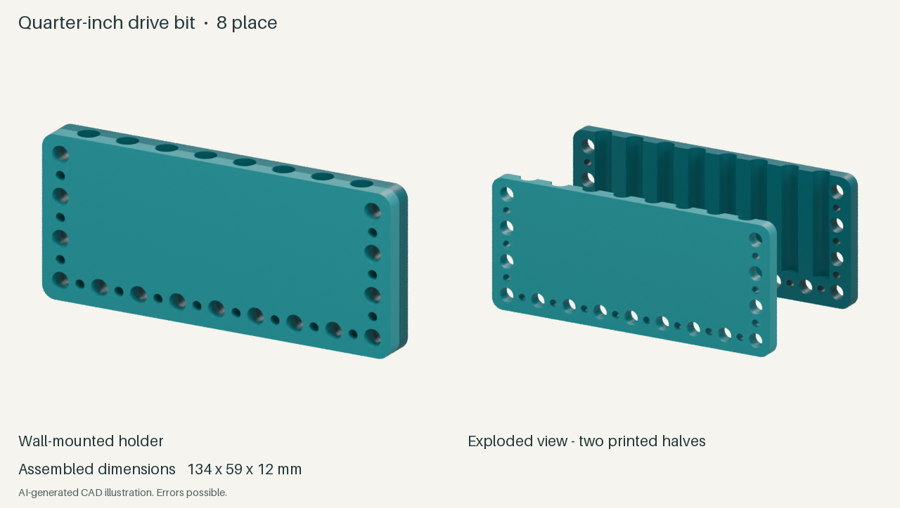
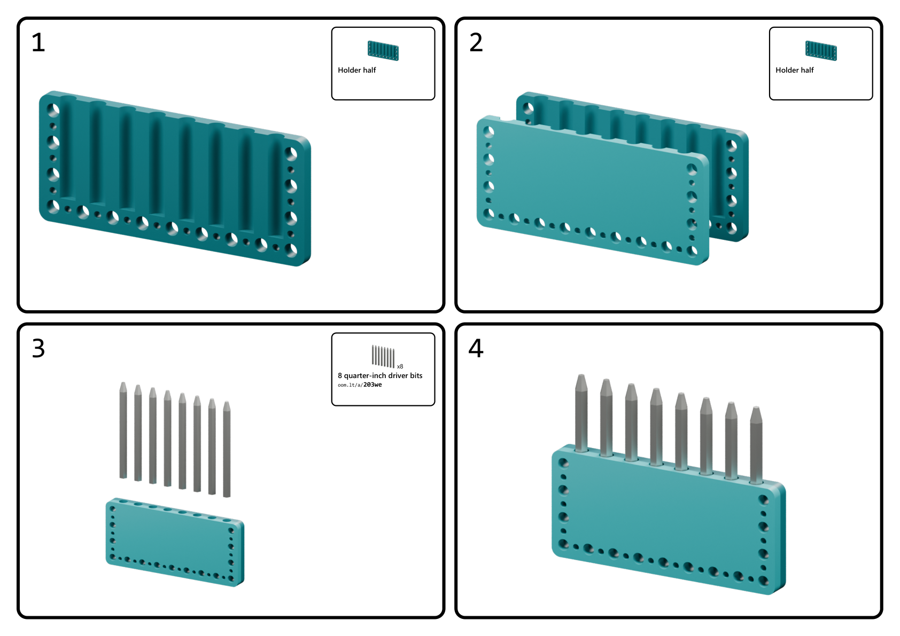

<!-- oobb-presentation:start -->
# Quarter-inch drive bit

AI-generated CAD images and instructions. Errors possible.

## Summary

OOBB driver bit holder · 8 place.

This is an entirely AI-generated coding project. The generated outputs are included and usually work. The project is published so others can modify and regenerate the designs with their own AI tools.



## Details

| Grid (width × height) | Assembled thickness | Thickness per printed piece |
| --- | --- | --- |
| 9 × 4 | 12 mm | 6 mm |

The grid pitch is 15 mm. The dashed line on the plan locates the cross section. [Section drawing](working.svg)

OOMP ID `oobb_part_holder_tool_driver_bit_quarter_inch_8_place_9x4x12`

[Part folder](./) · [OOBB navigation](../../navigation_oobb/oobb/part/holder_tool/driver_bit/quarter_inch/8_place/) · [Source design](https://github.com/oomlout/oomlout_oobb_part_tool_holder_vertical/tree/93a962a09e0c275c3cfa62187182ac3203bde1b2/parts/oobb_part_tool_holder_vertical_9_width_4_height_12_mm_depth_tool_screwdriver_bit_quarter_inch_drive_tool_8_multiple_extra)

<details><summary>Complete part metadata</summary>

```yaml
assembly_details:
  alignment: Hold the bits vertically above their round pockets.
  check: Each shank rests at the pocket floor with the tip accessible above the holder.
  instance_x_mm:
  - -52.5
  - -37.5
  - -22.5
  - -7.5
  - 7.5
  - 22.5
  - 37.5
  - 52.5
  label: 8 quarter-inch driver bits
  layout: 8_place
  model_kind: long_driver_bit
  rotation_deg:
  - 0
  - 0
  - 0
  steps:
  - action: Orient the rear half as it sits on the wall, with the pocket facing you
      and the opening at the top.
    add:
    - holder
    key: step_01
    upper_lift_mm: 0
    withdraw_mm: 0
  - action: Face the front half toward the rear pocket. Align the mounting holes and
      both top openings.
    add:
    - holder
    key: step_02
    upper_lift_mm: 36
    withdraw_mm: 0
  - action: Bring the halves together until their rims meet. Hold the bits vertically
      above their round pockets.
    add:
    - tool
    - tool
    - tool
    - tool
    - tool
    - tool
    - tool
    - tool
    key: step_03
    upper_lift_mm: 0
    withdraw_mm: 70
  - action: Lower the tools through the top openings. Each shank rests at the pocket
      floor with the tip accessible above the holder.
    add: []
    key: step_04
    upper_lift_mm: 0
    withdraw_mm: 0
  style:
    border: '000000'
    border_radius_mm: 3
    border_width_pt: 3
    columns: 2
    component_border_width_pt: 1.1
    font_body_pt: 7
    font_code_pt: 6.4
    font_url_prefix_pt: 4.8
    gutter_mm: 4
    margin_mm: 6
    page_mm:
    - 297
    - 210
    quantity_pt: 5.8
    quantity_shift_mm: 1
    rows: 2
    thumbnail_height_mm: 8.5
  tool_id: tool_screwdriver_bit_quarter_inch_drive
  translation_mm:
  - 0
  - -17.75
  - 0
body_style: vertical_project
bottom_m6_clearance_mm: 1.5
construction:
  mirror_second_print_x: false
  mode: repeat_half
  pocket_on_underside: true
count: 8
depth: 12
height: 4
layered: false
layout: 8_place
model: quarter_inch
oobb_details:
  body_style: vertical_project
  bottom_m6_clearance_mm: 1.5
  corner_radius_mm: 5
  count: 8
  depth: 12
  edge_reduction_mm: 1
  height: 4
  layered: false
  offset_mm:
  - 0
  - 0
  - 0
  oobb_type: holder_tool
  pitch_mm: 15
  profile:
  - h: 100
    pos:
    - 0
    - 0
    - 0
    r: 4
    rot:
    - -90
    - 0
    - 0
    shape: cylinder
  run_scad: true
  run_solidcraft: false
  spacing_mm: 15
  width: 9
oobb_type: holder_tool
profile: quarter_inch
show_underside: true
source_id: oobb_part_tool_holder_vertical_9_width_4_height_12_mm_depth_tool_screwdriver_bit_quarter_inch_drive_tool_8_multiple_extra
spacing_mm: 15
svg_details:
  cross_section_y_fraction: 0.82
  near_face_fraction: 0.08
  show_underside: true
  svg_name: holder_sections
taxonomy_1: oobb
taxonomy_10: ''
taxonomy_11: ''
taxonomy_12: ''
taxonomy_13: ''
taxonomy_14: ''
taxonomy_15: ''
taxonomy_2: part
taxonomy_3: holder_tool
taxonomy_4: driver_bit
taxonomy_5: quarter_inch
taxonomy_6: 8_place
taxonomy_7: 9x4x12
taxonomy_8: ''
taxonomy_9: ''
title: Quarter-inch drive bit
tool_type: driver_bit
width: 9
id: oobb_part_holder_tool_driver_bit_quarter_inch_8_place_9x4x12
directory: parts/oobb_part_holder_tool_driver_bit_quarter_inch_8_place_9x4x12
md5: 9330c1b366dca85afd3badfc9e05bb1b
md5_6: 9330c1
md5_6_alpha: 5qr41
```

</details>

## Parts

Use the print mesh in the part folder. Tool and mounting hardware are supplied separately.

## Assembly

Print two copies of the holder STL. The dark teal half sits against the wall and the light teal half faces the room.

1. Orient the rear half as it sits on the wall, with the pocket facing you and the opening at the top. [View step 1](assembly/render/raw/step_01.png)
2. Face the front half toward the rear pocket. Align the mounting holes and both top openings. [View step 2](assembly/render/raw/step_02.png)
3. Bring the halves together until their rims meet. Hold the bits vertically above their round pockets. [View step 3](assembly/render/raw/step_03.png)
4. Lower the tools through the top openings. Each shank rests at the pocket floor with the tip accessible above the holder. [View step 4](assembly/render/raw/step_04.png)

<details><summary>Illustrated assembly steps</summary>



</details>

Representative Wera 851/4 Z PH2 bit, 89 mm long with a quarter-inch drive. The tapered tip is simplified and its length and end diameter are estimated. The digital model was checked against the printed holder. Physical fit remains unverified. [OOMP tool record](https://github.com/oomlout/oomp_tool_version_5/tree/main/parts/tool_screwdriver_bit_quarter_inch_drive)

[Open assembly viewer](https://raw.githack.com/oomlout/oomlout_oobb_part_holder_tool_version_5/main/parts/oobb_part_holder_tool_driver_bit_quarter_inch_8_place_9x4x12/assembly/assembly_instructions.html) · [Print booklet (PDF)](assembly/assembly_instructions.pdf)
<!-- oobb-presentation:end -->
