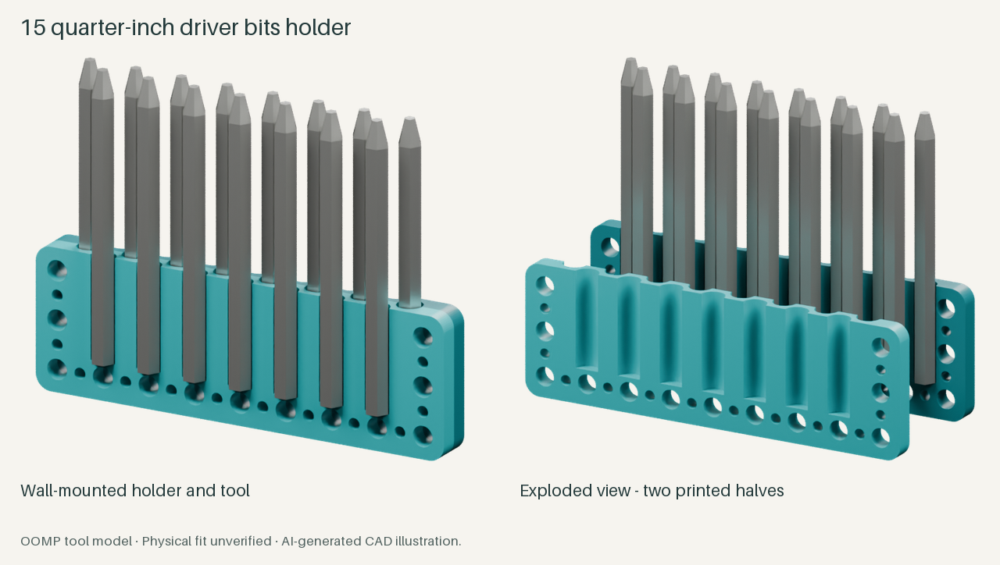

# 15 quarter-inch driver bits holder

AI-generated CAD images and instructions. Errors possible.

[Offline step viewer](assembly_instructions.html) · [Print booklet](assembly_instructions.pdf) · [Holder files](../)

## Assembly and loading

Print two copies of the holder STL. The dark teal half sits against the wall. The light teal half faces the room. The opening and tool handles point up.

1. Orient the rear half as it sits on the wall, with the pocket facing you and the opening at the top.
2. Face the front half toward the rear pocket. Align the mounting holes and both top openings.
3. Bring the halves together until their rims meet. Place eight bits in the centre row and seven in the staggered front row.
4. Lower the tools through the top openings. Seat the shanks at the pocket floors. The staggered row lies in the front-face grooves.

## Model and fit

Representative Wera 851/4 Z PH2 bit, 89 mm long with a quarter-inch drive. The tapered tip is simplified and its length and end diameter are estimated. The illustrated pose was checked against the production STL at the original model scale. Physical fit remains unverified. [OOMP tool record](https://github.com/oomlout/oomp_tool_version_5/tree/main/parts/tool_screwdriver_bit_quarter_inch_drive)

The seven staggered front positions are open-face grooves. Bit retention has not been physically tested.

The PDF uses eight landscape A4 pages in reader order. Choose booklet printing for folded copies.
