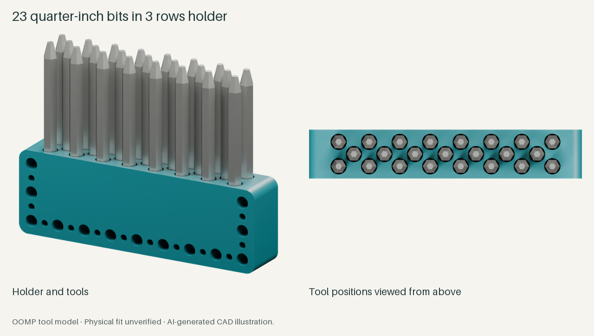
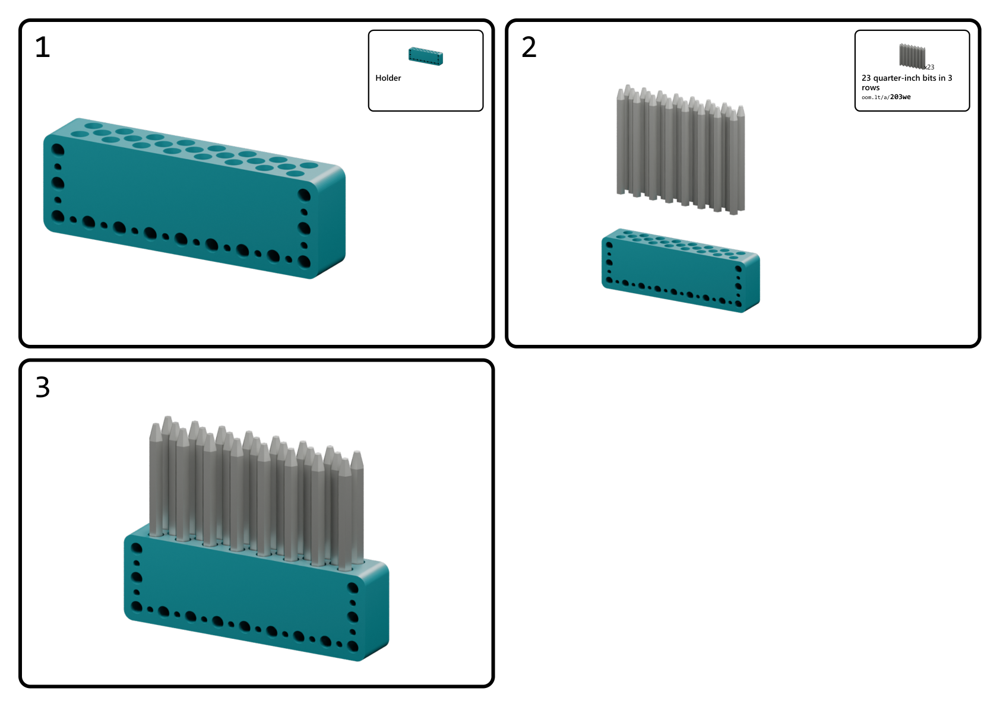

<!-- oobb-presentation:start -->
# Quarter-inch drive bit block, 3 rows

AI-generated CAD images and instructions. Errors possible.

## Summary

OOBB driver bit holder · block 3 rows.

This is an entirely AI-generated coding project. The generated outputs are included and usually work. The project is published so others can modify and regenerate the designs with their own AI tools.



## Details

| Grid (width × height) | Assembled thickness | Thickness per printed piece |
| --- | --- | --- |
| 9 × 3 | 24 mm | 24 mm |

The grid pitch is 15 mm. The dashed line on the plan locates the cross section. [Section drawing](working.svg)

OOMP ID `oobb_part_holder_tool_driver_bit_quarter_inch_block_3_rows_9x3x24`

[Part folder](./) · [OOBB navigation](../../navigation_oobb/oobb/part/holder_tool/driver_bit/quarter_inch/block_3_rows/) · [Source design](../../working_oomp_populate.py)

<details><summary>Complete part metadata</summary>

```yaml
assembly_details:
  alignment: Align the bits vertically above the staggered rows of openings.
  check: Each shank rests on its pocket floor, with its tip above the block.
  insertion_axis:
  - 0
  - 0
  - 1
  instance_offsets_mm:
  - - -52.5
    - 6
    - 0
  - - -37.5
    - 6
    - 0
  - - -22.5
    - 6
    - 0
  - - -7.5
    - 6
    - 0
  - - 7.5
    - 6
    - 0
  - - 22.5
    - 6
    - 0
  - - 37.5
    - 6
    - 0
  - - 52.5
    - 6
    - 0
  - - -45
    - 0
    - 0
  - - -30
    - 0
    - 0
  - - -15
    - 0
    - 0
  - - 0
    - 0
    - 0
  - - 15
    - 0
    - 0
  - - 30
    - 0
    - 0
  - - 45
    - 0
    - 0
  - - -52.5
    - -6
    - 0
  - - -37.5
    - -6
    - 0
  - - -22.5
    - -6
    - 0
  - - -7.5
    - -6
    - 0
  - - 7.5
    - -6
    - 0
  - - 22.5
    - -6
    - 0
  - - 37.5
    - -6
    - 0
  - - 52.5
    - -6
    - 0
  label: 23 quarter-inch bits in 3 rows
  layout: block_3_rows
  model_kind: long_driver_bit
  rotation_deg:
  - 90
  - 0
  - 0
  single_piece: true
  steps:
  - action: Place the printed block upright with all pocket openings facing up.
    add:
    - holder
    key: step_01
    upper_lift_mm: 0
    withdraw_mm: 0
  - action: Align the bits vertically above the staggered rows of openings.
    add:
    - tool
    - tool
    - tool
    - tool
    - tool
    - tool
    - tool
    - tool
    - tool
    - tool
    - tool
    - tool
    - tool
    - tool
    - tool
    - tool
    - tool
    - tool
    - tool
    - tool
    - tool
    - tool
    - tool
    key: step_02
    upper_lift_mm: 0
    withdraw_mm: 70
  - action: Lower the bits into the pockets. Each shank rests on its pocket floor,
      with its tip above the block.
    add: []
    key: step_03
    upper_lift_mm: 0
    withdraw_mm: 0
  style:
    border: '000000'
    border_radius_mm: 3
    border_width_pt: 3
    columns: 2
    component_border_width_pt: 1.1
    font_body_pt: 7
    font_code_pt: 6.4
    font_url_prefix_pt: 4.8
    gutter_mm: 4
    margin_mm: 6
    page_mm:
    - 297
    - 210
    quantity_pt: 5.8
    quantity_shift_mm: 1
    rows: 2
    thumbnail_height_mm: 8.5
  tool_id: tool_screwdriver_bit_quarter_inch_drive
  translation_mm:
  - 0
  - 0
  - 11.75
body_style: bit_block
bottom_m6_clearance_mm: 1.5
construction:
  mirror_second_print_x: false
  mode: block
  pocket_on_underside: false
count: 8
cross_section_y_fraction: 0.5
depth: 24
height: 3
layout: block_3_rows
model: quarter_inch
oobb_details:
  body_style: bit_block
  bottom_m6_clearance_mm: 1.5
  corner_radius_mm: 5
  count: 8
  depth: 24
  edge_reduction_mm: 1
  height: 3
  layered: false
  offset_mm:
  - 0
  - 0
  - 0
  oobb_type: holder_tool
  pitch_mm: 15
  profile:
  - h: 100
    pos:
    - 0
    - 0
    - 0
    r: 4
    rot:
    - -90
    - 0
    - 0
    shape: cylinder
  row_count: 3
  row_pitch_mm: 6
  run_scad: true
  run_solidcraft: false
  spacing_mm: 15
  width: 9
oobb_type: holder_tool
profile: quarter_inch
row_count: 3
row_pitch_mm: 6
spacing_mm: 15
svg_details:
  cross_section_y_fraction: 0.5
  near_face_fraction: 0.08
  show_underside: false
  svg_name: holder_sections
taxonomy_1: oobb
taxonomy_10: ''
taxonomy_11: ''
taxonomy_12: ''
taxonomy_13: ''
taxonomy_14: ''
taxonomy_15: ''
taxonomy_2: part
taxonomy_3: holder_tool
taxonomy_4: driver_bit
taxonomy_5: quarter_inch
taxonomy_6: block_3_rows
taxonomy_7: 9x3x24
taxonomy_8: ''
taxonomy_9: ''
title: Quarter-inch drive bit block, 3 rows
tool_type: driver_bit
width: 9
id: oobb_part_holder_tool_driver_bit_quarter_inch_block_3_rows_9x3x24
directory: parts/oobb_part_holder_tool_driver_bit_quarter_inch_block_3_rows_9x3x24
md5: d63ed4e94547cbaf4ec058fe2cb5e389
md5_6: d63ed4
md5_6_alpha: 8cxxw
```

</details>

## Parts

Use the print mesh in the part folder. Tool and mounting hardware are supplied separately.

## Assembly

Print the holder once. Place the holder upright with its openings facing up.

1. Place the printed block upright with all pocket openings facing up. [View step 1](assembly/render/raw/step_01.png)
2. Align the bits vertically above the staggered rows of openings. [View step 2](assembly/render/raw/step_02.png)
3. Lower the bits into the pockets. Each shank rests on its pocket floor, with its tip above the block. [View step 3](assembly/render/raw/step_03.png)

<details><summary>Illustrated assembly steps</summary>



</details>

Representative Wera 851/4 Z PH2 bit, 89 mm long with a quarter-inch drive. The tapered tip is simplified and its length and end diameter are estimated. The digital model was checked against the printed holder. Physical fit remains unverified. [OOMP tool record](https://github.com/oomlout/oomp_tool_version_5/tree/main/parts/tool_screwdriver_bit_quarter_inch_drive)

[Open assembly viewer](https://raw.githack.com/oomlout/oomlout_oobb_part_holder_tool_version_5/main/parts/oobb_part_holder_tool_driver_bit_quarter_inch_block_3_rows_9x3x24/assembly/assembly_instructions.html) · [Print booklet (PDF)](assembly/assembly_instructions.pdf)
<!-- oobb-presentation:end -->
