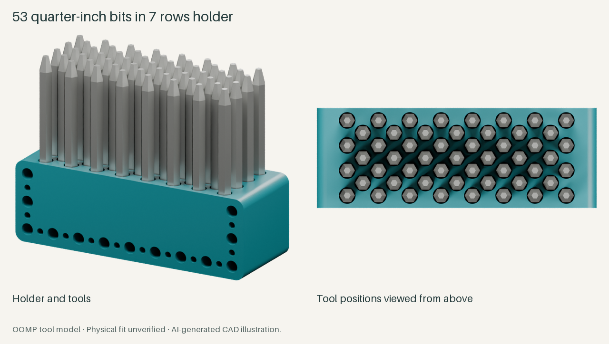

# 53 quarter-inch bits in 7 rows holder

AI-generated CAD images and instructions. Errors possible.

[Offline step viewer](assembly_instructions.html) · [Print booklet](assembly_instructions.pdf) · [Holder files](../)

## Assembly and loading

Print the holder once. Place the block upright with the openings facing up.

1. Place the printed block upright with all pocket openings facing up.
2. Align the bits vertically above the staggered rows of openings.
3. Lower the bits into the pockets. Each shank rests on its pocket floor, with its tip above the block.

## Model and fit

Representative Wera 851/4 Z PH2 bit, 89 mm long with a quarter-inch drive. The tapered tip is simplified and its length and end diameter are estimated. The illustrated pose was checked against the production STL at the original model scale. Physical fit remains unverified. [OOMP tool record](https://github.com/oomlout/oomp_tool_version_5/tree/main/parts/tool_screwdriver_bit_quarter_inch_drive)

The PDF uses eight landscape A4 pages in reader order. Choose booklet printing for folded copies.
