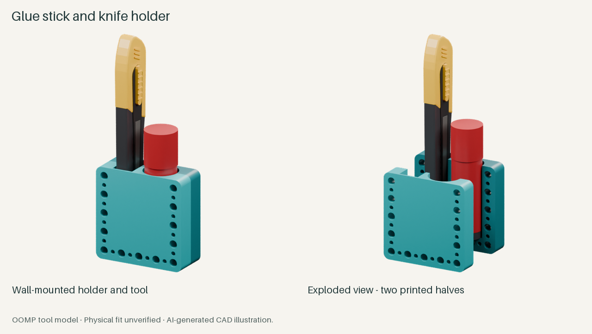

# Glue stick and knife holder

AI-generated CAD images and instructions. Errors possible.

[Offline step viewer](assembly_instructions.html) · [Print booklet](assembly_instructions.pdf) · [Holder files](../)

## Assembly and loading

Print the supplied two-half layout once. The dark teal half sits against the wall. The light teal half faces the room. The opening and tool handles point up.

1. Orient the rear half as it sits on the wall, with the pocket facing you and the opening at the top.
2. Face the front half toward the rear pocket. Align the mounting holes and both top openings.
3. Bring the halves together until their rims meet. Hold the glue stick closed over the round pocket and the closed utility knife edge-on over its slot.
4. Lower the tools through the top openings. The twist base and closed knife sit in their separate pockets, with their upper ends accessible.

## Model and fit

Representative PLUS Pritt medium NS-702, approximately 20 g and 26 × 95 mm. The red closed body and dark twist base are simplified, with estimated cap and base lengths. The workshop specimen has not been measured. The illustrated pose was checked against the production STL at the original model scale. Physical fit remains unverified. [OOMP tool record](https://github.com/oomlout/oomp_tool_version_5/tree/main/parts/stationery_glue_stick_medium_prit_style)

Closed exterior based on the photo and a provisional 165 mm STANLEY 0-10-151 reference. The 17 mm OOMP label is retained. Size variant awaits measurement. [OOMP tool record](https://github.com/oomlout/oomp_tool_version_5/tree/main/tool_knife_craft_17_mm_black_exacto_style)

The PDF uses eight landscape A4 pages in reader order. Choose booklet printing for folded copies.
