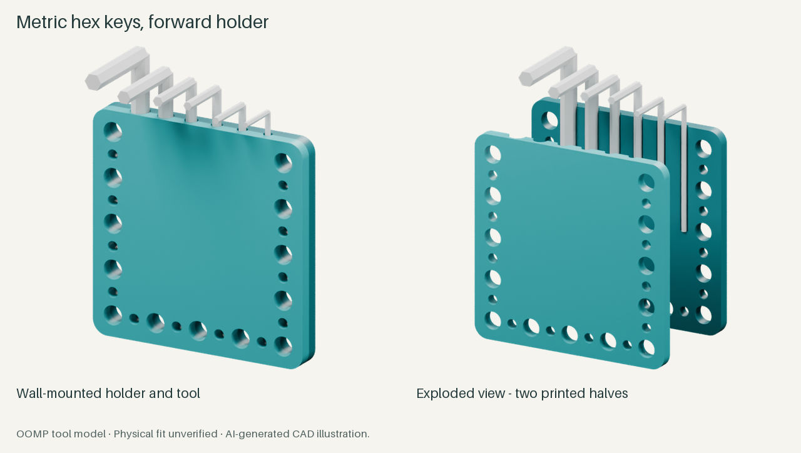

# Metric hex keys, forward holder

AI-generated CAD images and instructions. Errors possible.

[Offline step viewer](assembly_instructions.html) · [Print booklet](assembly_instructions.pdf) · [Holder files](../)

## Assembly and loading

Print the supplied two-half layout once. The dark teal half sits against the wall. The light teal half faces the room. The opening and tool handles point up.

1. Orient the rear printed half on the wall with the pockets facing out.
2. Align the front printed half with the rear half and their holes.
3. Join the halves and lower the 1.5, 2 and 2.5 mm keys into their pockets.
4. Lower the 3, 4 and 5 mm keys into the remaining pockets.
5. Seat every key at its pocket floor with each short arm pointing forward.

## Model and fit

The holder specifies the hex size. Arm lengths follow the Wiha 350 short series as a representative example. The holder source leaves the key manufacturer unspecified. The elbow is simplified. The illustrated pose was checked against the production STL at the original model scale. Physical fit remains unverified. [OOMP tool record](https://github.com/oomlout/oomp_tool_version_5/tree/main/parts/tool_hex_key_1_5_mm)

The holder specifies the hex size. Arm lengths follow the Wiha 350 short series as a representative example. The holder source leaves the key manufacturer unspecified. The elbow is simplified. [OOMP tool record](https://github.com/oomlout/oomp_tool_version_5/tree/main/tool_hex_key_2_mm)

The holder specifies the hex size. Arm lengths follow the Wiha 350 short series as a representative example. The holder source leaves the key manufacturer unspecified. The elbow is simplified. [OOMP tool record](https://github.com/oomlout/oomp_tool_version_5/tree/main/tool_hex_key_2_5_mm)

The holder specifies the hex size. Arm lengths follow the Wiha 350 short series as a representative example. The holder source leaves the key manufacturer unspecified. The elbow is simplified. [OOMP tool record](https://github.com/oomlout/oomp_tool_version_5/tree/main/tool_hex_key_3_mm)

The holder specifies the hex size. Arm lengths follow the Wiha 350 short series as a representative example. The holder source leaves the key manufacturer unspecified. The elbow is simplified. [OOMP tool record](https://github.com/oomlout/oomp_tool_version_5/tree/main/tool_hex_key_4_mm)

The holder specifies the hex size. Arm lengths follow the Wiha 350 short series as a representative example. The holder source leaves the key manufacturer unspecified. The elbow is simplified. [OOMP tool record](https://github.com/oomlout/oomp_tool_version_5/tree/main/tool_hex_key_5_mm)

The PDF uses eight landscape A4 pages in reader order. Choose booklet printing for folded copies.
