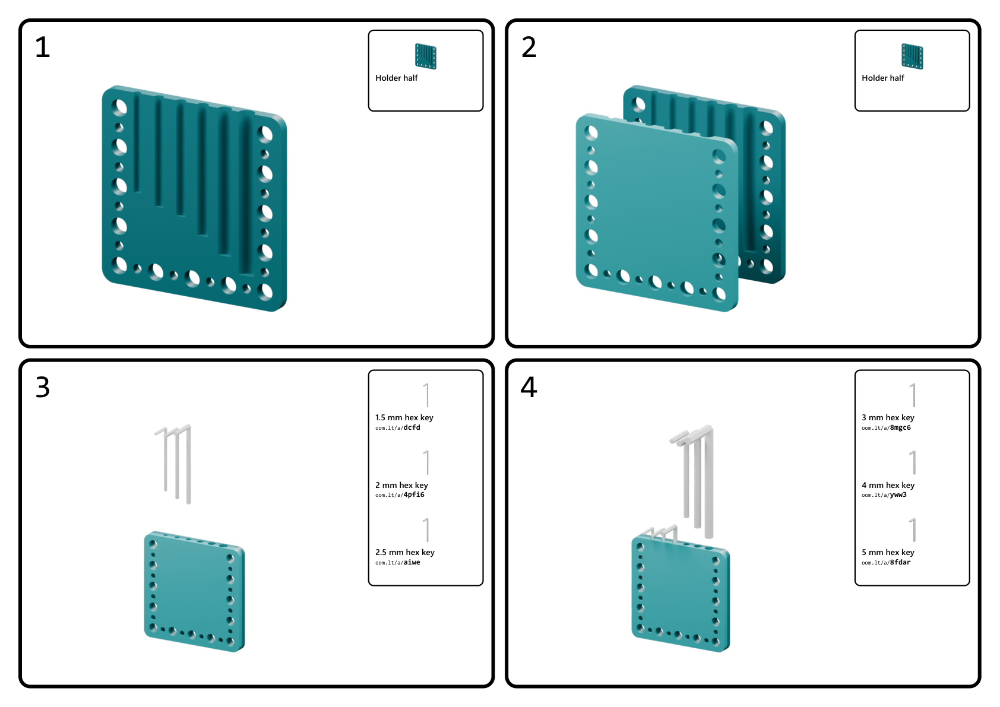
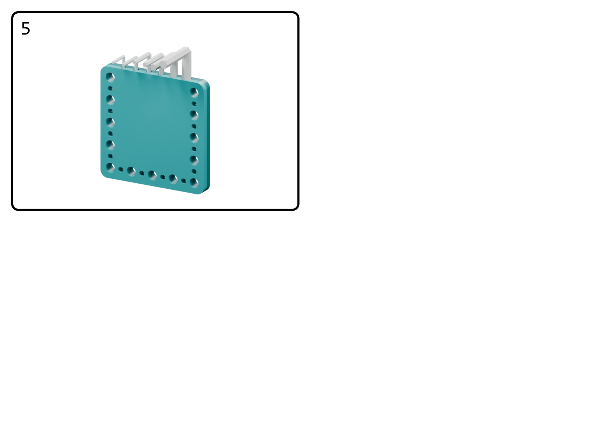

<!-- oobb-presentation:start -->
# Small metric hex keys, 1.5–5 mm

AI-generated CAD images and instructions. Errors possible.

## Summary

OOBB hex key holder · 6 reverse.

This is an entirely AI-generated coding project. The generated outputs are included and usually work. The project is published so others can modify and regenerate the designs with their own AI tools.


## Details

| Grid (width × height) | Assembled thickness | Thickness per printed piece |
| --- | --- | --- |
| 5 × 5 | 8 mm | 4 mm |

The grid pitch is 15 mm. The dashed line on the plan locates the cross section. [Section drawing](working.svg)

OOMP ID `oobb_part_holder_tool_hex_key_small_metric_set_6_reverse_5x5x8`

[Part folder](./) · [OOBB navigation](../../navigation_oobb/oobb/part/holder_tool/hex_key/small_metric_set/6_reverse/) · [Source design](https://github.com/oomlout/oomlout_oobb_version_4/blob/41f5386997faef4473c959dfb8c929864d7bf697/oobb_make_sets.py#L626)

<details><summary>Complete part metadata</summary>

```yaml
assembly_details:
  additional_tools:
  - key: key_2
    label: 2 mm hex key
    model_kind: hex_key
    rotation_deg:
    - 0
    - -90
    - 0
    tool_id: tool_hex_key_2_mm
    translation_mm:
    - -13.5
    - -5
    - 3
  - key: key_2_5
    label: 2.5 mm hex key
    model_kind: hex_key
    rotation_deg:
    - 0
    - -90
    - 0
    tool_id: tool_hex_key_2_5_mm
    translation_mm:
    - -4.5
    - -7
    - 3
  - key: key_3
    label: 3 mm hex key
    model_kind: hex_key
    rotation_deg:
    - 0
    - -90
    - 0
    tool_id: tool_hex_key_3_mm
    translation_mm:
    - 4.5
    - -13
    - 3
  - key: key_4
    label: 4 mm hex key
    model_kind: hex_key
    rotation_deg:
    - 0
    - -90
    - 0
    tool_id: tool_hex_key_4_mm
    translation_mm:
    - 13.5
    - -19
    - 3
  - key: key_5
    label: 5 mm hex key
    model_kind: hex_key
    rotation_deg:
    - 0
    - -90
    - 0
    tool_id: tool_hex_key_5_mm
    translation_mm:
    - 22.5
    - -25
    - 3
  alignment: Turn each key so its short arm points forward, then align the long arm
    over its sized bore.
  check: Each key rests at its own bore floor and all six short arms remain accessible.
  custom_steps:
  - action: Orient the rear printed half on the wall with the pockets facing out.
    add:
    - holder
    key: step_01
    upper_lift_mm: 0
    withdraw_mm: 0
  - action: Align the front printed half with the rear half and their holes.
    add:
    - holder
    key: step_02
    upper_lift_mm: 36
    withdraw_mm: 0
  - action: Join the halves and lower the 1.5, 2 and 2.5 mm keys into their pockets.
    add:
    - tool
    - key_2
    - key_2_5
    key: step_03
    upper_lift_mm: 0
    withdraw_mm: 70
  - action: Lower the 3, 4 and 5 mm keys into the remaining pockets.
    add:
    - key_3
    - key_4
    - key_5
    key: step_04
    upper_lift_mm: 0
    withdraw_mm: 70
  - action: Seat every key at its pocket floor with each short arm pointing forward.
    add: []
    key: step_05
    upper_lift_mm: 0
    withdraw_mm: 0
  label: Metric hex keys, reverse
  layout: 6_reverse
  model_kind: hex_key
  primary_label: 1.5 mm hex key
  rotation_deg:
  - 0
  - -90
  - 0
  steps:
  - action: Orient the rear printed half on the wall with the pockets facing out.
    add:
    - holder
    key: step_01
    upper_lift_mm: 0
    withdraw_mm: 0
  - action: Align the front printed half with the rear half and their holes.
    add:
    - holder
    key: step_02
    upper_lift_mm: 36
    withdraw_mm: 0
  - action: Join the halves and lower the 1.5, 2 and 2.5 mm keys into their pockets.
    add:
    - tool
    - key_2
    - key_2_5
    key: step_03
    upper_lift_mm: 0
    withdraw_mm: 70
  - action: Lower the 3, 4 and 5 mm keys into the remaining pockets.
    add:
    - key_3
    - key_4
    - key_5
    key: step_04
    upper_lift_mm: 0
    withdraw_mm: 70
  - action: Seat every key at its pocket floor with each short arm pointing forward.
    add: []
    key: step_05
    upper_lift_mm: 0
    withdraw_mm: 0
  style:
    border: '000000'
    border_radius_mm: 3
    border_width_pt: 3
    columns: 2
    component_border_width_pt: 1.1
    font_body_pt: 7
    font_code_pt: 6.4
    font_url_prefix_pt: 4.8
    gutter_mm: 4
    margin_mm: 6
    page_mm:
    - 297
    - 210
    quantity_pt: 5.8
    quantity_shift_mm: 1
    rows: 2
    thumbnail_height_mm: 8.5
  tool_id: tool_hex_key_1_5_mm
  translation_mm:
  - -22.5
  - -1
  - 3
body_style: handed_pair
construction:
  mirror_second_print_x: false
  mode: handed_pair
  pocket_on_underside: false
depth: 8
height: 5
layout: 6_reverse
model: small_metric_set
oobb_details:
  body_style: handed_pair
  corner_radius_mm: 5
  count: 1
  depth: 8
  edge_reduction_mm: 1
  height: 5
  layered: false
  offset_mm:
  - 0
  - 0
  - 0
  oobb_type: holder_tool
  pitch_mm: 15
  profile:
  - h: 100
    pos:
    - -22.5
    - -25
    - -1
    r: 3.25
    rot:
    - -90
    - 0
    - 0
    shape: cylinder
  - h: 100
    pos:
    - -13.5
    - -19
    - -1
    r: 2.75
    rot:
    - -90
    - 0
    - 0
    shape: cylinder
  - h: 100
    pos:
    - -4.5
    - -13
    - -1
    r: 2.25
    rot:
    - -90
    - 0
    - 0
    shape: cylinder
  - h: 100
    pos:
    - 4.5
    - -7
    - -1
    r: 1.95
    rot:
    - -90
    - 0
    - 0
    shape: cylinder
  - h: 100
    pos:
    - 13.5
    - -5
    - -1
    r: 1.8
    rot:
    - -90
    - 0
    - 0
    shape: cylinder
  - h: 100
    pos:
    - 22.5
    - -1
    - -1
    r: 1.55
    rot:
    - -90
    - 0
    - 0
    shape: cylinder
  run_scad: true
  run_solidcraft: false
  spacing_mm: 15
  width: 5
oobb_type: holder_tool
profile: tool_screwdriver_hex_key_set_small_reverse
show_underside: false
source_id: tool_screwdriver_hex_key_set_small_reverse
svg_details:
  cross_section_y_fraction: 0.82
  near_face_fraction: 0.08
  show_underside: false
  svg_name: holder_sections
taxonomy_1: oobb
taxonomy_10: ''
taxonomy_11: ''
taxonomy_12: ''
taxonomy_13: ''
taxonomy_14: ''
taxonomy_15: ''
taxonomy_2: part
taxonomy_3: holder_tool
taxonomy_4: hex_key
taxonomy_5: small_metric_set
taxonomy_6: 6_reverse
taxonomy_7: 5x5x8
taxonomy_8: ''
taxonomy_9: ''
title: Small metric hex keys, 1.5–5 mm
tool_type: hex_key
width: 5
id: oobb_part_holder_tool_hex_key_small_metric_set_6_reverse_5x5x8
directory: parts/oobb_part_holder_tool_hex_key_small_metric_set_6_reverse_5x5x8
md5: 351b177e93cec4418e26f70d2562e828
md5_6: 351b17
md5_6_alpha: 22lg7
```

</details>

## Parts

Use the print mesh in the part folder. Tool and mounting hardware are supplied separately.

## Assembly

Print the supplied two-half layout once. The dark teal half sits against the wall and the light teal half faces the room.

1. Orient the rear printed half on the wall with the pockets facing out. [View step 1](assembly/render/raw/step_01.png)
2. Align the front printed half with the rear half and their holes. [View step 2](assembly/render/raw/step_02.png)
3. Join the halves and lower the 1.5, 2 and 2.5 mm keys into their pockets. [View step 3](assembly/render/raw/step_03.png)
4. Lower the 3, 4 and 5 mm keys into the remaining pockets. [View step 4](assembly/render/raw/step_04.png)
5. Seat every key at its pocket floor with each short arm pointing forward. [View step 5](assembly/render/raw/step_05.png)

<details><summary>Illustrated assembly steps</summary>




</details>

The holder specifies the hex size. Arm lengths follow the Wiha 350 short series as a representative example. The holder source leaves the key manufacturer unspecified. The elbow is simplified. The digital model was checked against the printed holder. Physical fit remains unverified. [OOMP tool record](https://github.com/oomlout/oomp_tool_version_5/tree/main/parts/tool_hex_key_1_5_mm)

The holder specifies the hex size. Arm lengths follow the Wiha 350 short series as a representative example. The holder source leaves the key manufacturer unspecified. The elbow is simplified. [OOMP tool record](https://github.com/oomlout/oomp_tool_version_5/tree/main/parts/tool_hex_key_2_mm)

The holder specifies the hex size. Arm lengths follow the Wiha 350 short series as a representative example. The holder source leaves the key manufacturer unspecified. The elbow is simplified. [OOMP tool record](https://github.com/oomlout/oomp_tool_version_5/tree/main/parts/tool_hex_key_2_5_mm)

The holder specifies the hex size. Arm lengths follow the Wiha 350 short series as a representative example. The holder source leaves the key manufacturer unspecified. The elbow is simplified. [OOMP tool record](https://github.com/oomlout/oomp_tool_version_5/tree/main/parts/tool_hex_key_3_mm)

The holder specifies the hex size. Arm lengths follow the Wiha 350 short series as a representative example. The holder source leaves the key manufacturer unspecified. The elbow is simplified. [OOMP tool record](https://github.com/oomlout/oomp_tool_version_5/tree/main/parts/tool_hex_key_4_mm)

The holder specifies the hex size. Arm lengths follow the Wiha 350 short series as a representative example. The holder source leaves the key manufacturer unspecified. The elbow is simplified. [OOMP tool record](https://github.com/oomlout/oomp_tool_version_5/tree/main/parts/tool_hex_key_5_mm)

[Open assembly viewer](https://raw.githack.com/oomlout/oomlout_oobb_part_holder_tool_version_5/main/parts/oobb_part_holder_tool_hex_key_small_metric_set_6_reverse_5x5x8/assembly/assembly_instructions.html) · [Print booklet (PDF)](assembly/assembly_instructions.pdf)
<!-- oobb-presentation:end -->
