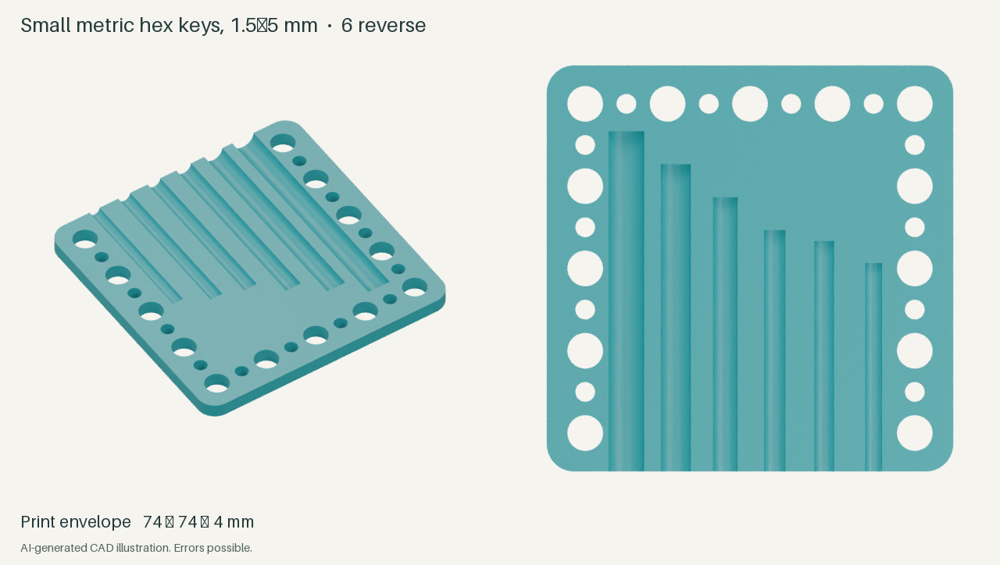

<!-- oobb-presentation:start -->
# Small metric hex keys, 1.5–5 mm

AI-generated CAD images and instructions. Errors possible.

## Summary

OOBB hex key holder · 6 reverse.

This is an entirely AI-generated coding project. The generated outputs are included and usually work. The project is published so others can modify and regenerate the designs with their own AI tools.



## Details

| Grid (width × height) | Design depth | Printed thickness |
| --- | --- | --- |
| 5 × 5 | 8 mm | 4 mm |

The grid pitch is 15 mm. The dashed line on the plan locates the cross section. [Section drawing](working.svg)

OOMP ID `oobb_part_holder_tool_hex_key_small_metric_set_6_reverse_5x5x8`

[Part folder](./) · [OOBB navigation](../../navigation_oobb/oobb/part/holder_tool/hex_key/small_metric_set/6_reverse/) · [Source design](https://github.com/oomlout/oomlout_oobb_version_4/blob/41f5386997faef4473c959dfb8c929864d7bf697/oobb_make_sets.py#L626)

<details><summary>Complete part metadata</summary>

```yaml
body_style: vertical_v4
depth: 8
height: 5
layout: 6_reverse
model: small_metric_set
oobb_details:
  body_style: vertical_v4
  corner_radius_mm: 5
  count: 1
  depth: 8
  edge_reduction_mm: 1
  height: 5
  layered: false
  offset_mm:
  - 0
  - 0
  - 0
  oobb_type: holder_tool
  pitch_mm: 15
  profile:
  - h: 100
    pos:
    - -22.5
    - -25
    - -1
    r: 3.25
    rot:
    - -90
    - 0
    - 0
    shape: cylinder
  - h: 100
    pos:
    - -13.5
    - -19
    - -1
    r: 2.75
    rot:
    - -90
    - 0
    - 0
    shape: cylinder
  - h: 100
    pos:
    - -4.5
    - -13
    - -1
    r: 2.25
    rot:
    - -90
    - 0
    - 0
    shape: cylinder
  - h: 100
    pos:
    - 4.5
    - -7
    - -1
    r: 1.95
    rot:
    - -90
    - 0
    - 0
    shape: cylinder
  - h: 100
    pos:
    - 13.5
    - -5
    - -1
    r: 1.8
    rot:
    - -90
    - 0
    - 0
    shape: cylinder
  - h: 100
    pos:
    - 22.5
    - -1
    - -1
    r: 1.55
    rot:
    - -90
    - 0
    - 0
    shape: cylinder
  run_scad: true
  run_solidcraft: false
  spacing_mm: 15
  width: 5
oobb_type: holder_tool
profile: tool_screwdriver_hex_key_set_small_reverse
show_underside: true
source_id: tool_screwdriver_hex_key_set_small_reverse
svg_details:
  cross_section_y_fraction: 0.82
  near_face_fraction: 0.08
  show_underside: true
  svg_name: holder_sections
taxonomy_1: oobb
taxonomy_10: ''
taxonomy_11: ''
taxonomy_12: ''
taxonomy_13: ''
taxonomy_14: ''
taxonomy_15: ''
taxonomy_2: part
taxonomy_3: holder_tool
taxonomy_4: hex_key
taxonomy_5: small_metric_set
taxonomy_6: 6_reverse
taxonomy_7: 5x5x8
taxonomy_8: ''
taxonomy_9: ''
title: Small metric hex keys, 1.5–5 mm
tool_type: hex_key
width: 5
id: oobb_part_holder_tool_hex_key_small_metric_set_6_reverse_5x5x8
directory: parts/oobb_part_holder_tool_hex_key_small_metric_set_6_reverse_5x5x8
md5: 351b177e93cec4418e26f70d2562e828
md5_6: 351b17
md5_6_alpha: 22lg7
```

</details>

## Parts

Use the print mesh in the part folder. Tool and mounting hardware are supplied separately.

## Assembly

Identify the tool pockets in the section drawing before choosing the mounting orientation. [Illustrated guides for the four photo-modelled tools](../../README.md#assembly)
<!-- oobb-presentation:end -->
