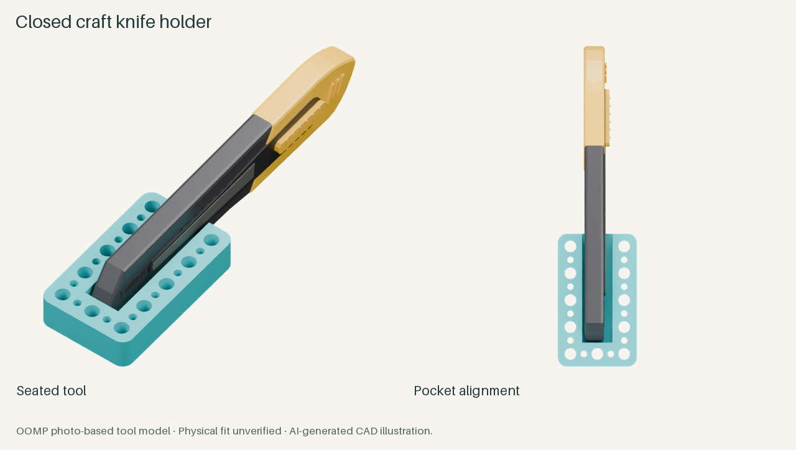

# Closed craft knife holder

AI-generated CAD images and instructions. Errors possible.

[Offline step viewer](assembly_instructions.html) · [Print booklet](assembly_instructions.pdf) · [Holder files](../)

## Loading sequence

1. Orient the printed holder with the pocket facing up. Locate its open end.
2. Keep the knife closed. Turn the housing edge-on and align the nose with the closed end of the slot.
3. Lower the tool into the recess, keeping its nose between the pocket walls.
4. The housing stands on its narrow edge. The heel projects past the open end of the holder.

## Model and fit

Closed exterior based on the photo and a provisional 165 mm STANLEY 0-10-151 reference. The 17 mm OOMP label is retained. Size variant awaits measurement. The illustrated pose was checked against the production STL at the original model scale. Physical fit remains unverified. [OOMP tool record](https://github.com/oomlout/oomp_tool_version_5/tree/main/parts/tool_knife_craft_17_mm_black_exacto_style)

The PDF uses eight landscape A4 pages in reader order. Choose booklet printing for folded copies.
