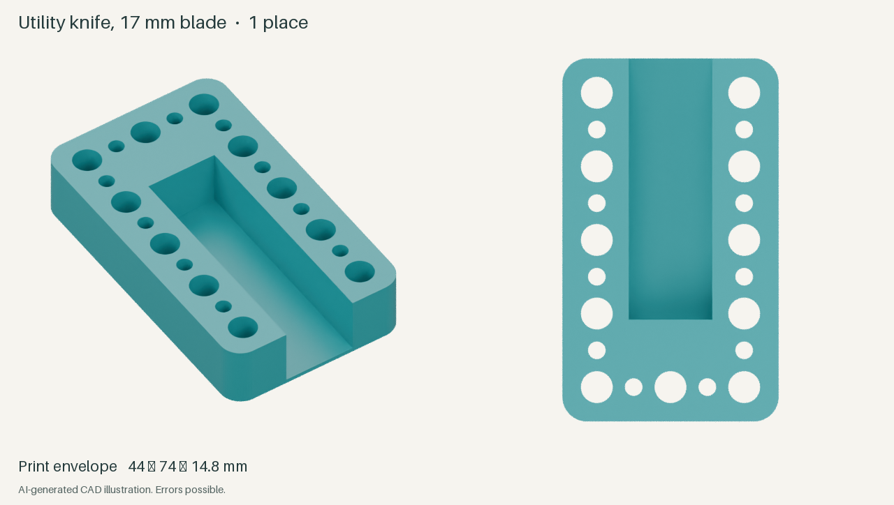
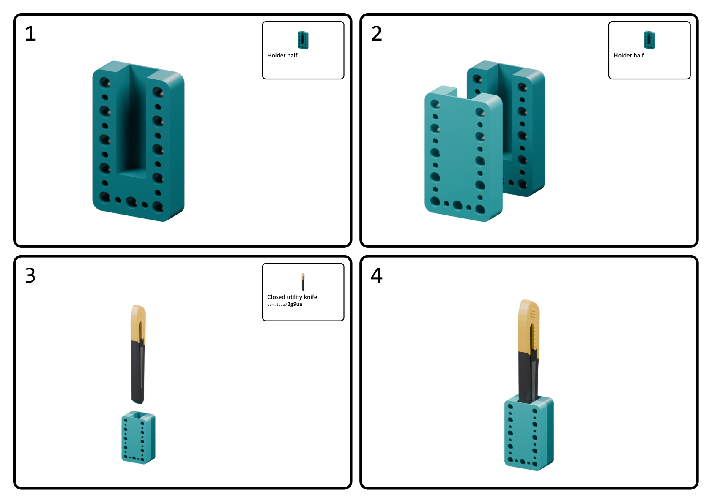

<!-- oobb-presentation:start -->
# Utility knife, 17 mm blade

AI-generated CAD images and instructions. Errors possible.

## Summary

OOBB knife holder · 1 place.

This is an entirely AI-generated coding project. The generated outputs are included and usually work. The project is published so others can modify and regenerate the designs with their own AI tools.



## Details

| Grid (width × height) | Assembled thickness | Thickness per printed piece |
| --- | --- | --- |
| 3 × 5 | 29.5 mm | 14.75 mm |

The grid pitch is 15 mm. The dashed line on the plan locates the cross section. [Section drawing](working.svg)

OOMP ID `oobb_part_holder_tool_knife_utility_17mm_1_place_3x5x29d5`

[Part folder](./) · [OOBB navigation](../../navigation_oobb/oobb/part/holder_tool/knife/utility_17mm/1_place/) · [Source design](https://github.com/oomlout/oomlout_oobb_version_4/blob/41f5386997faef4473c959dfb8c929864d7bf697/oobb_make_sets.py#L626)

<details><summary>Complete part metadata</summary>

```yaml
assembly_details:
  alignment: Keep the knife closed. Turn the housing edge-on and align the nose with
    the closed end of the slot.
  check: The housing sits edge-on in the slot. The heel projects above the holder.
  label: Closed utility knife
  rotation_deg:
  - 0
  - 90
  - 0
  steps:
  - action: Orient the rear half as it sits on the wall, with the pocket facing you
      and the opening at the top.
    add:
    - holder
    key: step_01
    upper_lift_mm: 0
    withdraw_mm: 0
  - action: Face the front half toward the rear pocket. Align the mounting holes and
      both top openings.
    add:
    - holder
    key: step_02
    upper_lift_mm: 36
    withdraw_mm: 0
  - action: Bring the halves together until their rims meet. Keep the knife closed.
      Turn the housing edge-on and align the nose with the closed end of the slot.
    add:
    - tool
    key: step_03
    upper_lift_mm: 0
    withdraw_mm: 70
  - action: Lower the tool through the top opening. The housing sits edge-on in the
      slot. The heel projects above the holder.
    add: []
    key: step_04
    upper_lift_mm: 0
    withdraw_mm: 0
  style:
    border: '000000'
    border_radius_mm: 3
    border_width_pt: 3
    columns: 2
    component_border_width_pt: 1.1
    font_body_pt: 7
    font_code_pt: 6.4
    font_url_prefix_pt: 4.8
    gutter_mm: 4
    margin_mm: 6
    page_mm:
    - 297
    - 210
    quantity_pt: 5.8
    quantity_shift_mm: 1
    rows: 2
    thumbnail_height_mm: 8.5
  tool_id: tool_knife_craft_17_mm_black_exacto_style
  translation_mm:
  - -7.5
  - -15.6
  - 8.96
body_style: paired_face_up
construction:
  mirror_second_print_x: false
  mode: handed_pair
  pocket_on_underside: false
depth: 29.5
height: 5
layout: 1_place
model: utility_17mm
oobb_details:
  body_style: paired_face_up
  corner_radius_mm: 5
  count: 1
  depth: 29.5
  edge_reduction_mm: 1
  height: 5
  layered: false
  offset_mm:
  - 0
  - 0
  - 0
  oobb_type: holder_tool
  pitch_mm: 15
  profile:
  - h: 27.5
    points:
    - - -8.5
      - 0
    - - -8.5
      - 160
    - - 8.5
      - 160
    - - 8.5
      - 0
    pos:
    - 0
    - -16.25
    - 0
    rot:
    - 0
    - 0
    - 0
    shape: polygon
  run_scad: true
  run_solidcraft: false
  spacing_mm: 15
  width: 3
oobb_type: holder_tool
profile: tool_knife_utility_17_mm_blade
show_underside: false
source_id: tool_knife_utility_17_mm_blade
svg_details:
  cross_section_y_fraction: 0.82
  near_face_fraction: 0.08
  show_underside: false
  svg_name: holder_sections
taxonomy_1: oobb
taxonomy_10: ''
taxonomy_11: ''
taxonomy_12: ''
taxonomy_13: ''
taxonomy_14: ''
taxonomy_15: ''
taxonomy_2: part
taxonomy_3: holder_tool
taxonomy_4: knife
taxonomy_5: utility_17mm
taxonomy_6: 1_place
taxonomy_7: 3x5x29d5
taxonomy_8: ''
taxonomy_9: ''
title: Utility knife, 17 mm blade
tool_type: knife
width: 3
id: oobb_part_holder_tool_knife_utility_17mm_1_place_3x5x29d5
directory: parts/oobb_part_holder_tool_knife_utility_17mm_1_place_3x5x29d5
md5: ab16782753258d5244498a1a7aa13ad4
md5_6: ab1678
md5_6_alpha: 6objs
```

</details>

## Parts

Use the print mesh in the part folder. Tool and mounting hardware are supplied separately.

## Assembly

Print the supplied two-half layout once. The dark teal half sits against the wall and the light teal half faces the room.

1. Orient the rear half as it sits on the wall, with the pocket facing you and the opening at the top. [View step 1](assembly/render/raw/step_01.png)
2. Face the front half toward the rear pocket. Align the mounting holes and both top openings. [View step 2](assembly/render/raw/step_02.png)
3. Bring the halves together until their rims meet. Keep the knife closed. Turn the housing edge-on and align the nose with the closed end of the slot. [View step 3](assembly/render/raw/step_03.png)
4. Lower the tool through the top opening. The housing sits edge-on in the slot. The heel projects above the holder. [View step 4](assembly/render/raw/step_04.png)

<details><summary>Illustrated assembly steps</summary>



</details>

Closed exterior based on the photo and a provisional 165 mm STANLEY 0-10-151 reference. The 17 mm OOMP label is retained. Size variant awaits measurement. The digital model was checked against the printed holder. Physical fit remains unverified. [OOMP tool record](https://github.com/oomlout/oomp_tool_version_5/tree/main/parts/tool_knife_craft_17_mm_black_exacto_style)

[Offline HTML viewer](assembly/assembly_instructions.html) · [Print booklet (PDF)](assembly/assembly_instructions.pdf)
<!-- oobb-presentation:end -->
