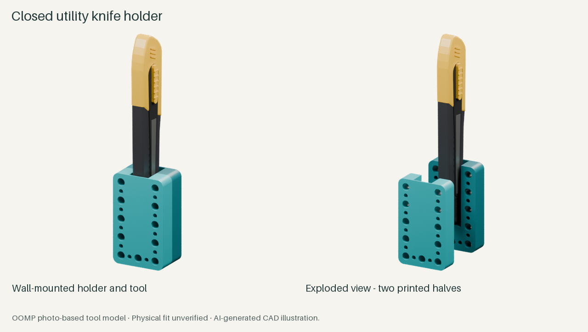

# Closed utility knife holder

AI-generated CAD images and instructions. Errors possible.

[Offline step viewer](assembly_instructions.html) · [Print booklet](assembly_instructions.pdf) · [Holder files](../)

## Assembly and loading

Print the supplied two-half layout once. The dark teal half sits against the wall. The light teal half faces the room. The opening and tool handles point up.

1. Orient the rear half as it sits on the wall, with the pocket facing you and the opening at the top.
2. Face the front half toward the rear pocket. Align the mounting holes and both top openings.
3. Bring the halves together until their rims meet. Keep the knife closed. Turn the housing edge-on and align the nose with the closed end of the slot.
4. Lower the tool through the top opening. The housing sits edge-on in the slot. The heel projects above the holder.

## Model and fit

Closed exterior based on the photo and a provisional 165 mm STANLEY 0-10-151 reference. The 17 mm OOMP label is retained. Size variant awaits measurement. The illustrated pose was checked against the production STL at the original model scale. Physical fit remains unverified. [OOMP tool record](https://github.com/oomlout/oomp_tool_version_5/tree/main/parts/tool_knife_craft_17_mm_black_exacto_style)

The PDF uses eight landscape A4 pages in reader order. Choose booklet printing for folded copies.
