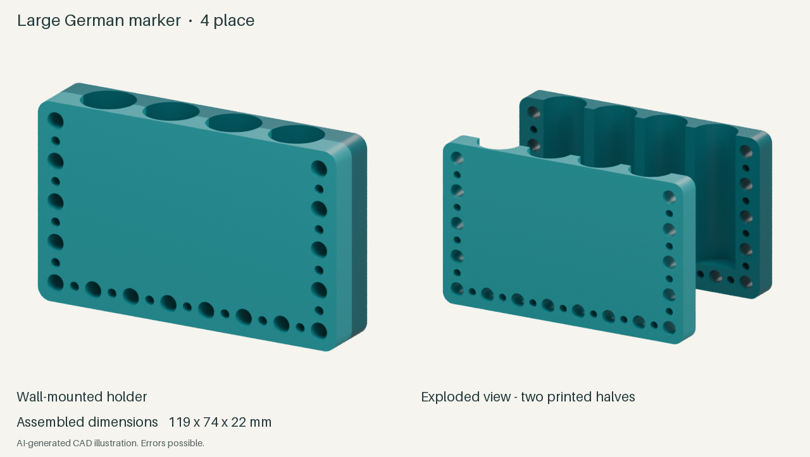

<!-- oobb-presentation:start -->
# Large German marker

AI-generated CAD images and instructions. Errors possible.

## Summary

OOBB marker holder · 4 place.

This is an entirely AI-generated coding project. The generated outputs are included and usually work. The project is published so others can modify and regenerate the designs with their own AI tools.



## Details

| Grid (width × height) | Assembled thickness | Thickness per printed piece |
| --- | --- | --- |
| 8 × 5 | 22 mm | 11 mm |

The grid pitch is 15 mm. The dashed line on the plan locates the cross section. [Section drawing](working.svg)

OOMP ID `oobb_part_holder_tool_marker_german_big_4_place_8x5x22`

[Part folder](./) · [OOBB navigation](../../navigation_oobb/oobb/part/holder_tool/marker/german_big/4_place/) · [Source design](https://github.com/oomlout/oomlout_oobb_version_4/blob/41f5386997faef4473c959dfb8c929864d7bf697/oobb_make_sets.py#L626)

<details><summary>Complete part metadata</summary>

```yaml
body_style: vertical_v4
construction:
  mirror_second_print_x: false
  mode: repeat_half
  pocket_on_underside: true
count: 4
depth: 22
height: 5
layout: 4_place
model: german_big
oobb_details:
  body_style: vertical_v4
  corner_radius_mm: 5
  count: 4
  depth: 22
  edge_reduction_mm: 1
  height: 5
  layered: false
  offset_mm:
  - 0
  - 0
  - 0
  oobb_type: holder_tool
  pitch_mm: 15
  profile:
  - h: 115
    pos:
    - 0
    - -25
    - -1
    r: 10
    rot:
    - -90
    - 0
    - 0
    shape: cylinder
  run_scad: true
  run_solidcraft: false
  spacing_mm: 25
  width: 8
oobb_type: holder_tool
profile: tool_marker_german_big
show_underside: true
source_id: tool_marker_german_big_x4
spacing_mm: 25
svg_details:
  cross_section_y_fraction: 0.82
  near_face_fraction: 0.08
  show_underside: true
  svg_name: holder_sections
taxonomy_1: oobb
taxonomy_10: ''
taxonomy_11: ''
taxonomy_12: ''
taxonomy_13: ''
taxonomy_14: ''
taxonomy_15: ''
taxonomy_2: part
taxonomy_3: holder_tool
taxonomy_4: marker
taxonomy_5: german_big
taxonomy_6: 4_place
taxonomy_7: 8x5x22
taxonomy_8: ''
taxonomy_9: ''
title: Large German marker
tool_type: marker
width: 8
id: oobb_part_holder_tool_marker_german_big_4_place_8x5x22
directory: parts/oobb_part_holder_tool_marker_german_big_4_place_8x5x22
md5: 4567b115bf4b30330b7b7562fa9ada56
md5_6: 4567b1
md5_6_alpha: 2pho1
```

</details>

## Parts

Use the print mesh in the part folder. Tool and mounting hardware are supplied separately.

## Assembly

Print two copies of the holder half. Turn one over, face the pockets inward and line up the mounting holes and open ends. [Illustrated guides for the four photo-modelled tools](../../README.md#assembly)
<!-- oobb-presentation:end -->
