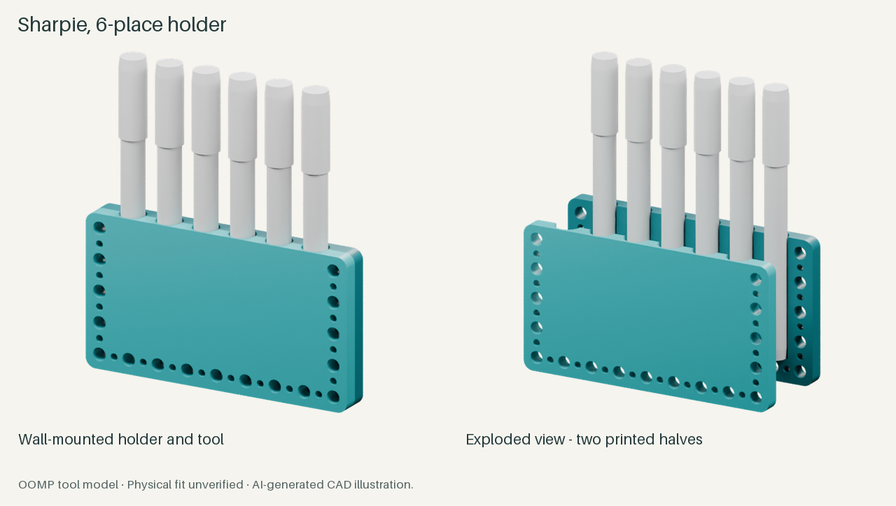
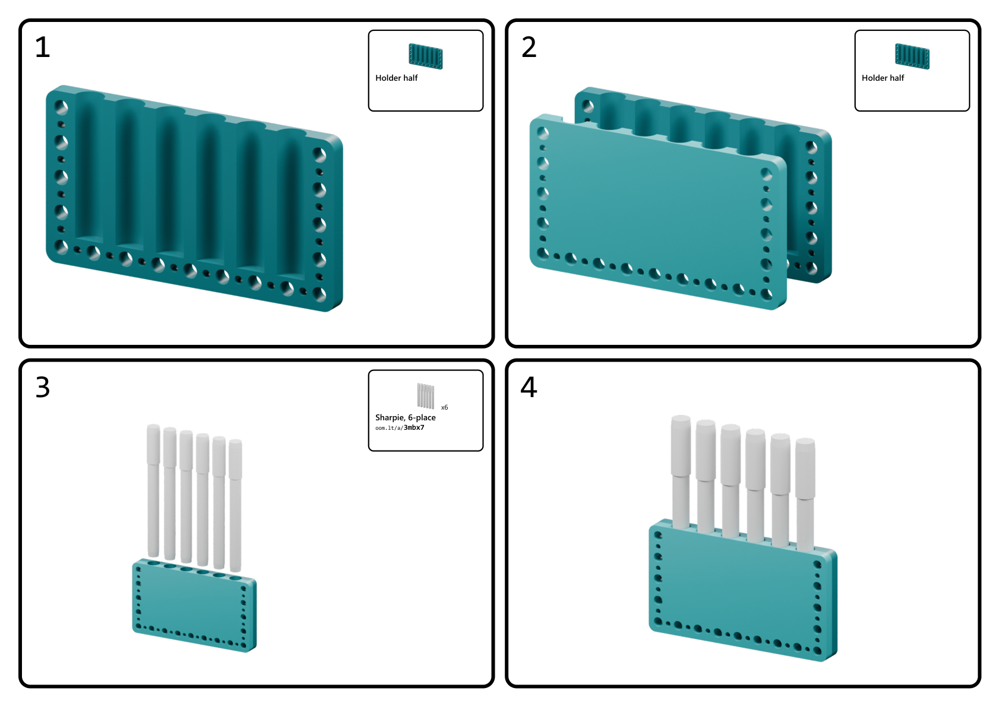

<!-- oobb-presentation:start -->
# Sharpie marker, 13 mm v4 profile

AI-generated CAD images and instructions. Errors possible.

## Summary

OOBB marker holder · 6 place.

This is an entirely AI-generated coding project. The generated outputs are included and usually work. The project is published so others can modify and regenerate the designs with their own AI tools.



## Details

| Grid (width × height) | Assembled thickness | Thickness per printed piece |
| --- | --- | --- |
| 9 × 5 | 15 mm | 7.5 mm |

The grid pitch is 15 mm. The dashed line on the plan locates the cross section. [Section drawing](working.svg)

OOMP ID `oobb_part_holder_tool_marker_sharpie_6_place_9x5x15`

[Part folder](./) · [OOBB navigation](../../navigation_oobb/oobb/part/holder_tool/marker/sharpie/6_place/) · [Source design](https://github.com/oomlout/oomlout_oobb_version_4/blob/41f5386997faef4473c959dfb8c929864d7bf697/oobb_make_sets.py#L626)

<details><summary>Complete part metadata</summary>

```yaml
assembly_details:
  alignment: Hold the capped markers vertically above their openings.
  check: Each marker rests at its pocket floor with the cap accessible.
  instance_x_mm:
  - -46.875
  - -28.125
  - -9.375
  - 9.375
  - 28.125
  - 46.875
  label: Sharpie, 6-place
  layout: 6_place
  model_kind: marker
  rotation_deg:
  - 0
  - 0
  - 0
  steps:
  - action: Orient the rear half as it sits on the wall, with the pocket facing you
      and the opening at the top.
    add:
    - holder
    key: step_01
    upper_lift_mm: 0
    withdraw_mm: 0
  - action: Face the front half toward the rear pocket. Align the mounting holes and
      both top openings.
    add:
    - holder
    key: step_02
    upper_lift_mm: 36
    withdraw_mm: 0
  - action: Bring the halves together until their rims meet. Hold the capped markers
      vertically above their openings.
    add:
    - tool
    - tool
    - tool
    - tool
    - tool
    - tool
    key: step_03
    upper_lift_mm: 0
    withdraw_mm: 70
  - action: Lower the tools through the top openings. Each marker rests at its pocket
      floor with the cap accessible.
    add: []
    key: step_04
    upper_lift_mm: 0
    withdraw_mm: 0
  style:
    border: '000000'
    border_radius_mm: 3
    border_width_pt: 3
    columns: 2
    component_border_width_pt: 1.1
    font_body_pt: 7
    font_code_pt: 6.4
    font_url_prefix_pt: 4.8
    gutter_mm: 4
    margin_mm: 6
    page_mm:
    - 297
    - 210
    quantity_pt: 5.8
    quantity_shift_mm: 1
    rows: 2
    thumbnail_height_mm: 8.5
  tool_id: stationery_felt_tip_pen_sharpie_standard_tip_style_13_mm_diameter_137_mm_length_sharpie
  translation_mm:
  - 0
  - -25
  - 1
body_style: vertical_v4
construction:
  mirror_second_print_x: false
  mode: repeat_half
  pocket_on_underside: true
count: 6
depth: 15
height: 5
layout: 6_place
model: sharpie
oobb_details:
  body_style: vertical_v4
  corner_radius_mm: 5
  count: 6
  depth: 15
  edge_reduction_mm: 1
  height: 5
  layered: false
  offset_mm:
  - 0
  - 0
  - 0
  oobb_type: holder_tool
  pitch_mm: 15
  profile:
  - h: 137
    pos:
    - 0
    - -25
    - -1
    r: 6.5
    rot:
    - -90
    - 0
    - 0
    shape: cylinder
  run_scad: true
  run_solidcraft: false
  spacing_mm: 18.75
  width: 9
oobb_type: holder_tool
profile: tool_marker_sharpie
show_underside: true
source_id: tool_marker_sharpie_x6
spacing_mm: 18.75
svg_details:
  cross_section_y_fraction: 0.82
  near_face_fraction: 0.08
  show_underside: true
  svg_name: holder_sections
taxonomy_1: oobb
taxonomy_10: ''
taxonomy_11: ''
taxonomy_12: ''
taxonomy_13: ''
taxonomy_14: ''
taxonomy_15: ''
taxonomy_2: part
taxonomy_3: holder_tool
taxonomy_4: marker
taxonomy_5: sharpie
taxonomy_6: 6_place
taxonomy_7: 9x5x15
taxonomy_8: ''
taxonomy_9: ''
title: Sharpie marker, 13 mm v4 profile
tool_type: marker
width: 9
id: oobb_part_holder_tool_marker_sharpie_6_place_9x5x15
directory: parts/oobb_part_holder_tool_marker_sharpie_6_place_9x5x15
md5: 5925ac39049af267ffd678a6f09183e2
md5_6: 5925ac
md5_6_alpha: 3h7zg
```

</details>

## Parts

Use the print mesh in the part folder. Tool and mounting hardware are supplied separately.

## Assembly

Print two copies of the holder STL. The dark teal half sits against the wall and the light teal half faces the room.

1. Orient the rear half as it sits on the wall, with the pocket facing you and the opening at the top. [View step 1](assembly/render/raw/step_01.png)
2. Face the front half toward the rear pocket. Align the mounting holes and both top openings. [View step 2](assembly/render/raw/step_02.png)
3. Bring the halves together until their rims meet. Hold the capped markers vertically above their openings. [View step 3](assembly/render/raw/step_03.png)
4. Lower the tools through the top openings. Each marker rests at its pocket floor with the cap accessible. [View step 4](assembly/render/raw/step_04.png)

<details><summary>Illustrated assembly steps</summary>



</details>

The standard-tip OOMP record matches the branded v4 profile in diameter and length. Cap and barrel split are illustrative. The digital model was checked against the printed holder. Physical fit remains unverified. [OOMP tool record](https://github.com/oomlout/oomp_tool_version_5/tree/main/parts/stationery_felt_tip_pen_sharpie_standard_tip_style_13_mm_diameter_137_mm_length_sharpie)

[Offline HTML viewer](assembly/assembly_instructions.html) · [Print booklet (PDF)](assembly/assembly_instructions.pdf)
<!-- oobb-presentation:end -->
