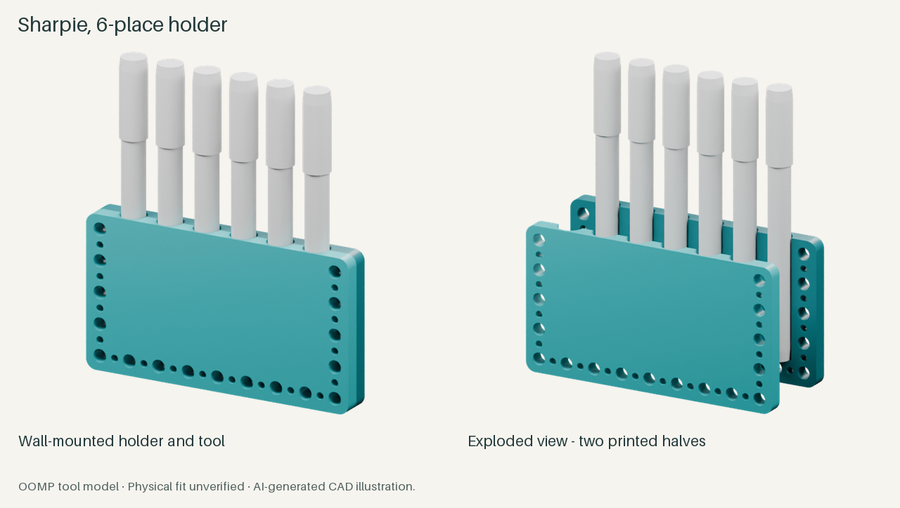

# Sharpie, 6-place holder

AI-generated CAD images and instructions. Errors possible.

[Offline step viewer](assembly_instructions.html) · [Print booklet](assembly_instructions.pdf) · [Holder files](../)

## Assembly and loading

Print two copies of the holder STL. The dark teal half sits against the wall. The light teal half faces the room. The opening and tool handles point up.

1. Orient the rear half as it sits on the wall, with the pocket facing you and the opening at the top.
2. Face the front half toward the rear pocket. Align the mounting holes and both top openings.
3. Bring the halves together until their rims meet. Hold the capped markers vertically above their openings.
4. Lower the tools through the top openings. Each marker rests at its pocket floor with the cap accessible.

## Model and fit

The standard-tip OOMP record matches the branded v4 profile in diameter and length. Cap and barrel split are illustrative. The illustrated pose was checked against the production STL at the original model scale. Physical fit remains unverified. [OOMP tool record](https://github.com/oomlout/oomp_tool_version_5/tree/main/parts/stationery_felt_tip_pen_sharpie_standard_tip_style_13_mm_diameter_137_mm_length_sharpie)

The PDF uses eight landscape A4 pages in reader order. Choose booklet printing for folded copies.
