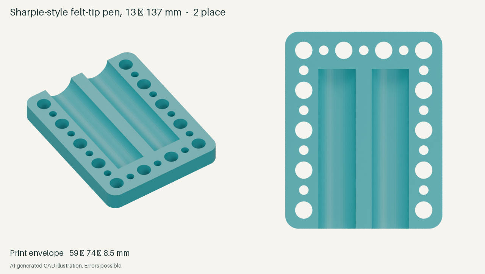

<!-- oobb-presentation:start -->
# Sharpie-style felt-tip pen, 13 × 137 mm

AI-generated CAD images and instructions. Errors possible.

## Summary

OOBB marker holder · 2 place.

This is an entirely AI-generated coding project. The generated outputs are included and usually work. The project is published so others can modify and regenerate the designs with their own AI tools.



## Details

| Grid (width × height) | Design depth | Printed thickness |
| --- | --- | --- |
| 4 × 5 | 17 mm | 8.5 mm |

The grid pitch is 15 mm. The dashed line on the plan locates the cross section. [Section drawing](working.svg)

OOMP ID `oobb_part_holder_tool_marker_sharpie_style_13mm_2_place_4x5x17`

[Part folder](./) · [OOBB navigation](../../navigation_oobb/oobb/part/holder_tool/marker/sharpie_style_13mm/2_place/) · [Source design](https://github.com/oomlout/oomlout_oobb_part_tool_holder_vertical/tree/93a962a09e0c275c3cfa62187182ac3203bde1b2/parts/oobb_part_tool_holder_vertical_4_width_5_height_17_mm_depth_stationery_felt_tip_pen_13_mm_diameter_137_mm_length_sharpie_style_tool_2_multiple_extra)

<details><summary>Complete part metadata</summary>

```yaml
body_style: vertical_project
count: 2
depth: 17
height: 5
layered: false
layout: 2_place
model: sharpie_style_13mm
offset_mm:
- 0
- 45.5
- 0
oobb_details:
  body_style: vertical_project
  corner_radius_mm: 5
  count: 2
  depth: 17
  edge_reduction_mm: 1
  height: 5
  layered: false
  offset_mm:
  - 0
  - 45.5
  - 0
  oobb_type: holder_tool
  pitch_mm: 15
  profile:
  - h: 137
    pos:
    - 0
    - -68.5
    - 0
    r: 7
    rot:
    - -90
    - 0
    - 0
    shape: cylinder
  run_scad: true
  run_solidcraft: false
  spacing_mm: 20
  width: 4
oobb_type: holder_tool
profile: sharpie_style_13mm
show_underside: true
source_id: oobb_part_tool_holder_vertical_4_width_5_height_17_mm_depth_stationery_felt_tip_pen_13_mm_diameter_137_mm_length_sharpie_style_tool_2_multiple_extra
spacing_mm: 20
svg_details:
  cross_section_y_fraction: 0.82
  near_face_fraction: 0.08
  show_underside: true
  svg_name: holder_sections
taxonomy_1: oobb
taxonomy_10: ''
taxonomy_11: ''
taxonomy_12: ''
taxonomy_13: ''
taxonomy_14: ''
taxonomy_15: ''
taxonomy_2: part
taxonomy_3: holder_tool
taxonomy_4: marker
taxonomy_5: sharpie_style_13mm
taxonomy_6: 2_place
taxonomy_7: 4x5x17
taxonomy_8: ''
taxonomy_9: ''
title: Sharpie-style felt-tip pen, 13 × 137 mm
tool_type: marker
width: 4
id: oobb_part_holder_tool_marker_sharpie_style_13mm_2_place_4x5x17
directory: parts/oobb_part_holder_tool_marker_sharpie_style_13mm_2_place_4x5x17
md5: 41473f93d449d013670e0d2bdbd6ad84
md5_6: 41473f
md5_6_alpha: 2jozj
```

</details>

## Parts

Use the print mesh in the part folder. Tool and mounting hardware are supplied separately.

## Assembly

Identify the tool pockets in the section drawing before choosing the mounting orientation. [Illustrated guides for the four photo-modelled tools](../../README.md#assembly)
<!-- oobb-presentation:end -->
