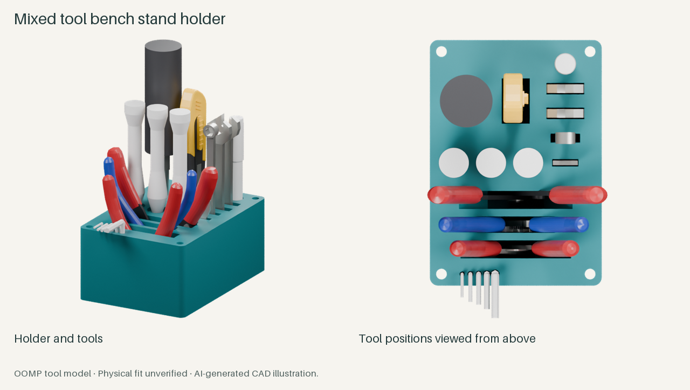
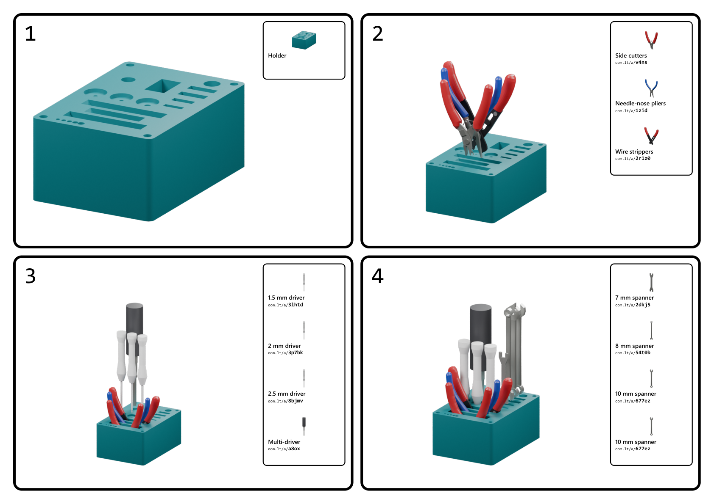
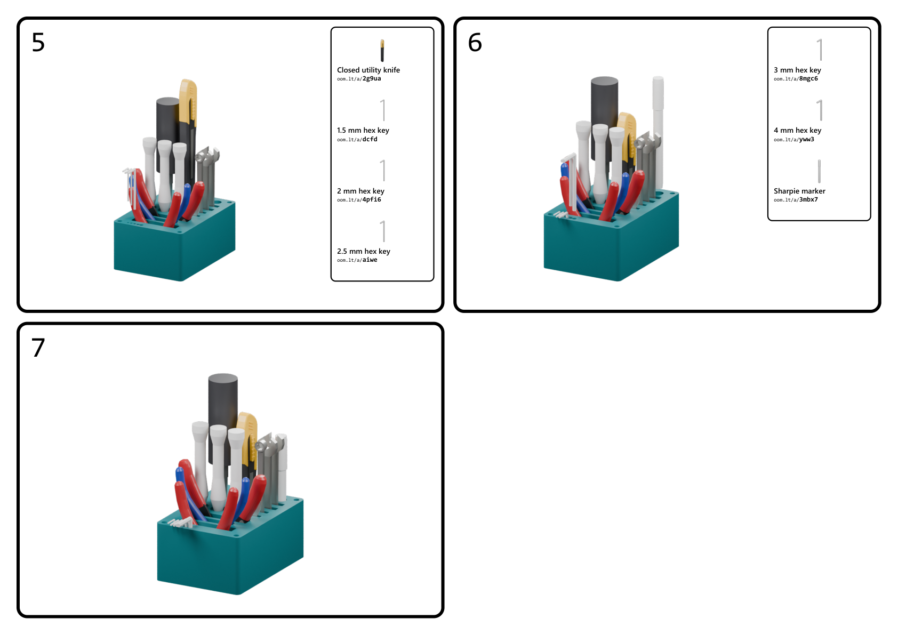

<!-- oobb-presentation:start -->
# Basic mixed-tool bench stand

AI-generated CAD images and instructions. Errors possible.

## Summary

OOBB mixed tools holder · bench.

This is an entirely AI-generated coding project. The generated outputs are included and usually work. The project is published so others can modify and regenerate the designs with their own AI tools.



## Details

| Grid (width × height) | Assembled thickness | Thickness per printed piece |
| --- | --- | --- |
| 7 × 10 | 66 mm | 66 mm |

The grid pitch is 15 mm. The dashed line on the plan locates the cross section. [Section drawing](working.svg)

OOMP ID `oobb_part_holder_tool_mixed_tools_basic_stand_bench_7x10x66`

[Part folder](./) · [OOBB navigation](../../navigation_oobb/oobb/part/holder_tool/mixed_tools/basic_stand/bench/) · [Source design](https://github.com/oomlout/oomlout_oobb_version_4/blob/41f5386997faef4473c959dfb8c929864d7bf697/oobb_make_sets.py#L626)

<details><summary>Complete part metadata</summary>

```yaml
assembly_details:
  additional_tools:
  - key: pliers
    label: Needle-nose pliers
    model_kind: photo_reference
    rotation_deg:
    - 90
    - -2.16
    - 0
    tool_id: tool_pliers_needle_nose_130_mm_length_blue
    translation_mm:
    - -9.55
    - -32.75
    - -29.21
  - key: wire
    label: Wire strippers
    model_kind: photo_reference
    rotation_deg:
    - 90
    - 0.65
    - 0
    tool_id: tool_wire_strippers_120_mm_length_red
    translation_mm:
    - 5.91
    - -14
    - -27.5
  - key: driver15
    label: 1.5 mm driver
    model_kind: wera
    rotation_deg:
    - 90
    - 0
    - 0
    tool_id: tool_screw_driver_precision_kraftform_micro_style_18_mm_diameter_157_mm_depth_hex_head_1_5_mm_wera_2054_series_05118066001
    translation_mm:
    - -37.5
    - 0
    - -30
  - key: driver2
    label: 2 mm driver
    model_kind: wera
    rotation_deg:
    - 90
    - 0
    - 0
    tool_id: tool_screw_driver_precision_kraftform_micro_style_18_mm_diameter_157_mm_depth_hex_head_2_mm_wera_2054_series_05118068001
    translation_mm:
    - -15
    - 0
    - -30
  - key: driver25
    label: 2.5 mm driver
    model_kind: wera
    rotation_deg:
    - 90
    - 0
    - 0
    tool_id: tool_screw_driver_precision_kraftform_micro_style_18_mm_diameter_157_mm_depth_hex_head_2_5_mm_wera_2054_series_05118070001
    translation_mm:
    - 7.5
    - 0
    - -30
  - key: picquic
    label: Multi-driver
    model_kind: picquic_sixpac
    rotation_deg:
    - 90
    - 0
    - 0
    tool_id: tool_screw_driver_multi_driver_200_mm_quikpik
    translation_mm:
    - -30
    - 37.5
    - -30
  - key: m7
    label: 7 mm spanner
    model_kind: open_spanner
    rotation_deg:
    - 90
    - 0
    - 0
    tool_id: tool_wrench_m7
    translation_mm:
    - 30
    - 0
    - -30
  - key: m8
    label: 8 mm spanner
    model_kind: combination_spanner
    rotation_deg:
    - 90
    - 180
    - 0
    tool_id: tool_wrench_m8
    translation_mm:
    - 30
    - 15
    - 115
  - key: m10a
    label: 10 mm spanner
    model_kind: combination_spanner
    rotation_deg:
    - 90
    - 0
    - 0
    tool_id: tool_wrench_m10
    translation_mm:
    - 30
    - 30
    - -30
  - key: m10b
    label: 10 mm spanner
    model_kind: combination_spanner
    rotation_deg:
    - 90
    - 0
    - 0
    tool_id: tool_wrench_m10
    translation_mm:
    - 30
    - 45
    - -30
  - key: knife
    label: Closed utility knife
    model_kind: photo_reference
    rotation_deg:
    - 90
    - 0
    - 90
    tool_id: tool_knife_craft_17_mm_black_exacto_style
    translation_mm:
    - -7.5
    - 42
    - -29.35
  - key: hex15
    label: 1.5 mm hex key
    model_kind: hex_key
    rotation_deg:
    - 90
    - 0
    - -90
    tool_id: tool_hex_key_1_5_mm
    translation_mm:
    - -32.5
    - -67.5
    - -7
  - key: hex2
    label: 2 mm hex key
    model_kind: hex_key
    rotation_deg:
    - 90
    - 0
    - -90
    tool_id: tool_hex_key_2_mm
    translation_mm:
    - -27.5
    - -67.5
    - -12
  - key: hex25
    label: 2.5 mm hex key
    model_kind: hex_key
    rotation_deg:
    - 90
    - 0
    - -90
    tool_id: tool_hex_key_2_5_mm
    translation_mm:
    - -22.5
    - -67.5
    - -17
  - key: hex3
    label: 3 mm hex key
    model_kind: hex_key
    rotation_deg:
    - 90
    - 0
    - -90
    tool_id: tool_hex_key_3_mm
    translation_mm:
    - -17.5
    - -67.5
    - -22
  - key: hex4
    label: 4 mm hex key
    model_kind: hex_key
    rotation_deg:
    - 90
    - 0
    - -90
    tool_id: tool_hex_key_4_mm
    translation_mm:
    - -12.5
    - -67.5
    - -27
  - key: marker
    label: Sharpie marker
    model_kind: marker
    rotation_deg:
    - 90
    - 0
    - 0
    tool_id: stationery_felt_tip_pen_sharpie_standard_tip_style_13_mm_diameter_137_mm_length_sharpie
    translation_mm:
    - 30
    - 60
    - -30
  alignment: Place each closed tool above its matching pocket.
  check: Seat the tools with handles above the stand and the short arms of the hex
    keys pointing outward.
  custom_steps:
  - action: Place the printed stand upright on its flat base.
    add:
    - holder
    key: step_01
    upper_lift_mm: 0
    withdraw_mm: 0
  - action: Lower the closed cutters, pliers and wire strippers into the wide front
      pockets.
    add:
    - tool
    - pliers
    - wire
    key: step_02
    upper_lift_mm: 0
    withdraw_mm: 70
  - action: Place the three precision drivers and the multi-driver in their round
      pockets.
    add:
    - driver15
    - driver2
    - driver25
    - picquic
    key: step_03
    upper_lift_mm: 0
    withdraw_mm: 70
  - action: Place the 7 mm and 8 mm spanners open-end down and the two 10 mm spanners
      ring-end down.
    add:
    - m7
    - m8
    - m10a
    - m10b
    key: step_04
    upper_lift_mm: 0
    withdraw_mm: 70
  - action: Keep the utility knife closed and place it in its slot. Add the 1.5, 2
      and 2.5 mm hex keys.
    add:
    - knife
    - hex15
    - hex2
    - hex25
    key: step_05
    upper_lift_mm: 0
    withdraw_mm: 70
  - action: Add the 3 and 4 mm hex keys and the capped marker.
    add:
    - hex3
    - hex4
    - marker
    key: step_06
    upper_lift_mm: 0
    withdraw_mm: 70
  - action: Seat every tool and keep all handles and short key arms accessible.
    add: []
    key: step_07
    upper_lift_mm: 0
    withdraw_mm: 0
  insertion_axis:
  - 0
  - 0
  - 1
  label: Mixed tool bench stand
  layout: bench
  model_kind: photo_reference
  primary_label: Side cutters
  rotation_deg:
  - 90
  - -0.24
  - 0
  single_piece: true
  steps:
  - action: Place the printed stand upright on its flat base.
    add:
    - holder
    key: step_01
    upper_lift_mm: 0
    withdraw_mm: 0
  - action: Lower the closed cutters, pliers and wire strippers into the wide front
      pockets.
    add:
    - tool
    - pliers
    - wire
    key: step_02
    upper_lift_mm: 0
    withdraw_mm: 70
  - action: Place the three precision drivers and the multi-driver in their round
      pockets.
    add:
    - driver15
    - driver2
    - driver25
    - picquic
    key: step_03
    upper_lift_mm: 0
    withdraw_mm: 70
  - action: Place the 7 mm and 8 mm spanners open-end down and the two 10 mm spanners
      ring-end down.
    add:
    - m7
    - m8
    - m10a
    - m10b
    key: step_04
    upper_lift_mm: 0
    withdraw_mm: 70
  - action: Keep the utility knife closed and place it in its slot. Add the 1.5, 2
      and 2.5 mm hex keys.
    add:
    - knife
    - hex15
    - hex2
    - hex25
    key: step_05
    upper_lift_mm: 0
    withdraw_mm: 70
  - action: Add the 3 and 4 mm hex keys and the capped marker.
    add:
    - hex3
    - hex4
    - marker
    key: step_06
    upper_lift_mm: 0
    withdraw_mm: 70
  - action: Seat every tool and keep all handles and short key arms accessible.
    add: []
    key: step_07
    upper_lift_mm: 0
    withdraw_mm: 0
  style:
    border: '000000'
    border_radius_mm: 3
    border_width_pt: 3
    columns: 2
    component_border_width_pt: 1.1
    font_body_pt: 7
    font_code_pt: 6.4
    font_url_prefix_pt: 4.8
    gutter_mm: 4
    margin_mm: 6
    page_mm:
    - 297
    - 210
    quantity_pt: 5.8
    quantity_shift_mm: 1
    rows: 2
    thumbnail_height_mm: 8.5
  tool_id: tool_side_cutters_110_mm_length_red
  translation_mm:
  - -1.84
  - -47
  - -22
body_style: stand
construction:
  mirror_second_print_x: false
  mode: stand
  pocket_on_underside: false
depth: 66
height: 10
layout: bench
model: basic_stand
oobb_details:
  body_style: stand
  corner_radius_mm: 5
  count: 1
  depth: 66
  edge_reduction_mm: 1
  height: 10
  layered: false
  offset_mm:
  - 0
  - 0
  - 0
  oobb_type: holder_tool
  pitch_mm: 15
  profile:
  - h: 11
    points:
    - - -11.5
      - -30
    - - -11.5
      - 5
    - - -33
      - 30
    - - -42
      - 80
    - - 42
      - 80
    - - 33
      - 30
    - - 11.5
      - 5
    - - 11.5
      - -30
    pos:
    - 0
    - -47
    - 0
    rot:
    - 90
    - 0
    - 0
    shape: polygon
  - h: 10
    points:
    - - -17
      - -30
    - - -17
      - 24
    - - -46
      - 63
    - - -50
      - 95
    - - 50
      - 95
    - - 46
      - 63
    - - 17
      - 24
    - - 17
      - -30
    pos:
    - 0
    - -32.5
    - 0
    rot:
    - 90
    - 0
    - 0
    shape: polygon
  - h: 11
    points:
    - - -17
      - -30
    - - -17
      - 5
    - - -45
      - 50
    - - -55
      - 90
    - - 55
      - 90
    - - 45
      - 50
    - - 17
      - 5
    - - 17
      - -30
    pos:
    - 0
    - -17
    - 0
    rot:
    - 90
    - 0
    - 0
    shape: polygon
  - h: 60
    pos:
    - -37.5
    - 0
    - -30
    r: 1.75
    rot:
    - 0
    - 0
    - 0
    shape: cylinder
  - h: 98
    pos:
    - -37.5
    - 0
    - 30
    r: 9
    rot:
    - 0
    - 0
    - 0
    shape: cylinder
  - h: 60
    pos:
    - -15
    - 0
    - -30
    r: 1.75
    rot:
    - 0
    - 0
    - 0
    shape: cylinder
  - h: 98
    pos:
    - -15
    - 0
    - 30
    r: 9
    rot:
    - 0
    - 0
    - 0
    shape: cylinder
  - h: 60
    pos:
    - 7.5
    - 0
    - -30
    r: 2.5
    rot:
    - 0
    - 0
    - 0
    shape: cylinder
  - h: 98
    pos:
    - 7.5
    - 0
    - 30
    r: 9
    rot:
    - 0
    - 0
    - 0
    shape: cylinder
  - h: 57
    pos:
    - -30
    - 37.5
    - -30
    r: 3.85
    rot:
    - 0
    - 0
    - 0
    shape: cylinder
  - h: 30
    pos:
    - -30
    - 37.5
    - 27
    r: 5.5
    rot:
    - 0
    - 0
    - 0
    shape: cylinder
  - h: 17
    pos:
    - -30
    - 37.5
    - 57
    r: 6.5
    rot:
    - 0
    - 0
    - 0
    shape: cylinder
  - h: 100
    pos:
    - -30
    - 37.5
    - 74
    r: 18
    rot:
    - 0
    - 0
    - 0
    shape: cylinder
  - h: 4.5
    points:
    - - 22
      - -30
    - - 22
      - 80
    - - 38
      - 80
    - - 38
      - -30
    pos:
    - 0
    - 2.25
    - 0
    rot:
    - 90
    - 0
    - 0
    shape: polygon
  - h: 5.5
    points:
    - - 21
      - -30
    - - 21
      - 90
    - - 39
      - 90
    - - 39
      - -30
    pos:
    - 0
    - 17.75
    - 0
    rot:
    - 90
    - 0
    - 0
    shape: polygon
  - h: 7
    points:
    - - 18.5
      - -30
    - - 18.5
      - 110
    - - 41.5
      - 110
    - - 41.5
      - -30
    pos:
    - 0
    - 33.5
    - 0
    rot:
    - 90
    - 0
    - 0
    shape: polygon
  - h: 7
    points:
    - - 18.5
      - -30
    - - 18.5
      - 110
    - - 41.5
      - 110
    - - 41.5
      - -30
    pos:
    - 0
    - 48.5
    - 0
    rot:
    - 90
    - 0
    - 0
    shape: polygon
  - h: 27.5
    points:
    - - -8.5
      - -30
    - - -8.5
      - 130
    - - 8.5
      - 130
    - - 8.5
      - -30
    pos:
    - 0
    - 51.25
    - 0
    rot:
    - 90
    - 0
    - 0
    shape: polygon
  - h: 100
    pos:
    - -32.5
    - -67.5
    - -7
    r: 1.55
    rot:
    - 0
    - 0
    - 0
    shape: cylinder
  - h: 100
    pos:
    - -27.5
    - -67.5
    - -12
    r: 1.8
    rot:
    - 0
    - 0
    - 0
    shape: cylinder
  - h: 100
    pos:
    - -22.5
    - -67.5
    - -17
    r: 1.95
    rot:
    - 0
    - 0
    - 0
    shape: cylinder
  - h: 100
    pos:
    - -17.5
    - -67.5
    - -22
    r: 2.25
    rot:
    - 0
    - 0
    - 0
    shape: cylinder
  - h: 100
    pos:
    - -12.5
    - -67.5
    - -27
    r: 2.75
    rot:
    - 0
    - 0
    - 0
    shape: cylinder
  - h: 137
    pos:
    - 30
    - 60
    - -30
    r: 6.5
    rot:
    - 0
    - 0
    - 0
    shape: cylinder
  run_scad: true
  run_solidcraft: false
  spacing_mm: 15
  width: 7
oobb_type: holder_tool
profile: basic_bench_stand
show_underside: false
source_id: tool_holder_basic
svg_details:
  cross_section_y_fraction: 0.82
  near_face_fraction: 0.08
  show_underside: false
  svg_name: holder_sections
taxonomy_1: oobb
taxonomy_10: ''
taxonomy_11: ''
taxonomy_12: ''
taxonomy_13: ''
taxonomy_14: ''
taxonomy_15: ''
taxonomy_2: part
taxonomy_3: holder_tool
taxonomy_4: mixed_tools
taxonomy_5: basic_stand
taxonomy_6: bench
taxonomy_7: 7x10x66
taxonomy_8: ''
taxonomy_9: ''
title: Basic mixed-tool bench stand
tool_type: mixed_tools
width: 7
id: oobb_part_holder_tool_mixed_tools_basic_stand_bench_7x10x66
directory: parts/oobb_part_holder_tool_mixed_tools_basic_stand_bench_7x10x66
md5: 204636b0c2a0478cbdde1c138b72ea71
md5_6: '204636'
md5_6_alpha: 19c1i
```

</details>

## Parts

Use the print mesh in the part folder. Tool and mounting hardware are supplied separately.

## Assembly

Print the holder once. Place the holder upright with its openings facing up.

1. Place the printed stand upright on its flat base. [View step 1](assembly/render/raw/step_01.png)
2. Lower the closed cutters, pliers and wire strippers into the wide front pockets. [View step 2](assembly/render/raw/step_02.png)
3. Place the three precision drivers and the multi-driver in their round pockets. [View step 3](assembly/render/raw/step_03.png)
4. Place the 7 mm and 8 mm spanners open-end down and the two 10 mm spanners ring-end down. [View step 4](assembly/render/raw/step_04.png)
5. Keep the utility knife closed and place it in its slot. Add the 1.5, 2 and 2.5 mm hex keys. [View step 5](assembly/render/raw/step_05.png)
6. Add the 3 and 4 mm hex keys and the capped marker. [View step 6](assembly/render/raw/step_06.png)
7. Seat every tool and keep all handles and short key arms accessible. [View step 7](assembly/render/raw/step_07.png)

<details><summary>Illustrated assembly steps</summary>




</details>

Open-pose photo trace with a provisional 110 mm closed-length reference (Rapid SA-706 RED). Grip thickness is estimated. The digital model was checked against the printed holder. Physical fit remains unverified. [OOMP tool record](https://github.com/oomlout/oomp_tool_version_5/tree/main/parts/tool_side_cutters_110_mm_length_red)

Open-pose photo trace with a provisional 130 mm closed-length reference (Rapid PC-022). Jaw and grip depths are estimated. [OOMP tool record](https://github.com/oomlout/oomp_tool_version_5/tree/main/parts/tool_pliers_needle_nose_130_mm_length_blue)

Open-pose photo trace scaled to the candidate Anvil AV-LDWS catalogue length of 130 mm. The 120 mm OOMP label is retained. Thickness is estimated. [OOMP tool record](https://github.com/oomlout/oomp_tool_version_5/tree/main/parts/tool_wire_strippers_120_mm_length_red)

Wera specifies the shaft diameter, shaft length and handle length. The archived OOMP record supplies the 18 mm handle envelope. Grip taper, cap and tip transition are illustrative. [OOMP tool record](https://github.com/oomlout/oomp_tool_version_5/tree/main/parts/tool_screw_driver_precision_kraftform_micro_style_18_mm_diameter_157_mm_depth_hex_head_1_5_mm_wera_2054_series_05118066001)

Wera specifies the shaft diameter, shaft length and handle length. The archived OOMP record supplies the 18 mm handle envelope. Grip taper, cap and tip transition are illustrative. [OOMP tool record](https://github.com/oomlout/oomp_tool_version_5/tree/main/parts/tool_screw_driver_precision_kraftform_micro_style_18_mm_diameter_157_mm_depth_hex_head_2_mm_wera_2054_series_05118068001)

Wera specifies the shaft diameter, shaft length and handle length. The archived OOMP record supplies the 18 mm handle envelope. Grip taper, cap and tip transition are illustrative. [OOMP tool record](https://github.com/oomlout/oomp_tool_version_5/tree/main/parts/tool_screw_driver_precision_kraftform_micro_style_18_mm_diameter_157_mm_depth_hex_head_2_5_mm_wera_2054_series_05118070001)

Representative Picquic SIXPAC Plus, 200 mm overall and 32 mm handle diameter from a distributor listing. Picquic specifies 3-inch quarter-inch bits and a 7/16-inch hex bolster. Exposed bit, shank and bolster lengths are estimates for the stored-bit pose. The handle contour, stored bits and workshop specimen have not been measured. [OOMP tool record](https://github.com/oomlout/oomp_tool_version_5/tree/main/parts/tool_screw_driver_multi_driver_200_mm_quikpik)

Generic 7 mm open-end spanner using the FACOM 34.7 as a dimensional reference. Length, maximum head width and thickness follow the catalogue. The square-on jaws and shank are simplified, and the workshop specimen has not been measured. [OOMP tool record](https://github.com/oomlout/oomp_tool_version_5/tree/main/parts/tool_wrench_m7)

Generic 8 mm combination spanner using Stahlwille OPEN BOX 14 article 40100808 as a dimensional reference. Length and both head widths and thicknesses follow the catalogue. The straight body, head outlines and ring offset are simplified. The workshop specimen has not been measured. [OOMP tool record](https://github.com/oomlout/oomp_tool_version_5/tree/main/parts/tool_wrench_m8)

Generic 10 mm combination spanner using the Bahco 111M-10 as a dimensional reference. Length and head widths and thicknesses follow the catalogue. The straight shank, jaw outline and six-point ring are simplified. The workshop specimen has not been measured. [OOMP tool record](https://github.com/oomlout/oomp_tool_version_5/tree/main/parts/tool_wrench_m10)

Generic 10 mm combination spanner using the Bahco 111M-10 as a dimensional reference. Length and head widths and thicknesses follow the catalogue. The straight shank, jaw outline and six-point ring are simplified. The workshop specimen has not been measured. [OOMP tool record](https://github.com/oomlout/oomp_tool_version_5/tree/main/parts/tool_wrench_m10)

Closed exterior based on the photo and a provisional 165 mm STANLEY 0-10-151 reference. The 17 mm OOMP label is retained. Size variant awaits measurement. [OOMP tool record](https://github.com/oomlout/oomp_tool_version_5/tree/main/parts/tool_knife_craft_17_mm_black_exacto_style)

The holder specifies the hex size. Arm lengths follow the Wiha 350 short series as a representative example. The holder source leaves the key manufacturer unspecified. The elbow is simplified. [OOMP tool record](https://github.com/oomlout/oomp_tool_version_5/tree/main/parts/tool_hex_key_1_5_mm)

The holder specifies the hex size. Arm lengths follow the Wiha 350 short series as a representative example. The holder source leaves the key manufacturer unspecified. The elbow is simplified. [OOMP tool record](https://github.com/oomlout/oomp_tool_version_5/tree/main/parts/tool_hex_key_2_mm)

The holder specifies the hex size. Arm lengths follow the Wiha 350 short series as a representative example. The holder source leaves the key manufacturer unspecified. The elbow is simplified. [OOMP tool record](https://github.com/oomlout/oomp_tool_version_5/tree/main/parts/tool_hex_key_2_5_mm)

The holder specifies the hex size. Arm lengths follow the Wiha 350 short series as a representative example. The holder source leaves the key manufacturer unspecified. The elbow is simplified. [OOMP tool record](https://github.com/oomlout/oomp_tool_version_5/tree/main/parts/tool_hex_key_3_mm)

The holder specifies the hex size. Arm lengths follow the Wiha 350 short series as a representative example. The holder source leaves the key manufacturer unspecified. The elbow is simplified. [OOMP tool record](https://github.com/oomlout/oomp_tool_version_5/tree/main/parts/tool_hex_key_4_mm)

The standard-tip OOMP record matches the branded v4 profile in diameter and length. Cap and barrel split are illustrative. [OOMP tool record](https://github.com/oomlout/oomp_tool_version_5/tree/main/parts/stationery_felt_tip_pen_sharpie_standard_tip_style_13_mm_diameter_137_mm_length_sharpie)

[Offline HTML viewer](assembly/assembly_instructions.html) · [Print booklet (PDF)](assembly/assembly_instructions.pdf)
<!-- oobb-presentation:end -->
