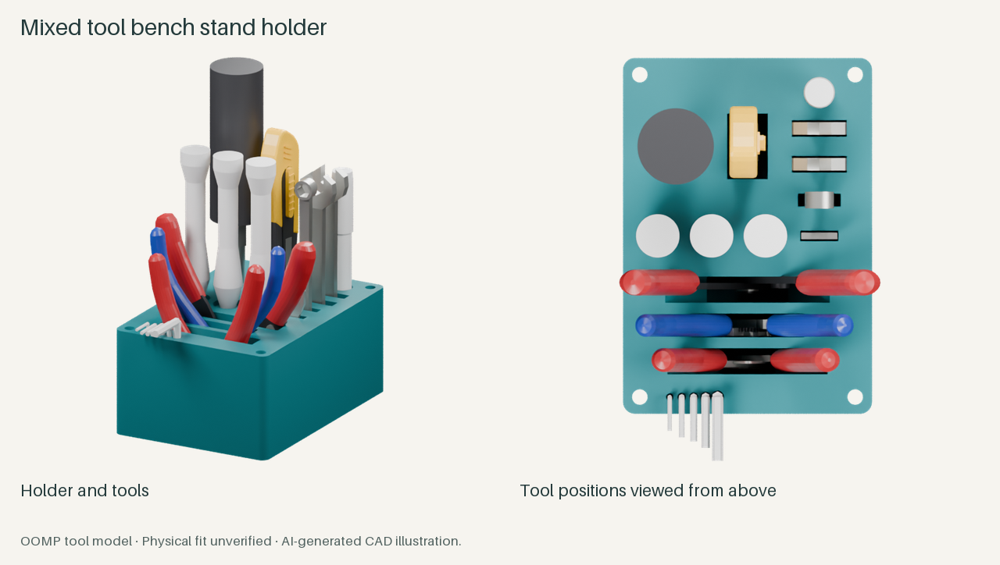

# Mixed tool bench stand holder

AI-generated CAD images and instructions. Errors possible.

[Offline step viewer](assembly_instructions.html) · [Print booklet](assembly_instructions.pdf) · [Holder files](../)

## Assembly and loading

Print the holder once. Place the holder upright with the openings facing up.

1. Place the printed stand upright on its flat base.
2. Lower the closed cutters, pliers and wire strippers into the wide front pockets.
3. Place the three precision drivers and the multi-driver in their round pockets.
4. Place the 7 mm and 8 mm spanners open-end down and the two 10 mm spanners ring-end down.
5. Keep the utility knife closed and place it in its slot. Add the 1.5, 2 and 2.5 mm hex keys.
6. Add the 3 and 4 mm hex keys and the capped marker.
7. Seat every tool and keep all handles and short key arms accessible.

## Model and fit

Open-pose photo trace with a provisional 110 mm closed-length reference (Rapid SA-706 RED). Grip thickness is estimated. The illustrated pose was checked against the production STL at the original model scale. Physical fit remains unverified. [OOMP tool record](https://github.com/oomlout/oomp_tool_version_5/tree/main/parts/tool_side_cutters_110_mm_length_red)

Open-pose photo trace with a provisional 130 mm closed-length reference (Rapid PC-022). Jaw and grip depths are estimated. [OOMP tool record](https://github.com/oomlout/oomp_tool_version_5/tree/main/tool_pliers_needle_nose_130_mm_length_blue)

Open-pose photo trace scaled to the candidate Anvil AV-LDWS catalogue length of 130 mm. The 120 mm OOMP label is retained. Thickness is estimated. [OOMP tool record](https://github.com/oomlout/oomp_tool_version_5/tree/main/tool_wire_strippers_120_mm_length_red)

Wera specifies the shaft diameter, shaft length and handle length. The archived OOMP record supplies the 18 mm handle envelope. Grip taper, cap and tip transition are illustrative. [OOMP tool record](https://github.com/oomlout/oomp_tool_version_5/tree/main/tool_screw_driver_precision_kraftform_micro_style_18_mm_diameter_157_mm_depth_hex_head_1_5_mm_wera_2054_series_05118066001)

Wera specifies the shaft diameter, shaft length and handle length. The archived OOMP record supplies the 18 mm handle envelope. Grip taper, cap and tip transition are illustrative. [OOMP tool record](https://github.com/oomlout/oomp_tool_version_5/tree/main/tool_screw_driver_precision_kraftform_micro_style_18_mm_diameter_157_mm_depth_hex_head_2_mm_wera_2054_series_05118068001)

Wera specifies the shaft diameter, shaft length and handle length. The archived OOMP record supplies the 18 mm handle envelope. Grip taper, cap and tip transition are illustrative. [OOMP tool record](https://github.com/oomlout/oomp_tool_version_5/tree/main/tool_screw_driver_precision_kraftform_micro_style_18_mm_diameter_157_mm_depth_hex_head_2_5_mm_wera_2054_series_05118070001)

Representative Picquic SIXPAC Plus, 200 mm overall and 32 mm handle diameter from a distributor listing. Picquic specifies 3-inch quarter-inch bits and a 7/16-inch hex bolster. Exposed bit, shank and bolster lengths are estimates for the stored-bit pose. The handle contour, stored bits and workshop specimen have not been measured. [OOMP tool record](https://github.com/oomlout/oomp_tool_version_5/tree/main/tool_screw_driver_multi_driver_200_mm_quikpik)

Generic 7 mm open-end spanner using the FACOM 34.7 as a dimensional reference. Length, maximum head width and thickness follow the catalogue. The square-on jaws and shank are simplified, and the workshop specimen has not been measured. [OOMP tool record](https://github.com/oomlout/oomp_tool_version_5/tree/main/tool_wrench_m7)

Generic 8 mm combination spanner using Stahlwille OPEN BOX 14 article 40100808 as a dimensional reference. Length and both head widths and thicknesses follow the catalogue. The straight body, head outlines and ring offset are simplified. The workshop specimen has not been measured. [OOMP tool record](https://github.com/oomlout/oomp_tool_version_5/tree/main/tool_wrench_m8)

Generic 10 mm combination spanner using the Bahco 111M-10 as a dimensional reference. Length and head widths and thicknesses follow the catalogue. The straight shank, jaw outline and six-point ring are simplified. The workshop specimen has not been measured. [OOMP tool record](https://github.com/oomlout/oomp_tool_version_5/tree/main/tool_wrench_m10)

Generic 10 mm combination spanner using the Bahco 111M-10 as a dimensional reference. Length and head widths and thicknesses follow the catalogue. The straight shank, jaw outline and six-point ring are simplified. The workshop specimen has not been measured. [OOMP tool record](https://github.com/oomlout/oomp_tool_version_5/tree/main/tool_wrench_m10)

Closed exterior based on the photo and a provisional 165 mm STANLEY 0-10-151 reference. The 17 mm OOMP label is retained. Size variant awaits measurement. [OOMP tool record](https://github.com/oomlout/oomp_tool_version_5/tree/main/tool_knife_craft_17_mm_black_exacto_style)

The holder specifies the hex size. Arm lengths follow the Wiha 350 short series as a representative example. The holder source leaves the key manufacturer unspecified. The elbow is simplified. [OOMP tool record](https://github.com/oomlout/oomp_tool_version_5/tree/main/tool_hex_key_1_5_mm)

The holder specifies the hex size. Arm lengths follow the Wiha 350 short series as a representative example. The holder source leaves the key manufacturer unspecified. The elbow is simplified. [OOMP tool record](https://github.com/oomlout/oomp_tool_version_5/tree/main/tool_hex_key_2_mm)

The holder specifies the hex size. Arm lengths follow the Wiha 350 short series as a representative example. The holder source leaves the key manufacturer unspecified. The elbow is simplified. [OOMP tool record](https://github.com/oomlout/oomp_tool_version_5/tree/main/tool_hex_key_2_5_mm)

The holder specifies the hex size. Arm lengths follow the Wiha 350 short series as a representative example. The holder source leaves the key manufacturer unspecified. The elbow is simplified. [OOMP tool record](https://github.com/oomlout/oomp_tool_version_5/tree/main/tool_hex_key_3_mm)

The holder specifies the hex size. Arm lengths follow the Wiha 350 short series as a representative example. The holder source leaves the key manufacturer unspecified. The elbow is simplified. [OOMP tool record](https://github.com/oomlout/oomp_tool_version_5/tree/main/tool_hex_key_4_mm)

The standard-tip OOMP record matches the branded v4 profile in diameter and length. Cap and barrel split are illustrative. [OOMP tool record](https://github.com/oomlout/oomp_tool_version_5/tree/main/stationery_felt_tip_pen_sharpie_standard_tip_style_13_mm_diameter_137_mm_length_sharpie)

The PDF uses eight landscape A4 pages in reader order. Choose booklet printing for folded copies.
