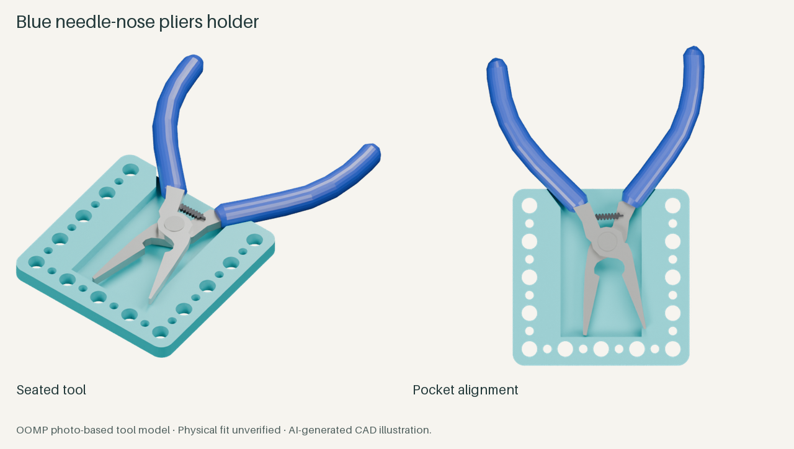

# Blue needle-nose pliers holder

AI-generated CAD images and instructions. Errors possible.

[Offline step viewer](assembly_instructions.html) · [Print booklet](assembly_instructions.pdf) · [Holder files](../)

## Loading sequence

1. Orient the printed holder with the pocket facing up. Locate its open end.
2. Point the long jaws toward the closed end of the recess. Centre the steel nose between the rails.
3. Lower the tool into the recess, keeping its nose between the pocket walls.
4. The blue grips extend beyond the open end, with the pivot visible above the recess.

## Model and fit

Open-pose photo trace with a provisional 130 mm closed-length reference (Rapid PC-022). Jaw and grip depths are estimated. The illustrated pose was checked against the production STL at the original model scale. Physical fit remains unverified. [OOMP tool record](https://github.com/oomlout/oomp_tool_version_5/tree/main/parts/tool_pliers_needle_nose_130_mm_length_blue)

The PDF uses eight landscape A4 pages in reader order. Choose booklet printing for folded copies.
