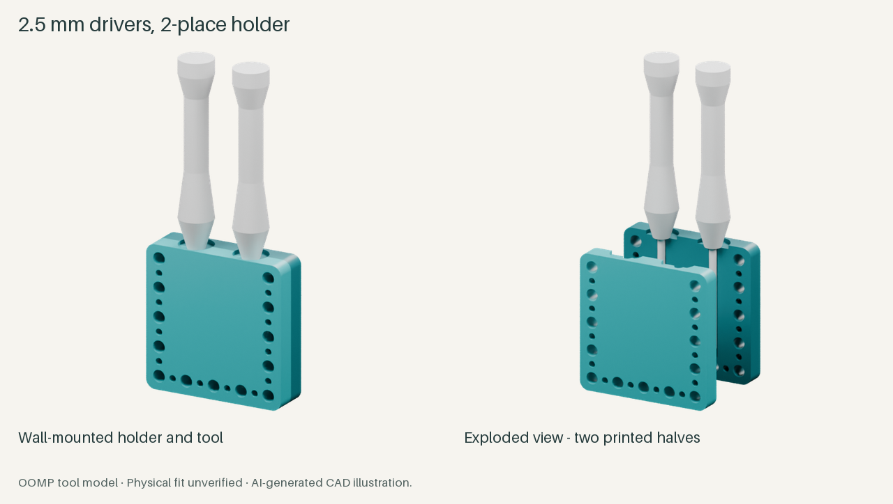
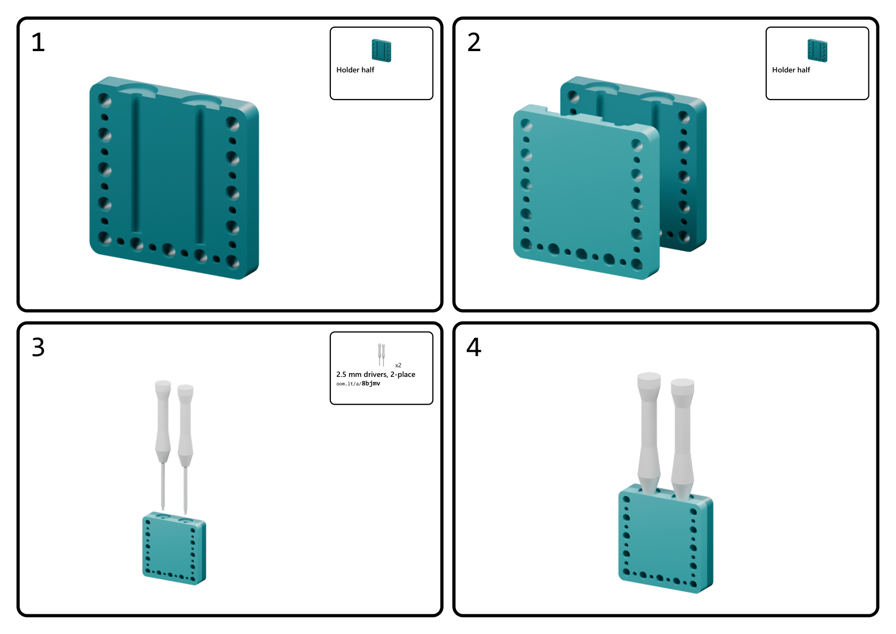

<!-- oobb-presentation:start -->
# Tall precision screwdriver, 2.5 mm hex, 60 mm

AI-generated CAD images and instructions. Errors possible.

## Summary

OOBB screwdriver precision tall holder · m2d5 2 place.

This is an entirely AI-generated coding project. The generated outputs are included and usually work. The project is published so others can modify and regenerate the designs with their own AI tools.



## Details

| Grid (width × height) | Assembled thickness | Thickness per printed piece |
| --- | --- | --- |
| 5 × 5 | 20 mm | 10 mm |

The grid pitch is 15 mm. The dashed line on the plan locates the cross section. [Section drawing](working.svg)

OOMP ID `oobb_part_holder_tool_screwdriver_precision_tall_hex_60mm_m2d5_2_place_5x5x20`

[Part folder](./) · [OOBB navigation](../../navigation_oobb/oobb/part/holder_tool/screwdriver_precision_tall/hex_60mm/m2d5_2_place/) · [Source design](https://github.com/oomlout/oomlout_oobb_version_4/blob/41f5386997faef4473c959dfb8c929864d7bf697/oobb_make_sets.py#L626)

<details><summary>Complete part metadata</summary>

```yaml
assembly_details:
  alignment: Point the hex tips down and centre the shafts over the openings.
  check: Each tip reaches its pocket floor and the handles remain accessible above
    the holder.
  instance_x_mm:
  - -15
  - 15
  label: 2.5 mm drivers, 2-place
  layout: m2d5_2_place
  model_kind: wera
  rotation_deg:
  - 0
  - 0
  - 0
  steps:
  - action: Orient the rear half as it sits on the wall, with the pocket facing you
      and the opening at the top.
    add:
    - holder
    key: step_01
    upper_lift_mm: 0
    withdraw_mm: 0
  - action: Face the front half toward the rear pocket. Align the mounting holes and
      both top openings.
    add:
    - holder
    key: step_02
    upper_lift_mm: 36
    withdraw_mm: 0
  - action: Bring the halves together until their rims meet. Point the hex tips down
      and centre the shafts over the openings.
    add:
    - tool
    - tool
    key: step_03
    upper_lift_mm: 0
    withdraw_mm: 70
  - action: Lower the tools through the top openings. Each tip reaches its pocket
      floor and the handles remain accessible above the holder.
    add: []
    key: step_04
    upper_lift_mm: 0
    withdraw_mm: 0
  style:
    border: '000000'
    border_radius_mm: 3
    border_width_pt: 3
    columns: 2
    component_border_width_pt: 1.1
    font_body_pt: 7
    font_code_pt: 6.4
    font_url_prefix_pt: 4.8
    gutter_mm: 4
    margin_mm: 6
    page_mm:
    - 297
    - 210
    quantity_pt: 5.8
    quantity_shift_mm: 1
    rows: 2
    thumbnail_height_mm: 8.5
  tool_id: tool_screw_driver_precision_kraftform_micro_style_18_mm_diameter_157_mm_depth_hex_head_2_5_mm_wera_2054_series_05118070001
  translation_mm:
  - 0
  - -25
  - 1
body_style: vertical_v4
construction:
  mirror_second_print_x: false
  mode: repeat_half
  pocket_on_underside: true
count: 2
depth: 20
height: 5
layout: m2d5_2_place
model: hex_60mm
oobb_details:
  body_style: vertical_v4
  corner_radius_mm: 5
  count: 2
  depth: 20
  edge_reduction_mm: 1
  height: 5
  layered: false
  offset_mm:
  - 0
  - 0
  - 0
  oobb_type: holder_tool
  pitch_mm: 15
  profile:
  - h: 60
    pos:
    - 0
    - -25
    - -1
    r: 2.5
    rot:
    - -90
    - 0
    - 0
    shape: cylinder
  - h: 98
    pos:
    - 0
    - 35
    - -1
    r: 9
    rot:
    - -90
    - 0
    - 0
    shape: cylinder
  run_scad: true
  run_solidcraft: false
  spacing_mm: 30
  width: 5
oobb_type: holder_tool
profile: tool_screwdriver_hex_m2d5_precision_tall_60_mm
show_underside: true
spacing_mm: 30
svg_details:
  cross_section_y_fraction: 0.82
  near_face_fraction: 0.08
  show_underside: true
  svg_name: holder_sections
taxonomy_1: oobb
taxonomy_10: ''
taxonomy_11: ''
taxonomy_12: ''
taxonomy_13: ''
taxonomy_14: ''
taxonomy_15: ''
taxonomy_2: part
taxonomy_3: holder_tool
taxonomy_4: screwdriver_precision_tall
taxonomy_5: hex_60mm
taxonomy_6: m2d5_2_place
taxonomy_7: 5x5x20
taxonomy_8: ''
taxonomy_9: ''
title: Tall precision screwdriver, 2.5 mm hex, 60 mm
tool_type: screwdriver_precision_tall
width: 5
id: oobb_part_holder_tool_screwdriver_precision_tall_hex_60mm_m2d5_2_place_5x5x20
directory: parts/oobb_part_holder_tool_screwdriver_precision_tall_hex_60mm_m2d5_2_place_5x5x20
md5: 7634df48bed8d3a0b8b5294d59069c53
md5_6: 7634df
md5_6_alpha: 4m1gf
```

</details>

## Parts

Use the print mesh in the part folder. Tool and mounting hardware are supplied separately.

## Assembly

Print two copies of the holder STL. The dark teal half sits against the wall and the light teal half faces the room.

1. Orient the rear half as it sits on the wall, with the pocket facing you and the opening at the top. [View step 1](assembly/render/raw/step_01.png)
2. Face the front half toward the rear pocket. Align the mounting holes and both top openings. [View step 2](assembly/render/raw/step_02.png)
3. Bring the halves together until their rims meet. Point the hex tips down and centre the shafts over the openings. [View step 3](assembly/render/raw/step_03.png)
4. Lower the tools through the top openings. Each tip reaches its pocket floor and the handles remain accessible above the holder. [View step 4](assembly/render/raw/step_04.png)

<details><summary>Illustrated assembly steps</summary>



</details>

Wera specifies the shaft diameter, shaft length and handle length. The archived OOMP record supplies the 18 mm handle envelope. Grip taper, cap and tip transition are illustrative. The digital model was checked against the printed holder. Physical fit remains unverified. [OOMP tool record](https://github.com/oomlout/oomp_tool_version_5/tree/main/parts/tool_screw_driver_precision_kraftform_micro_style_18_mm_diameter_157_mm_depth_hex_head_2_5_mm_wera_2054_series_05118070001)

[Open assembly viewer](https://raw.githack.com/oomlout/oomlout_oobb_part_holder_tool_version_5/main/parts/oobb_part_holder_tool_screwdriver_precision_tall_hex_60mm_m2d5_2_place_5x5x20/assembly/assembly_instructions.html) · [Print booklet (PDF)](assembly/assembly_instructions.pdf)
<!-- oobb-presentation:end -->
