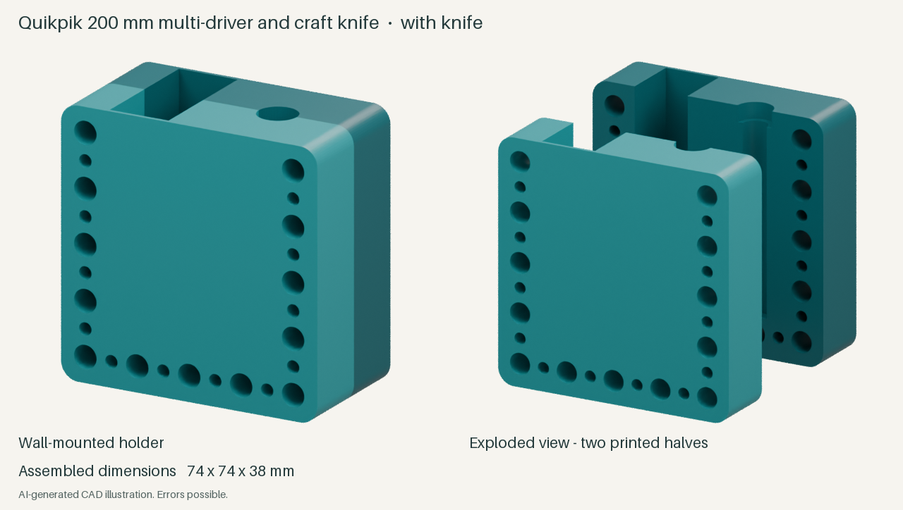

<!-- oobb-presentation:start -->
# Quikpik 200 mm multi-driver and craft knife

AI-generated CAD images and instructions. Errors possible.

## Summary

OOBB screwdriver holder · with knife.

This is an entirely AI-generated coding project. The generated outputs are included and usually work. The project is published so others can modify and regenerate the designs with their own AI tools.



## Details

| Grid (width × height) | Assembled thickness | Thickness per printed piece |
| --- | --- | --- |
| 5 × 5 | 38 mm | 19 mm |

The grid pitch is 15 mm. The dashed line on the plan locates the cross section. [Section drawing](working.svg)

OOMP ID `oobb_part_holder_tool_screwdriver_quikpik_200mm_with_knife_5x5x38`

[Part folder](./) · [OOBB navigation](../../navigation_oobb/oobb/part/holder_tool/screwdriver/quikpik_200mm/with_knife/) · [Source design](https://github.com/oomlout/oomlout_oobb_version_4/blob/41f5386997faef4473c959dfb8c929864d7bf697/oobb_make_sets.py#L626)

<details><summary>Complete part metadata</summary>

```yaml
body_style: vertical_v4
construction:
  mirror_second_print_x: true
  mode: repeat_half
  pocket_on_underside: false
depth: 38
height: 5
layout: with_knife
model: quikpik_200mm
oobb_details:
  body_style: vertical_v4
  corner_radius_mm: 5
  count: 1
  depth: 38
  edge_reduction_mm: 1
  height: 5
  layered: false
  offset_mm:
  - 0
  - 0
  - 0
  oobb_type: holder_tool
  pitch_mm: 15
  profile:
  - h: 27.5
    points:
    - - -23.5
      - 0
    - - -23.5
      - 160
    - - -6.5
      - 160
    - - -6.5
      - 0
    pos:
    - 0
    - -23.75
    - 0
    rot:
    - 0
    - 0
    - 0
    shape: polygon
  - h: 57
    pos:
    - 15
    - -25
    - 18
    r: 3.85
    rot:
    - -90
    - 0
    - 0
    shape: cylinder
  - h: 30
    pos:
    - 15
    - 32
    - 18
    r: 5.5
    rot:
    - -90
    - 0
    - 0
    shape: cylinder
  - h: 17
    pos:
    - 15
    - 62
    - 18
    r: 6.5
    rot:
    - -90
    - 0
    - 0
    shape: cylinder
  - h: 100
    pos:
    - 15
    - 79
    - 18
    r: 18
    rot:
    - -90
    - 0
    - 0
    shape: cylinder
  run_scad: true
  run_solidcraft: false
  spacing_mm: 15
  width: 5
oobb_type: holder_tool
profile: tool_screwdriver_multi_quikpik_200_mm_knife
show_underside: false
source_id: tool_screwdriver_multi_quikpik_200_mm_knife
svg_details:
  cross_section_y_fraction: 0.82
  near_face_fraction: 0.08
  show_underside: false
  svg_name: holder_sections
taxonomy_1: oobb
taxonomy_10: ''
taxonomy_11: ''
taxonomy_12: ''
taxonomy_13: ''
taxonomy_14: ''
taxonomy_15: ''
taxonomy_2: part
taxonomy_3: holder_tool
taxonomy_4: screwdriver
taxonomy_5: quikpik_200mm
taxonomy_6: with_knife
taxonomy_7: 5x5x38
taxonomy_8: ''
taxonomy_9: ''
title: Quikpik 200 mm multi-driver and craft knife
tool_type: screwdriver
width: 5
id: oobb_part_holder_tool_screwdriver_quikpik_200mm_with_knife_5x5x38
directory: parts/oobb_part_holder_tool_screwdriver_quikpik_200mm_with_knife_5x5x38
md5: f2d42d359ca5bb9a020245cd4a6db1fc
md5_6: f2d42d
md5_6_alpha: 9h3cd
```

</details>

## Parts

Use the print mesh in the part folder. Tool and mounting hardware are supplied separately.

## Assembly

Print one half as supplied and mirror the second copy along X in the slicer before printing. Turn one half over and bring the matching pockets and mounting holes together.

These tools also have illustrated single-place holder guides. [Black Exacto-style craft knife, 17 mm](../oobb_part_holder_tool_knife_exacto_17mm_1_place_3x5x29d5/README.md#assembly)
<!-- oobb-presentation:end -->
