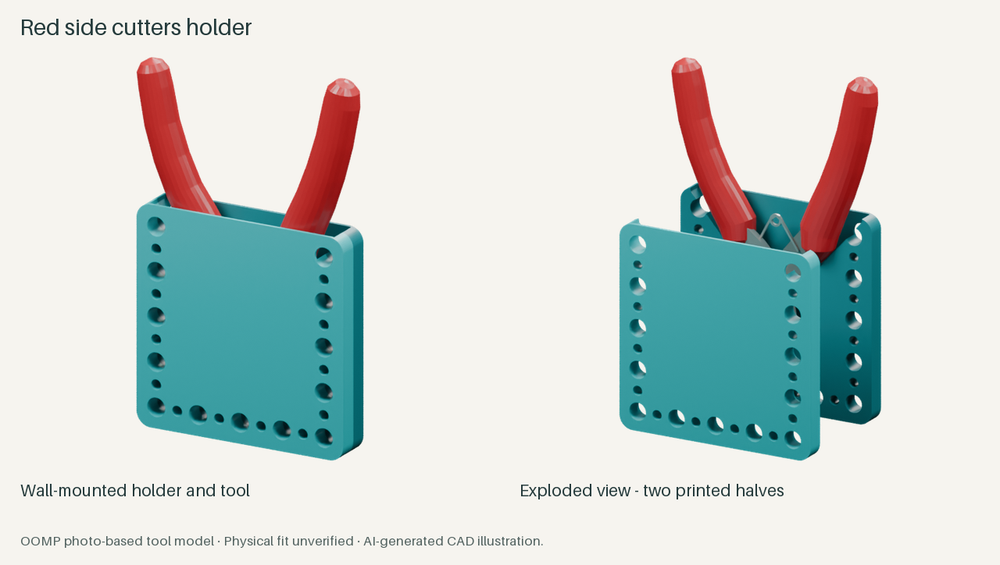

# Red side cutters holder

AI-generated CAD images and instructions. Errors possible.

[Offline step viewer](assembly_instructions.html) · [Print booklet](assembly_instructions.pdf) · [Holder files](../)

## Assembly and loading

Print two copies of the holder STL. The dark teal half sits against the wall. The light teal half faces the room. The opening and tool handles point up.

1. Orient the rear half as it sits on the wall, with the pocket facing you and the opening at the top.
2. Face the front half toward the rear pocket. Align the mounting holes and both top openings.
3. Bring the halves together until their rims meet. Point the cutting head toward the closed end. Align the steel arms with the widening pocket.
4. Lower the tool through the top opening. Leave both red grips clear of the open end. The jaw tips sit short of the end wall in the photographed pose.

## Model and fit

Open-pose photo trace with a provisional 110 mm closed-length reference (Rapid SA-706 RED). Grip thickness is estimated. The illustrated pose was checked against the production STL at the original model scale. Physical fit remains unverified. [OOMP tool record](https://github.com/oomlout/oomp_tool_version_5/tree/main/parts/tool_side_cutters_110_mm_length_red)

The PDF uses eight landscape A4 pages in reader order. Choose booklet printing for folded copies.
