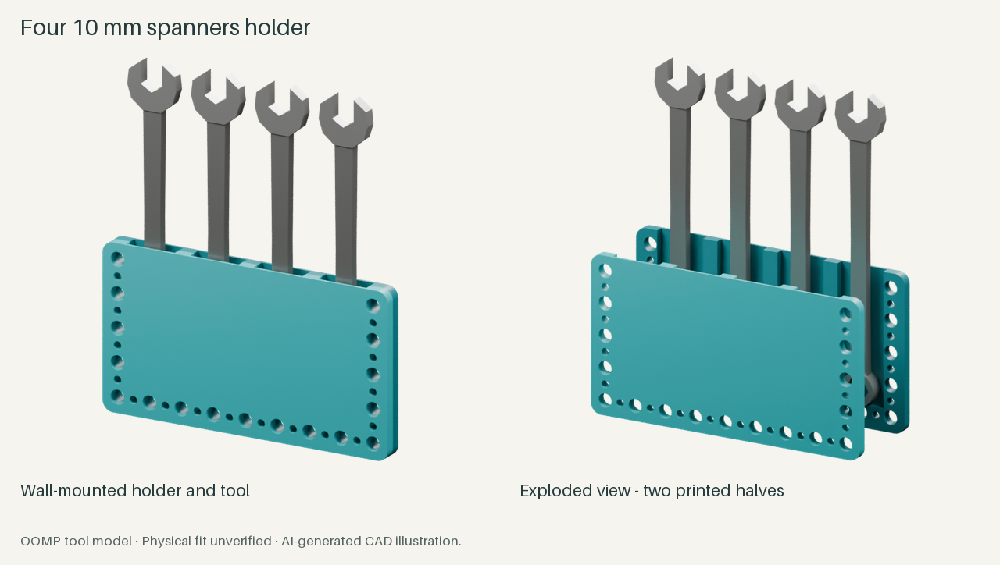
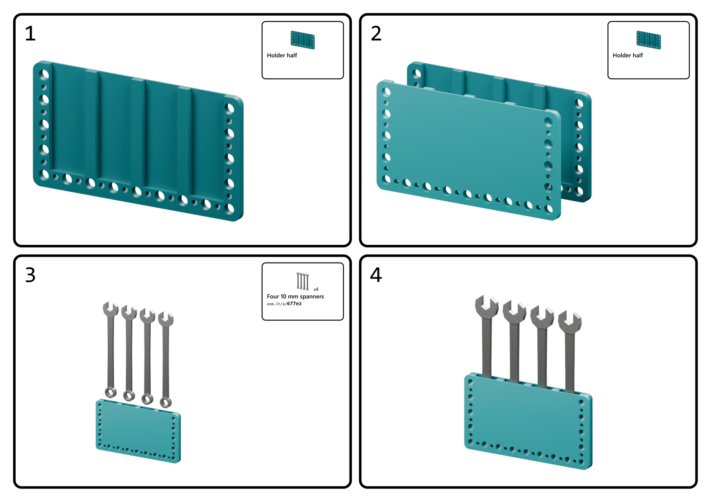

<!-- oobb-presentation:start -->
# M10 spanner

AI-generated CAD images and instructions. Errors possible.

## Summary

OOBB spanner holder · 4 place.

This is an entirely AI-generated coding project. The generated outputs are included and usually work. The project is published so others can modify and regenerate the designs with their own AI tools.



## Details

| Grid (width × height) | Assembled thickness | Thickness per printed piece |
| --- | --- | --- |
| 9 × 5 | 9 mm | 4.5 mm |

The grid pitch is 15 mm. The dashed line on the plan locates the cross section. [Section drawing](working.svg)

OOMP ID `oobb_part_holder_tool_spanner_m10_4_place_9x5x9`

[Part folder](./) · [OOBB navigation](../../navigation_oobb/oobb/part/holder_tool/spanner/m10/4_place/) · [Source design](https://github.com/oomlout/oomlout_oobb_version_4/blob/41f5386997faef4473c959dfb8c929864d7bf697/oobb_make_sets.py#L626)

<details><summary>Complete part metadata</summary>

```yaml
assembly_details:
  alignment: Hold the four spanners with their ring ends down over the openings.
  check: Each ring rests on its own pocket floor, with the open jaws above the holder.
  instance_x_mm:
  - -45
  - -15
  - 15
  - 45
  label: Four 10 mm spanners
  layout: 4_place
  model_kind: combination_spanner
  rotation_deg:
  - 0
  - 0
  - 0
  steps:
  - action: Orient the rear half as it sits on the wall, with the pocket facing you
      and the opening at the top.
    add:
    - holder
    key: step_01
    upper_lift_mm: 0
    withdraw_mm: 0
  - action: Face the front half toward the rear pocket. Align the mounting holes and
      both top openings.
    add:
    - holder
    key: step_02
    upper_lift_mm: 36
    withdraw_mm: 0
  - action: Bring the halves together until their rims meet. Hold the four spanners
      with their ring ends down over the openings.
    add:
    - tool
    - tool
    - tool
    - tool
    key: step_03
    upper_lift_mm: 0
    withdraw_mm: 70
  - action: Lower the tools through the top openings. Each ring rests on its own pocket
      floor, with the open jaws above the holder.
    add: []
    key: step_04
    upper_lift_mm: 0
    withdraw_mm: 0
  style:
    border: '000000'
    border_radius_mm: 3
    border_width_pt: 3
    columns: 2
    component_border_width_pt: 1.1
    font_body_pt: 7
    font_code_pt: 6.4
    font_url_prefix_pt: 4.8
    gutter_mm: 4
    margin_mm: 6
    page_mm:
    - 297
    - 210
    quantity_pt: 5.8
    quantity_shift_mm: 1
    rows: 2
    thumbnail_height_mm: 8.5
  tool_id: tool_wrench_m10
  translation_mm:
  - 0
  - -26.5
  - 3.5
body_style: vertical_v4
construction:
  mirror_second_print_x: false
  mode: repeat_half
  pocket_on_underside: false
count: 4
depth: 9
height: 5
layout: 4_place
model: m10
oobb_details:
  body_style: vertical_v4
  corner_radius_mm: 5
  count: 4
  depth: 9
  edge_reduction_mm: 1
  height: 5
  layered: false
  offset_mm:
  - 0
  - 0
  - 0
  oobb_type: holder_tool
  pitch_mm: 15
  profile:
  - h: 7
    points:
    - - -11.5
      - 0
    - - -11.5
      - 140
    - - 11.5
      - 140
    - - 11.5
      - 0
    pos:
    - 0
    - -26.5
    - 0
    rot:
    - 0
    - 0
    - 0
    shape: polygon
  run_scad: true
  run_solidcraft: false
  spacing_mm: 30
  width: 9
oobb_type: holder_tool
profile: tool_spanner_m10
show_underside: false
spacing_mm: 30
svg_details:
  cross_section_y_fraction: 0.82
  near_face_fraction: 0.08
  show_underside: false
  svg_name: holder_sections
taxonomy_1: oobb
taxonomy_10: ''
taxonomy_11: ''
taxonomy_12: ''
taxonomy_13: ''
taxonomy_14: ''
taxonomy_15: ''
taxonomy_2: part
taxonomy_3: holder_tool
taxonomy_4: spanner
taxonomy_5: m10
taxonomy_6: 4_place
taxonomy_7: 9x5x9
taxonomy_8: ''
taxonomy_9: ''
title: M10 spanner
tool_type: spanner
width: 9
id: oobb_part_holder_tool_spanner_m10_4_place_9x5x9
directory: parts/oobb_part_holder_tool_spanner_m10_4_place_9x5x9
md5: eeb7e0478f39317fe9d5acb01da6a815
md5_6: eeb7e0
md5_6_alpha: 9bbhc
```

</details>

## Parts

Use the print mesh in the part folder. Tool and mounting hardware are supplied separately.

## Assembly

Print two copies of the holder STL. The dark teal half sits against the wall and the light teal half faces the room.

1. Orient the rear half as it sits on the wall, with the pocket facing you and the opening at the top. [View step 1](assembly/render/raw/step_01.png)
2. Face the front half toward the rear pocket. Align the mounting holes and both top openings. [View step 2](assembly/render/raw/step_02.png)
3. Bring the halves together until their rims meet. Hold the four spanners with their ring ends down over the openings. [View step 3](assembly/render/raw/step_03.png)
4. Lower the tools through the top openings. Each ring rests on its own pocket floor, with the open jaws above the holder. [View step 4](assembly/render/raw/step_04.png)

<details><summary>Illustrated assembly steps</summary>



</details>

Generic 10 mm combination spanner using the Bahco 111M-10 as a dimensional reference. Length and head widths and thicknesses follow the catalogue. The straight shank, jaw outline and six-point ring are simplified. The workshop specimen has not been measured. The digital model was checked against the printed holder. Physical fit remains unverified. [OOMP tool record](https://github.com/oomlout/oomp_tool_version_5/tree/main/parts/tool_wrench_m10)

[Offline HTML viewer](assembly/assembly_instructions.html) · [Print booklet (PDF)](assembly/assembly_instructions.pdf)
<!-- oobb-presentation:end -->
