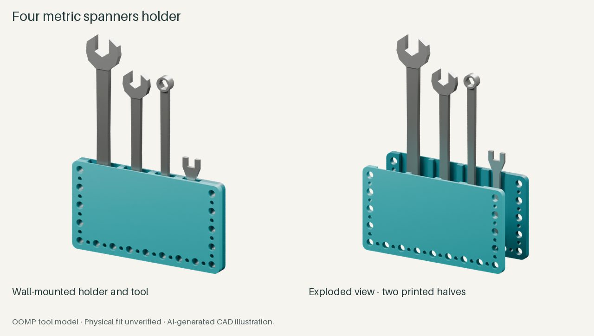
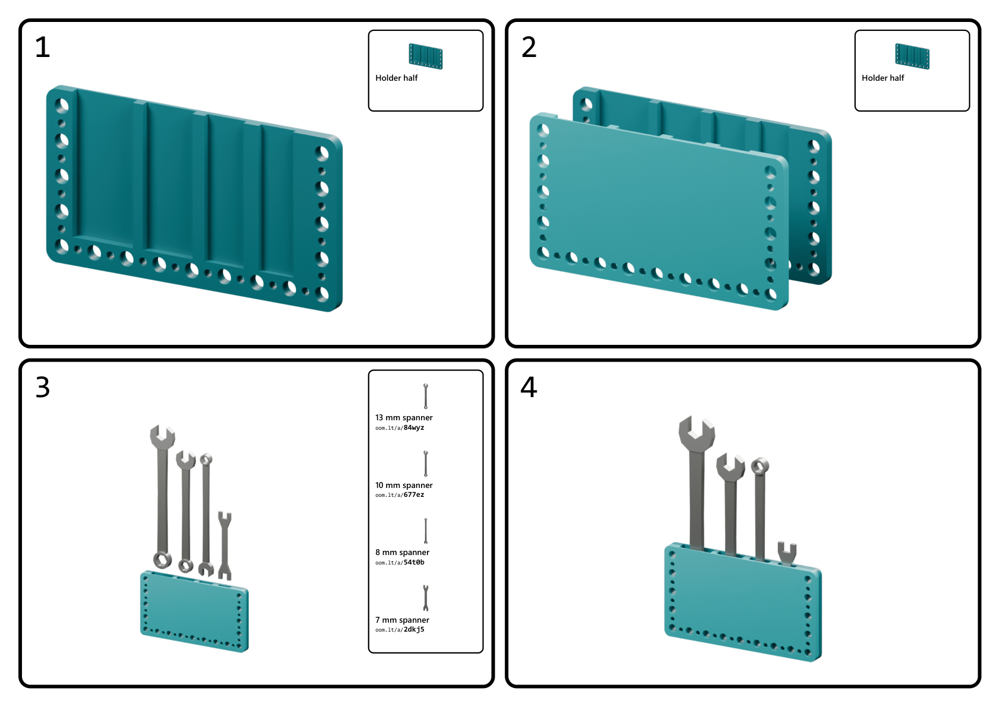

<!-- oobb-presentation:start -->
# M13, M10, M8 and M7 spanners

AI-generated CAD images and instructions. Errors possible.

## Summary

OOBB spanner holder · 4 place.

This is an entirely AI-generated coding project. The generated outputs are included and usually work. The project is published so others can modify and regenerate the designs with their own AI tools.



## Details

| Grid (width × height) | Assembled thickness | Thickness per printed piece |
| --- | --- | --- |
| 9 × 5 | 10 mm | 5 mm |

The grid pitch is 15 mm. The dashed line on the plan locates the cross section. [Section drawing](working.svg)

OOMP ID `oobb_part_holder_tool_spanner_m13_m10_m8_m7_4_place_9x5x10`

[Part folder](./) · [OOBB navigation](../../navigation_oobb/oobb/part/holder_tool/spanner/m13_m10_m8_m7/4_place/) · [Source design](../../working_oomp_populate.py)

<details><summary>Complete part metadata</summary>

```yaml
assembly_details:
  additional_tools:
  - key: spanner_m10
    label: 10 mm spanner
    model_kind: combination_spanner
    rotation_deg:
    - 0
    - 0
    - 0
    tool_id: tool_wrench_m10
    translation_mm:
    - -11
    - -25
    - 4
  - key: spanner_m8
    label: 8 mm spanner
    model_kind: combination_spanner
    rotation_deg:
    - 0
    - 0
    - 180
    tool_id: tool_wrench_m8
    translation_mm:
    - 15
    - 120
    - 4
  - key: spanner_m7
    label: 7 mm spanner
    model_kind: open_spanner
    rotation_deg:
    - 0
    - 0
    - 0
    tool_id: tool_wrench_m7
    translation_mm:
    - 39
    - -25
    - 4
  alignment: Align the four spanners with their matching pockets. The 13 and 10 mm
    ring ends point down; the 8 and 7 mm open ends point down.
  check: Each spanner rests at its pocket floor. From left to right the sizes are
    13, 10, 8 and 7 mm.
  label: Four metric spanners
  layout: 4_place
  model_kind: combination_spanner
  primary_label: 13 mm spanner
  rotation_deg:
  - 0
  - 0
  - 0
  steps:
  - action: Orient the rear half as it sits on the wall, with the pocket facing you
      and the opening at the top.
    add:
    - holder
    key: step_01
    upper_lift_mm: 0
    withdraw_mm: 0
  - action: Face the front half toward the rear pocket. Align the mounting holes and
      both top openings.
    add:
    - holder
    key: step_02
    upper_lift_mm: 36
    withdraw_mm: 0
  - action: Bring the halves together until their rims meet. Align the four spanners
      with their matching pockets. The 13 and 10 mm ring ends point down; the 8 and
      7 mm open ends point down.
    add:
    - tool
    - spanner_m10
    - spanner_m8
    - spanner_m7
    key: step_03
    upper_lift_mm: 0
    withdraw_mm: 70
  - action: Lower the tools through the top openings. Each spanner rests at its pocket
      floor. From left to right the sizes are 13, 10, 8 and 7 mm.
    add: []
    key: step_04
    upper_lift_mm: 0
    withdraw_mm: 0
  style:
    border: '000000'
    border_radius_mm: 3
    border_width_pt: 3
    columns: 2
    component_border_width_pt: 1.1
    font_body_pt: 7
    font_code_pt: 6.4
    font_url_prefix_pt: 4.8
    gutter_mm: 4
    margin_mm: 6
    page_mm:
    - 297
    - 210
    quantity_pt: 5.8
    quantity_shift_mm: 1
    rows: 2
    thumbnail_height_mm: 8.5
  tool_id: tool_wrench_m13
  translation_mm:
  - -41
  - -25
  - 4
body_style: paired_face_up
construction:
  mirror_second_print_x: false
  mode: handed_pair
  pocket_on_underside: false
depth: 10
height: 5
layout: 4_place
model: m13_m10_m8_m7
oobb_details:
  body_style: paired_face_up
  corner_radius_mm: 5
  count: 1
  depth: 10
  edge_reduction_mm: 1
  height: 5
  layered: false
  offset_mm:
  - 0
  - 0
  - 0
  oobb_type: holder_tool
  pitch_mm: 15
  profile:
  - h: 8
    points:
    - - -14
      - 0
    - - -14
      - 70
    - - 14
      - 70
    - - 14
      - 0
    pos:
    - -41
    - -25
    - 0
    rot:
    - 0
    - 0
    - 0
    shape: polygon
  - h: 7
    points:
    - - -11.5
      - 0
    - - -11.5
      - 70
    - - 11.5
      - 70
    - - 11.5
      - 0
    pos:
    - -11
    - -25
    - 0.5
    rot:
    - 0
    - 0
    - 0
    shape: polygon
  - h: 5.5
    points:
    - - -9
      - 0
    - - -9
      - 70
    - - 9
      - 70
    - - 9
      - 0
    pos:
    - 15
    - -25
    - 1.25
    rot:
    - 0
    - 0
    - 0
    shape: polygon
  - h: 4.5
    points:
    - - -8
      - 0
    - - -8
      - 70
    - - 8
      - 70
    - - 8
      - 0
    pos:
    - 39
    - -25
    - 1.75
    rot:
    - 0
    - 0
    - 0
    shape: polygon
  run_scad: true
  run_solidcraft: false
  spacing_mm: 15
  width: 9
oobb_type: holder_tool
profile: four_spanners
svg_details:
  cross_section_y_fraction: 0.82
  near_face_fraction: 0.08
  show_underside: false
  svg_name: holder_sections
taxonomy_1: oobb
taxonomy_10: ''
taxonomy_11: ''
taxonomy_12: ''
taxonomy_13: ''
taxonomy_14: ''
taxonomy_15: ''
taxonomy_2: part
taxonomy_3: holder_tool
taxonomy_4: spanner
taxonomy_5: m13_m10_m8_m7
taxonomy_6: 4_place
taxonomy_7: 9x5x10
taxonomy_8: ''
taxonomy_9: ''
title: M13, M10, M8 and M7 spanners
tool_type: spanner
width: 9
id: oobb_part_holder_tool_spanner_m13_m10_m8_m7_4_place_9x5x10
directory: parts/oobb_part_holder_tool_spanner_m13_m10_m8_m7_4_place_9x5x10
md5: 45fe8c6861efb989d47d2b6e535f2259
md5_6: 45fe8c
md5_6_alpha: 2qbgs
```

</details>

## Parts

Use the print mesh in the part folder. Tool and mounting hardware are supplied separately.

## Assembly

Print the supplied two-half layout once. The dark teal half sits against the wall and the light teal half faces the room.

1. Orient the rear half as it sits on the wall, with the pocket facing you and the opening at the top. [View step 1](assembly/render/raw/step_01.png)
2. Face the front half toward the rear pocket. Align the mounting holes and both top openings. [View step 2](assembly/render/raw/step_02.png)
3. Bring the halves together until their rims meet. Align the four spanners with their matching pockets. The 13 and 10 mm ring ends point down; the 8 and 7 mm open ends point down. [View step 3](assembly/render/raw/step_03.png)
4. Lower the tools through the top openings. Each spanner rests at its pocket floor. From left to right the sizes are 13, 10, 8 and 7 mm. [View step 4](assembly/render/raw/step_04.png)

<details><summary>Illustrated assembly steps</summary>



</details>

Generic 13 mm combination spanner using the Bahco 111M-13 as a dimensional reference. Length and head widths and thicknesses follow the catalogue. The straight shank, jaw outline and six-point ring are simplified. The workshop specimen has not been measured. The digital model was checked against the printed holder. Physical fit remains unverified. [OOMP tool record](https://github.com/oomlout/oomp_tool_version_5/tree/main/parts/tool_wrench_m13)

Generic 10 mm combination spanner using the Bahco 111M-10 as a dimensional reference. Length and head widths and thicknesses follow the catalogue. The straight shank, jaw outline and six-point ring are simplified. The workshop specimen has not been measured. [OOMP tool record](https://github.com/oomlout/oomp_tool_version_5/tree/main/parts/tool_wrench_m10)

Generic 8 mm combination spanner using Stahlwille OPEN BOX 14 article 40100808 as a dimensional reference. Length and both head widths and thicknesses follow the catalogue. The straight body, head outlines and ring offset are simplified. The workshop specimen has not been measured. [OOMP tool record](https://github.com/oomlout/oomp_tool_version_5/tree/main/parts/tool_wrench_m8)

Generic 7 mm open-end spanner using the FACOM 34.7 as a dimensional reference. Length, maximum head width and thickness follow the catalogue. The square-on jaws and shank are simplified, and the workshop specimen has not been measured. [OOMP tool record](https://github.com/oomlout/oomp_tool_version_5/tree/main/parts/tool_wrench_m7)

[Offline HTML viewer](assembly/assembly_instructions.html) · [Print booklet (PDF)](assembly/assembly_instructions.pdf)
<!-- oobb-presentation:end -->
