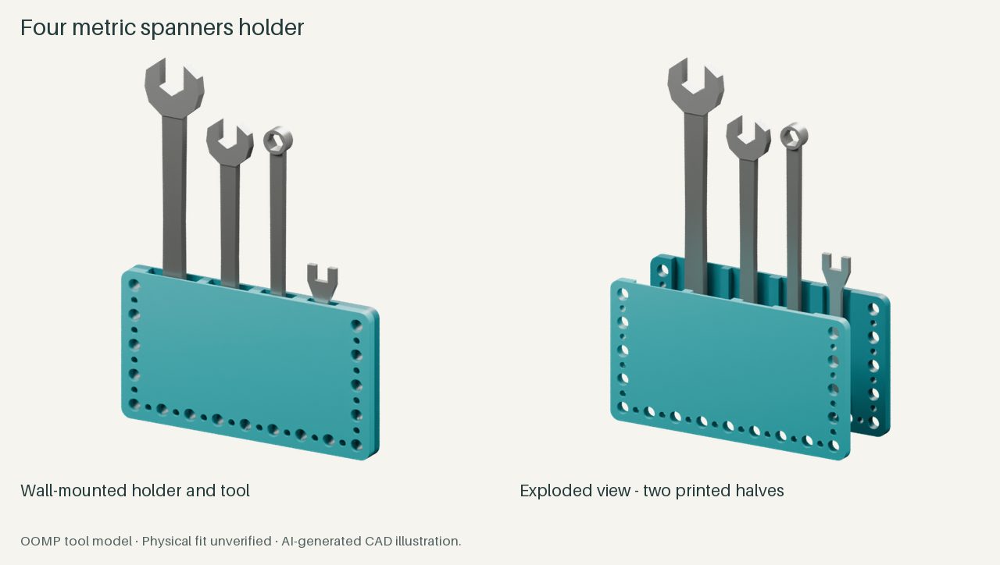

# Four metric spanners holder

AI-generated CAD images and instructions. Errors possible.

[Offline step viewer](assembly_instructions.html) · [Print booklet](assembly_instructions.pdf) · [Holder files](../)

## Assembly and loading

Print the supplied two-half layout once. The dark teal half sits against the wall. The light teal half faces the room. The opening and tool handles point up.

1. Orient the rear half as it sits on the wall, with the pocket facing you and the opening at the top.
2. Face the front half toward the rear pocket. Align the mounting holes and both top openings.
3. Bring the halves together until their rims meet. Align the four spanners with their matching pockets. The 13 and 10 mm ring ends point down; the 8 and 7 mm open ends point down.
4. Lower the tools through the top openings. Each spanner rests at its pocket floor. From left to right the sizes are 13, 10, 8 and 7 mm.

## Model and fit

Generic 13 mm combination spanner using the Bahco 111M-13 as a dimensional reference. Length and head widths and thicknesses follow the catalogue. The straight shank, jaw outline and six-point ring are simplified. The workshop specimen has not been measured. The illustrated pose was checked against the production STL at the original model scale. Physical fit remains unverified. [OOMP tool record](https://github.com/oomlout/oomp_tool_version_5/tree/main/parts/tool_wrench_m13)

Generic 10 mm combination spanner using the Bahco 111M-10 as a dimensional reference. Length and head widths and thicknesses follow the catalogue. The straight shank, jaw outline and six-point ring are simplified. The workshop specimen has not been measured. [OOMP tool record](https://github.com/oomlout/oomp_tool_version_5/tree/main/tool_wrench_m10)

Generic 8 mm combination spanner using Stahlwille OPEN BOX 14 article 40100808 as a dimensional reference. Length and both head widths and thicknesses follow the catalogue. The straight body, head outlines and ring offset are simplified. The workshop specimen has not been measured. [OOMP tool record](https://github.com/oomlout/oomp_tool_version_5/tree/main/tool_wrench_m8)

Generic 7 mm open-end spanner using the FACOM 34.7 as a dimensional reference. Length, maximum head width and thickness follow the catalogue. The square-on jaws and shank are simplified, and the workshop specimen has not been measured. [OOMP tool record](https://github.com/oomlout/oomp_tool_version_5/tree/main/tool_wrench_m7)

The PDF uses eight landscape A4 pages in reader order. Choose booklet printing for folded copies.
