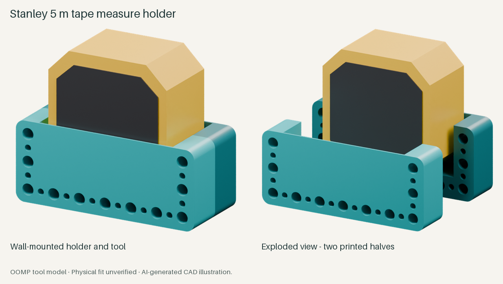

# Stanley 5 m tape measure holder

AI-generated CAD images and instructions. Errors possible.

[Offline step viewer](assembly_instructions.html) · [Print booklet](assembly_instructions.pdf) · [Holder files](../)

## Assembly and loading

Print two copies of the holder STL. The dark teal half sits against the wall. The light teal half faces the room. The opening and tool handles point up.

1. Orient the rear half as it sits on the wall, with the pocket facing you and the opening at the top.
2. Face the front half toward the rear pocket. Align the mounting holes and both top openings.
3. Bring the halves together until their rims meet. Retract the tape and lower the case into the wide opening with the dark face forward.
4. Lower the tool through the top opening. The lower case rests on the pocket floor and the upper case remains accessible.

## Model and fit

Retracted Stanley Tylon 1-30-696, modelled with a 69 × 72 × 40 mm case from a distributor listing. The outline and coloured face follow the manufacturer photograph. The lock, hook and belt clip are simplified or omitted; dimensions and physical fit require confirmation on the actual tool. The illustrated pose was checked against the production STL at the original model scale. Physical fit remains unverified. [OOMP tool record](https://github.com/oomlout/oomp_tool_version_5/tree/main/parts/tool_measure_tape_measure_5000_mm_length_stanley_1_30_696)

The PDF uses eight landscape A4 pages in reader order. Choose booklet printing for folded copies.
