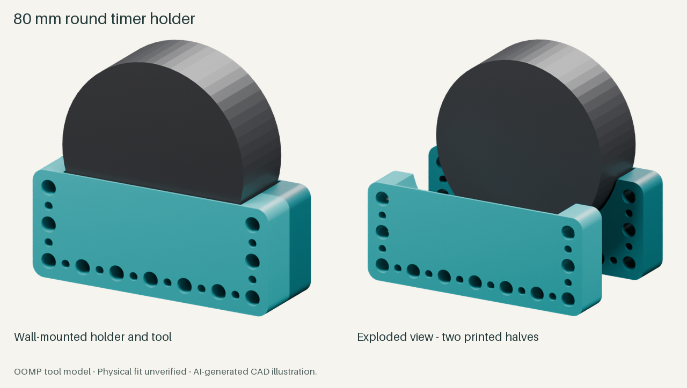

# 80 mm round timer holder

AI-generated CAD images and instructions. Errors possible.

[Offline step viewer](assembly_instructions.html) · [Print booklet](assembly_instructions.pdf) · [Holder files](../)

## Assembly and loading

Print two copies of the holder STL. The dark teal half sits against the wall. The light teal half faces the room. The opening and tool handles point up.

1. Orient the rear half as it sits on the wall, with the pocket facing you and the opening at the top.
2. Face the front half toward the rear pocket. Align the mounting holes and both top openings.
3. Bring the halves together until their rims meet. Hold the round timer with its face towards the room and align it above the curved pocket.
4. Lower the tool through the top opening. Lower the timer until its rim rests on the curved pocket floor.

## Model and fit

External body envelope from the OOMP timer record. The holder has clearance around both faces and the rim. The illustrated pose was checked against the production STL at the original model scale. Physical fit remains unverified. [OOMP tool record](https://github.com/oomlout/oomp_tool_version_5/tree/main/parts/tool_timer_80_mm_diameter_30_mm_depth_black)

The PDF uses eight landscape A4 pages in reader order. Choose booklet printing for folded copies.
