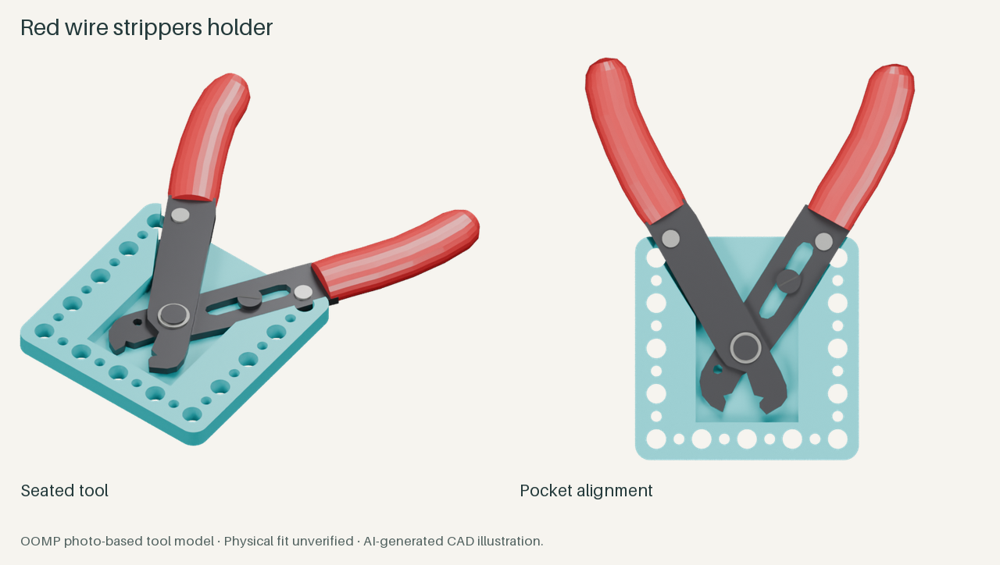

# Red wire strippers holder

AI-generated CAD images and instructions. Errors possible.

[Offline step viewer](assembly_instructions.html) · [Print booklet](assembly_instructions.pdf) · [Holder files](../)

## Loading sequence

1. Orient the printed holder with the pocket facing up. Locate its open end.
2. Point the jaws toward the closed end with the adjustment hardware facing up.
3. Lower the tool into the recess, keeping its nose between the pocket walls.
4. The offset jaws sit in the narrow pocket and the spread grips extend past the wide opening.

## Model and fit

Open-pose photo trace scaled to the candidate Anvil AV-LDWS catalogue length of 130 mm. The 120 mm OOMP label is retained. Thickness is estimated. The illustrated pose was checked against the production STL at the original model scale. Physical fit remains unverified. [OOMP tool record](https://github.com/oomlout/oomp_tool_version_5/tree/main/parts/tool_wire_strippers_120_mm_length_red)

The PDF uses eight landscape A4 pages in reader order. Choose booklet printing for folded copies.
